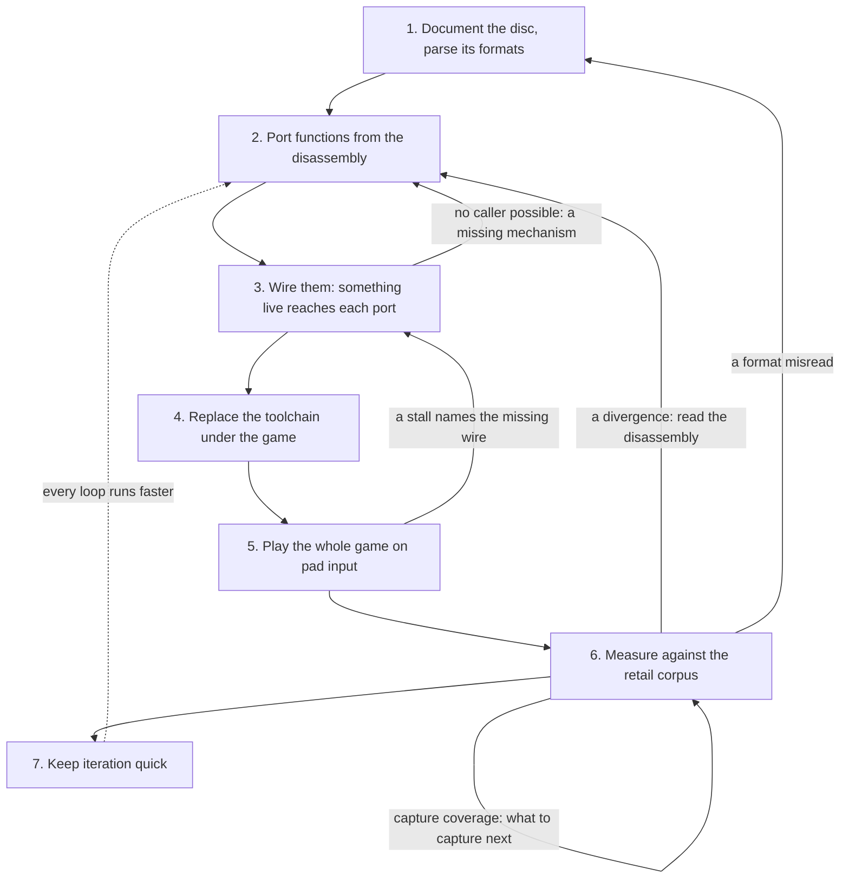

# Porting a game by engine reimplementation

This page explains how this project ports Legend of Legaia and why it goes about it this way. Three broad methods can bring an old console game to modern machines: decompilation, static recompilation and engine reimplementation. This project takes the third: a playable port and modding hub standing on Ghidra-traced reverse engineering, fresh Rust written from format docs with the decompiled output as reference. That is the ScummVM / OpenRCT2 model, not a decompilation and not a static recompilation of `SCUS_942.54`.

Each method suits different goals, and none of them is the best in general. The page compares the three, says what this choice costs and buys, and then walks through the method step by step, with the gate that keeps each step honest and an example from this repository. The tool pages hold the detail; this page is the thread that connects them.

Nothing here changes the ground rules: the user supplies the disc, no Sony-owned bytes are committed or shipped, and the engine extracts what it needs at runtime ([legal posture](subsystems/engine.md#legal-posture)).

## Contents

- [Three ways to port a game](#three-ways-to-port-a-game)
- [Why this project reimplements](#why-this-project-reimplements)
- [The method at a glance](#the-method-at-a-glance)
- [Step 1: document the disc and parse its formats](#step-1-document-the-disc-and-parse-its-formats)
- [Step 2: port functions from the disassembly](#step-2-port-functions-from-the-disassembly)
- [Step 3: wire them](#step-3-wire-them)
- [Step 4: replace the toolchain under the game](#step-4-replace-the-toolchain-under-the-game)
- [Step 5: play the whole game on pad input](#step-5-play-the-whole-game-on-pad-input)
- [Step 6: measure against a retail corpus](#step-6-measure-against-a-retail-corpus)
- [Step 7: keep iteration quick](#step-7-keep-iteration-quick)
- [The feedback loops](#the-feedback-loops)
- [Evidence grades](#evidence-grades)
- [Traps a newcomer hits](#traps-a-newcomer-hits)
- [Applying this to another game](#applying-this-to-another-game)
- [See also](#see-also)

## Three ways to port a game

The clearest way to separate the methods is by what each one starts with and what it still has to earn.

  <picture>
    <source media="(prefers-color-scheme: dark)" srcset="../site/assets/porting-routes-dark.svg">
    
  </picture>

| | Decompilation | Static recompilation | Engine reimplementation |
|---|---|---|---|
| **Works from** | The executable, rewritten as source | The executable, translated mechanically | Format docs and the traced behaviour |
| **Starts with** | A check on every function, when matching | The whole game running, with retail behaviour | Free choice of structure, language and platform |
| **Has to earn** | Coverage, names, then a platform layer | Readable structure and the freedom to change it | Every behaviour, and proof that it matches |
| **What executes** | The original's logic, recompiled from source | The original's code, translated | New code; the original's code is reference only |

**Decompilation** turns the executable back into source code. In a *matching* decompilation the source must compile to the retail bytes, function by function, so the byte match proves the source says what the game does. That gives exact source-level truth, and nothing else on this page gives it. The cost is reproducing the original compiler and its flags, and patient per-function work. A *non-matching* decompilation gives up the proof for speed, and has to test equivalence some other way. Names and types are human work in both. Decompiled source can then be retargeted, which is its own project with its own platform layer, and in return the whole game can be changed at the source level.

It is the right choice when understanding the original exactly is the goal in itself, when source-level modding is the aim, and when the original compiler can be pinned down.

**Static recompilation** translates the machine code into host code, and supplies a runtime for the hardware it used to talk to. The great strength is time: the whole game can run early, with retail behaviour nearly for free, quirks and timing included. The costs are indirect jumps and overlays, which take analysis (in this game, overlays share virtual addresses, so an address alone does not identify a function: [VA aliasing](reference/re-do-not-re-walk.md)), a hardware model that must be faithful, and output shaped like machine code rather than like a program. Changing behaviour means hooks over translated code, and the original executable stays part of the build or the run.

It is the right choice when retail behaviour on modern machines is the product, and when the game's code is tractable to translate.

**Engine reimplementation** writes a new engine that loads the original's data and behaves like the original. The engine's structure, language and platforms are free choices, and new rendering, audio and mechanics are ordinary features. The costs are the mirror image of a recomp's strengths: nothing works until it is built, the road to a first playable game is long, and every behaviour that matches retail has to be found, written and measured. A wrong reading of a routine produces a running game that is quietly different.

It is the right choice when the goal goes beyond the original's behaviour, when the target cannot carry the original's code, and when much of the game is data the engine can load, rather than logic it has to rewrite.

Put shortly: a recomp gets you the game; a reimplementation, plus the oracles that measure it, gets you an engine for the game. Neither is the better route in general. A recomp is the faster way to retail behaviour on a new machine, and a matching decompilation is the only one that proves what the code says. A reimplementation trades both of those away for an engine whose structure is its own, and then has to buy fidelity back by measurement.

## Why this project reimplements

The project has two coordinated tracks: preserving and documenting every asset, and a port the user runs over their own disc. Format documentation is a deliverable here regardless of the porting method, and the disc patcher and language packs are built on it. The port aims to go past the original with retail one toggle away ([fidelity and enhancements](subsystems/engine.md#fidelity-and-enhancements)). And Legaia is heavily data-driven: field scripts, effects and moves are bytecode on the disc, so porting a [VM](subsystems/vm-inventory.md) brings along every script the disc holds for it.

### What it costs

- **Accuracy has to be earned.** A recomp inherits retail behaviour; this port has to reach it, one mechanism at a time, and prove it. Most of the tooling linked below exists to pay this cost.
- **A long road to first playable.** Formats, VMs, a renderer, an audio stack and a battle system all have to exist before the game can be played at all.
- **The measuring instruments are a project of their own.** Seeding the engine from retail RAM, scoring frames and keeping baselines honest take real, ongoing engineering.
- **Being faithful is a discipline.** Every enhancement must leave the faithful mode bit-identical when off, or "faithful" stops being a testable claim.
- **Fidelity is a long tail, paid continuously.** The first playable game is far from the last divergence. Every scene, cast and menu screen the corpus has not seen is unmeasured, and parity on what it has seen says nothing about the rest ([step 6](#step-6-measure-against-a-retail-corpus)).
- **It rests on decompilation-grade analysis; it does not replace it.** Every port is read from the disassembly with the care a decompilation takes, routine by routine. Reimplementing changes what gets written from that reading, not how much of the original has to be understood.

### What it buys

- **New rendering.** Enhanced lighting, volumetric fog, the camera-occlusion fade and SSAO are ordinary passes in the [wgpu renderer](subsystems/renderer-port.md), beside a PSX mode on the native `320 x 240` target that the corpus scores.
- **Its own audio stack.** A from-scratch [SPU and sequencer](subsystems/audio.md) play the game's banks on both hosts, and pack music mixes beside them.
- **More hosts.** The same session runs in a native window and [in the browser](subsystems/browser-host.md), with [VR](subsystems/vr-mode.md) on the site's 3D pages.
- **Modding by game concept.** An [expansion pack](formats/expansion-pack.md) is TOML that names monsters, formations, maps, quests, arts and items, not addresses and byte patches; [run rules](subsystems/run-rules.md) add difficulty and an in-engine randomizer, and [game modes](subsystems/expansion-modes.md) and [netplay](subsystems/netplay.md) are the port's own. Features the disc patcher proves against retail with MIPS hooks graduate into engine toggles ([gameplay tweaks](subsystems/gameplay-tweaks.md)).
- **Rules you can read.** A damage formula, an AI pick or a script opcode is a named Rust kernel with no `World` behind it, tagged `// PORT:` with the retail address it was read from, so the retail routine stays its provenance and the [port catalog](tooling/port-catalog.md) can derive what is ported from the tree.
- **No original code executing.** The engine parses data tables out of `SCUS_942.54` and the overlays on the user's disc, and reads a cast module's image to recover which presentation calls each arm makes (`legaia_overlay_images::cast_presentation`), but no MIPS executes, so there is no translated code to carry.

### Fidelity is measured, not inherited

A recomp is faithful because the original's code runs. Here nothing of the original runs, so fidelity is a measurement, and each instrument scores one axis of it against retail and commits the result as a ratchet that may only rise:

- **Stills.** The [retail comparison corpus](tooling/retail-compare.md) seats the engine where each of several hundred retail save states stood and scores the frame, camera, player, placements, music, flags, party and enemies per state, in [`scripts/ci/retail-compare-baseline.json`](../scripts/ci/retail-compare-baseline.json).
- **Film.** The [cast-sequence oracle](tooling/cast-sequence-oracle.md) records a spell, summon or monster cast on both sides and scores it frame by frame on the game's own state-machine clock, where a still would see one instant.
- **Sound.** The [audio-state sweep and real retail PCM](subsystems/audio.md#the-audio-state-sweep) compare the music and cues against what the emulator actually played, in `scripts/ci/audio-sweep-baseline.json` and `scripts/ci/audio-pcm-baseline.json`.
- **Routines.** The [retail kernel differential](tooling/retail-kernel-differential.md) runs a retail routine off the user's disc in the `crates/retail-exec` R3000 interpreter beside the Rust kernel that ports it, on generated inputs, with no hand reading between the two.
- **The whole game.** The [full-game ladder](tooling/full-game-ladder.md) plays New Game to credits on pad input, segment by segment and as one continuous run.

None of these is a proof in the sense a matching decompilation's byte match is. Each measures what it samples, which is why the corpus takes its denominator from the disc ([capture coverage](tooling/capture-coverage.md)) and why its gates refuse a silent loosening ([ratchet integrity](tooling/ratchet-integrity.md)).

### The boundary, stated honestly

The project does not call this "clean-room". The same people read the Ghidra output and write the Rust, which is not the two-team firewall that term means. The boundary actually enforced is narrower and checkable: the dumps in `ghidra/scripts/funcs/` stay reference material and are never committed, no Sony-derived bytes are committed, and no code is mechanically translated ([legal posture](subsystems/engine.md#legal-posture)).

### The methods complement each other

Choosing one method does not rule out using the others as tools, and this project does so.

- **A static recomp as a differential oracle.** The [recomp differential](tooling/recomp-differential.md) runs a local recompiled build beside the engine, emits one state-trace shape from both, and reports the first frame each channel diverges. A save state holds one instant; a recomp gives a continuous run to compare with, down to [the stream of key-ons](tooling/recomp-differential.md#note-level-audio-differential) a sequencer asks for. The recomp workspace and its traces stay out of the repository.
- **A decompiler as a pointer.** Ghidra's C says where to look, and the disassembly says what is true ([step 2](#step-2-port-functions-from-the-disassembly)). Any source-level truth, from whatever method, makes a stronger reference.
- **An emulator as the judge.** Save states from emulators are the retail corpus itself ([step 6](#step-6-measure-against-a-retail-corpus)).
- **The disc patcher as a proving ground.** Features proved against retail with MIPS hooks, such as randomizer logic and softlock fixes, are expected to graduate into engine toggles ([gameplay tweaks](subsystems/gameplay-tweaks.md)).

In the other direction, the format docs, disc and save-state readers and measurement method are written so that other projects can reuse them, whichever method they chose.

## The method at a glance

The seven steps are listed in the order each one first becomes possible. It is not a waterfall: a subsystem passes through steps 1 to 4 many times, and steps 5 and 6 keep sending work back ([the feedback loops](#the-feedback-loops)).

Every step runs through a gate. A gate here is a check that fails on its own, usually a committed baseline that may only improve ([ratchet integrity](tooling/ratchet-integrity.md)), and a green gate only means what that gate measures.

## Step 1: document the disc and parse its formats

**What is done.** Walk the disc from sectors to sub-assets. Trace each format to the routine that reads it in Ghidra, write the byte-level page, and write a parser with a way back to bytes where a tool needs one. Every format carries a [confidence level](formats/overview.md): Confirmed, Inferred or Unknown.

**What it produces.** [Format pages](formats/overview.md), one parser per format, the [extraction pipeline](tooling/extraction.md), viewers, and the disc patcher built on the same parsers. All of it is useful before any engine exists.

**The gate.** The denominator comes from the disc, not from the work done so far. [Disc coverage](tooling/disc-coverage.md) counts the code bytes inside dumped functions and the entries with a known format class. [Byte accounting](tooling/byte-accounting.md) counts which bytes a parser actually consumes, so a format nobody has walked surfaces as a large residue at the top of a list. Both are ratchets. The patcher's disc-gated oracles patch a scratch copy of the disc, then re-decode it from the patched image to prove the round trip.

**An example.** The bytes `0x01059B84` at the start of a scene's texture entry look like a format's magic number, and read that way they invent a third pack format. They are a DATA_FIELD chunk header, `(TIM_LIST << 24) | payload_len`, wrapping an ordinary pack. [`field-pack.md`](formats/field-pack.md) says so and records how the wrong reading arose. The same discipline applies to validity: an LZS stream that "decompresses without error" proves nothing, since the ring buffer starts as zeros and most inputs decode to something plausible ([`lzs.md`](formats/lzs.md)).

## Step 2: port functions from the disassembly

**What is done.** Dump the function, read the instruction stream, and write a fresh Rust function that does the same thing, then tag it with `// PORT: FUN_<addr>`. The rule is to port and document from the disassembly and use the decompiled C only as a hint about where to look. The C is a rendering, and it fails in repeatable ways: register arguments vanish from calls, stores get reordered or dropped, labels print as calls, and a module imported at the wrong base prints every address shifted by a constant ([decompiler artifacts](tooling/ghidra.md#decompiler-artifacts-that-have-produced-false-claims)).

**What it produces.** World-free kernels in the engine's crates, a citation in the docs, and a row in the [port catalog](tooling/port-catalog.md), which derives each function's status from the tree on every run and so cannot go stale the way a hand-kept table does.

**The gate.** `port-catalog.py --check` ratchets the figures. Function worklists are read through [worklist classification](tooling/worklist-classification.md), so that an address which is no real function entry does not read as work. An honest gap remains: nothing gates whether a `// PORT:` address names the routine the Rust actually implements, so [port provenance](tooling/port-provenance.md) is a warn-only worklist.

**An example.** A sweep for writers of `_DAT_8007B8C2` searched the absolute `lui` + offset form and found none, which was read as "BSS zero-init sets the value", then as "retail runs with the flag at 0", inverting the flag's documented polarity. Its writer is `0x80015F08 sh v0,0x5aa(gp)`, a gp-relative store that scan could not see, and the executable's header clears no BSS at all. The chain is in [`ghidra.md`](tooling/ghidra.md#decompiler-artifacts-that-have-produced-false-claims), and it is why a negative result is held to the same evidence bar as a positive one.

## Step 3: wire them

**What is done.** Give each port a caller that a host can reach. A ported function is not done until something live reaches it: an unwired port compiles, passes its own unit tests, reads as progress and does nothing for a player.

**What it produces.** Ports that a host reaches, and for the rest an explicit statement of why not: `// NOT WIRED:` names what must exist first, and `// REPLACED-BY:` names the different mechanism that does the routine's job.

**The gate.** Two measurements, one static and one at runtime. `port-catalog.py --live` builds a call graph from the hosts' real entry points, and every ambiguity resolves toward reachability, so what `--not-live` reports is a hard floor on what cannot run. [Live-audit triage](tooling/live-audit-triage.md) settles each row with a verdict: `WIRE`, `DISCLOSE`, `DELETE`, `REPLACE` or `FALSE INERT` (the audit's own error, fixed in the audit). The [runtime denominator](tooling/port-catalog.md#the-runtime-denominator-replay-port-coveragepy) then asks what a replay actually entered, and [reach triage](tooling/reach-triage.md) records the verdicts. Because three hosts run one engine, [host drift](tooling/host-drift.md) gates catch a feature wired into only one.

**An example.** Three field effect handlers stay unconverted across coverage runs, which reads as "a composed-overworld ladder would reach them". That reading is falsified: no production path constructs an actor on any of the three, so the gap is a constructor, not a test ([measurement readings](reference/re-do-not-re-walk.md#measurement-readings)). The runtime side has a sharper form too: an anchor tagged `NOT WIRED` that a passing oracle executed has the highest priority, since an oracle traversing stub code can certify behaviour nothing implements.

## Step 4: replace the toolchain under the game

**What is done.** Find the line between the game's own logic and the PlayStation toolchain it was built on, then keep the first and replace the second with new foundational libraries. Sony's PsyQ libraries are statically linked into `SCUS_942.54`, where they appear as recognisable address clusters. The game's own logic is above them and mostly lives in overlays.

| Retail | The port |
|---|---|
| libsnd / SsAPI sequencer | `Sequencer` in [`engine-audio`](subsystems/audio.md) |
| libspu and the SPU hardware | `spu::Spu`, with `AudioOut` (cpal) and `WebAudioOut` |
| GTE and GPU | The GTE model in `render-kernels`; [`engine-render`](subsystems/renderer-port.md) on wgpu natively, WebGL2 in the browser |
| CD streaming | The `Vfs` backends and CD streaming host traits in `engine-scene` |
| Memory card | The card flow in `engine-menus`, the writer in `engine-menu-runtime`, `legaia_save` |
| MDEC movies | [`mdec`](../crates/mdec/README.md), with XA audio in sync |

The line is not simply where a library ends. It depends on what a player can observe:

- **Game decisions stay game logic, even when they sit next to the hardware.** The visible-tile crop, the actor cull and the per-primitive rejects are retail's choices, so the port makes the same ones ([`renderer.md`](subsystems/renderer.md)).
- **Observable hardware behaviour is modelled, not swapped away.** Voices, ADSR, the Gaussian resampler and reverb are all in the SPU model. The GTE's register limits, vertex snap and dither sit behind PSX mode ([renderer port](subsystems/renderer-port.md#psx-style-rendering)).
- **A library's documented format may not be the game's.** Legaia's SEQ departs from stock PsyQ SEQ, and reading it as stock plays music about three times too fast ([`seq.md`](formats/seq.md)).

**What it produces.** A foundation that runs on hosts the original never knew, with instruction-level reference kernels (such as `seq_calc`) kept beside the practical implementation to pin the behaviour.

**The gate.** [The layering gate](subsystems/engine.md#the-layering-gate) keeps kernel crates from reaching the session, renderer or a host, and a `wasm32` type-check holds the shared session free of native dependencies. What the replacement *does* is measured in step 6: the [image channel](tooling/retail-compare.md#the-image-channel) at the [native target](subsystems/renderer-port.md#the-native-target), and audio through the [audio-trace oracle](subsystems/audio.md#audio-trace-parity-oracle) and [real retail PCM](subsystems/audio.md#real-retail-pcm).

**An example.** The audio stack runs both hosts from one core, with only the output differing. Its scene-entry behaviour is a sequence every host owes, and the docs record [what each missing step sounds like](subsystems/audio.md#the-cold-scene-entry-sequence-and-what-each-missing-step-sounds-like).

## Step 5: play the whole game on pad input

**What is done.** Play New Game to credits with no human, on pad input alone. A scripted hand walks, talks, fights, heals and shops by pressing the buttons a player would. Story and battle defects that no unit test sees appear here, and a game that cannot be finished is not a port.

**What it produces.** The [full-game ladder](tooling/full-game-ladder.md). The story is cut into segments between milestones anchored to retail saves, and each segment climbs the tiers `loads`, `enters`, `progresses` (the player is placed on doors) and `pad` (pad input only). The [continuous run](tooling/full-game-ladder.md#the-continuous-run) then plays one session from New Game with no re-seeding, so it has to arrive at each stretch with the levels it earned and the items it bought. Alongside it, the [soak harness](tooling/soak-harness.md) throws seeded, game-shaped random input at every scene and minigame.

**The gate.** The tiers are ratcheted in a committed baseline, and a red run may not be turned green by lowering them. One random stream can hide a fight won only by the deal, since a change that shifts one draw re-deals every later encounter, so [the seed set](tooling/full-game-ladder.md#the-seed-set) repeats the whole run on other streams, and each asserts its own row. [Record and replay](tooling/determinism-replay.md) keeps it all reproducible: the same input gives bit-identical traces.

**An example.** A stall is a diagnosis rather than a red light. The report names the script instruction that parked, the door gate that refused, the story flag never set and the disc records that set it ([how to read a stall](tooling/full-game-ladder.md#how-to-read-a-stall)). The page also says what the ladder cannot claim, such as a segmented tier that places the player proving doors and scripts but not locomotion ([what it cannot measure](tooling/full-game-ladder.md#what-it-cannot-measure)).

## Step 6: measure against a retail corpus

**What is done.** Capture moments of the original as emulator save states. For each, read what retail was doing out of the state's own memory, put the engine in the same situation through its own load path, and score the difference per channel, worst state first. The channels cover what a player notices: the frame on screen, player position, camera, NPC placement, facing, the music track, story flags, party, enemies and more ([channels](tooling/retail-compare.md#channels)). The method is written up engine-neutral in [the retail-oracle method](tooling/retail-oracle-method.md).

**What it produces.** The [retail comparison corpus](tooling/retail-compare.md) and its siblings: the [cast-sequence oracle](tooling/cast-sequence-oracle.md) for what unfolds over time, the [audio sweep and real PCM comparison](subsystems/audio.md#the-audio-state-sweep) for sound, the [retail kernel differential](tooling/retail-kernel-differential.md) for single routines run off the disc, and the [recomp differential](tooling/recomp-differential.md) for continuous traces. Its reports are a worklist, with a [catalogue of divergence shapes](tooling/retail-compare.md#divergence-shapes) saying what each pattern usually means.

**The gate.** Per-state, per-channel [scores may only rise](tooling/retail-compare.md#the-ratchet). Two more gates protect the ratchet itself ([ratchet integrity](tooling/ratchet-integrity.md)): a baselined value that moved the wrong way needs a reasoned entry in a ledger that is never pruned, and a test that skipped for want of its data is not counted as passed.

**Keeping it wide.** A corpus grows where capturing is easy, and parity on those moments says nothing about the rest. [Capture coverage](tooling/capture-coverage.md) takes the denominator from the disc, listing every scene, monster, enemy attack, player cast and menu screen, then ranks what no state shows yet. As parity is reached on what the corpus holds, the corpus is extended into what it does not hold, so the headline keeps measuring more of the game.

**An example.** On `noaru_field_card_walk`, the engine's frame is black where retail shows a floor, with every other channel exact. That pattern points at one thing: a mesh-bearing ambient part seated off its anchor. Noaru's ice floor rides the camera focus through move-VM extension op `0x24` ([world position lerp](subsystems/move-vm-overlay-ext.md#world-position-lerp-0x24--0x2a-and-box-gates-0x06--0x07)). The frame pointed at the gap, and the mechanism itself is read from the move VM's overlay extension.

## Step 7: keep iteration quick

**What is done.** Focused performance rounds, run now and then rather than continuously, on two costs: what the engine costs a player, and what a change costs a developer. Every other step's value depends on how often it can run. An oracle that takes too long gets run less, and defects survive longer.

**What it produces.** [Frame benchmarks](tooling/frame-bench.md) on both hosts, covering frame time, allocations and scene entry, and [build and test profiles](tooling/build-and-test-speed.md) with an edit-time `dev-fast` path, a result cache on the corpus, and a parallel [full gate](tooling/build-and-test-speed.md#the-full-gate). The numbers are before-and-after comparisons on one machine, deliberately not committed: a frame-time gate on a shared machine can only flake.

**The gate.** A speedup is proved by the output, not by the timing. The ladder's trace with its wall-clock fields stripped must match line for line, and a patcher feature's `.ppf` from a fixed seed must hash the same ([profiling](tooling/build-and-test-speed.md#profiling-without-perf)). A cache has to key on everything its result depends on: the corpus's [result cache](tooling/retail-compare.md#parallel-states-and-the-result-cache) hashes the binary, disc, state, memory card, manifest row, frame mode and environment, and a bless or a check never reads it.

**An example.** The `readPixels` on the battle transition's arming frame is expensive, and an asynchronous read would remove the wait. It would also land the capture frames later, which moves the transition, so that is not an optimisation available here ([what the numbers have shown](tooling/frame-bench.md#what-the-numbers-have-shown)). The deferred work that was taken is a pure function of what the load captured, so its reader gets what it would have had.

## The feedback loops

The arrows that run backwards do most of the work.

- **From corpus to disassembly.** A divergence is read for its shape, then either the instrument or the engine is at fault. If it is the engine, the mechanism goes back to step 2, or to step 1 if a format was misread.
- **From ladder to wiring.** A stall names the parked op and the unset flag, which usually means a port with no caller, or a routine that was never ported.
- **From wiring to porting.** A port that cannot be given a caller exposes what is missing above it, such as the constructor in step 3's example.
- **From denominator to worklist.** Coverage over the disc finds new work, and a rising worklist after a dump pass means the measurement got wider, not that the work went backwards ([disc coverage](tooling/disc-coverage.md#why-this-exists-alongside-the-port-catalog)).
- **From every step to the falsified register.** A disproved reading is kept with its reasoning: the tempting reading, the decisive instruction, capture or count, and what is true instead ([do not re-walk](reference/re-do-not-re-walk.md)). Each newcomer finds the same wrong readings plausible for the same reasons.

Measurement is corrected this way as much as the game is. The Sol Tower stair walks miss on `camera` by a position-shaped amount, which reads as a defect in the follow compose. The engine's seat equals retail's staging descriptor to the unit, and retail's live pose is short of it, because the ease only runs while the player moves. The answer is in what the channel compares against, and the wrong reading goes in the register ([measurement readings](reference/re-do-not-re-walk.md#measurement-readings)).

## Evidence grades

A claim about the original carries a grade naming what it rests on, and it takes the grade of its weakest load-bearing piece ([the evidence column](reference/re-settled-threads.md#the-evidence-column)):

- **`disassembly`:** instructions at stated addresses, branch and store sequences. The strongest grade, and only as good as the addresses it cites.
- **`capture`:** a save state, a probe log, a disc-derived oracle.
- **`decompiled-C`:** Ghidra's rendering, an inferred signature, a label someone typed into the database. This grade marks a claim nobody has confirmed against instructions, which makes it a re-audit worklist and not a verdict of wrong.
- **`inference`:** reasoning from surrounding facts or from absence, usually stated openly.

A docs page is not a grade of its own. A statement on one carries the grade of what it cites, and a statement with no citation is a hypothesis until someone re-reads the listing. Grades let a reader see how much weight a claim will bear, and they make the audit cheap: the re-audits that falsify claims here find them in the `decompiled-C` bucket.

## Traps a newcomer hits

**Green tests are not parity.** A test can only fail on what its author thought to check, and three quieter failures sit beside that one. A disc-gated test that finds its input missing reports `ok` ([a skipped test is not a passed test](tooling/ratchet-integrity.md#a-skipped-test-is-not-a-passed-test)). An oracle can have no way to disagree: `pcm_oracle`'s "retail" window is the engine's own mixer seeded from a snapshot, which is why [real retail PCM](subsystems/audio.md#real-retail-pcm) records the emulator's actual output. And a corpus channel may measure less than its name suggests: `party` and `inventory` are seeded from the retail window, so on their own they check the seeding ([channels](tooling/retail-compare.md#channels)).

**A still frame cannot prove a cast.** The corpus scores one frame per state, and a cast runs for hundreds of vsyncs. A high image score on a mid-cast state says that frame matches, and nothing about the order, timing or length around it. On most summons the state's one instant is the white flash, which the metric cannot see under. The [cast-sequence oracle](tooling/cast-sequence-oracle.md) records both sides and pairs frames on the game's own state-machine clock.

**A save state replays old RAM.** A state holds the RAM of the disc that booted it, so loading it onto a freshly patched disc keeps the old executable, overlays and models resident. A fix can look absent, and a fixed defect can look present. PCSX-Redux will also silently apply a `.ppf` sitting beside the image. Verify disc edits from a cold boot or a memory-card load, and read the resident executable out of the state rather than trusting a file name ([patched-disc taint](tooling/pcsx-redux-automation.md#patched-disc-taint)).

**"No static caller" is not dead code.** Most game logic lives in overlays loaded at runtime, and much of it is reached through pointer tables and actor templates. "No caller found" becomes "no reference exists" only after a search of every image's bytes in every encoding an address can take ([address reference scan](tooling/address-reference-scan.md)), and a search can fail in its own ways: a `grep` through `| head` reads as empty when the pipe cuts it off before the hit ([shell observer traps](tooling/shell-observer-traps.md)).

**A speedup that changes a result is a bug.** The optimiser's choices must not move a simulation that runs on integers, and a cache that misses one input hands back an old answer for a new question. Prove a speedup by comparing the output ([step 7](#step-7-keep-iteration-quick)).

**A score can fall because a fix is right.** The `0x2A` chain-exit fix drops two Tail Fire frames, which reads as a regression. The old scores rested on the error, and the state's own RAM shows it ([measurement readings](reference/re-do-not-re-walk.md#measurement-readings)). Read why a score moved before reverting or blessing it, and record the reason in the [ledger](tooling/ratchet-integrity.md#a-baseline-may-not-loosen-silently).

## Applying this to another game

Most of the method transfers, and a good part of the code does too. [Reusing for other PS1 games](tooling/reusing-for-other-ps1-games.md) sorts the crates and scripts by how far they carry and names each Legaia assumption that would trip a second title. [The retail-oracle method](tooling/retail-oracle-method.md) writes the measurement half engine-neutral, with [an adoption order](tooling/retail-oracle-method.md#where-to-start).

Before starting, three questions decide much of the shape:

- **How much of the game is data?** The more of its logic is bytecode and tables, the more a ported VM carries, and the stronger the case for reimplementing.
- **Does an emulator give you states you can read?** Without readable machine states there is no corpus, and every accuracy claim stays an impression.
- **What is the actual goal?** If it is retail behaviour on modern machines and nothing more, another method may reach it sooner.

Then start small on each axis instead of finishing one step at a time: one format with a round trip, one VM wired into a host, one state channel over a handful of states, and the evidence grades and falsified register from day one, since those cost nothing to start.

## See also

- [Engine reimplementation](subsystems/engine.md) - the port as it is: crate layering, hosts, fidelity, legal posture and how it is verified.
- [Overview](overview.md) - the project in four parts, and how the disc's layers stack.
- [The retail-oracle method](tooling/retail-oracle-method.md) - the measurement half, written for any game.
- [Reusing for other PS1 games](tooling/reusing-for-other-ps1-games.md) - which crates and scripts carry.
- [Open RE threads](reference/open-rev-eng-threads.md) - the live hunts, and [falsified readings](reference/re-do-not-re-walk.md) - the ones not worth repeating.
