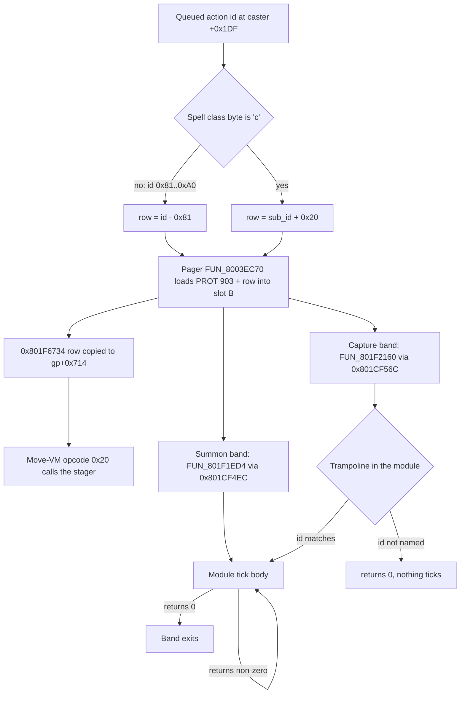
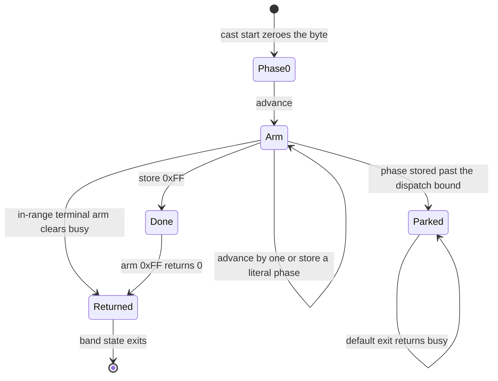

# Cast modules: the slot-B summon and capture-class band

Every summon and every capture-class cast (Seru capture, the item-capture
Amulet, the boss cinematic specials) runs its choreography from its own small
overlay program, a **cast module**. The 64 modules are PROT entries
`0903..=0966`. The battle overlay (PROT 0898) pages one into the side overlay
window "slot B" at `0x801F69D8` and re-enters it every frame until it reports
done. A module owns the cast's phase machine, its camera, its particle
spawns, its voice cue and its damage constants, so anything that edits or
ports a special attack ends up here.

This page is the module anatomy: how an action reaches a module, the image
layout, the `ctx+0x279` phase machine, the tick ABI, the damage shapes, the
routine catalogue, and what the Rust port runs. Related pages:

- File layout and spawn records: [slot-b-module-layout.md](../formats/slot-b-module-layout.md).
- The streamed creature / texture side-band: [summon-readef.md](../formats/summon-readef.md).
- The battle action state machine that drives the band: [battle-action.md](battle-action.md),
  and its [Seru-magic summon-overlay dispatch](battle-action-helpers.md#seru-magic-summon-overlay-dispatch).
- Staged clip sequences per module: [monster-animation.md](../formats/monster-animation.md#a-special-attack-can-be-a-chain-of-entries).
- The damage wrappers and their per-module call census: [battle-formulas.md](battle-formulas.md).
- Per-arm behaviour rows and non-entry addresses: [functions/battle.md](../reference/functions/battle.md#slot-b-summon--cast-modules-prot-09030966),
  [functions/cast-modules.md](../reference/functions/cast-modules.md).
- What a player-caster port of a module has to change: [randomizer.md](../tooling/randomizer.md#the-retail-cast-route).

## At a glance

| Item | Value |
|---|---|
| Module band | extraction PROT `0903..=0966`, 64 images, one per stager-table row |
| Load base | slot B, `0x801F69D8` (shared by all 64, so a VA needs its owning entry) |
| Pager | `FUN_8003EC70(arg)`; TOC index = `arg + 0x381` |
| Summon tick dispatcher | `FUN_801F1ED4` (0898, file `+0x236BC`), table `0x801CF4EC`, row `id - 0x81` |
| Capture tick dispatcher | `FUN_801F2160` (0898, file `+0x23948`), table `0x801CF56C`, row = spell record `+1` sub-id |
| Stager table | `0x801F6734` (0898, file `+0x27F1C`), 64 words, called by move-VM opcode `0x20` through `gp[+0x714]` = `0x8007BA2C` |
| Battle context | pointer at `0x8007BD24`; module phase byte `ctx+0x279`, `ctx+0x278`, caster seat `ctx+0x13`, band timer `ctx+0x6D8` |
| Actor pointer table | `0x801C9370` (`DAT_801C9370`), eight seats: party `0..2`, monsters `3..7`, summon creature seat `7` |
| Damage wrappers | `FUN_801DD0AC`, `FUN_801DD4B0`, `FUN_801DD6B4` in 0898 |
| Port | `crates/engine-cast` (`cast_module_ticks`, `cast_arm_ticks`, `seru_magic_ticks`, `cast_module_camera`, `cast_fatal_decision`); `crates/engine-battle-vm` (`battle_cast_dispatch`, `battle_cast_cue`); band driver `crates/engine-core/src/world/battle/cast_band.rs`; spawn pool `crates/overlay-images/src/cast_effect_pool.rs` |

### The module band

| PROT | Class | Reached by | What it is |
|---|---|---|---|
| `0903..=0913` | player Seru magic | action ids `0x81..=0x8B`, `0x801CF4EC` rows 0..10 | Gimard, Theeder, Vera, Gizam, Nighto, Zenoir, Viguro, Swordie, Orb, Freed, Nova |
| `0914..=0934` | evolved / high summons and item casts | ids `0x8C..=0xA0`, rows 11..31 | Gola Gola .. Ozma; 0924 Ultimate Rave, 0925 the Spikefish flute, 0926 a null stub (id `0x98`, no tick arm) |
| `0935..=0966` | capture class (spell class byte `'c'`) | spell record `+1` sub-id `0x00..=0x1F`, `0x801CF56C` rows 0..31 | monster specials and boss cinematics: Earthquake (0935) .. Evil Seru Magic (0966) |

The spell-table side of the capture-class index is on
[spell-table.md](../formats/spell-table.md#capture-class-module-index-prot-09350966).
The three Delilas signature modules are the fully decoded exemplars: PROT
**958** (Blazing Slash `0x79`, Gi), **959** (Megaton Press `0x7A`, Che) and
**960** (Plasma Strike `0x7B`, Lu).

Module addresses below are VAs at the slot-B base, or file offsets with
`VA = 0x801F69D8 + off`. Because every image shares the base, an offset or VA
is meaningless without its module.

## How an action reaches a module

<a id="the-entry-tables-and-where-the-addresses-live"></a>

A module is a **library, not a program**: nothing inside it names its own
entry points. No entry VA appears in any extracted image as a word, a
`lui`+`addiu` pair or a `jal` / `j` target (five-form sweep,
`scripts/ghidra-analysis/find-address-word-refs.py`) except inside PROT 0898,
where they are fixed at link time. Each module has two callable routines, a
**tick** and a **stager**, and three tables in 0898 name them.



### Paging and the drive loop

Battle phase `0x28` routes a capture-class action to `0x6E..0x71` and pages
the module via `FUN_8003EC70(record[+1] + 0x28)`; a summon pages with
`id - 0x79`. Both arguments index the TOC at `+0x381`, which is the same
entry the tables below reach.

Phase `0x70` re-enters the module's tick **every frame and advances only when
the tick returns zero**. There is no timer and no bail-out, so a module phase
whose exit gate can never pass is a softlock
([re-do-not-re-walk.md](../reference/re-do-not-re-walk.md)).

While a module is resident, the word at `0x801F69D8` is the module's own
word 0. That is a third meaning for an address the corpus maps twice already
(PROT 0900's jump-table head, and the world-map band's `FUN_801F69D8`). A
probe watching it sees `0x001000E2` when slot B is empty (the bytes 0898's own
image holds there), then the module's word 0 at paging. Word 0 is **not** an
entry VA: it is arm 0 of the head jump table where the image has one, and the
first instruction where it does not.

### The three tables in PROT 0898

| Table | Dispatcher | Index | Entry it reaches | Battle-SM call sites |
|---|---|---|---|---|
| `0x801CF4EC`, 32 slots | `FUN_801F1ED4` | `id - 0x81`, bounded `< 0x20` | PROT `903 + row`: the tick, called directly | `0x801E4B1C`, `0x801E4C7C`, `0x801E4CA8` |
| `0x801CF56C`, 32 slots | `FUN_801F2160` (`0x801F2160..0x801F2410`, 688 B) | spell record `+1` sub-id, `sltiu v0, sub_id, 0x20` | PROT `935 + row`: a trampoline or the tick | `0x801E50C8` only |
| `0x801F6734`, 64 words | move-VM opcode `0x20` | row `i` = PROT `903 + i`, `i = 0..0x3F` | the stager | row copied at `0x801E44C8` and `0x801E4630` |

**The summon tick.** `FUN_801F1ED4` loads the caster `actor_table[ctx+0x13]`
from `0x801C9370`, takes its queued action byte `actor[+0x1DF]`, and jumps
through `0x801CF4EC`. Each arm is a hard-coded `jal` into the resident module
plus `s0 = v0`. The shared epilogue at `0x801F2128` calls `FUN_801F2410` when
`ctx[+0x27A] != 0` and returns `s0`. Id `0x98` has no arm: its slot points
straight at the epilogue, so that id ticks nothing. The three call sites in
the battle SM `FUN_801E295C` are:

| Site | Role |
|---|---|
| `0x801E4B1C` | cast start: zeroes `ctx+0x278` and the module phase `ctx+0x279`, seeds the countdown `s7[+2] = 0x78` |
| `0x801E4C7C` | per-frame re-entry; the countdown running out forces battle phase `0x36` |
| `0x801E4CA8` | proceeds only when the tick returns `0` |

**The capture-class tick.** `FUN_801F2160` derives the caster the same way,
reads `caster[+0x1DF]`, indexes the static spell table `0x800754C8` at
`id * 12`, takes the record's `+1` byte and jumps through `0x801CF56C`. Each
arm is a `jal` into the resident module plus `s0 = v0`; the epilogue at
`0x801F23D8` mirrors `0x801F2128` exactly. `jal 0x801F2160` occurs once in
0898's bytes, so one dispatcher entry is one module tick.

**The stager.** The battle SM copies the selected `0x801F6734` row into
`gp[+0x714]` = `0x8007BA2C` at `0x801E44C8` (capture class, row
`sub_id + 0x20`) and `0x801E4630` (row `move_id - 0x81`). Move-VM opcode `0x20`
calls it: `lw v0, 0x714(gp); jalr v0` at SCUS `0x80023764`, with `a0` = actor
and `a1` / `a2` = the move-table instruction's two signed halfwords. `a1` is an
arm index. 15 of the 64 stagers bound it with `sltiu vX, a1, N` and jump
through a table; the rest compare it against literals in a `beq` / `slti`
chain. `0x8007BA2C` is a code pointer, not an effect-data pointer, and the
table is bounded by byte tables below it and ASCII above.

All three indexings agree on the entry: the `move_id - 0x81` band
`0x81..0xA0` covers PROT 0903..0934, and the capture-class `sub_id + 0x20`
band covers 0935..0966.

**Identity check.** For every one of the 64 entries, the `0x801F6734` row and
the arm from whichever tick table covers it land on a function head recovered
from that image's own bytes and from no other image: all 64 stager rows, all
31 `0x801CF4EC` arms and all 32 `0x801CF56C` arms. The map rows in
[`static-overlays.toml`](../../crates/asset/data/static-overlays.toml) rest on
that test, which needs only the disc.

A module's entry can sit a few instructions **above** its prologue, where the
routine materialises the battle ctx `0x8007BD24` and the frame-delta scalar
`0x1F800393` before setting up the frame. PROT 0946 and 0953 both enter at
`0x801F69FC` with the prologue at `0x801F6A0C`. The table is the authority,
not a prologue scan.

### Capture-class trampolines

<a id="the-trampolines-are-their-own-port-and-one-cell-holds-six-spells"></a>

**21 of the 32** `0x801CF56C` arms do not call a tick body. They call a
trampoline, an 88 to 204 byte routine in the module that opens
`addiu sp, sp, -0x18`, materialises the battle ctx `*0x8007BD24`, loads the
caster `actor_table[ctx+0x13]` out of `0x801C9370`, reads `caster[+0x1DF]` and
`jal`s the tick body for that action id. An id the routine does not name
returns `a0 = 0`, so the module ticks nothing and the drive loop proceeds. The
other eleven arms (PROT 0935, 0936, 0937, 0939, 0946, 0947, 0948, 0949, 0953,
0954, 0966) point straight at a body.

The 21 trampolines name **48** `(action id -> body)` arms over 32 distinct
bodies. Eleven cells hold more than one choreography, so a dispatcher keyed on
the PROT entry alone runs the wrong one for the cell's other ids.

| Owner | Trampoline | Action id -> tick body |
|---|---|---|
| 938 (`cast_chaos_breath`) | `0x801F7A40` | `0x4E` -> `0x801F726C`, `0xB7` -> `0x801F69EC` |
| 940 (`cast_glare_divide`) | `0x801F8228` | `0x3C` -> `0x801F69F8`, `0x50` / `0xAE` -> `0x801F78B8`, `0xAC` -> `0x801F7240` |
| 941 (`cast_steal`) | `0x801F7D38` | `0x51` -> `0x801F730C`, `0xB9` -> `0x801F6A04` |
| 942 (`cast_power_up`) | `0x801F80A0` | `0x52` -> `0x801F7D34`, `0xAA` -> `0x801F69F4` |
| 943 (`cast_curse`) | `0x801F7624` | `0x40` -> `0x801F6EF4`, `0xB5` -> `0x801F6A04` |
| 944 (`cast_guilty_cross`) | `0x801F7EBC` | `0x37` -> `0x801F6A04`, `0x53` -> `0x801F7470` |
| 945 (`cast_water_column`) | `0x801F76F4` | `0x54` -> `0x801F6EDC`, `0xBA` -> `0x801F69F8` |
| 950 (`cast_rolling_flare`) | `0x801F8190` | `0x5A` -> `0x801F79F8`, `0xAB` -> `0x801F6A24` |
| 951 (`cast_chaos_flare`) | `0x801F816C` | `0x36` -> `0x801F6A20`, `0x5B` -> `0x801F77E8` |
| 952 (`cast_bloody_horns`) | `0x801F7B28` | `0x5C` -> `0x801F7118`, `0xB8` -> `0x801F6A0C` |
| 955 (`cast_white_shield`) | `0x801F92A4` | six ids, [below](#prot-0955-is-a-six-spell-cell) |
| 956 (`cast_water_hazard`) | `0x801F7E4C` | `0x71` -> `0x801F7298`, `0x75` -> `0x801F69D8` |
| 957 (`summon_effect_table`) | `0x801F9BA8` | `0x76` -> `0x801F798C`, `0x77` -> `0x801F6A14` |
| 958 (`cast_blazing_slash`) | `0x801F8E60` | `0x79` -> `0x801F6DD8` |
| 959 (`cast_megaton_press`) | `0x801F87F4` | `0x7A` -> `0x801F69F0` |
| 960 (`cast_plasma_strike`) | `0x801F8638` | `0x7B` -> `0x801F74E4`, `0xA6` -> `0x801F69D8` |
| 961 (`cast_dead_end_crisis`) | `0x801F7A54` | `0xA1` and `0xB4` -> `0x801F69D8` |
| 962 (`cast_blade_breath`) | `0x801F8080` | `0xA2` -> `0x801F7AE4`, `0xA3` -> `0x801F74A0`, `0xA4` -> `0x801F6D54`, `0xA5` -> `0x801F69D8` |
| 963 (`cast_genocidal_cannon`) | `0x801F8438` | `0xB3` -> `0x801F6A20` |
| 964 (`cast_element_change`) | `0x801F8E3C` | `0xAF` -> `0x801F88EC`, `0xB0`..`0xB2` -> `0x801F69D8` |
| 965 (`cast_doomsday`) | `0x801F7B1C` | `0xB6` -> `0x801F69D8` |

Two arm maps read against the grain of their `beq` chains. PROT 0940's `0x50`
and `0xAE` both reach `0x801F78B8` (the `beq` at `0x801F825C` and the `bne` at
`0x801F8288` land on the same `jal`). PROT 0964's second body is reached by a
**range** test (`slti v1, 0xaf` then `slti v1, 0xb3` at `0x801F8E88` /
`0x801F8E90`), so ids `0xB0`, `0xB1` and `0xB2` share it.

The port carries the map as data (`cast_arm_ticks::CAPTURE_TRAMPOLINES`,
`capture_tick_body`), and `crates/overlay-images/tests/cast_module_data_rows_real.rs`
re-derives each row off the disc from the `0x801CF56C` arm and the
trampoline's own `jal` set.

<a id="a-body-va-is-not-a-key---only-entry-body-is"></a>

**A body VA is not a key; only `(entry, body)` is.** Six trampolines send an
id to `0x801F69D8`, the load base itself: PROT 0956, 0960, 0961, 0962, 0964
and 0965. Those are six different routines, each its own image's word 0.
`0x801F6A20` is PROT 0951's Chaos Flare *and* PROT 0963's only arm.
`0x801F6A04` is an arm in PROT 0941, 0943 and 0944, frame-matching at three
different sizes (2312 B, 1264 B, 2668 B). On the summon side, five VAs cover
the eleven player-Seru arms, and `0x801F69D8` alone is the arm for six of them
(PROT 0903, 0904, 0905, 0908, 0911, 0912). Anything that resolves a body (a
dispatcher, a damage-shape lookup, a port tag) carries the owning entry beside
the VA.

#### PROT 0955 is a six-spell cell

`0x801F92A4` is the one trampoline that dispatches through a jump table. It
bounds `id - 0x60` with `sltiu 0x14` and indexes the module's **head table**,
twenty words filling file `0x00..0x50`. Fourteen point at the shared epilogue
`0x801F9360` and tick nothing. The other six are whole choreographies:
`0x60` -> `0x801F8F0C`, `0x6E` -> `0x801F86A4`, `0x6F` -> `0x801F7FA4`,
`0x70` -> `0x801F767C`, `0x72` -> `0x801F7158`, `0x73` -> `0x801F6A28`. The
image's first function opens at file `+0x50`, immediately past the table. This
head table therefore belongs to the trampoline, not to the tick or the stager
(see [image anatomy](#image-anatomy)).

## Image anatomy

<a id="image-anatomy-recovered-from-the-bytes"></a>

A function in these images starts at `addiu sp, sp, -F` and ends at the first
`jr ra` whose delay slot restores the **same** `F`. That frame-matched pairing
is exact over the band and survives a frameless leaf, an early `jr ra` inside
a body, and a `jr ra` word that is tail data (PROT 0906 has one at
`0x801F8070`). It recovers **196 framed functions** across the 64 images,
between one (0903, 0926, 0939, 0947, 0954) and eight (0955) each. 25 of the 64
images contain internal `jal`s (a multi-spell module calls its own bodies);
the rest call only SCUS and the resident battle overlay, so Ghidra dumps have
to be driven from an address list rather than a call graph.

| Region | Contents |
|---|---|
| head | the jump table of one switch, 0 to 256 words; the first function's prologue is the first word past it |
| tick | the `ctx+0x279` phase machine, reached from `0x801CF4EC` / `0x801CF56C` |
| stager | the `a1` spawn switch, reached from `0x801F6734` |
| tail | data: the spawn / emitter records handed to `FUN_80050ED4` and `FUN_80021B04`, plus the module's scratch words |

**Which switch owns the head table varies; read the `sltiu` immediate.** PROT
0934's table is 26 words and its tick bounds on `sltiu a0, 0x1A`. PROT 0929's
is 9 words and its **stager** bounds on `sltiu a1, 9` (0928: 7 and 7). Over the
band the head table is the tick's in 8 images (0921, 0922, 0925, 0930..0934)
and the stager's in 11 (0906, 0909, 0910, 0913, 0914, 0916, 0917, 0928, 0929,
0941, 0959); 25 images head with code and no table. The per-image answer is on
[`functions/battle.md`](../reference/functions/battle.md#slot-b-summon--cast-modules-prot-09030966).

The data tail is the bulk of the residue `disc-coverage.py` reports on these
images. PROT 0934's is `0x801F9C08..0x801FA9D8`, and the `lui 0x8020` +
negative-displacement operands its stager passes as `a2` resolve into exactly
that span.

### The three exemplar images

| Module | Size | Head shape | Tick trampoline | Tick body |
|---|---|---|---|---|
| PROT 958 | `0x3000` B | 256-entry VA dispatch table fills file `0x0..0x400` (default arm `0x801F8CFC`) | `0x801F8E60` | `0x801F6DD8` = file `+0x400`, 8024 B |
| PROT 959 | `0x3000` B | 6-entry head table (`0x801F8290, 82C4, 8478, 850C, 8600, 878C`), owned by its **stager** dispatcher at `0x801F8250` | `0x801F87F4` | `0x801F69F0` = file `+0x18`, 6240 B |
| PROT 960 | `0x2800` B | none, code at file `+0` | `0x801F8638` | `0x801F74E4` (`0x7B` Plasma Strike, 4436 B) / `0x801F69D8` (`0xA6` Neo Star Slash, 2828 B) |

958's 256 slots hold only 27 arms: `0..=25` and `0xFF` (`0x801F8CBC`). The
other 229 point at the default exit, which returns busy without advancing. Arm
25, once its countdown runs out, stores `0xFF` to the phase
(`0x801F8CB0..0x801F8CB8`), and arm `0xFF` clears the return register
(`sw zero,0x28(sp)` at `0x801F8CF4`): the module's one Done. The bound
`sltiu 0x100` covers the whole byte, so a port that only increments the phase
wraps and holds state `0x70` forever.

Two interior addresses are not entries. `0x801F6E9C` (958 file `+0x4C4`) is
0xC4 bytes inside the tick body's register-save block. `0x801F8290` (959 file
`+0x18B8`) is inside the 1444-byte stager `0x801F8250`.

### Inherited tails

<a id="a-module-image-ends-in-another-images-bytes"></a>

Every one of the 64 images ends in a byte-identical, same-file-offset run of
another extracted image, and the run always ends exactly at the shorter
image's own length. Nine end in **PROT 0899's** bytes (the menu overlay, a
slot-A image at a different base), which settles the direction: the module was
mastered over a buffer that still held the previous build. PROT 0926 is the
limit case: 2040 of its 2048 bytes are PROT 0925's, and its own content is the
eight-byte null stager at `0x801F69D8`.

Consequences:

- **A dump's filename does not name the owner.** Seven catalogued addresses
  sit in an image that only holds the residue: `0x801F6A14` and `0x801F798C`
  (owner 0957, residue in 0964), `0x801F74E4` and `0x801F86B0` (0960, in 0961),
  `0x801F8118` (0942, in 0943), `0x801F8578` (0919, in 0920) and `0x801F8EAC`
  (0904, in 0910). The decisive test is the residual trampoline's own `jal`
  targets: PROT 0961's copy of `0x801F8638` calls `0x801F69D8` and
  `0x801F74E4`, and in 0961's own bytes `0x801F74E4` is interior to the tick
  body.
- **The tail is not shared library code.** The words 958 and 959 hold in
  common past `~+0x2A00` are inherited. In the four 12288-byte images 904 /
  912 / 917 / 918 the inherited words are PROT 0899's, at file offset
  `0x2A80`: a routine that materialises the live game-state window
  `0x80084140` and tail-jumps to `0x801D1298 + 0x8C`. Its printed VA under the
  slot-B base, `0x801F9458`, names no routine.
- **The residue is what `disc-coverage.py` reports as un-dumped code.** Of the
  137 `ambiguous = no` runs of 64 bytes or more in this band, 103 are the
  module's own data tail, 24 are byte-identical residue of a sibling's real
  function, 4 are the PROT 0899 tail, and 6 are interior to a tick body (PROT
  0915, 0935). None is an un-dumped function of the image it is filed under.
- **A frame partition is not an own-content measure.** An inherited tail
  carries the donor's prologue / epilogue pairs. PROT 0949 partitions into two
  framed routines, and the second, `0x801F8504`, is PROT 0948's stager sitting
  in 0949's tail, while 0949's own stager `0x801F75BC` is frameless and
  invisible to the partition. What bounds an image's own content is the top of
  the record chain, walked as move-VM programs
  ([slot-b-module-layout.md](../formats/slot-b-module-layout.md#bounding-the-highest-record)).
- **The boundary is per image.** PROT 0912's tick uses three module-local
  words at `0x801F92A8` / `0x801F92AC` / `0x801F92B0` (file `+0x28D0` /
  `+0x28D4` / `+0x28D8`), inside the run `0x801F8D2C..0x801F99D8` filed as
  inherited from PROT 0899. The byte-identical run is exactly file
  `+0x2908..+0x3000` (slot-B `0x801F92E0..0x801F99D8`, 1784 bytes). The three
  words sit `0x38` bytes below it, in a window that is zero in 0912 while 0899
  carries code there: the image's own zero scratch.

**Same VA, different routine.** Six "also present in" pairs are byte-for-byte
residue at the same file offset, each run ending at the shorter image's
length: `0x801F8EAC` (904, also in 908 and 910), `0x801F7F2C` (944 in 945),
`0x801F8118` (942 in 943), `0x801F8504` (948 in 949), `0x801F8578` (919 in
920) and `0x801F86B0` (960 in 961). `0x801F81DC` is not: PROT 0910's words
there differ from PROT 0951's in the first instruction. They are two routines
at one VA, 0951's 272-byte spawn stager and 0910's 2040-byte damage applier.

**The appendix check.** A byte-level re-derivation of the seventeen
`ambiguous = no` runs large enough to reach `disc-coverage.py`'s 64-byte floor
names no new routine. Force-disassembled, each run's own half decodes 9-34%
implausible opcodes against 0% for a real body in the band. A prologue scan
over the seventeen images finds five `addiu sp, sp, -F` words outside the
partition (`0x801F8078`, `0x801F816C`, `0x801F88EC`, `0x801F89D4`,
`0x801F9458`), each inside an inherited tail and a function head of the donor
image. The run-by-run boundaries are on
[`functions/cast-modules.md`](../reference/functions/cast-modules.md), and
`ghidra/scripts/dump/dump_static_overlay.py`'s `NOT_CODE` record carries the band.

### The slot-B base cross-check

<a id="the-three-entries-that-nearly-lost-their-base-row"></a>

All 64 entries carry a
[`static-overlays.toml`](../../crates/asset/data/static-overlays.toml) row and
an extracted image. The base cross-check in
`crates/overlay-images/tests/static_overlay_extract.rs` counts each image's
`lui 0x801f` / `0x8020` + `addiu` pairs and asks how many resolve **inside**
the image. References that legitimately leave the image are excluded rather
than counted against the base, which lets the acceptance floor sit at 0.90
(0.60 when they were counted). Three entries make such references:

| Entry | Spell | Where the outside references point |
|---|---|---|
| 0915 | `0x8D` Mushura | `0x801F6978` / `0x801F6980`, below the slot-B base, inside PROT 0898's own data |
| 0935 | capture sub-id `0x00`, Earthquake | `0x801FA320..0x801FA3B8`, above the image end: post-image `.bss` working storage in the shared slot-B buffer |
| 0926 | `0x98`, no tick arm and no spell-table record | `0x801F7D3C` / `0x801F7F2C`, the same post-image scratch; a 1-sector stub has almost nothing else to measure |

All three also pass the stronger test: their `0x801F6734` row (and, for 0915,
its `0x801CF4EC` arm) lands on a byte-recovered function head.

### Null stagers and unreferenced routines

<a id="six-of-the-64-stagers-are-a-null-routine"></a>

**Six stagers are a null routine.** PROT 0920, 0939, 0940, 0947, 0952 and 0954
answer opcode `0x20` with eight bytes, `jr ra` + `nop`, byte-identical across
the six. Those spells stage nothing from the move script. PROT 0903's row
(`0x801F771C`) and PROT 0926's (`0x801F69D8`) are the same routine.

**`0x801F7948` is reachable from nothing.** PROT 0909 partitions into five
framed functions. Two are the tick (`0x801F69F4`) and the stager
(`0x801F7AF4`). The other three (`0x801F7948`, `0x801F7CC8`, `0x801F7D30`)
have real prologues and clean epilogues and no reference: the five-form sweep
over `SCUS_942.54` and all 83 mapped overlay images reports no word, `jal`,
`j`, PC-relative branch or `lui`+`addiu` pair, and PROT 0909 holds no jump
table that could reach them. The sweep's only hits are cross-image aliases,
which its `--home` flag filters: a PC-relative branch inside PROT 0908 lands
on `0x801F793C` and one inside PROT 0949 on `0x801F7CD8`, neither of which can
leave its own image, and PROT 0958's head table carries `0x801F7D30` as one of
its own arms.

**PROT 0949's stager is a frameless table dispatch.** `0x801F75BC` has no
prologue. It bounds its operand with `sltiu v1, a1, 8`, forms the table base
with `lui v0, 0x801F; addiu v0, v0, 0x69F0` and `jr`s through it. The table is
eight words, `0x801F69F0..0x801F6A0C` inclusive (`0x801F6A10` is the next
routine's `addiu sp, sp, -0x50`). The arms are one eight-step ramp writing the
victim's tint `+0x0C` (`0x200`..`0x1000`) and anim rate `+0x21D` (`7`..`0`).
Seven are 20-byte leaves ending in `jr ra` with the `sb` in its delay slot
(arm 0 at `0x801F761C` is the fall-through past the `jr`). Arm 7 at
`0x801F76A8` is twelve bytes with no `jr ra` of its own and falls into the
shared epilogue at `0x801F76B4`, where the out-of-range `beqz` also lands.

**Two entries carry no spawn record.** PROT 0926 is the null stub. PROT 0952's
two spawn sites sit in its inherited tail (file `+0x11E8..+0x1800`, PROT
0951's bytes), and their `lui` / `addiu` pairs resolve to `0x801F8348` /
`0x801F836C`, two of PROT 0951's records, past the end of 0952's
`0x1800`-byte image.

### SCUS calls into slot B at one VA (PROT 0920)

<a id="scus-calls-into-slot-b-at-one-fixed-va---and-only-prot-0920-arms-it"></a>
<a id="the-arm-is-an-in-battle-frame-path-not-a-teardown"></a>

`FUN_800480D8`, the per-actor battle draw tick, calls `jal 0x801F7B88` at
`0x800481A0` under `_DAT_8007BDC0 != 0` (`lui v0,0x8008` /
`lw v0,-0x4240(v0)` / `beq` at `0x8004818C..0x800481A0`,
`see ghidra/scripts/funcs/800480d8.txt`). The `jal` alone names no image:
sixty-five of the sixty-eight slot-B rows in `static-overlays.toml` are long
enough to hold a routine at base `+0x11B0`. The gate names it.
`_DAT_8007BDC0` is `gp+0xAA8`, and `find-gp-relative-refs.py --va 0x8007BDC0`
finds it in exactly two images across SCUS and all 83 mapped overlays: SCUS,
which only stores zero (`0x80055BBC`), and **PROT 0920** (`summon_slippery`,
the Slippery / "Deadly Rain" module).

The word is a drain **budget**, touched by five sites in PROT 0920:

| Site | Effect |
|---|---|
| `0x801F6BBC` | zeroes it before the cast |
| `0x801F6FEC` | `addiu v0,zero,0x204` ; `sw v0,-0x4240(v1)`: seeds `0x204` (516) inside the module's 64-iteration spawn loop |
| `0x801F70CC` | `sw v0,-0x4240(t0)` after `subu v0,v0,a0`: drains it per frame by `2 * byte[s0+0x7F]` (`8` per frame across 64 writes in the capture) |
| `0x801F712C` | floors it at `4`, so it never reaches zero on its own |
| `0x801F7B4C` | `sw zero,-0x4240(v0)`: clears it, in the epilogue of the function that ends at `0x801F7B84` |

`0x801F7B88` is the next routine: 1632 bytes at file `+0x11B0`
(`addiu sp,sp,-0x60`, 408 instructions, reading the per-frame scalar
`_DAT_1F800393`). It reads the budget it never writes, walks the module's own
particle records and hands them to `FUN_80021B04`.

The call is an in-battle frame path, not a teardown. `FUN_800480D8` reaches
the gate when the request byte `gp[+0xA0C]->[+0x272]` is non-zero **and** the
battle-end signal `_DAT_8007BD71` reads `0xFF`, the *battle running* value
(`0xFE` is what the end sequence raises, see
[`battle-action.md`](battle-action.md)). The arm consumes its own request byte
(`sb zero, 0x272(v0)` at `0x800481B0`), so it is a per-frame one-shot.

Measurements (`capture`):

- Driving action id `0x92` pages PROT 0920 in (loader tracker `25`) and the
  `jal` fires **212 times in one cast**, with `_DAT_8007BD71 = 0xFF`
  throughout, across module phases `6..10` and once at `0xFF`. The module's
  own clear closes the arm 1039 VSyncs after it opened.
- Outside a Slippery cast the gate read is entered once per rendered frame
  and blocked by the budget alone: 123 entries across `rim_elm_gimard_victory`
  (`scripts/pcsx-redux/autorun_slippery_budget_gate.lua`, 1800 vsyncs), all
  with the budget zero, and none after the victory raises `0xFE` at vsync 323.
- `_DAT_8007BDC0` reads zero in all 176 states of
  [`scripts/scenarios.toml`](../../scripts/scenarios.toml). In the mednafen
  state `slippery_summon_mid_cast` PROT 0920 is byte-resident at slot B (8183
  of 8192 bytes) and the sixteen bytes at `0x801F7B88` equal the image's
  `+0x11B0`.

So the routine is a per-frame tick of the module while its effect drains:
it is the rain itself, spawning, moving, projecting and drawing up to
`0x400` streaks a call ([PROT 0920 below](#prot-0920-slippery)).

## The module phase machine (`ctx + 0x279`)

<a id="the-module-phase-byte-ctx--0x279"></a>

A tick body is a dispatcher over its own phase byte at battle-ctx `+0x279`
(ctx pointer `0x8007BD24`). It is a **second, module-local phase space** riding
under the battle SM's band state (`0x34..0x36` for a summon, `0x70` for a
capture-class cast); probes log it alongside the battle phase `ctx+7`. The
tick seeds a saved register with `1` and returns it, so the default answer is
"busy"; only a terminal arm zeroes it.



| Phase value | Name | What the arm does | Exits |
|---|---|---|---|
| `0` | entry | first tick of the cast, typically the opening camera cut or shot | advances to `1` (dwell is one tick in every measured walk) |
| `1 ..= N` | working arms | stage clips (`+0x1DA` / `+0x1DC`), spawn records, move the camera, roll damage, write stats; `N` comes from the module's dispatch bound (`sltiu 0x1D` in PROT 0927 and 0966, for example) | holds (returns busy) while its gate is closed; then `+1`, or a literal store that skips arms (PROT 0905 arm 5 -> 8, 0907 arm 13 -> 15, 0911 arm 5 -> 9, 0966 arm 4 -> 10) |
| in-range terminal arm | finish | spends the countdown, tests the settle state, clears the busy register and `ctx[+0x0D]`; stores **no** phase | tick returns `0` |
| past the bound | parked | the default arm: nothing | returns busy forever; a softlock if reached |
| `0xFF` | Done | chain-dispatched and table-with-`0xFF`-arm bodies store `0xFF` from their last working arm; the `0xFF` arm clears the returned register | tick returns `0` after exactly one `0xFF` tick |

Dispatch takes two forms: a `sltiu` bound and a jump table (the head table, or
one inside the image), or a `beq` / `slti` compare chain over literals (960's
is at file `+0x0BB0..+0x0C70`, reaching arms `0..=0x10` before `0xFF`).
Measured arm sets match the bound walked: each table-dispatched body walks
exactly the arms its `sltiu` allows and stops on the terminal arm with no
`0xFF` (`0..7` for PROT 0940's `0xAC`, `0..4` for the three `sltiu 5` bodies,
`0..5` for PROT 0944's `0x37`). Each chain-dispatched body walks `0..3`
(`0..4` for PROT 0962's) and then latches `0xFF` for one tick.

**Exit rules.**

- *Out of range is busy, not done.* PROT 0949's out-of-bound `beqz` at
  `0x801F6AA4` targets `0x801F758C`, one instruction past the `move s7, zero`
  at `0x801F7588`.
- *A terminal arm is in range and stores no phase.* PROT 0951's Chaos Flare
  (arm 11, `0x801F76F4`) and Scythe Wind (arm 5, `0x801F801C`) and PROT 0952's
  Bloody Horns (arm 6, `0x801F79DC`) each end on the last word of their table:
  they spend the countdown, test the victim's settle state, then clear the
  busy register and `ctx[+0x0D]` and return without touching `ctx[+0x279]`
  (`0x801F77A0`, `0x801F8138`, `0x801F7AF4`). A port that advances through
  that arm walks into the parked state.
- *Most capture bodies end on three stores:* the busy result cleared,
  `sb zero,0xd` (the framing style) and `0x780` into the yaw counter
  `ctx[+0x6DA]` (Zora's Glare at `0x801F7208` in PROT 0940, for one). PROT
  0935..0937, 0939, 0946..0948, 0953, 0959, 0960 and 0962 clear the style
  without the yaw store.

**Two store forms write the phase.** Every player-Seru tick materialises a
pointer to `ctx + 0x279` in its prologue (`addiu s6, s1, 0x279` at
`0x801F6A78` in PROT 0903, `addiu s5, v1, 0x279` at `0x801F6A54` in 0908) and
writes the byte through that register at displacement zero, beside the literal
`sb rX, 0x279(rY)` form. Eight of the eleven write their terminal `0xFF`
through the register form, and PROT 0908 writes the phase six times with no
literal-displacement store. A store census counts both forms.

**What gates an arm.** An arm holds on one of:

- the caster's or victim's clip state (`+0x1D9` playing id, see
  [staging](#tick-abi-caster-victim-staging));
- progress halfwords of the model or the scene (a travel distance, a range
  poll);
- the shared settle loop, which waits until no live actor plays anything but
  the settle id `8` (960 file `+0x0A40`);
- a **module countdown**: one word in the module's own image, seeded as a
  multiple of the speed scalar `*(0x1F80037D)` and drained per pass by a
  multiple of the frame-delta byte `*(0x1F800393)`.

The countdown's per-pass drain is part of each arm's code, not a property of
the word. Three forms appear, two of them inside one body:

| Drain per pass | Arm | Instructions |
|---|---|---|
| `*(0x1F800393) * *(0x1F80037D)` | PROT 0940 `0x50` arm 1; PROT 0941 `0x51`'s last arm | `lbu 0x69(v0)` / `lbu 0x7f(v0)` off `0x1F800314`, `mult`, `mflo`, `subu` at `0x801F7A88..0x801F7AA4`, `0x801F7CCC..0x801F7CE8` |
| `*(0x1F800393) << 1` | PROT 0940 `0x50` arm 2 | `lbu 0x393(v1)`, `sll v1,v1,1`, `subu a0,a0,v1` at `0x801F7B6C..0x801F7B7C` |
| `*(0x1F800393)` | PROT 0943 `0xB5` | `lbu 0x7f(a1)` off `0x1F800314`, `subu a2,v0,v1` at `0x801F6B88..0x801F6B94` |

PROT 0940's `0x50` drains the same word `0x801F864C` by two expressions in two
arms. The frame step is adaptive and changes inside a cast (the audio frame
driver rewrites `DAT_1F800393` per frame, see [`audio.md`](audio.md)), so a
dwell is the seed divided by the *sum* of per-pass drains. Measured dwells are
in [measured arm timing](#measured-arm-timing).

The band timer `ctx[+0x6D8]` is a context word, not a module word. A
player-Seru cast finds it at `120` (`0x78`) on its first tick and the sustain
state `0x35` drains it by the frame step; a capture-class cast leaves it at
`20` throughout (333 tick entries of PROT 0959). PROT 0904, 0907 and 0908 take
it over as their own countdown, which holds the action SM in `0x35` until the
module lets it go negative ([state `0x35`](battle-action.md#state-0x35---summon---sustain)):
their arms in `0x35` drain the module's `rate * speed` plus the SM's `rate`
a pass.

### Worked example: PROT 0903 (Gimard)

Thirteen arms and `0xFF`. Dwell is in module ticks from one driven cast at a
frame step of `4` (see [measured arm timing](#measured-arm-timing)).

| Arm | What it does | Dwell |
|---:|---|---:|
| 0 | camera snap | 1 |
| 1 | camera pan | 1 |
| 2 | countdown gate | 64 |
| 3 | places the creature half a unit from the victim toward the caster, facing the victim, `0x200` under the floor with its render node's floor clip `+0x42 = 1`; spawns the arrival records | 1 |
| 4 | raises the creature a frame product a pass; camera cut, gate | 9 |
| 5 | raises the creature; gate; lands it (`+0x36 = 0`) and drops the floor clip (`0x801F701C`); prints the spell name, measured, at `x = 0xAC - width/2` (PROT 0903 and 0905 centre on 172, eight sibling modules on 166, the rest on 160 - see [name-centering.md](../reference/glitches/name-centering.md)) | 8 |
| 6 | camera cut, gate; replaces the caption with the actor record's attack name (`FUN_8003541C(.., 0x96, ..)`); spawns the fire tunnel | 99 |
| 7 | `0xC0`-frame pan, gate | 1 |
| 8 | gate; spawns the breath | 15 |
| 9 | gate; sets the creature's render flag and tint word (`+0x21C = 3`, red) | 8 |
| 10 | gate; stores depth `ctx[+0x6D0] = 0x800` and yaw base `ctx[+0x6DA] = 0x200`; its exit queues the walk clip | 24 |
| 11 | walk-in: `FUN_801D5854(7, 6)` every pass, holds on the range poll `FUN_8004E2F0(7, victim)`; lands the hit; adds `scalar * 192` to the countdown | 16 |
| 12 | drains that countdown, then waits for the victim to settle | 87 |
| `0xFF` | Done | - |

The run from arm 1 to the hit is about 500 display frames, so the module, not
a fixed stager script, sets how long battle state `0x36` lasts. Arm details
are under [spawn reports](#a-module-that-reports-its-spawns) and
[the summon-band camera](#summon-band-camera).

## Tick ABI: caster, victim, staging

| Datum | Where | Notes |
|---|---|---|
| ctx | `*0x8007BD24` | battle context |
| caster | `actor_table[ctx+0x13]` | `actor_table` = `DAT_801C9370` |
| victim | `actor_table[caster+0x1DD]` | the caster's target-slot byte |
| queued action | `caster+0x1DE` (category, `2` = Magic), `+0x1DF` (id) | read by dispatchers and trampolines |
| staged clip | `+0x1DA`, restage counter `+0x1DC` | the commit mirrors the id into `+0x1D9` (playing) and `+0x1DB` |
| clip loop count | `+0x1F4` | counts loops while a staged clip repeats |
| reaction map | `+0x1F1` knockdown, `+0x1F2`, `+0x1F3` Block | the victim's own ids, copied to its `+0x1DA` |
| HP / damage popup | `+0x14C` / `+0x10` | combo accumulator at `+0x00` |
| status / targetable | `+0x16E` | bit `4` skips a seat (Stone); bit `0x400` set by the turn steal |
| anim rate | `+0x21D` | `8` is normal |
| tint / render | `+0x0C` tint, `+0x04` prim word, `+0x21C` render flag | |
| party / monster count | `ctx[+0]` / `ctx[+1]` | see [below](#ctx0-is-the-party-count-not-the-actor-count) |
| return | `v0` | non-zero = busy, `0` = done |

**Derivation.** The tick prologue derives caster and victim as above (958 at
file `+0x0438..+0x0460`, 960 at `+0x0B44..+0x0B6C`). Register discipline
differs per module and matters to any patch: 959 keeps the victim in `$s4`
(written exactly twice, the derivation and the epilogue restore); 960 keeps it
in `$s3` (derived once at `+0x0B6C`); 958's `$s1` holds the victim only until
an arm reuses it, and its finale arm burns `$s1/$s3/$s4` (and `$s2`) as
GPU-packet constants.

**Staging.** The module drives clips through the actor anim channel
([battle-actor-rendering.md](battle-actor-rendering.md#one-staged-anim-channel-actor0x1da)):
store the action id to `+0x1DA` and bump `+0x1DC`. Victim reactions are staged
from the victim's own reaction map (`lbu +0x1F1` stored back to its `+0x1DA`),
with Block (`+0x1F3`'s id) held through build-up phases. Two caster idioms
appear, literal (`li <id>`) and stepper (`lbu +0x1DA; addiu; sb`). The
per-module walks are on
[monster-animation.md](../formats/monster-animation.md#a-special-attack-can-be-a-chain-of-entries).

**Paired stage / confirm gates.** A staging literal can have a twin. 960's
phase-5 arm stages id `0x0D` per tick and holds the phase until
`lbu caster+0x1D9` equals the same literal (compare at file `+0x118C`, VA
`0x801F7B64`), ANDed with a progress check (`ctx[+0x22C]->+0x68 >= 0x90`). An
edit that remaps the stage without the compare stalls phase 5 forever
(probe-measured on a natural duel cast). 959's two gates compare `+0x1D9`
against `+0x1F2`, register-register and immune to id remaps. 958 has no
caster-literal gate: its `+0x2134` gate is victim `+0x1D9` vs `+0x1F1`, and
the shared-tail gates compare the settle id `8`, which no cast stages.

**The victim is the core's target, not the caster.** The monster AI's Delilas
arms (`FUN_801E9FD4`, `0x801EB7C0..0x801EB81C`) store only `+0x1DE = 2` and
`+0x1DF = id - 0x29`; `+0x1DD` keeps the generic core's party pick, so the
derived victim is a party seat.

**The attacker seat differs by band.** Player-Seru wrapper calls pass the
summon seat `7` as a literal (`addiu a1, zero, 7` at `0x801F74A8` in PROT 0903
and `0x801F8880` in 0910; the capture reads `a1 = 7` with `ctx[+0x13] = 0`).
Capture-class bodies pass the caster's seat: PROT 0959's three sites set
`a1` from `lbu a1, 0x13(...)` (`0x801F71E4`, `0x801F7A8C`, `0x801F7EB8`), and
its tick returns to `0x801F8838`, inside slot B, not to a 0898 arm.

### `ctx[+0]` is the party count, not the actor count

The two bytes bound disjoint halves of `actor_table`:

- **`ctx[+1]` = monster count**, the fight's seated monsters: a downed one
  stays counted, and an empty slot is none. The port counts the engine slots
  a monster sits in, not the active ones - a slot an earlier fight left
  active once held Theeder's and Gizam's arm-14 row poll for good, and the
  battle entry clears every row past the fight's layout. The two party-wipe
  sweeps read it as the loop
  bound (`lbu a1,1(ctx)` at `0x8004B10C`, `lbu v0,1(ctx)` at `0x8005039C`) and
  index `actor_table[(i + 3)]` (`addiu v0,v0,3; sll v0,v0,2` at `0x8004B12C` /
  `0x800503B4`), the enemy row.
- **`ctx[+0]` = party count.** `0x8004B3F0` reads it as the bound of a loop
  indexing `DAT_8007BD10[i]`, the per-seat 1-based party character id, and
  turns it into a `0x414`-byte party-record address: `v1 = DAT_8007BD10[i] - 1`,
  then the shift / add chain at `0x8004B430..0x8004B444` multiplies by `0x414`
  and adds `0x80084140`, reading `+0x6C0` off it. Only party seats have such a
  record.

Retail seats monster `k` at pool slot `3 + k` whatever the party size, and
leaves a small party's seats `1..2` empty (`FUN_800513F0`,
`addiu s0,s2,0x3` at `0x8005185C`). In the Tetsu tutorial's solo capture those
two slots are zeroed structs: HP `0`, `+0x16E` flags `0`, prim word `+0x04`
`0`. The port's seat mapping is under [what the port runs](#retail-seats-in-the-engine).

### The seat-0 hardcode

<a id="the-seat-0-hardcode-and-where-it-does-not-hold"></a>

In the three exemplars every apply site loads `actor_table[0]`
(`lw rX, 0x9370(base)`) instead of the derived victim: twelve sites in 958
(six clamp / write pairs), five in 959, two in 960 (`+0x17AC` / `+0x17DC`).
Retail never notices, because a boss cinematic's victim is the party's seat 0.
Any reuse that points the cast at a monster inherits friendly fire from these
sites. The finale has the same assumption: a dead-victim arm declares game
over on the spot. It is not a band-wide rule: the [AoE sweeps](#the-two-aoe-sweeps)
index the table by their own loop counter and pass that seat as `a2`.

## Damage

Each hit is one call into a roll wrapper with a **baked per-hit power** in
`a0`, then an apply: clamp the roll against the victim's HP `+0x14C`,
accumulate into the damage-popup word `+0x10`, write HP back. The power is an
immediate compiled into the module image, so a cast never reads the
move-power table for its magnitude. Which wrapper a module calls is tabulated
on [battle-formulas.md](battle-formulas.md).

### Baked power constants

<a id="the-baked-power-constants"></a>

Read off the `a0` set at each `jal` into `0x801DD0AC` / `0x801DD4B0` /
`0x801DD6B4`:

| Module / routine | Wrapper | Powers (call-site order) |
|---|---|---|
| 903 tick | `FUN_801DD0AC(.., 7)` at `0x801F74AC` | `0x12` |
| 904 tick | `FUN_801DD0AC` at `0x801F7D38` | `0x11` |
| 908 tick | `FUN_801DD0AC` at `0x801F76CC`, `0x801F7C14` | `0x12`, `0x10` |
| 910 applier `0x801F81DC` | `FUN_801DD0AC(0x12, 7)` at `0x801F887C` | `0x12`, four slashes from one site |
| 927 (Juggernaut) stager and tick | `FUN_801DD0AC` with `a1 = 7`, the shared kernel's summon branch | `0x12` at `0x801F8758` (stager) and `0x801F7E0C` (tick) |
| 935 (Earthquake) | capture wrapper at `0x801F7AFC` | `0x1AE` |
| 945 (Water Column) | `FUN_801DD4B0` | `0x30` |
| 949 tick | `FUN_801DD4B0` at `0x801F7318` | `0xC0`, baked at `0x801F72F8` |
| 957 tick `0x801F6A14` | `FUN_801DD4B0` | `0x100` |
| 958 (Blazing Slash) | `FUN_801DD6B4` | `0x30, 0x38, 0x38, 0x38, 0x40, 0x30` (the sixth site is `0x801F88D8`) |
| 959 (Megaton Press) | `FUN_801DD6B4` at `0x801F71E8`, `0x801F7A90`, `0x801F7EBC` | `0x80`, `0x80`, `0x30` (the last fires four times inside arm 15) |
| 960 (Plasma Strike) | `FUN_801DD6B4` | `0x1C0` |
| 966 stager `0x801F8D64` | `FUN_801DD4B0` | `0x100` |
| 966 tick body | `FUN_801DD4B0` at `0x801F8610` | `0x327` |

Further constants are in the [tick-body tables](#tick-bodies).
`World::baked_module_power` seeds the engine's wrappers from these
(`cast_module_ticks::baked_power_for`, `CAPTURE_SITE_POWERS`), feeding
`capture_bypass_predamage` / `capture_respect_predamage`.

Reading rules:

- **Stager and tick are two routines.** 966's stager bakes `0x100` and clamps
  shape B; its tick bakes `0x327` and clamps shape A at `0x801F863C`. 0927 has
  `0x12` on both sides and only the clamp differs. A module's entry number
  answers for its stager.
- **Read the delay slot.** PROT 0951's `0x5B` body sets `a0` after the call
  word: `jal 0x801DD4B0` at `0x801F7F88` with `addiu a0, zero, 0x80` in its
  delay slot.
- **A power can ride a reused register.** PROT 0918's arm gate
  `addiu v0, zero, 0x12; bne v1, v0` compares the phase byte against `0x12`
  and the call reuses the register (`move a0, v0` at `0x801F8798`), so the
  phase number and the baked power are one constant.

Measured rolls (`capture`, one driven cast each; see
[measured arm timing](#measured-arm-timing)):

| PROT | Call site | `a0` | Wrapper return | HP lost |
|---|---|---|---|---|
| 0903 | `0x801F74AC` | `0x12` | 247 / 417 | 76 (bar emptied) / 417 |
| 0904 | `0x801F7D38` | `0x11` | 371 | 371 |
| 0908 | `0x801F76CC` | `0x12` | 522 | 130 (a quarter) |
| 0908 | `0x801F7C14` | `0x10` | 541 | 405 (three quarters) |
| 0910 | `0x801F887C` | `0x12` | 427, 427, 380, 384 | 106, 106, 95, 96 |
| 0959 | three sites | `0x80`, `0x80`, `0x30` | 67 / 71 / 26 / 25 / 30 / 25 | applied unscaled |

PROT 0910 takes `return >> 2` per slash: the `srl s1, s1, 2` at `0x801F8898`
sits between the two operands of the running-total update at `0x8007BD14` and
rewrites the register the clamp at `0x801F88F0` and both stores at
`0x801F8900..0x801F8910` then use. The two heals land on their arithmetic: at
magic level `3`, PROT 0905 restored `320` (`3 * 0x20 + 0xE0`) into a seat on
`42` of `999` HP and PROT 0911 restored `640` (`(3 << 6) + 0x1C0`). MP costs
read off the same casts: `0x81` 10, `0x82` 24, `0x83` 6, `0x85` 13, `0x86` 36,
`0x88` 32, `0x89` 18.

### Astral Slash rolls no wrapper

<a id="astral-slash-rolls-no-wrapper"></a>

PROT 0952's `0xB8` body (`0x801F6A0C`) has no damage site. Arm 2 stages clip
`0x0A` on the caster and parks the battle's strike cursor (`ctx[+0x15] = 0xFF`,
`0x801F6E74..0x801F6E78`), and the damage is the melee kernel's: the anim tick
`FUN_80047430` calls `FUN_801EC3E4` on the playing entry every frame
(`0x800478A0`), and Gaza's entry `0x0A` carries four beats (`14 15 16 17`) with
power bytes `0D 0E 0F 10`. Four melee hits accumulate and, the cursor parked,
the total lands in live HP on the fourth beat. The guard ladder is the kernel's
inlined copy, keyed on the attacking monster's element, so a Luminous Jewel
halves the cast against light-element Gaza
([melee ladder](battle-formulas.md#underdog-rewrite-chip-floor-and-cap)).

**Port.** `World::run_cast_module_code` parks the caster's strike index on arm
2 and marks the band's fold as owed nothing (`module_skips_fold`), so the
cast's outcome is the hits `World::tick_battle_hit_events` lands off the
staged clip. Disc oracle: `engine-core/tests/astral_slash_clip_damage_disc.rs`.

### The three clamp shapes

<a id="the-three-clamp-shapes"></a>
<a id="the-two-clamp-shapes"></a>

The 64 images hold **83** `jal` words into the three wrappers, **79** inside a
frame-matched function of the image carrying them. The other four sit in an
inherited tail: PROT 0911's `0x801F887C` is 0910's, 0951's `0x801F8E04` is
0934's, 0952's `0x801F7F88` is 0951's and 0965's `0x801F853C` is 0964's. Of
the 79 own sites, **70 clamp shape A, seven shape C, two shape B**. All three
are ported in `cast_module_ticks`.

| Shape | Cap | Compare | Can kill | Negative roll | Sites |
|---|---|---|---|---|---|
| A | live HP | `sltu` (unsigned) | yes | reads as huge, rewritten to the whole bar: kills | 70, including 0945, 0957 (both bodies), 0958, 0960 |
| B | `HP - 1` | `slt` (signed) | no, leaves 1 HP | passes unclamped: the subtract raises HP | 2, both stagers: `0x801F8758` (0927), `0x801F8F08` (0966) |
| C | `HP - 1` | `sltu` (unsigned) | no | rewritten to `HP - 1` | 7, all tick bodies or their callees |

```text
shape A                    shape B                    shape C
a0 = victim[+0x14C]        v0 = victim[+0x14C]        v0 = victim[+0x14C]
sltu v0, a0, dmg           v1 = v0 - 1                v1 = v0 - 1
if v0 { dmg = a0 }         slt v0, v1, dmg            sltu v0, v1, dmg
victim[+0x10]  += dmg      if v0 { dmg = v1 }         if v0 { dmg = v1 }
victim[+0x14C] -= dmg      (same two stores)          (same two stores)
```

The wrapper's return is a signed word, which is what makes the
signed / unsigned choice matter. "0927 / 0966 never kill" is true of their
stager sweeps and false of their ticks, which clamp shape A.

Shape C sites:

| Wrapper site | Owner | Routine |
|---|---|---|
| `0x801F76CC` | 908 `summon_zenoir` | tick `0x801F69D8`, the `/4` splash arm |
| `0x801F7108` | 915 `summon_mushura` | tick `0x801F69D8` |
| `0x801F8114` | 928 `summon_palma` | tick `0x801F69F4` |
| `0x801F7E4C` | 929 `summon_mule` | tick `0x801F69FC`; the apply is 117 instructions later at `0x801F8020` |
| `0x801F7BA0` | 932 `summon_meta` | tick `0x801F6A34` |
| `0x801F7CCC` | 933 `summon_terra` | tick `0x801F6A30` |
| `0x801F8E04` | 934 `summon_ozma` | tick `0x801F6A40`; apply at `0x801F8F9C` |

0929 and 0934 park the return in a saved register across a branch, so a census
has to follow the roll register to its apply rather than window the call.

**PROT 0910 picks its cap at run time.** The applier `0x801F81DC` counts its
slashes in the module word `0x801F8DAC` and chooses the cap from that count:
`HP - 1` on slashes 1..3 (`0x801F88D8` / `0x801F88E4`), live HP on slash 4
(`0x801F88E8`), with one `sltu` at `0x801F88F0` either way. Kill capability
there is per hit. A cap of `HP - 1` on a victim already at `0` is `0xFFFFFFFF`
(`lhu` then `addiu -1`), so nothing clamps.

The applier is a per-slash state machine. Each slash owns a progress word at
`0x801F8D9C + slash * 4`. A call returns at once when the word has reached
`speed << 6` (`0x801F8264`); otherwise it grows the word by `rate * speed`
(`0x801F8280`, `rate` = `0x1F800393`, `speed` = `0x1F80037D`) and lands the
hit (counter, wrapper roll, cap, reaction) only on the call that carries it
over the limit. The tick `0x801F69EC` calls it from three sites
(`0x801F78E8`, `0x801F7928`, `0x801F7A08`); the roll is
`addiu a0, zero, 0x12` / `addiu a1, zero, 7` / `jal 0x801DD0AC` at
`0x801F8874..0x801F887C`, and the HP store is `sh v1, 0x14C(s2)` at
`0x801F8910`. Arm `9` starts slash `i` once `ctx[+0x6D8]` passes
`(i + 2) * speed * 16`, so the four slashes overlap, and arm `0x0A` keeps
calling all four until the last has landed and a `speed << 7` countdown
(`0x801F8DB0`) has drained. At four vsyncs a tick those gates give arm `7` 65
ticks and arm `9` 25, the measured dwell. Port:
`seru_magic_ticks::swordie_slash_step`, driven by
`World::run_cast_module_code` on the world's frame step with a neutral wrapper
return, so each landing stages its reaction clip while the HP outcome stays
the fold's.

### Row sweeps

<a id="the-two-aoe-sweeps"></a>

Two **stagers** apply damage across a row, driven by the move script through
opcode `0x20` rather than by the phase machine:

| | PROT 0927 (Juggernaut) `0x801F85A8` | PROT 0966 (Evil Seru Magic) `0x801F8D64` |
|---|---|---|
| seats swept | `actor_table[3 ..]`, the enemy row | `actor_table[0 ..]`, the party row |
| bound | `ctx[+1]` (monster count) | `ctx[+0]` (party count) |
| skips | `+0x14C == 0`, `+0x16E & 4` | the same two |
| wrapper | `FUN_801DD0AC(0x12, 7, seat)` | `FUN_801DD4B0(0x100, ctx[+0x13], seat)` |
| clamp | shape B | shape B |
| also writes | - | `+0x1DA = +0x1F1`, `+0x1DC += 1`, `+0x21D = 2` |

Cort's ESM sweep stages each victim's knockdown and drops every hit seat into
slow motion. Four **tick** bodies sweep the party row
`actor_table[0 .. ctx[+0]]` too, all with shape A, so they kill:

| Body | Sweep arm | Site |
|---|---|---|
| 938 `0x4E` Chaos Breath | phase `2` | `0x801F7750` |
| 938 `0xB7` Mystic Circle | phase `3` (table word 3 at `0x801F69E4`) | tests only `+0x14C == 0` (`0x801F70D0`): **no Stone guard**, it hits a petrified seat |
| 965 `0xB6` Doomsday | phase `0x0B` (the `beq v1,0x0C` / `slt` pair at `0x801F6AE8` sends it to `0x801F7648`) | |
| 966 tick | arm 26 | power `0x327`, see [PROT 0966](#prot-0966-evil-seru-magic) |

### One owner per hit

**The flurry lands in the module, not in the hit kernel.** A cast clip's hit
events run the damage kernel `FUN_801EC3E4` like any swing, but the kernel
only applies the combo total once the strike cursor `ctx[+0x15]` is parked at
`0xFF`, and during a cast it is not (it reads `0` mid-cast in a captured
Plasma Strike). Each hit adds to the victim's combo accumulator `+0x00` and
the bar's `+0x10`, and live HP keeps the damage. 960's arm `0x0C`
(`0x801F8098..0x801F80C8`) lands it: `total = victim[+0x00]` clamped to
`+0x14C`, `+0x14C -= total`, `+0x00 = 0`. Arm `0x0D` then fires the burst:
`li a0,0x1C0` / `lbu a1,0x13(ctx)` / `clear a2` / `jal 0x801DD6B4` at
`0x801F8160..0x801F816C`, aimed at seat `0`, followed by the shape-A clamp,
the `+0x10` accumulate and the HP write (`0x801F818C..0x801F81CC`). A Plasma
Strike is exactly two HP writes. A port that stops 960 short of arm `0x0C`
leaves the bar below live HP, and the action SM's `0x51` settle gate
(`FUN_801E7250`, a plain `+0x14C` vs `+0x172` compare) never opens.

Every `jal` to a wrapper in `0903..0966` is a hit the cast owes once. The port
gives each exactly one owner:

- **The fold** is the default. A body the port runs with a neutral wrapper
  return (`None`, `|_| 0`, a zero heal) writes no HP, and the band's generic
  fold rolls the cast with the baked power. That covers every player-Seru and
  summon tick and every single-target capture body except Plasma Strike's
  burst.
- **The tick** owns the outcome where a body rolls in-tick, and the fold is
  waived:
  - PROT 0927 / 0966's stager sweeps: the fold runs the stager itself,
    `run_cast_module_aoe_for`.
  - The three whole-row tick sweeps (PROT 0938's two and 0965's), waived by
    `tick_body_owns_the_fold` once the phase is past the sweep arm. The waiver
    is keyed on `(entry, body)`, because six images put a body at
    `0x801F69D8` and only 0965's is Doomsday.
  - The three trampoline-arm sweeps (PROT 0941 `0xB9`, 0950 `0xAB`, 0956
    `0x71`), waived by `arm_sweep_arm` past the arm.
  - PROT 0966's arm-11 stager hit and PROT 0960's burst, which raise
    `module_skips_fold`.

Whatever rolls the wrapper in-tick must waive the fold on the same branch.
Two module HP writes are not wrapper rolls and owe the fold nothing: PROT
0907's kill / confuse fork and PROT 0924's finale `sh zero, 0x14c` at
`0x801F76A0`. The tests
`no_capture_module_lands_its_hit_through_both_the_tick_and_the_fold` and
`no_seru_or_summon_tick_writes_hp_beside_its_fold`
(`crates/engine-core/src/world/tests/cast_band.rs`) drive every choreography
and check the rule.

### Stat-block writers

<a id="the-band-has-eight-stat-block-writers-not-one"></a>

A sweep of all 64 images for `sh` with an immediate in `+0x150..+0x16D` (the
HP / MP / AGL triplet, the five `(working, base)` stat pairs and the
initiative key) finds stores in **eight** images:

| Image | Routine | What it does to the block |
|---|---|---|
| 0940 `cast_glare_divide` | `0x801F78B8` | the `0xAE` coin flip: `+0x14C` / `+0x150` / `+0x154` / `+0x156` / `+0x158` on one of two exclusive branches of five stores, plus `+0x16C` at `0x801F8064` |
| 0942 `cast_power_up` | `0x801F7D34` | one store: `+0x156` (AGL base) `= record[+0x0E] * 3 / 2` |
| 0943 `cast_curse` | `0x801F6A04` (`0xB5`) | the MP pair `+0x150` / `+0x152` at `0x801F6D08` / `0x801F6D1C`, over `0 .. ctx[+0]` with no liveness guard |
| 0945 `cast_water_column` | `0x801F69F8` (`0xBA`) | arm 2 (`0x801F6DA8..0x801F6E44`): all ten stat halfwords `x + (x >> 2)`, then the same `+0x156` write as 0942 |
| 0954 `cast_fatal_decision` | `0x801F6A58` | halves stat halfwords (`srl 1`, then `bnez` / `addiu +1`: floor of `1`), ORs status bits into `+0x16E` |
| 0955 `cast_white_shield` | six bodies | [below](#the-four-prot-0955-bodies-that-write-no-damage), plus two turn-steal `+0x16C` clears |
| 0925 `summon_spikefish` | `0x801F6A00` | `+0x16C` only, at `0x801F7A70..0x801F7A88` |
| 0956 `cast_water_hazard` | `0x801F69D8` | `+0x16C` only, at `0x801F7098` |

0945's operands are all `lhu` and the shift is `srl`, so a stat near `0xFFFF`
wraps. The AGL write is shared verbatim: `+0x156` takes
`record[+0x0E] * 3 / 2` through `0x801C9348[ctx[+0x13] - 3]`, in PROT 0942 at
`0x801F8060..0x801F8074` and in 0945 at `0x801F6E38..0x801F6E44`. Neither
writes `+0x154`, so the working gauge picks the buff up at the next round
reset. Ports: `cast_module_ticks::power_up_tick`, `all_stats_surge_tick`.

#### The four PROT 0955 bodies that write no damage

<a id="the-four-prot-0955-bodies-that-write-no-damage"></a>

| Body | What its working arm writes |
|---|---|
| `0x801F8F0C` White Shield | both halves of both defence pairs (`+0x15C` / `+0x15E`, `+0x160` / `+0x162`) = the caster's **record** base `x 3/2`, read through `0x801C9348[seat - 3]`; idempotent, since the source is the record |
| `0x801F7158` Power Charge | both halves of the ATK pair (`+0x158` / `+0x15A`) `+= x >> 2`, each capped at `999` (`sltiu 0x3E8` at `0x801F74D4`) |
| `0x801F7FA4` Melt Spray | ten halfwords (ATK, UDF, LDF, SPD, INT, working and base), each `x - (x + 9) / 5` |
| `0x801F6A28` Void Accessories | `rand() % 3` picks one of the victim's accessory slots (`record[+0x19B + slot]`); on a second `rand() & 1 == 0` and a non-empty slot it refunds the id to the bag (`FUN_800421D4`), clears the record byte and rebuilds the ability bitfield (`FUN_80042558`) |

Melt Spray's floor: each store is followed by `bnez ...; addiu v0,v0,1`, which
tests the full 32-bit difference while the store is a 16-bit `sh`. A stat of
`2` lands on zero and is corrected to `1`; a stat of `0` or `1` goes to `-1`,
misses the `bnez`, and is written back as `0xFFFF`. This differs from the item
buffs' `x * 6/5` clamped to `0xFFFF`
([battle-formulas.md](battle-formulas.md)), and from 0954's floor of `1`.

**The turn steal.** The other two 0955 bodies share one idiom
(`0x801F8CF4..0x801F8D54` in Kiss of Death's miss arm,
`0x801F7E18..0x801F7E4C` in Terror Scream's arm 3): refund the victim's queued
item when `+0x1DE == 1` and `+0x16C != 0`, clear `+0x1DE`, clear the
initiative key `+0x16C` and bump the turn cursor `ctx[+0x1A]`. Kiss of Death
reaches it only on the odd half of a `FUN_80056798() & 1` coin flip and sets
`+0x16E` bit `0x400` beside it; its even half clears `+0x16E & 0x0F80`,
applies exactly one point of damage and stages the victim's reaction.

### Cure tiers

<a id="where-a-cure-tier-comes-from"></a>

Three ticks switch on a cure tier `1..=4` and `and` a keep-mask into the
target's `+0x16E`: PROT 0905 (Vera) at `0x801F7D68`, 0911 (Orb) at
`0x801F7BE4` and 0919 (Spoon) at `0x801F8168`. The masks are `0xFFFC` /
`0xFF84` / `0xFB84` / `0xFB84`. Tier `4` also doubles the battle AP gauge
`+0x170` under a `0x64` clamp (Vera `0x801F7F24..0x801F7F48`, Orb
`0x801F7E10..0x801F7E3C`, Spoon `0x801F8394..0x801F83C0`), the level-9 heal
doubling first reported by the_rabidsquirel from retail save-state testing
([battle-formulas.md](battle-formulas.md#the-battle-ap-gauge---every-writer)).
Orb and Spoon skip a dead seat whole, but `+0x16E & 4` skips only their HP
store; the cure ladder still runs on that seat.

The tier is not module data. All three read the battle-overlay word
`0x801F6960`, below the slot-B base: the Seru side-effect stager's output
latch. `FUN_801F3D3C` selects an 8-byte record from the
`[element][level band]` table at `0x801F6870`
(`0x801F6870 + ((level - 3) >> 1) * 8 + element * 0x20`, built at
`0x801F4420..0x801F4440`) and stores its first byte there
(`sw v1,0x6960(v0)` at `0x801F4480`). On the light row that byte is the cure
class `1, 2, 3, 4` by magic-level band. On the six damaging rows it is a
percent `5 / 10 / 15 / 20`, which matches none of the four arms, so a
non-light summon cures nothing with no second test. Below magic level `3` the
stager returns before staging, the latch holds `0`, and each module's own
`sltiu v0,v0,0x3` skips the ladder too. The table is on
[`battle-formulas.md`](battle-formulas.md#seru-magic-side-effects---the-element-debuffs-fun_801f3d3c--the-finisher-switch).

Parser: [`legaia_game_tables::seru_side_effect`](../../crates/game-tables/src/seru_side_effect.rs).
Masks and constants are in `seru_magic_ticks`; the latch is
`BattleActionCtx::follow_up_pending`, and `World::cure_selector` feeds the
ported ticks.

## Routine catalogue

<a id="the-band-as-a-port-worklist"></a>

Every routine in the band is one of the two PROT 0898 names per module (tick,
stager), a body one of those reaches, or an artefact (a null stager, an
unreferenced routine, inherited residue). "Owner" is the image whose 0898
table row or own trampoline names the VA, established from the bytes.

### Stagers

The `0x801F6734` rows, plus the bodies the catalog once listed beside them.
Verdicts:

- **DATA**: an arm switch on `a1` whose arms only call `FUN_80021B04` /
  `FUN_80050ED4` / `FUN_801DFDF0` / `FUN_80024E80` with a module-resident
  record pointer and a scale literal. The spawn pool produces its whole
  output, so the routine is not a port site: a scope row under
  `[slot_b_spawn_stagers]` in `scripts/ci/port-catalog-ignore.toml`.
- **PORT (spawn-only)**: the same shape, hand-ported. The engine runs the
  arms one by one (`cast_module_ticks`' `*_stager_spawns` modules), seating
  each spawn call on the arm and pass that makes it instead of seating the
  module's whole record set at once. The routine still writes no simulation
  state, but a hand port is a port site: each carries a `// PORT:` tag and
  none is on the ignore list.
- **PORT**: reads or writes simulation state (a damage roll with the HP
  clamp, the staged-clip bytes, `ctx+0x279`, `ctx+0x278`, the victim's
  fields). Ported in `cast_module_ticks`.
- **SCOPE-IGNORE**: nothing there. Scope rows under `[slot_b_cast_module]`: six
  null stagers and PROT 0909's three unreferenced routines (the table lists
  the stager-adjacent one).

`crates/overlay-images/tests/cast_module_data_rows_real.rs` re-derives the
spawn-only shape off the disc for every DATA and PORT (spawn-only) row, and
for PROT 0912's stager `0x801F835C`: the routine frame-matches in its owning
image, its spawn count is the one below, and it calls no damage wrapper.

| VA | Owner | Routine | Verdict |
|---|---|---|---|
| `801F6A14` | 957 (`summon_effect_table`) | cast tick body via the trampoline; damage roll (resist); writes HP `+0x14C`, staged `+0x1DA`, restage `+0x1DC`, `ctx+0x278`, phase `ctx+0x279` | PORT |
| `801F74E4` | 960 (`cast_plasma_strike`) | cast tick body via the trampoline; damage roll (bypass); writes `+0x0C`, HP `+0x14C`, `+0x1DA`, `+0x1DC`, `ctx+0x278`, `ctx+0x279` | PORT |
| `801F798C` | 957 (`summon_effect_table`) | cast tick body via the trampoline; writes `+0x0C`, HP `+0x14C`, `+0x1DA`, `+0x1DC`, `ctx+0x279` | PORT |
| `801F81DC` | 951 (`cast_chaos_flare`) | spawn stager, 4 spawn calls | DATA |
| `801F81DC` | 910 (`summon_swordie`) | per-slash damage applier, three `jal`s from the tick; rolls `FUN_801DD0AC(0x12, 7)`, run-time cap, writes HP `+0x14C`, `+0x1DA`, `+0x1DC` | PORT |
| `801F8EAC` | 904 (`summon_theeder`) | spawn stager, 1 spawn call (residue in 908, 910) | DATA |
| `801F6A0C` | 952 (`cast_bloody_horns`) | cast tick body (`0xB8`, Astral Slash), 5 phase arms; writes `+0x1DA`, `+0x1DC`, anim rate `+0x21D`, `ctx+0x279`, strike cursor `ctx+0x15`; no damage site ([below](#astral-slash-rolls-no-wrapper)) | PORT |
| `801F6DD8` | 958 (`cast_blazing_slash`) | cast tick body via the trampoline; damage roll (bypass); writes HP `+0x14C`, `+0x1DA`, `+0x1DC`, `ctx+0x278` | PORT |
| `801F6EDC` | 945 (`cast_water_column`) | cast tick body via the trampoline; damage roll (resist); writes HP `+0x14C`, status `+0x16E`, `+0x1DA`, `+0x1DC` | PORT |
| `801F7F2C` | 944 (`cast_guilty_cross`) | spawn stager, 3 spawn calls (residue in 945) | PORT (spawn-only) |
| `801F8118` | 942 (`cast_power_up`) | spawn stager, 2 spawn calls (residue in 943) | DATA |
| `801F8504` | 948 (`cast_cross_beam`) | spawn stager, 1 spawn call (residue in 949) | DATA |
| `801F8578` | 919 (`summon_spoon`) | spawn stager, 4 spawn calls (residue in 920) | DATA |
| `801F86B0` | 960 (`cast_plasma_strike`) | spawn stager, 2 spawn calls (residue in 961) | DATA |
| `801F74B4` | 939 (`cast_spore_gas`) | null stager | SCOPE-IGNORE |
| `801F75BC` | 949 (`cast_water_crystals`) | frameless stager, `sltiu a1, 8`, 0 spawn calls; writes the **victim**'s `+0x0C` and anim rate `+0x21D` | PORT |
| `801F769C` | 943 (`cast_curse`) | spawn stager, 3 spawn calls | DATA |
| `801F76C4` | 946 (`cast_call_wave`) | spawn stager, 5 spawn calls | PORT (spawn-only) |
| `801F7740` | 906 (`summon_gizam`) | spawn stager, `sltiu a1, 7`, 4 spawn arms; writes `+0x0C`, `ctx+0x279` | PORT |
| `801F776C` | 945 (`cast_water_column`) | spawn stager, 2 spawn calls | DATA |
| `801F7820` | 924 (`stager_ultimate_rave`) | spawn stager, 1 spawn call | PORT (spawn-only) |
| `801F7850` | 937 (`cast_hyper_lightning`) | spawn stager, 5 spawn calls | DATA |
| `801F78A4` | 961 (`cast_dead_end_crisis`) | spawn stager, 6 spawn calls | PORT (spawn-only) |
| `801F78F8` | 947 (`cast_v_windhash`) | null stager | SCOPE-IGNORE |
| `801F7948` | 909 (`summon_viguro`) | framed routine no table names and nothing references | SCOPE-IGNORE |
| `801F7A80` | 914 (`summon_gola_gola`) | spawn stager, `sltiu a1, 6`, 2 spawn calls | PORT (spawn-only) |
| `801F7AB8` | 938 (`cast_chaos_breath`) | spawn stager, 3 spawn calls | PORT (spawn-only) |
| `801F7AE8` | 925 (`summon_spikefish`) | spawn stager, 3 spawn calls | PORT (spawn-only) |
| `801F7AF4` | 909 (`summon_viguro`) | spawn stager, `sltiu a1, 7`, 2 spawn calls; writes `+0x0C`, `+0x1DA`, target `+0x1DD`, `ctx+0x279` | PORT |
| `801F7B74` | 965 (`cast_doomsday`) | spawn stager, 2 spawn calls | DATA |
| `801F7BA0` | 952 (`cast_bloody_horns`) | null stager | SCOPE-IGNORE |
| `801F7BD0` | 936 (`cast_hyper_crush`) | spawn stager, 4 spawn calls | DATA |
| `801F7DB0` | 941 (`cast_steal`) | spawn stager, `sltiu a1, 5`, 2 spawn calls | DATA |
| `801F7EA4` | 930 (`summon_horn`) | spawn stager, `sltiu a1, 7`, 8 spawn calls | PORT (spawn-only) |
| `801F7EC4` | 956 (`cast_water_hazard`) | spawn stager, 5 spawn calls | DATA |
| `801F7FA8` | 907 (`summon_nighto`) | spawn stager, 2 spawn calls, called by its own parts; writes into the parts it seats and into a record's bytes | PORT |
| `801F7FE8` | 911 (`summon_orb`) | spawn stager, 1 spawn call | PORT (spawn-only) |
| `801F800C` | 921 (`summon_iota`) | spawn stager, 2 spawn calls | PORT (spawn-only) |
| `801F8078` | 905 (`summon_stager_x83`) | spawn stager, 2 spawn calls | PORT (spawn-only) |
| `801F813C` | 962 (`cast_blade_breath`) | spawn stager, 3 spawn calls | PORT (spawn-only) |
| `801F81A0` | 963 (`cast_genocidal_cannon`) | spawn stager, 4 spawn calls | DATA |
| `801F81E8` | 920 (`summon_slippery`) | null stager | SCOPE-IGNORE |
| `801F8208` | 950 (`cast_rolling_flare`) | spawn stager, 1 spawn call | DATA |
| `801F8250` | 959 (`cast_megaton_press`) | spawn stager, `sltiu a1, 6`, 11 spawn calls | DATA |
| `801F82CC` | 940 (`cast_glare_divide`) | null stager | SCOPE-IGNORE |
| `801F82D8` | 917 (`summon_barra`) | spawn stager, `sltiu a1, 5`, 3 spawn calls | PORT (spawn-only) |
| `801F8310` | 908 (`summon_zenoir`) | spawn stager, 5 spawn calls, called by its own parts; writes into the parts it seats | PORT |
| `801F835C` | 912 (`summon_freed`) | spawn stager, 3 spawn arms and a fade, called by its own parts; writes into the parts it seats | PORT |
| `801F84A4` | 932 (`summon_meta`) | spawn stager, 1 spawn call | PORT (spawn-only) |
| `801F85A8` | 927 (`summon_juggernaut`) | spawn stager, `sltiu a1, 9`, 7 spawn calls; damage roll (shared); writes HP `+0x14C` | PORT |
| `801F85D4` | 954 (`cast_fatal_decision`) | null stager | SCOPE-IGNORE |
| `801F864C` | 913 (`summon_nova`) | spawn stager, `sltiu a1, 6`, 3 spawn calls | PORT (spawn-only) |
| `801F8748` | 933 (`summon_terra`) | spawn stager, 2 spawn calls | PORT (spawn-only) |
| `801F88F8` | 916 (`summon_aluru`) | spawn stager, `sltiu a1, 8`, 7 spawn calls | DATA |
| `801F89D4` | 910 (`summon_swordie`) | spawn stager, `sltiu a1, 5`, 1 spawn call | PORT (spawn-only) |
| `801F8AB0` | 918 (`summon_kemaro`) | spawn stager, `a1` arms 0..2, 3 spawn calls (the last a 16-iteration loop); keeps arm 0's handle in `0x801F92C4` | PORT (spawn-only) |
| `801F8ADC` | 931 (`summon_jedo`) | spawn stager, 1 spawn call | PORT (spawn-only) |
| `801F8B90` | 923 (`summon_gilium`) | spawn stager, 3 spawn calls; writes `ctx+0x278` | PORT |
| `801F8BF8` | 964 (`cast_element_change`) | spawn stager, 2 spawn calls | DATA |
| `801F8C30` | 929 (`summon_mule`) | spawn stager, `sltiu a1, 9`, 10 spawn calls | PORT (spawn-only) |
| `801F8D30` | 958 (`cast_blazing_slash`) | spawn stager, 7 spawn calls | DATA |
| `801F8D64` | 966 (`cast_evil_seru_magic`) | spawn stager, `sltiu a1, 9`, 7 spawn calls; damage roll (resist); writes HP `+0x14C`, `+0x1DA`, `+0x1DC` | PORT |
| `801F8E68` | 928 (`summon_palma`) | spawn stager, `sltiu a1, 7`, 12 spawn calls | PORT (spawn-only) |
| `801F90E4` | 922 (`summon_puera`) | spawn stager, 0 spawn calls; writes `ctx+0x278` | PORT |
| `801F92AC` | 934 (`summon_ozma`) | spawn stager, 11 spawn calls | PORT (spawn-only) |
| `801F7F34` | 915 (`summon_mushura`) | spawn stager, two arms sharing one `jal` and two record pointers | PORT (spawn-only) |
| `801F7FF0` | 935 (`cast_earthquake`) | spawn stager, arm 0 only, 1 spawn call | DATA |
| `801F9370` | 955 (`cast_white_shield`) | spawn stager, 1 spawn call | DATA |
| `801F99F4` | 957 (`summon_effect_table`) | spawn stager, `sltiu a1, 5`, 3 spawn calls | DATA |

A null stager is `jr ra` + `nop`, the whole routine. Of the PORT rows, four
have a byte-recovered arm map because their head is a word table: PROT 0906,
0909, 0949 (stagers) and 0952 (the Astral Slash tick).

### Tick bodies

<a id="tick-bodies"></a>

Sizes are the frame-matched extent in the **owning** image. "Wrapper" counts
`jal` to `FUN_801DD0AC` / `FUN_801DD4B0` / `FUN_801DD6B4`. Every body here is
ported unless a row says otherwise; `World::run_cast_module_code` drives them.

#### Player Seru magic (PROT 0903..0913)

<a id="the-player-seru-bands-tick-bodies-are-code-not-data"></a>

A stager's DATA verdict answers for the stager only. Each of the eleven
`0x801CF4EC` arms for ids `0x81..=0x8B` is a full tick body:

| Id | PROT (spell) | Tick | Size | Wrapper calls | HP `+0x14C` stores | Stage `+0x1DA` stores | Phase stores (literal + register) |
|---|---|---|---|---|---|---|---|
| `0x81` | 903 `summon_gimard` (Gimard) | `0x801F69D8` | 3396 B | 1 | 1 | 3 | 4 (2 + 2) |
| `0x82` | 904 `summon_theeder` (Theeder) | `0x801F69D8` | 6020 B | 1 | 1 | 3 | 6 (4 + 2) |
| `0x83` | 905 `summon_stager_x83` (Vera) | `0x801F69D8` | 5792 B | 0 | 1 | 3 | 4 (3 + 1) |
| `0x84` | 906 `summon_gizam` (Gizam) | `0x801F69F4` | 3404 B | 1 | 1 | 4 | 8 (5 + 3) |
| `0x85` | 907 `summon_nighto` (Nighto) | `0x801F69E8` | 5568 B | 0 | 1 | 2 | 10 (9 + 1) |
| `0x86` | 908 `summon_zenoir` (Zenoir) | `0x801F69D8` | 6456 B | 3 | 3 | 10 | 6 (0 + 6) |
| `0x87` | 909 `summon_viguro` (Viguro) | `0x801F69F4` | 3924 B | 1 | 1 | 4 | 6 (3 + 3) |
| `0x88` | 910 `summon_swordie` (Swordie) | `0x801F69EC` | 4652 B | 0 (+1) | 0 (+1) | 3 (+2) | 5 (3 + 2) |
| `0x89` | 911 `summon_orb` (Orb) | `0x801F69D8` | 5648 B | 0 | 1 | 1 | 3 (3 + 0) |
| `0x8A` | 912 `summon_freed` (Freed) | `0x801F69D8` | 6532 B | 1 | 1 | 3 | 6 (4 + 2) |
| `0x8B` | 913 `summon_nova` (Nova) | `0x801F69F0` | 7260 B | 1 | 1 | 4 | 5 (1 + 4) |

`(+n)` on 0910's row is what its callee `0x801F81DC` adds
([above](#the-three-clamp-shapes)). The image labels are the
`static-overlays.toml` ones, kept for filename stability; `summon_stager_x83`
is Vera ([spell-table.md](../formats/spell-table.md)), whose tick restores HP
and cures status, hence zero wrapper calls. The arm pairing and entry VAs are
confirmed from live RAM: a probe decoding the `jal` in each 16-byte
`0x801CF4EC` arm reads the same eleven targets, and PROT 0907 enters at
`0x801F69E8` with `ra = 0x801F1F84` (stub 4 + 8), 0910 at `0x801F69EC` with
`ra = 0x801F1FB4`, 0911 at `0x801F69D8` with `ra = 0x801F1FC4`.

Ports: `seru_magic_ticks` (`gimard_tick`, `theeder_tick`, `vera_tick`,
`gizam_tick`, `nighto_tick`, `zenoir_tick`) and `seru_magic_ticks`
(`viguro_tick`, `swordie_tick` with `swordie_slash`, `orb_tick`, `freed_tick`,
`nova_tick`, plus PROT 0919's `spoon_cure_sweep`); the module heal amounts `vera_heal_amount` /
`orb_heal_amount` / `spoon_heal_amount` are `battle_formulas`'. The
damage folds once at `World::cast_spell_on_slots_prepaid` with the module's
magnitudes routed in (Vera's `level * 0x20 + 0xE0`, Orb's
`(level << 6) + 0x1C0`), so no body applies HP twice.

#### Other directly-called ticks

| Tick | Owner | Reached from | Phase arms | Damage |
|---|---|---|---|---|
| `0x801F6A00` | 925 (`summon_spikefish`) | `0x801CF4EC` row 22 | `sltiu a0, 0x0A` -> 10, table at file `+0` | none |
| `0x801F6A18` | 924 (`stager_ultimate_rave`) | row 21 | `sltiu a1, 0x0C` -> 12, table at `0x801F69E8` | none; the finale arm zeroes `+0x14C` outright |
| `0x801F6A3C` | 922 (`summon_puera`) | row 19 | `sltiu a0, 0x19` -> 25 | `FUN_801DD0AC(0x12, 7)` at `0x801F8E1C`, shape A |
| `0x801F6A84` | 927 (`summon_juggernaut`) | row 24 | `sltiu a1, 0x1D` -> 29 | `FUN_801DD0AC(0x12, 7)` at `0x801F7E0C`, shape A (`sltu a0, s1`) |
| `0x801F6C70` | 918 (`summon_kemaro`) | row 15 | `beq` / `slti` chain, literals `1 ..= 0x14` + `0xFF` | `FUN_801DD0AC` at `0x801F87A4`, shape A |
| `0x801F6A10` | 949 (`cast_water_crystals`) | `0x801CF56C` row 14 | `sltiu v1, 6` -> 6 | `FUN_801DD4B0(0xC0)` at `0x801F7318`, shape A |

The summon-branch wrapper `FUN_801DD0AC(0x12, 7)` is not itself a never-kill
shape: 0922 and 0927's ticks pair it with shape A. PROT 0918's damage arm also
credits a kill: past the clamp it increments the word at `+0x664` of the
caster's per-character record in the `0x80084140 + n * 0x414` block
(`0x801F87D4..0x801F881C`).

The summon ticks of PROT 0914..0917, 0920, 0921, 0923, 0928..0934 are not
ported as tick bodies: a director carries each one's whole phase chain
([summon-creature directors](#summon-creature-directors)), and the band folds
the damage on the director's hit arm.

#### Twelve capture-class bodies with full ports

<a id="the-twelve-bodies-the-trampoline-map-names"></a>

Each is a whole choreography behind a trampoline arm, ported in
`cast_module_ticks`:

| Body | Owner | Action id | Size | Phase bound | Damage |
|---|---|---|---|---|---|
| `0x801F726C` | 938 | `0x4E` Chaos Breath | 2004 B | `beq` / `slti` chain | `FUN_801DD4B0(0x274)` at `0x801F77C0`, shape A, party row |
| `0x801F69EC` | 938 | `0xB7` Mystic Circle | 2176 B | `sltiu 5`, table `0x801F69D8` | `FUN_801DD4B0(0x309)` at `0x801F70EC`, shape A, party row |
| `0x801F6A20` | 951 | `0x36` Chaos Flare | 3528 B | `sltiu 0x0C`, table `0x801F69D8` | `FUN_801DD4B0(0x3A0)` at `0x801F7414`, shape A |
| `0x801F77E8` | 951 | `0x5B` Scythe Wind | 2436 B | `sltiu 6`, table `0x801F6A08` | `FUN_801DD4B0(0x80)` at `0x801F7F88`, shape A |
| `0x801F7118` | 952 | `0x5C` Bloody Horns | 2576 B | `sltiu 7`, table `0x801F69F0` | `FUN_801DD6B4(0x1D0)` at `0x801F7948`, shape A |
| `0x801F69D8` | 965 | `0xB6` Doomsday | 4420 B | `beq` / `slti` chain | `FUN_801DD4B0(0x600)` at `0x801F77B4`, shape A, party row |
| `0x801F8F0C` | 955 | `0x60` White Shield | 920 B | `beq` / `slti` chain | none: a defence buff |
| `0x801F86A4` | 955 | `0x6E` Kiss of Death | 2152 B | `beq` / `slti` chain | no wrapper; a coin flip, a status mark and a literal `-1` HP |
| `0x801F7FA4` | 955 | `0x6F` Melt Spray | 1792 B | `beq` / `slti` chain | none: a five-stat debuff |
| `0x801F767C` | 955 | `0x70` Terror Scream | 2344 B | `beq` / `slti` chain | none: a turn thief |
| `0x801F7158` | 955 | `0x72` Power Charge | 1316 B | `beq` / `slti` chain | none: an ATK buff |
| `0x801F6A28` | 955 | `0x73` Void Accessories | 1840 B | `beq` / `slti` chain | none: strips an equipped accessory |

`0x801F69EC` runs `0x880` bytes to where the `0x4E` body opens, and 0965's
`0x801F69D8` runs `0x1144` bytes from the load base to where its trampoline
begins. The 0955 bodies' writes are under
[stat-block writers](#the-four-prot-0955-bodies-that-write-no-damage).

**Chaos Breath spends the gauge that gated it.** Monster `0x8A`'s pick fires
the breath once its own `+0x170` gauge passes `0x31` and clamps the gauge to
`0x32` (`FUN_801E9FD4`, `0x801EB960..0x801EB984`). The breath's arm 3 closes
the gate: every seat the sweep hits re-arms the module timer `0x801F8040` to
`0x32` (`0x801F7880`), and arm 3 spends that timer out of the caster's
`+0x170` a frame step at a time (`0x801F793C..0x801F7978`). A cast leaves the
gauge at zero, and the breath returns only after the monster takes fresh
damage. The port folds the whole drain at the sweep.

#### Fourteen trampoline-arm bodies

<a id="the-fourteen-trampoline-arms-that-are-the-bands-other-tick-bodies"></a>
<a id="the-fourteen-trampoline-arms-that-are-unported-tick-bodies"></a>

Ported as `cast_arm_ticks`, keyed on `(entry, body)`. Per-arm behaviour rows
are on [`functions/battle.md`](../reference/functions/battle.md#slot-b-summon--cast-modules-prot-09030966).

| Body | Owner | Action id | Size | Damage wrapper |
|---|---|---|---|---|
| `0x801F7240` | 940 `cast_glare_divide` | `0xAC` | 1656 B | none |
| `0x801F78B8` | 940 `cast_glare_divide` | `0x50` / `0xAE` | 2416 B | none |
| `0x801F730C` | 941 `cast_steal` | `0x51` | 2604 B | none |
| `0x801F6A04` | 941 `cast_steal` | `0xB9` | 2312 B | one |
| `0x801F6EF4` | 943 `cast_curse` | `0x40` | 1840 B | none |
| `0x801F6A04` | 943 `cast_curse` | `0xB5` | 1264 B | none |
| `0x801F6A04` | 944 `cast_guilty_cross` | `0x37` | 2668 B | one |
| `0x801F7470` | 944 `cast_guilty_cross` | `0x53` | 2636 B | none |
| `0x801F79F8` | 950 `cast_rolling_flare` | `0x5A` | 1944 B | one |
| `0x801F6A24` | 950 `cast_rolling_flare` | `0xAB` | 4052 B | one |
| `0x801F7298` | 956 `cast_water_hazard` | `0x71` | 2996 B | two |
| `0x801F7AE4` | 962 `cast_blade_breath` | `0xA2` | 1436 B | one |
| `0x801F74A0` | 962 `cast_blade_breath` | `0xA3` | 1604 B | one |
| `0x801F6D54` | 962 `cast_blade_breath` | `0xA4` | 1868 B | one |

Notes on individual arms:

- **PROT 0941 `0x51` (enemy Steal) reaches no damage wrapper.** Its ten
  distinct `jal` targets are `0x80019B28`, `0x8003CA78`, `0x8003CAC4`,
  `0x80042310`, `0x8004E2F0`, `0x8004FE5C`, `0x80050E2C`, `0x80056798`,
  `0x801D5854` and `0x801D8DE8`. The outcome is an inventory consume
  (`FUN_80042310`) or a roll against the static steal table
  ([`functions/cast-modules.md`](../reference/functions/cast-modules.md)).
  The module's wrapper belongs to its `0xB9` body.
- **PROT 0943's `0xB5` body (Lapis Wave) zeroes every party seat's current
  and maximum MP and sits at `0x801F6A04`.**
  `0x801F69D8` there is the head table: eleven words holding two stacked
  five-arm tables (the `0xB5` body's at `0x801F69D8`, the `0x40` body's at
  `0x801F69F0`, one zero word between), with the first prologue at file
  `+0x2C`.
- **PROT 0940's `0x50` / `0xAE` body is the only routine in the band that
  allocates a battle seat** (the Glare split's clone, seated at
  `3 + ctx[+1]`, bounded `ctx[+1] < 5`).
- **PROT 0940's `0xAC` is Cort's Mystic Shield.** It blanks
  `actor_table[3]`'s reaction-clip run through a reassigned `s0`, and stores
  the handle of the effect it spawns into `_DAT_8007BD84` (`0x801F7678`), the
  word's only non-zero writer. While the handle is non-null the damage
  finisher halves every hit on an enemy defender (`FUN_801DDB30`,
  `0x801DDB98..0x801DDBC8`), and the `0xB4` pick's Evil Seru Magic arm, which
  tests the word for null, stays shut. The shield breaks in the per-frame
  actor pass `FUN_8004CE2C` (`0x8004D534..0x8004D668`): with the first
  formation id `0x8007BD0C` at `0xB4`, once the first monster seat's HP falls
  to half its maximum, the pass restores the reaction run
  (`+0x1EF..+0x1F2 = 3, 2, 4, 5`), retires the effect, fires cue `0x10D` and
  clears the word. Engine: `MonsterAiState::flag_bd84`,
  `World::raise_mystic_shield`, `World::tick_mystic_shield`. It is the one
  module effect retail keeps alive across actions
  ([below](#the-mystic-shield-effect)). The blanked reaction
  run has a second consequence: Mushura (PROT 0915, lockout load `0x801F7870`)
  and Theeder (PROT 0904, `0x801F7CF0`) use `+0x1D9 == 0` as their only re-hit
  lockout, a hit stages clip `0`, and the lockout never engages. Captured on a
  forced `0xB4` fight with injected casts: Mushura's run-over hits on every
  contact tick (28 against 4 unshielded) and Theeder hits at both centre
  crossings (2 against 1); restoring the run to `3, 2, 4, 5` with the handle
  still set returns both counts to normal. Mule (PROT 0929) tests the handle at
  `0x801F7E34` in front of its roll.
- **Neither `0x40` (Curse) nor `0x53` (Curse All) has a retail caster.** No
  monster record's `+0x21..+0x23` magic slots name them (disc-gated assertion
  in `crates/engine-cast/tests/cast_arm_retail_gating.rs`, with Cort's `0x37`
  as the positive control), and the AI picker's formation switch queues
  neither ([`spell-table.md`](../formats/spell-table.md)). Arm 0 of both
  stages clip `0x0B` on the caster (`sb 0x0B, 0x1DA(s1)` at `0x801F6FBC`;
  Curse All's at `0x801F758C`), which only a monster record with twelve or
  more spell entries can resolve (see
  [measured arm timing](#clip-index-overrun)).

#### Fourteen phase-chain bodies

<a id="the-fourteen-phase-chain-bodies"></a>

Seven sit behind a trampoline arm: PROT 0942 `0xAA`, 0956 `0x75`, 0959
`0x7A`, 0960 `0xA6` (Neo Star Slash), 0961 `0xA1` / `0xB4`, 0963 `0xB3` and
0964 `0xB0..=0xB2`. Seven are called directly: PROT 0919 (Spoon), 0935, 0936,
0937, 0939, 0947 and 0948. Each is the band's skeleton and nothing more: a
head over the phase, arms that stage clips and set `+0x21D` rates and
`ctx[+0x278]`, one exit per arm, and at most one damage site per arm. The port
is therefore data. `cast_module_ticks::chain_bodies` holds one descriptor per
body, with every arm's landing VA and every stage, rate and wrapper site;
`run_chain_body` interprets them. The disc-gated
`crates/engine-cast/tests/cast_chain_bodies_real.rs` re-derives each descriptor
from the owning image.

Four need more than a descriptor:

- **PROT 0964 forks three ways inside the body.** Its three ids run the same
  code, and nothing in it reads `+0x1DF`. Arm 1 picks one of three six-arm
  variants (phases `2..`, `0x32..`, `0x64..`) from `0x801C8FE4`, which holds
  the roll the module's own `0xAF` Element Change body last accepted.
- **PROT 0956 `0x75` steals a turn.** After its hit it sets
  `+0x16E |= 0x400` on a live victim and runs the turn-steal idiom
  (`0x801F6FC4..0x801F70A8`). The record immunity bits
  (`+0x6BC & 0x18000000`) that spare a victim are not visible to the port.
- **PROT 0961 is two casts.** In formation `0xB5` (the evolved Cort) it rolls
  `FUN_801DD4B0(0x880)` per party seat. In any other formation (the one other
  caster is Koru, whose round-4 finisher is `0xA1`) arm 3 keeps the `9999` it
  loaded in the `bne` delay slot (`0x801F739C`), calls no wrapper and draws no
  RNG, so every party seat goes to zero. Arm 5 then finds no one standing and
  raises the party-wipe end itself (signal `0xFE`, cause `5`), the same end
  the action SM's `0x5A` gate raises. The port lands both through the fold
  (`World::dead_end_crisis_wipes`), and the engine's own wipe scan ends the
  fight.
- **PROT 0919 heals.** It writes `+0x14C` directly, with no wrapper.

The hit on every chain body is the fold's; the descriptor records the site
without applying it. Two runner rules:

1. **Caster stages.** A body with a `CAPTURE_CASTER_STAGES` row has its
   caster clips staged by the band - ahead of its arms, or on the pass of the
   arm the row places them in (PROT 0961's arm 1) - so the runner does not
   stage those literals again.
2. **Rates.** A `+0x21D` store is carried only when the body itself returns
   the actor to rate `8`. PROT 0942's `0xAA`, 0960's `0xA6`, 0961 and 0963
   leave their caster slowed or frozen and rely on a reset outside the module.

**Arm gates.** Every capture-class chain body opens its arms on the countdown
shape, and its table sits in `cast_module_camera::capture_countdown`, keyed
`(entry, body)` behind a trampoline and the entry alone otherwise. The drain
is the product on every body but PROT 0963, which drains the bare step and
re-arms literals. Four arms do not fit one word:

- PROT 0956's `0x75` arm 3 leaves on a ramp
  (`0x801F86A8 += (scalar * step) << 2`) reaching `0x1000` long before its
  countdown would; the row runs the arm at the ramp's rate.
- PROT 0937's arm 7 paces its four hits on a second word that arm 6 zeroes;
  the row carries that cadence on the main word.
- PROT 0936's arm 4 holds on its own tick counter reaching `6` while it
  drains the word untested; the row passes it at once and carries the six
  drains forward.
- PROT 0935's arms 1 and 3 hold on the caster's `+0x21B` and on its model's
  `+0x68`, which no table carries; the rows keep only their seeds.

**Settle waits** are carried (`ChainSettle`, held by the band's caller). Each
tests a seat the same way: live (`+0x14C != 0`) once its playing clip `+0x1D9`
is back at `0`, dead once it reads the down clip `8`.

| Body | Arm | Seats | Dead monster settles on |
|---|---|---|---|
| PROT 0935 Earthquake | 6 | the row the caster's `+0x1DD` names | prim word `+0x04` at `0` |
| PROT 0936 Hyper Crush, 0960 `0xA6` | 8, 6 | party seats `0 .. ctx[+0x00]` | - |
| PROT 0937, 0939, 0956 `0x75` | 7, 5, 3 | the victim | clip `8` |
| PROT 0947, 0948 | 5, 5 | the victim | clip `8` or prim word `0` |

Retail's waits have no bound. The port lets go after `SETTLE_TICK_LIMIT`,
since an engine clip that never reports the id retail waits for would hold the
band for good. The engine's prim word is its colour word: a monster's defeat
fade has run out when it reads `0`. PROT 0919 (Spoon) stays ungated; it is a
summon-band module and the stager decides that band's length.

## Module notes

### PROT 0904 (Theeder)

The creature is seated once, in arm 4 (`0x801F6EEC..0x801F6F8C`, right after
`FUN_801F19EC`): facing `atan2(victim -> caster) + 0x800`, standing half a
unit (`sin / 2`, `cos / 2`) short of the victim on the caster-victim line. No
later arm stores to the seat's `+0x34` / `+0x38`. Port:
`seru_magic_ticks::theeder_seat_placement`, pinned from arm 4 on.

Arms 10 to 12 are ramps on `ctx[+0x6D8]`. Arm 10 zeroes it (`0x801F7768`).
Arm 11 adds `(step * scalar) >> 1` a pass and holds below `0x100`
(`0x801F778C..0x801F77BC`) before it retargets and zeroes the word. Arm 12
adds `(step * scalar) << 3` until `0x1000` (`0x801F7AE4` / `0x801F7EF0`); at the
captured step 4 and scalar 8 that is 256 a pass, 16 passes over 64 vsyncs. The
word is a sweep **phase**: the ray runs from a root `0x5C` ahead of the summon
(height `-0x11D`) to a tip `2/3` of a unit away at the summon's facing plus
`sin[phase & 0xFFF] / 16` (`0x801F7B90..0x801F7C4C`), so it swings `+-0x100`
(22.5 degrees) about the facing, and the cone (`+-0x30`, both bearings from
the root) reaches only the monsters in that arc. The port runs both ramps at
64 ticks (`theeder_ramp_per_tick`), builds the ray with `theeder_ray_tip`,
tests the cone against it, and gives the module a profile whose outcome arm is
the sweep, so the band holds `0x36` until the phase has run its turn. A hit in
the sweep arm stages the victim's knockdown id `+0x1F1` when its get-up id
`+0x1F2` is non-zero (`0x801F7DF0..0x801F7E08`) and the flinch id `+0x1EF` /
`+0x1F0` only otherwise (`0x801F7E0C..0x801F7E24`); the playing-clip test at
`0x801F7CF0` then keeps the second centre crossing from hitting a victim that
is still reacting.

The packet arms are drawn:

| Arm | Routine | What it draws |
|---|---|---|
| 8, 9 | `FUN_801F815C` | arm 8 seeds `ctx[+0x6D8] = scalar * 0x78`, arm 9 drains it, drawing two lightning prongs a pass: a textured `POLY_FT4` on texture page `0x27` / CLUT `0x7700`, one of four 32-texel cells by `rand() & 3`, from the beam root to points `0xA0` ahead and `0x5C` to either side |
| 10 | - | empties the trail ring at `0x801F90FC` (count `0x801F91FC`) |
| 11 | `FUN_801F83A4` | the charge beam: two `POLY_G4` glowing four pixels out from the line in `(L >> 5, L >> 5, L)`, `L` its ramp; the full beam once on exit |
| 12 | `FUN_801F8634` | shifts the ray tip into the ring, fans a blue quad from each consecutive pair of past tips back to the root (`(16 - i) * 15`), edges it with a one-pixel line, caps the count at `0xF`, draws the core root-to-tip in `(0x40, 0x40, 0xC0)` |
| 13 | `FUN_801F8B84` | the same fan without the core, dropping the count by one a pass until empty |

Port: `seru_magic_ticks::theeder_tick` with `TheederFx`, sampled once per
retail pass; both hosts build the primitives with `engine-ui::cast_theeder`
(`crates/engine-ui/src/cast_theeder.rs`) from `World::theeder_draw`. The
prong cells come from a per-cast counter rather than the battle RNG.

The arms ahead of the packets hold on `ctx[+0x6D8]` too. Arm 1 requests the
creature stream and steps to arm 2 while the band timer is still running,
which then holds until the sustain `0x35` has drained it (`0x801F6C80`).
Arm 3 arms `scalar * 10`; arms 4, 5 and 6 each drain the word and hold while
it reads non-negative, re-arming `scalar * 60` and `scalar * 180` on the way
out. Arm 7 holds while the creature's `+0x21B` reads `0xFF`
(`0x801F71C4`): the clip arm 6 staged has to commit and take its loop count
off the sentinel. Arm 13 arms a settle word `0x801F9204 = scalar * 96` once
the trail is empty, and arm 14 drains it and then polls the monster row
(alive and on idle, or dead with the node's `+0x74` colour gone) before it
stores `0xFF`. Port: `cast_module_camera::theeder_direct` (the countdown
gates, the settle word and the camera arms 0, 3, 6, 8, 9, 11, 12 and `0xFF`'s
case 8) beside the tick body (arm 7's wait and arm 14's poll). Clip 1 parks
on frame 17, so arm 7 holds about 140 vsyncs
([the loop counter](#the-creatures-loop-counter-0x21b)).

### PROT 0905 (Vera)

Arms 4, 5 and 8 kill the effect parts earlier arms spawned, through the
handle block `0x801F8828`: arm 4 the four arm-0 glows
(`0x801F6ECC..0x801F6F2C`), arm 5 the three arm-4 parts
(`0x801F71A0..0x801F71E8`), arm 8 all ten handles (`0x801F78FC..0x801F7924`).
The last set holds arm 5's two glows, whose programs never halt
(`0x18 0x4000` / `WAIT 4095` / `0x19`), and the eight sparks the stager's arm 0
(`FUN_801F8078`, record `0x801F8568`) seats into handles 2..9. Without the
kills the two glows stayed on screen past the cast. Port:
`cast_module_camera::vera_arm_kills`; the host tags each part a module arm
seats with its record and marks the named ones done on the arm's pass. Arm 5
steps the phase by three (`0x801F7434`), which the tick body now does.

Arm 4 also hides the target behind the cut's flash: render flag `0xFF` and
`+0x04 = 0` (`0x801F6FC8..0x801F6FD8`). Arms 5 and 8 frame the point over
the target's head and the hovering creature with nobody under it; arm 8's
exit shows the target again (`+0x04 = 0x20080200`, `+0x21C = 0` at
`0x801F7A20..0x801F7A24`). Ahead of its gate, every arm-8 pass restages the
creature's hover clip `2` and zeroes `+0x21B` / `+0x176`
(`0x801F78D0..0x801F78F4`), so the creature hovers until the countdown runs
out; the exit stages clip `3`. Ports: the tick body's `VERA_HIDE_ARM` and
`VERA_CAST_ARM`, and the director's held-pass clip
(`ModuleCamState::creature_stage`).

### PROT 0906 (Gizam)

Gizam's tick parks in a phase hole: no arm answers phase 5, and only stager
arm 2 (`ctx[+0x279] += 1`) moves it on. The stager is reached through move-VM
op `0x20`, from record `0x801F7B80`, one of the three parts arm 4 spawns. Its
program runs `WAIT 95, WAIT 63, WAIT 30, op20(0), WAIT 0, op20(1), WAIT 63,
op20(2)`: the white and blue flash pair, the creature shown (`+0x21C = 0`,
`+0x0C = 0x1000`), then the release. The engine runs the stager's spawn
arms off the parts' calls ([spawn reports](#a-module-that-reports-its-spawns))
but keeps these three on `cast_module_camera::gizam_direct`, which holds
phase 5 on that program's clock
(256 ticks, a wait `v` lasting `v + 1` frames) and the host fires stager arms
0 and 1 on ticks 191 and 192. Retail's hole lasts 309 vsyncs and its flash
lands about 60 vsyncs later than the clock puts it; the difference is not
traced.

The other arms are countdowns on `ctx[+0x6D8]`: arm 3 waits on the band
timer, arms 6, 8, 11 and 12 arm `scalar * 180`, `170`, `40` and `<< 8`, arm 9
re-arms `scalar * 20`, and arms 7, 9, 10, 12 and 13 drain and hold while the
word is non-negative. Arm 13 arms the settle word `0x801F7FD4 = scalar << 7`,
and arm 14 drains it and polls the row before `0xFF`: every monster seat
`3 .. 3 + ctx[+0x01]` alive with `+0x1D9 == 0`, or dead with `+0x04 == 0`
(`0x801F7644..0x801F76DC`). The clip bump sits in arm 7 (`0x801F6F4C`), which
also clears the render flag of each living monster seat and lights it
(`+0x04 = 0x20080200`). Both stores sit past the `beq` on the seat's HP at
`0x801F6F74`, whose delay slot is a `nop`, so a foe that died before the cast
keeps its defeat-fade state and its spent colour word. Clearing the dead
seat's flag as well hands it to the tint pass's decay arm, which never brings
`+0x04` back to zero, and the poll then holds for good. Arm 12's pass ends
on a loop over seats `3..7` storing render flag `4`, the tint pass's blue
arm, on every seat whose `+0x14C` is non-zero (`0x801F72C4..0x801F72FC`):
the row goes blue under the bubbles. Arm 13's hits take it off again: each
stamps `+0x04 = 0x3FF00000`, `+0x0C = 0x1000` and `+0x21C = 0`
(`0x801F7440..0x801F745C`) inside the live / targetable branch but outside
the damage, so `gizam_tick` makes those stores even when the host folds the
damage elsewhere; without them a killed foe enters its defeat fade from the
full blue lane and arm 14's poll holds sixty ticks longer than retail's.
Arm 13's pass also clears the caption after its exit shot (`FUN_800319A8(0)`
at `0x801F75D4`). The director frames arms 0
and 1 on the caster and arms 7..12 on the creature; arm 9 frames the
creature's `+0x3C` / `+0x40` pair, which the port reads as its seat. Arm
13's exit snaps onto the sweep's outcome at yaw `-facing` of the creature
(`0x801F7514..0x801F75CC`): on a group target (`caster[+0x1DD] >= 8`) the
negated centroid `FUN_801DCEAC` returns, pitch `0x80`, TR y `0x500` and TR z
three times the group's extent; on a single target the victim, pitch `0x40`,
TR y `0x600` and TR z two thirds of `ctx[+0x6D0]`
(`cast_module_camera::gizam_sweep_exit_shot`). No arm moves the creature: it
stays where `FUN_801F19EC` leaves it, on the caster
([the creature seat](#the-creature-seat)).

### PROT 0907 (Nighto)

The tick writes no wrapper damage; its outcome is a kill / confuse fork. The
resist word has two producers. `0x801F6BF0..0x801F6C24` reads `ctx[+0x287]`
(the scripted-fight flag) and, when it is set, indexes
`0x801C9348[victim_seat - 3]` and tests the monster record's `+0x20`: a
non-zero byte branches to `0x801F6CB8`, which stores a literal `1` into
`0x801F853C`, and the `rand()` throw at `0x801F6C28` never runs. So a scripted
boss's immunity is forced, not rolled.

The phase target forks on the **kill roll alone** (`beqz v0, 0x801F7E48` at
`0x801F7E04`): a non-zero roll takes the confuse path and its unconditional
`sb 0xF, 0x279` at `0x801F7E28`. The resist word only suppresses the victim
writes inside each path.

`capture`: on the Gaza 2 fight (`ctx[+0x287] = 4`, record `+0x20 = 1`) the
driven cast reads `0x801F853C = 1` on the first tick after arm `0`, kill roll
`0x801F8534 = 6`, leaves the boss's `+0x14C` at 15000 and `+0x16E` and
`+0x21C` untouched, and still walks `13 -> 15`. The same record carries the
scripted boost profile live: record ATK 288 / UDF 222 / INT 220 install as
360 / 444 / 247 (`x5/4`, `x2`, `x9/8`), against the random encounter's
17 / 15 / 10 installing as 17 / 25 / 12.

**Arm gates.** Every counted arm drains the halfword `ctx[+0x6D8]` by the
frame product and holds while it reads non-negative; the director
`cast_module_camera::nighto_direct` carries them and the body runs on the pass.

| Arm | Gate | Countdown it leaves |
|---|---|---|
| 3 | the band timer reads `0` | - |
| 4 | the stream poll | `scalar * 129` |
| 5, 6, 7, 8 | the countdown | `scalar * 96`, `scalar << 6`, `scalar * 180`, - |
| 10 | the creature's loop counter `+0x21B` stops reading `0xFF` (`0x801F7AC0`) | `scalar << 7` |
| 11, 13, 15 | the countdown | -, the leg's (`scalar * 120` kill, `scalar * 70` confuse) |
| 14 | the victim's colour word `+0x04` reaching `0`; a resisted kill also lets go once the countdown is spent | - |

Arm 10's `+0x21B` is the clip's loop counter
([the loop counter](#the-creatures-loop-counter-0x21b)): the commit of clip 2,
which arm 8 staged with the `+0x1DC` cut, seeds it with the count `0xFF`, and
it leaves the sentinel when the clip reaches its park on frame 19. The port
also waits for clip 2's commit, so its own pass order cannot let clip 1's
count through. Arm 12 writes the victim's colour word `0x20080200` before arm
14 polls it.

**What it puts on screen.** Four arms call `FUN_80021B04`, and every record
they seat calls back into the module's stager `0x801F7FA8` through move-VM
op `0x20`; the director reports the arm calls (`nighto_direct`) and the band
runs the stager calls (`World::run_part_stager_calls`).

| Arm | Seats | Where | Its stager calls |
|---:|---|---|---|
| 4 | `0x801F81D0` (the black summoning disc), `0x801F8280` (its flash) | the grid point on the floor | the disc calls arm `1` in a loop of count `5`, `0x12` frames apart: a yellow ring `0x801F8370` each, sized off the disc's live inner radius |
| 5 | `0x801F82C0` (the crystal, library mesh `18`) | the grid point `0x200` under the floor, yawed by the heading from the victim to the point | arm `0` once: eight rays `0x801F8314` fanned round the crystal |
| 10 | `0x801F83BC` | `0xA0` ahead of the creature, `y = -0x1A4` | arm `2` in a loop of count `8`: the yellow rings `0x801F8414` of the song |
| 11 | `0x801F845C` | back from the victim by `sin(f) * ctx[+0x6D0] / 0x6000`, `y = -0x140` | arm `3` in a loop of count `7`: the red rings `0x801F84B8` that close over the victim |

Arm 4 writes only the point's `x` / `z` and a zero yaw into its stack trios
(`0x801F7228..0x801F72C8`); the height and the pitch / roll slots keep what
earlier code left there, and the port seats the disc flat on the floor, as
the capture shows it. Arm 5 likewise leaves the pitch / roll slots unwritten
and the port seats the crystal level. The crystal rises through the floor
clip its program raises (op `0x10`), and once its rays are out it drops the
clip and ramps `+0x7A` (op `0x11`): the model draw's shatter gate breaks it
into shards that fly off and reveal the creature
([renderer.md](renderer.md#the-shatter-renderer-fun_80029888--fun_80029dd8)).
The red wash of arms 11..13 is the rings' own colour: `0x801F845C` and
`0x801F83BC` are `0xC8`-red discs of radius `0x200`, and each ring they call
for expands over the frame.

The stager's arms `1..3` seat their record on the calling part's position and
rotation (`a0 = part + 0x14`, `a1 = part + 0x24`). Arm `1` first stores the
caller's `+0xB4 - 0x20` over the ring record's two radius words
(`0x801F8388` / `0x801F838A`, op `0x13`'s `v10` / `v11`), so each ring starts
where the disc's edge stands. Arm `0` seats its eight rays at
`trunc(sin / 32)` / `trunc(cos / 32)` back along the crystal's `+0x26`, at
`y = -0x15E`, and writes into each ray it seated: `+0x54 = i`,
`+0x84 = ((rand & 0xFF) - 0x80) / 2`, `+0xBA = -0x160`,
`+0xB4 = rand % 0x3F + 0x40`, `+0xB6 = rand % 0xFF + 0x200`,
`+0x28 = i * 0x200 + (rand & 0x1FF)` (`0x801F8080..0x801F8154`).

### PROT 0908 (Zenoir)

The director `cast_module_camera::zenoir_direct` carries every arm's gate:

| Arm | Gate (address) | Then |
|---|---|---|
| 5 | countdown (`0x801F7234`) | `scalar * 180` |
| 6 | the creature's clip `+0x1D9` leaves `0` (`0x801F7328`); the countdown drains untested | turns the creature onto the victim, `ctx[+0x6D8] = 0` |
| 7 | the creature's clip reads `2` (`0x801F754C`) | the word climbs a frame product a pass and every pass snaps a pull-back framing off it |
| 8 | `FUN_8004E2F0(7, victim) == 0` (`0x801F7628`) | the opening hit |
| 10 | countdown (`0x801F797C`) | the creature moves over the victim |
| 11 | the creature's `+0x36` falls to `-0x12B` (`0x801F7BA8`) | the finisher; `scalar * 192` |
| 12 | countdown (`0x801F8294`) | `0xFF` directly |

Arms 9..12 move the creature's height themselves (`8 * scalar * delta` a
pass, up in 9 and 10, down in 11 and 12). The strike and the shatter have no
shot of their own: arm 10 cuts to the victim at the band's depth
`ctx[+0x6D0]`, and arms 11 and 12 add to pitch, yaw, TR y and TR z every
pass (`0x801F7B40..0x801F7B88`, `0x801F8184..0x801F81B0`), the pull-back the
shards fly in.

The creature's render node `+0x42` (the floor clip, see
[renderer.md](renderer.md#what-a-raised-0x42-draws)) goes up as arm 4 seats
it (`0x801F7094`) and down on arm 5's exit (`0x801F7254`): its appear clip
starts under the floor and climbs out through the summoning beams, so nothing
of it shows while the beams stand. Arm 11's hit raises it again
(`0x801F7D7C`, inside the targetable-victim branch), and the creature sinks
through the floor in arm 12. The director carries the byte
(`ModuleCamState::creature_floor_clip`); the host puts it on the seat's draw
every pass. The branch test is the victim's `+0x16E & 4`
(`lhu v0,0x16e(s6); andi v0,v0,0x4; bne v0,zero,0x801F7D9C` at
`0x801F7BF8..0x801F7C04`): a non-targetable victim takes neither the hit nor
the clip, and the director reads the bit off
`ModuleCamState::victim_untargetable`. Arms 4, 6 and 11 spawn their records
on the creature's plane pair (`ZENOIR_SEAT_SPAWNS`, `ZENOIR_STRIKE_SPAWNS`,
`ZENOIR_SLAM_SPAWNS`).

The green mound that rises inside the summoning beams is two of arm 4's
records, `0x801F85D4` and `0x801F8638`: textured cones (op `0x1F`'s texture
mode `4` over tpage `0x0D`) whose inner height climbs for nine frames, after
which op `0x11` ramps their `+0x7A` and the model draw's shatter gate throws
them apart in shards.

Its records call the stager `0x801F8310` (op `0x20`), which the band runs
off the calling parts (`World::run_part_stager_calls`):

| Stager arm | Caller | Seats |
|---:|---|---|
| 0 | the flash `0x801F8584`: a loop of count `0xC` calling it `9` frames apart, then once more | the red floor ring `0x801F869C` on the caller |
| 1 | `0x801F880C` (arm 6): a loop of count `5`, `0x13` frames apart | the flash `0x801F8880` on the creature's body point `+0x3C..+0x40`, then eight rays `0x801F8828` on the same point, each written as Nighto's are but with spin `(rand & 0xFF) - 0x80`, length `-0x80` and radius `rand % 0x1F + 0x20` (`0x801F83D4..0x801F84A0`) |
| 2 | the slam `0x801F8AA0` (arm 11): a loop of count `0xF` with no wait, turning `+0x26` by `0x100` between calls | two blasts `0x801F8ABC` on the caller, the second's speed `+0x98` halved (`0x801F84E0..0x801F8500`): the final explosion's fireballs |

### PROT 0909 (Viguro)

The two phases the tick does not name (`3`, `8`) are released by the module's
stager `FUN_801F7AF4`, which only the move VM's op `0x20` reaches. Arm 2
spawns record `0x801F7E18`, whose script is `WAIT 0x7F` then op `0x20` arm
`0`: the stager seats the creature at `(0, 0xC00)` facing `0x800` and steps
phase 3. Arm 7 spawns record `0x801F7F20`, which waits `0x13`, loops a
20-vsync body six times and calls arm `1`, stepping phase 8. The port queues
every op-`0x20` call a module's parts make (`CastFxState::module_stager_calls`)
and runs PROT 0909's through its stager on the module's next tick, so both
rendezvous fall where the parts' own waits put them. A host that does not
seat one of the two records (no disc, or a driver that steps the module
without the band seam) keeps that record's clock in its place
(`cast_module_camera::VIGURO_STAGER_CALLERS`, `CastFxState::module_record_clocks`):
armed on the pass whose arm spawns the record, dropped when the record is
seated as a part. A rendezvous phase with no record behind it holds, as
retail's does.

The director `cast_module_camera::viguro_direct` carries the rest: arm 4 holds
while the creature's `+0x38` is at or past `0x200`; arms 5, 7, 9 and 11 drain
the countdown; arm 12 **climbs** it by a quarter of the frame product until
it reaches `0x201`; arms 11..14 add to the yaw global every pass.

### PROT 0910 (Swordie)

<a id="prot-0910-swordie"></a>

The cast opens on two **opaque** panels that cover the whole frame and fall
away along a diagonal cut. Both are drawn by the module's own builders, which
read only module words:

| Routine | Called from | What it draws |
|---|---|---|
| `FUN_801F7C18` | arms `0..=4`, every pass, held or not (`0x801F6C80`, `0x801F6C90`, `0x801F6CD4`, `0x801F6F44`, `0x801F7030`) | two `0x38` `POLY_G4` from the vertex tables `0x801F8D6C` / `0x801F8D7C` in grey ramps (`0xC0` / `0xB0` over `0x80` / `0x70`, and `0xB0` / `0xA0` over `0x70` / `0x60`), linked at entry `3` |
| `FUN_801F7DD0` | arm `3`, every pass, before the panels (`0x801F6F3C`) | the slash: below a split counter of `0xE` two `0x32` `POLY_G3` heads riding the cut at row `16 c` with two `0x3A` `POLY_G4` trailing to the top of the frame; from `0xE` two quads along the whole cut that widen with the counter. Red `(0x80, 0x40, 0x40)` on the cut, `(0x40, 8, 8)` outside, entry `2` |

Arm `0` seeds the tables with the frame's two halves cut along
`(0x80, 0)..(0xC0, 0xE0)`. The split counter `0x801F8D8C` grows by
`(rate * speed) / 4` a pass in arms `3`, `4` and `5`: arm `3` holds below
`0x40` (the streak runs down the cut), arm `4` rewrites the tables from it
(the left panel by `(-4c, 8c) .. (-2c, 2c)`, the right by `(6c, 3c) .. (4c,
2c)` per corner) and holds while it is at most `0x80`, arm `5` holds below
`0x169`. At a step of `32` that is 8, 17 and 46 passes, the measured dwell.
The streak's packets set no draw mode; retail frames show it brightening the
grey panels to near-white pink, which only `B + F` does.

Port: `seru_magic_ticks::swordie_tick` carries the counter, the tables and
the arm gates and records which builder ran on the pass
(`SwordieDraw`); `legaia_render_kernels::cast_swordie` builds the packets and
`engine-screens::screen_layers` draws them for both hosts from
`World::swordie_draw`.

Arm `2` ends the band's flash-out before the panels open: past its CD poll it
sets the done bit on the fade parked at `ctx[+0x102C]` (`0x801F6CFC..
0x801F6D14`), which is the band's own `0x34` flash-out (`sw v0,0x102C(v1)` at
`0x801E4BC0`), and spawns a short additive flash of its own, `(0xC0, 0xC0,
0xE0)` down to black over `0x10` frames (`0x801F6DD8..0x801F6E08`). The
panels therefore show grey a few frames into arm `3`, not white. Arm `2` also
seats the creature half a unit from the victim toward the caster, facing that
way (`+0x46 = h`, `+0x34 = victim.x - sin(h) / 2`, `+0x38 = victim.z -
cos(h) / 2` at `0x801F6D40..0x801F6DD4`, `h` the heading from victim to
caster turned half round).

Port: the arm gates are the ones above plus the arm-`6..0x0A` timers
(`swordie_tick`); `cast_module_camera::swordie_direct` carries arm 0's cut,
arm 2's placement, the captions of arms 4 and 5, the creature framings of
arms `5..9` and arm 10's sway ([body-paced directors](#body-paced-directors));
the presentation hook fires arm 2's kill and flash.

### PROT 0911..0913 arm holds

<a id="prot-0911-0913-arm-holds"></a>

Orb, Freed and Nova hold almost every arm on **one module countdown** (Orb
`0x801F8558`, Freed `0x801F92A8`, Nova `0x801F9124`): the arm subtracts
`rate * speed` (`lbu 0x7F` times `lbu 0x69` off `0x1F800314`), holds while
the word stays positive (`bgtz` to the busy return, the `sw` in the delay
slot), and on its pass stores or adds the next arm's span as a multiple of the
scalar. Because the drain scales with the frame step, an arm's length in
vsyncs does not depend on the cadence, so the engine, which runs the body
once a vsync, drains the scalar alone. With the scalar at `8`:

| Module | Arm: ticks |
|---|---|
| 0911 Orb | 3: 128, 4: 100, 5: 180, 9: 256, `0x0A`: 256 |
| 0912 Freed | 3: 128, 4: 64, 5: 64, 6: 64, 7: 32, 8: 32, 9: 32, `0x0A`: 148, `0x0B`: clip, `0x0C`: 16, `0x0D`: 128, `0x0E`: 64, `0x0F`: 128, `0x10`: 64, `0x11`: 64, `0x12`: 128, `0x13`: 32 + row |
| 0913 Nova | 3: 64, 4: 160, 5: 64, 6: 32, 7: 240, 9: 128, `0x0A`: 128, `0x0B`: 64, `0x0C`: 64, `0x0D`: 48, `0x0F`: 64, `0x10`: 257, `0x13`: 129, `0x14`: 128 + victim |

The holds that are not the countdown:

- **Orb arm 4** holds on the creature's own height: arm 3 seats it at
  `+0x36 = -0x320` (`0x801F70EC`), arm 4 adds `rate * speed` a pass and holds
  while it reads negative (`bltz` at `0x801F7408`), so the creature drops to
  the ground. Arm 5's pass steps it an eighth of a unit along its facing and
  lifts it to `-0x400`, then jumps to arm 9.
- **Freed arm 9** holds on the shatter word `+0x1BA`, which arm 8 already
  drained beside its countdown: `scalar << 7` less `2 * rate * speed` a pass
  over arms 8 and 9.
- **Freed arm `0x0B`** holds until the creature's clip cursor (the anim
  node's `+0x68`, a 12.4 keyframe cursor) reaches `0x49` (`slti v0,v0,0x49`
  at `0x801F785C`), then stores `scalar << 4`.
- **Nova arm `0x10`** raises the word by `(rate * speed) / 2` and holds while
  it is at most `0x400` (`slti a2,0x401` at `0x801F80A8`), lifting and
  spinning the victim on the way; arm `0x13` drains it again and holds until
  it is spent (`blez` at `0x801F82A0`) before rolling the damage.
- The settle arms (Freed `0x13`, Nova `0x14`) add the row or victim poll to
  the gated drain.

Retail's measured dwell runs longer than these on the arms that draw the
heavy effects (Swordie's wind-up 347 vsyncs for 64 passes, Freed's shatter
arms three times their pass count): the frame step stays at `4` while a frame
takes longer, so the drain per pass undercounts the vsyncs. The port matches
the pass count. The overrun is the emulated frame cost, which no game state
the engine carries decides; the cast-sequence oracle measures retail on its
[game clock](../tooling/cast-sequence-oracle.md#the-game-clock) so the overrun
does not score as engine error.

Port: `seru_magic_ticks::{orb_tick, freed_tick, nova_tick}`. Each of 0910..0913
has a `ModuleProfile::body_paced` profile, so `0x36` holds on the body and the
creature walks nowhere the module does not move it (the stager's generic walk
otherwise drove Swordie's root-motion clip off the stage and parked the band
in phase `0xFF`). Nova's victim lift, spin and landing and its handle writes
are ported beside the tick
([module stagers and spawn reports](#module-stagers-and-spawn-reports)). The
camera arms are the [body-paced directors](#body-paced-directors).

### Body-paced directors

<a id="body-paced-directors"></a>

PROT 0910..0913's tick bodies are ported and hold their own arms, so their
directors (`cast_module_camera::{swordie,orb,freed,nova}_direct`) run before
the body, never hold, and see only the phase the body is about to run. What a
retail arm does on its **pass** - the `FUN_801D829C` call after the gate, a
caption - lands on the first tick of the arm the pass moved to, half a retail
frame after retail's; what it does on **every** pass (drifts into the camera
globals ahead of the gate, a shot re-armed before the gate) runs on every
tick the body spends in the arm. The clock lives in the director's countdown
word: `(phase + 1) << 16 | ticks in the arm`. A drift `P` below is the frame
product `scalar * delta`, per engine tick the scalar alone.

Three inputs come from the host beside the seats
(`World::feed_seru_cam`): the live yaw `0x8007B792`, for an arm that re-arms
a shot on the yaw it drifts or stores a yaw straight into the global;
`FUN_801DCEAC(caster[+0x1DD])` over the cast's own target code; and PROT
0910's module words (hit counter `0x801F8DAC`, fourth-slash progress
`0x801F8DA8`).

**PROT 0911 (Orb)**, `f` the creature's heading:

| Arm | When | Camera |
|---|---|---|
| 0 | pass | cut: pitch `-0x140`, yaw `0x800 - caster[+0x46]`, TR `(0, 0xC00, 0xC00)` on the caster (`0x801F6B74`) |
| 3 | pass | pitch `0x40`, yaw `0x800 - f`, TR `(0, 0x300, 0x800)` on the creature, `0x80` frames (`0x801F7130`) |
| 4, 5 | pass | the spell name, then the attack name and a cut: yaw `0x800 - f`, TR `(0, 0x1400, 0x400)` (`0x801F7634`) |
| 9 | every pass / pass | TR z `+= 2P`; cut: pitch `0x80`, yaw `0x600 - f`, TR z the group's extent, focus its centroid (`0x801F7890`) |
| 10 | every pass | yaw `+= 4 * delta`, then pitch `0x80` on the live yaw, TR z six extents, `0x80` frames (`0x801F7EF4..0x801F7F6C`) |

**PROT 0912 (Freed)**: arm 2 stores the creature's heading `0`
(`0x801F6C54`) and nothing turns it after.

| Arm | When | Camera |
|---|---|---|
| 0 | pass | cut: pitch `0x40`, TR `(0, 0x800, 0x1000)` on the caster |
| 2, 3, 4 | pass | on the creature: TR `(0, 0x600, 0x1200)` over `0x80`, TR `(0, 0x800, 0x800)` over `0x40`, cut pitch `-0x40` |
| 5..8 | every pass | yaw `+= P`; TR z `+= 2P` (5, 6), `+= 8P` with TR y `-= P` (7), `-= 4P` (8) |
| 8, 10 | pass | spell name; pitch `0x40`, yaw `0x840`, TR `(0x100, 0x300, 0xA00)` over `0x30` - attack name; cut pitch `0x100`, yaw `0x980`, TR `(0, 0x300, 0x800)` |
| 11 | pass | cut: yaw `0x800`, TR `(0x140, 0x600, 0x600)` |
| 13 | every pass / pass | TR y `+= 4P` up to `0xC00`; cut pitch `-0x200`, yaw `0xA00`, TR `(0x200, 0x800, 0x100)` |
| 14, 15 | every pass / pass | TR y `+= 2P`, cut yaw `0x800`, TR `(0, 0x2000, 0x600)` on the origin - TR z `-= P / 2`, pitch `0x180`, TR `(0, 0, 0x1000)` over `0x40` |
| 16..19 | every pass | yaw `+= 2P` (16, 17), TR z `+= 4P` and pitch `-= P / 2` (17), TR z `+= 4P` and pitch `+= P / 4` (18), TR z `-= P` (19) |

Arm `0x0B` (the creature's clip cursor) and arm `0x13` (the enemy row idle)
are the body's waits, not camera waits: their length follows the creature's
and the monsters' animation rates.

**PROT 0913 (Nova)**, `f` the creature's heading, `v` the victim, `d` the
depth `ctx[+0x6D0]`:

| Arm | When | Camera |
|---|---|---|
| 0 | pass | cut: pitch `0x400`, yaw `0x900 - caster[+0x46]`, TR `(0, 0, 0x400)` on the caster |
| 1, 2 | every pass | TR z `+= P / 4` |
| 2 | pass | pitch `0x80`, yaw `0x900 - f`, TR `(0, 0x300, 0x800)` on the creature over `0x40` |
| 3 | every pass / pass | yaw `+= 8P`, one whole turn over the arm; yaw global `= 0x900 - f` |
| 4 | every pass / pass | TR z and yaw `+= P / 4`; yaw global `= 0xA40 - f`, then pitch `-0x100`, yaw `0x940 - f`, TR `(0, 0x600, 0x400)` over `0x40` |
| 5..9 | pass | on the creature: `(0, 0x900, (0, 0x800, 0x800), 0x20)`, spell name and `(-0x80, 0x900, (0, 0x400, 0x800), 0x20)`, attack name and `(-0x80, 0x700, (0, 0x400, 0x600), 1)`, `(-0x40, 0x780, (0, 0x600, 0x400), 0x80)`, `(0x40, 0x800, (0, 0x600, 0x800), 0x80)` as (pitch, yaw `- f`, TR, frames) |
| 11 | every pass | TR y `+= 4P`, TR z `+= 2P`, pitch `-= P / 4` |
| 12, 13 | pass / every pass | pitch `-0x200`, yaw `0x800 - f`, TR `(0, 0x1000, 0x200)` on the creature over `0x10` |
| 13 | pass | the globals stored straight (`0x801F7B10..0x801F7B5C`): pitch `-0x200`, yaw `0x800 - v[+0x46]`, TR y `0x1000`, scaled TR z `0x200`, focus the victim |
| 14, 15 | pass | on the victim: pitch `0x40`, TR `(0, 0x600, d)` over `0x40`; pitch `-0x300`, TR `(0, d / 2, -d / 2)` over `0x100`; yaw `0x800 - v[+0x46]` |
| 16 | every pass | yaw `+= sin(W / 2) / 2`, `W` the climbing countdown - a fixed step a pass, so two engine ticks take half each |
| 17, 18 | pass | on the victim: cut pitch `-0x300`, yaw `-v[+0x46]`, TR `(0, 4d, 0)`; pitch `0x40`, yaw `0x800 - v[+0x46]`, TR `(0, 0x600, d)` over `0x80` |
| 20 | every pass | `FUN_801D5854(caster, 8)` |

Arm 16 turns the victim by `sin(W) / 2` a pass. The engine does not spin it,
so arms 17 and 18 take the turn retail's passes add up at the normal scalar
(`nova_victim_spin`) off the heading the victim kept.

### The shatter effect on monsters

The actor word `+0x1BA` reaches the draw as the node's `+0x7A`, where a
non-zero value breaks the body into flying triangles
([`renderer.md`](renderer.md#the-shatter-renderer-fun_80029888--fun_80029dd8)).
Eight cast modules write it. Six (Gimard `0x801F76C4`, Aluru `0x801F7138`,
Gola Gola `0x801F792C`, Spikefish `0x801F7358`, Swordie `0x801F6E28`, Freed
`0x801F74EC`) write their own creature in seat 7 (`0x801C9370 + 0x1C`). Two
write monsters:

| Module | Loop | Which monsters | Gate |
|---|---|---|---|
| 0908 Zenoir | phase `0xC`, `0x801F81C8..0x801F8264`, after the damage of phase 8 (`FUN_801DD0AC` at `0x801F76CC`) | seats 3..6 with `+0x14C == 0` and `+0x04 != 0`: the ones the blast killed | skipped when `ctx[+0x287]` and record `+0x20` are both set, or when the formation's first id is `0x4D`, `0xAD` or `0xAE` (the Berserkers) |
| 0931 Jedo | phase `0x1E` (jump-table word 30), `0x801F86E0..0x801F874C`, ahead of the kill store at `0x801F8814` | seats 3..6 with `+0x14C != 0`: every living monster, which the module then kills | the whole loop is skipped when `ctx[+0x287]` is set |

Each pass adds a step: `[0x1F800393] * [0x1F80037D]` for Zenoir, 32 per tick
in the capture; `[0x1F800393] << 2` for Jedo (`lbu v0,0x7f(a2)` off
`0x1F800314` is the frame byte, not the rate scalar). Zenoir's record test
reads the **latched victim's** record for every seat: the pointer `t5` is set
from the victim seat `s3` before the loop (`0x801F813C`) and never stepped.
The arm runs until the countdown its finisher arm seeds,
`ctx[+0x6D8] = scalar * 192` (`0x801F7BBC..0x801F7BD0`), drains negative, and
a seat stops growing once its `+0x04` colour word, which the defeat fade
drains, reaches zero - near `+0x1BA = 1000` in the capture. Nothing in either
module clears the word. A battle node's `+0x6D` reads `0xFF` in the capture,
whose row reads zero, so the default shatter (spin and outward push) is what
shows.

The summon writers, on seat 7:

| Module | Sites | What |
|---|---|---|
| 0903 Gimard | settle arm 12, `0x801F76A4..0x801F76C4` | `+= 2 * frame * scalar` on every pass, past the countdown's jump-in: the creature dissolves |
| 0910 Swordie | arms 2 and 3, `0x801F6E28` / `0x801F6E8C` | `= 0`: the creature appears whole |
| 0912 Freed | arm 7 `0x801F74EC`; arms 8 and 9 `0x801F75B8..0x801F75D4`, `0x801F7720..0x801F7744` | `= scalar << 7` as it hides the creature, then `-= 2 * frame * scalar` a pass until it reads non-positive, then `= 0`: the creature re-forms |
| 0914 Gola Gola | `0x801F790C..0x801F792C` | a ramp clamped at `0x7530` |
| 0916 Aluru | arm 4 `0x801F7138` `= 0x800`; drains `0x801F727C` (to `0x400`) and `0x801F7338` (to `0`) | assembles the creature; the kill path's `0x801F81AC` writes the **victim** (`s3`), not seat 7 |
| 0925 Spikefish | arm 8, `0x801F7348..0x801F7358` | `+= frame << 3` a pass |

The **Jette hook** at the tail of `FUN_8004CE2C`'s pass 2
(`0x8004D330..0x8004D438`) is the one writer outside the cast band. When the
first formation cell is Jette (`0xAA`), the acting actor targets a monster
seat and the action SM sits in `0x1E..0x20`, a target playing clip `2` takes
row `2` of `0x8007BE60` (offset zero, flags `6`: shrink, no push) and
`+0x1BA = cursor * 18` up to its node cursor `0xE0`, `0x1F80 - cursor * 18`
after; any other clip clears `+0x6D` and `+0x1BA`. Outside those states the
pair is cleared once the target's clip is back to `0`, unless the SM sits in
`0x32..0x3B`. Jette's dodge shrinks to nothing and grows back.

**Why scripted bosses are left out.** A monster killed in a random fight fades
to black and stops being drawn (the tint SM's arm 2, `+0x21C = 2`), so its
shatter plays out during the fade. A lone monster in a scripted fight does not
fade away: the draw tick `FUN_800480D8` stamps its colour word to `0x808080`
and keeps drawing it when `ctx[+0x287] != 0`, `0x8007BD0D == 0` and
`+0x21C == 2` (`0x800481D4..0x8004823C`, `0x80048278..0x800482DC`). A
shattered boss would stay on stage in pieces until the battle ends. Jedo
avoids that by skipping every scripted fight; Zenoir uses record `+0x20` as a
stand-in for "boss" and adds the three Berserker ids, which are lone scripted
monsters whose byte is `0`.

The stand-in leaves two lone scripted fights uncovered: the Golem (id 128,
`rikuroa` / `rikuroa2`) and the lone Puera (id 156, `taiku` row 8). Both have
record `+0x20 = 0` and are not on the list. (The tutorial Piuras, ids 19 and
20, also qualify but Zenoir cannot be cast there.)

`capture`: on forced formations with an injected cast, a scripted lone Golem
shatters and its node colour reads `0x00808080` from the first shattered frame
until the victory camera, while an unscripted one fades to black with its
shards; a scripted Berserker reaches the list test every tick and is never
written. The write-up is
[`glitches/status-and-damage.md`](../reference/glitches/status-and-damage.md#zenoir-leaves-a-lone-golem-in-pieces).

### PROT 0916 (Aluru)

<a id="prot-0916-aluru"></a>

The blast lands as a horizontal beam of light: four full-width `0x3B`
`POLY_G4` drawn inline by the tick (`0x801F7E74..0x801F8548`), a white core
line at `y = 0x70` with a green-tinted band above and below it and a yellow
one either side, all four under ABR 1 (a `SetDrawMode` of tpage `0x3F`
linked after them at the same entry, the framing depth `ctx[+0x6D0] >> 3`).
Arm `0x11` draws them once at rest on the pass its `ctx[+0x6D8]` drain runs
out; arms `0x12` and `0x13` grow that word by `rate * speed` a pass and draw
them every pass spread by `(i16)ctx[+0x6D8] / 24` rows, until it passes
`192 * speed` (`capture`: arm `0x12` 35 vsyncs, `0x13` 160).

Arm `0` draws the module's verdict into `0x801F9010` (`0` kills): `rand() %
(0x11 - level) < 8` kills, where `level` is the caster's level for the spell;
a scripted fight (`ctx[+0x287]`) against a record with `+0x20` set skips the
draw and never kills, unless the victim carries `+0x16E` bit `4`. The kill
path zeroes the victim's HP on arm `0x11`'s pass (`0x801F7E14`), breaks it up
through arm `0x13` (`+0x1BA += 2 * frame * scalar` on the victim,
`0x801F81AC`) and stores `0xFF` as that arm ends, raising banner element
`0x5B`. The damage path rolls `FUN_801DD0AC(0x12, 7, victim)` as arm `0x12`
leaves for `0x13` (`0x801F85A8`), steps on to arm `0x14` and stores `0xFF`
once the victim has settled.

Port: `cast_module_camera::aluru_direct` carries the whole chain
(`ModuleProfile::director_body`, hit arm `0x12`): the gates on the band word,
every shot and the arms 5 / 6 yaw drift, the captions, the spawn calls of arms
3, 4, 9 and 14, the creature's assembly (`+0x1BA` stored `0x800` on arm 4,
drained to `0x400` and `0`) and the band spread. `World::draw_aluru_verdict`
draws the verdict once per cast on the world's `rand()` stream (the Nighto
skip rule), `World::apply_summon_body_writes` makes the kill path's HP and
colour-word stores and waives the fold, and `World::aluru_band_draw` hands
the spread to `legaia_render_kernels::cast_aluru` in both hosts' screen
layers. Not carried: the battle lighting block writes of arms 4 and `0x11`,
the creature's and victim's `+0x21C` / `+0x04` stores, the kill of the arm-14
records in arm 15, arm `0x11`'s turn of the victim, the kill tallies in the
character record and banner `0x5B`; the arm `0x14` framing focuses the
victim's seat rather than its `+0x3C` / `+0x40` pair.

### PROT 0920 (Slippery)

<a id="prot-0920-slippery"></a>

Deadly Rain is the module's per-frame routine `0x801F7B88`
([above](#scus-calls-into-slot-b-at-one-va-prot-0920)) plus the tick that
sets its words. The tick's arms are countdown gates on `0x801F8440` (drained
`rate * speed` a pass) with camera writes; arm `0` sets the colour word
`0x801F8444 = 0x808080` and frees the `0x400` records, arm `5`'s exit seeds
the budget `_DAT_8007BDC0 = 0x204`, arm `6` drains it by `2 * rate` a pass
(`0x801F70CC`) and pins it at `4` on its exit, arm `9` steps the colour
towards red once a vsync and pins `0xFF4040` on its exit, where the damage
lands on every living monster, and the `0xFF` arm clears the budget.

On each call the routine:

1. gives every free record a `rand()` whose remainder by the budget must be
   zero to seed it - `x`, `z` in `0x600 - rand() % 0xC00`, `y` in
   `-0x400 - rand() % 0x400`, length `0x100 + rand() % 0x80` - so the budget
   is the spawn odds, `1` in `0x204` falling to `1` in `4`;
2. drifts every live record against the creature's facing by
   `(trig * 4 rate) >> 12` and drops it `rate << 6`;
3. frees a record whose `y` turns positive and, while fewer than `16` have
   this call, projects it on the ground and spawns a splash from the module
   record `0x801F81F0` where `IR3 > 0x100` and its `SX` or `SY` is on screen;
4. draws every other record as an additive `0x53` `LINE_G2` from its
   projection to the projection of the point `2 len / 3` higher and upwind,
   the head in the colour word scaled by `0x100 - min(IR3 + IR3', 0x8000) /
   128`, the tail black, linked at its depth with a `SetDrawMode` of ABR 1.

The `RTPS` calls run on the GTE state the battle draw tick leaves: the
camera rotation scaled by the battle world scale `4` and
`TR = tr + (R * stored_focus) >> 12` (`capture`: the control registers at
the routine's entry reproduce exactly).

Port: `cast_module_camera::slippery_direct` carries the whole phase chain
(`ModuleProfile::director_body`), so the band lasts as long as retail's and
the outcome lands at arm `9`'s exit; `World::slippery_rain_words` writes the
budget and colour words around it; `World::step_module_rain` makes the call
once a tick through `legaia_render_kernels::cast_rain` on the world's
`rand()` stream; both hosts draw `World::module_rain_lines` through
`engine-screens`. Not carried: the arms' captions, breath parts and fades,
arm `10`'s wait for every monster to be idle, and the group-target framing
of arm `8`. The splashes are seated into the cast's scene, but the record is
a model-less node and nothing of it draws in the port yet. The streaks
draw over the scene rather than sorted into it. Slippery's seat arm stores
only a height (`+0x36 = -(scalar << 8)`, `0x801F6D18..0x801F6D28`) and a clip
bump, so the creature hangs over the caster where `FUN_801F19EC` leaves it.

### PROT 0925 (the Spikefish flute)


<a id="prot-0925-the-spikefish-flute-flees-or-skips-the-round"></a>

Arm 8 of `FUN_801F6A00` carries the outcome. With the no-escape byte
`ctx[+0x287]` clear it stages the party's flee (the run band's own staging:
members walk off at facing `0x800`, the group re-centred on `(0, 0x400)`), the
reverse-angle camera, live HP floored at `1`, and stores `ctx[7] = 0x65` with
`ctx[+0x6D8] = 0x3C` and the escape outcome, so the action SM leaves the
summon band for the run band's wait and then the escape teardown. On a
scripted fight none of that runs, except the arm's **round tail**, which runs
on every fight (`0x801F79B4..0x801F7A88`):

- every living party seat bumps the turn cursor `ctx[+0x1A]`, and a seat
  still due an Item turn has the item refunded (`FUN_800421D4`);
- the cursor is then decremented once, and seats `0..2` have their initiative
  key `+0x16C` zeroed.

The cursor moves by the living party, not by the members who still had a
turn. Cast early in a round of a scripted fight, the flute pushes the cursor
past the monsters still due to act: the round ends before they move, and the
next round's picker (`FUN_801DABA4`, run at the round top before the
round-end check in state `0x5A`) chooses their action afresh. A boss's charged
move chosen the round before (an evolved Cort's Final Crisis) is lost that
way, and Koru's four-turn strip counts a round in which Koru never acted. That
is retail behaviour and the port reproduces it:
`cast_module_ticks::spikefish_round_tail`, `World::spikefish_outcome`, and
the action SM's write-back carries the module's cursor and flee stores over
its own context (`World::step_battle`).

### Summon countdown holds

<a id="summon-countdown-holds"></a>

PROT 0918 (Kemaro), 0919 (Spoon), 0922 (Puera), 0924 (Ultimate Rave), 0925
(the Spikefish flute) and 0927 (Juggernaut) each keep one countdown word in
their own image and open most arms on it: drain, store, return busy while it
is positive, and on the tick it is not run the arm's writes, re-arm the word
and advance. Their tick bodies are ported; the holds are
`cast_module_camera::summon_holds`, one table per module, run as a director
ahead of the body. For 0919 and 0924 the hold is the whole director: it
arms no camera, so the band keeps its framing. 0925's adds the body's
camera writes (`spikefish_direct`), all literal: arm 0 cuts to pitch `0`,
TR `(0, 0x500, 0x300)`; arm 3 drifts TR y `-2` and TR z `+8` a frame step;
arm 5 drifts TR y `+12`, TR z `+8`, yaw `+8` and pitch `-1` a step and
cuts to pitch `0x80`, TR `(0, 0x1400, 0x4000)` on its pass; arms 6 and 8
re-arm a `0x40`- and a `0x20`-frame tween to TR `(0, 0x2400, 0x2400)` and
`(0, 0x2400, 0x4E20)` on every pass ahead of their gates. Every shot's
focus is the stage origin. 0918, 0922 and 0927 have
full directors over the same tables ([below](#prot-0918-0922-and-0927-directors)).
Each module's profile paces the band, so `0x36` lasts as long as the module.

PROT 0924's finale is a one-in-128 kill. Arm 0 draws `rand()`
(`0x801F6B0C`) and raises the word `0x801F7C4C` only when the low seven bits
are zero; arm 2 picks its cue off the word (`0x189` on the kill path, `0x18A`
otherwise), arm 9 puts up the module's own "Ultimate Rave" title off the
kill path, and arm 10 - head-table word 10, `0x801F75A8` - zeroes the
victim's HP and stages its knockdown only on it (`beq a0,zero` at
`0x801F7664`, the store at `0x801F76A0`). The port draws the verdict at the
arming seam - the module's first tick - from the world `rand()` stream
(`World::ultimate_rave_verdict` over `ultimate_rave_kill_verdict`), raises
the cue it picks (`ultimate_rave_cue`) there, and lands the kill on arm 10's
pass. The head-cue census reads `0x189` for 0924 because the scan takes the
kill path's literal; a missed roll plays `0x18A`.

| PROT | word | drain | gate shapes beyond the plain countdown |
|---|---|---|---|
| 0918 | `0x801F92E4` | `scalar * step` | arm 6 counts the creature record's `+0x72` up `4 * scalar` a frame to `0x1000`; arm 17 has no gate |
| 0919 | `0x801F8E5C` | `scalar * step` | arm 1 drains with no gate |
| 0922 | `0x801FA0B8` | `scalar * step`, positive words only | arm 8 walks the creature's clip frame `+0x68` back from `0x1D0` while it drains; arm 24 waits for every monster seat to settle |
| 0924 | `0x801F7C48` | `step` | arm 1 drains with no gate |
| 0925 | `0x801F800C` | `step` | none |
| 0927 | `0x801F9C8C` | `step` | none |

The arms that store a literal phase are the tick bodies': PROT 0927's arm 2
stores `0x0B` and its arm 21 steps by two (arms 3..10 and 22 are never
reached), PROT 0922's arm 20 steps by two, PROT 0918's arm `0x13` stores
`0xFF`, and the terminal arms (0922's 24, 0924's 11, 0925's 9, 0927's 28) end
the module without advancing. The stream waits every module opens with
(`ctx[+0x276]`, `FUN_8003F2B8(1)`) pass at once: the engine's creature is
resident.

Measured against the cast-sequence oracle's retail captures (`0x90`, `0x94`,
`0x99` on seat 3), every arm retail runs at a frame step of `1` to `3`
matches the table within a battle frame. Arms retail runs at step `4` read
up to twice their countdown in vsyncs: a frame that takes longer than four
vsyncs still drains four vsyncs' worth, so those arms carry the lag of a
scene the hardware cannot draw at speed, and the port keeps the countdown.

### The side-band poll arm

<a id="the-side-band-poll-arm"></a>

Every summon image `0903..=0934` reads the side-band applier stage
`ctx[+0x276]` once (`lbu v0,0x276(..)`, then `bne v0,zero` to the busy
return) and, once it reads zero, issues its creature seek
`FUN_8003EAE4(0, n)` and moves on. The arm that holds the read, from each
image's phase switch (a `beq` on the register holding `1` counted as phase
`1`):

| Arm | Modules |
|---|---|
| 0 | 0923 Gilium (after its arm-0 drain) |
| 1 | 0904, 0909, 0910, 0911, 0912, 0913, 0916, 0917, 0919, 0920, 0921, 0922, 0925, 0927, 0928, 0929, 0933 |
| 2 | 0903, 0905, 0906, 0907, 0908, 0914, 0915, 0918, 0930, 0931, 0932, 0934 |

(0924 has no dump; 0926 is the null image.) In retail the byte is up from
state `0x32` until the applier has read the cast's last slot, about `30`
vsyncs a slot ([cast-sequence oracle](../tooling/cast-sequence-oracle.md#waits-the-engine-does-not-run)),
so the arm holds for whatever of that the band head did not cover. The
engine's side-band is resident and never raises the byte, so the arm passes
at once in play. `cast_module_camera::sideband_wait_arm` names the arms
whose directors gate on `ModuleCamState::sideband_busy` (0928, 0929, 0930,
0931); that flag is raised only by a capture replay standing on the arm, and
among the corpus's summon states only `jedo_summon_mid_cast` sits in a poll
arm with the byte still up (`8`, one pass into the sustain).

### PROT 0918, 0922 and 0927 directors

<a id="prot-0918-0922-and-0927-directors"></a>

Kemaro (`0x90`), Puera (`0x94`) and Juggernaut (`0x99`) run a director
over their hold tables that carries every camera write of the body, read off
each image's own disassembly: the `FUN_801D829C` cuts on the arms' passes,
and the drifts the arms add to the camera globals (pitch / yaw `0x8007B790`
/ `0x8007B792`, TR `0x800840B8..C0`) on every pass, held or not - Puera's
only while its countdown is still positive, since its drifts sit past the
`blez`. Ports: `cast_module_camera::kemaro_direct`, `puera_direct`,
`juggernaut_direct`. Juggernaut's cuts and drifts are PROT 0966's one for one
(the Evil Seru Magic body is the same choreography, numbered differently).

Each director reports its spawn calls, so the records are seated on the arm
that makes the call rather than all at once on the stager's first tick.
Every anchor is a literal stack trio or a seat: Puera's arm 13 seats two
rings and its arm 18 a standing ring of 23, each point off the trig table the
arm indexes. The fades are the presentation hook's, decoded off the image
([Presentation calls](#presentation-calls)); the captions are the arms' own
(`ModuleCaption::ModuleString` prints the string at the head of 0927's
image, its attack name).

Beside the directors an engine-side pass applies each arm's seat writes
(`World::apply_kemaro_writes`, `apply_puera_writes`, `apply_juggernaut_writes`):

| PROT | Writes |
|---|---|
| 0918 | the victim moved to `(0, -0x800)` and back, hidden and re-shown; the creature's spin as it grows (`facing = +0x72 * 6`), its landing at `z = 0x400`; `ctx[+0x278] = 2` on arm 4, `3` on arm 16 |
| 0922 | the monsters re-formed at half their alternate-family seats and restored on arm 24; the creature's sink, its ring pose `(0, -0x1100, -0x1100)` and rise; the part halts each arm makes by handle; `ctx[+0x278]` `0` / `2` / `0` on arms 0 / 11 / 12, and `3` from the stager, which only its parts' op-`0x20` calls reach |
| 0927 | `ctx[+0x278] = 3` and the backdrop pair dropped on arm 0; the monster row re-formed off `0x80077628` and restored; party and monsters hidden and re-shown; the creature's clips and rates; its emergence clipped by object-effect row 1 (`+0x42 = 2`); the pool flushes of arms 26 / 27; its stager run off the parts' calls (spawn arms, the salmon fades, the shake word `0x801F9C90` the epilogue runs down on TR y, and arm 4's sweep, which lands the outcome) |

`ctx[+0x278]` bit 0 with the stage ambient on its floor also takes the
ground grid off the screen
([battle-stage-camera.md](battle-stage-camera.md#near-colour-and-depth-cue)),
which is the black stage of Juggernaut's summoning.

Not carried: Kemaro's arm-4 and Puera's arms-14 / 15 TR y shakes (absolute
stores on alternate passes), Kemaro's arm-12 absolute pose store and the
heights its arms 13..17 walk the arm-9 parts through, Puera's arm-19 `rand()`
scatter, the monsters' half render scale under 0927 (`+0x72 = 0x800`), and
0927's second, kill-capable hit at arm 26: the band folds the cast once.

### Summon-creature directors

<a id="summon-creature-directors"></a>

The summon modules whose tick bodies are not ported (PROT 0914..0917, 0921,
0923, 0928..0934, with 0920 above) each run a director that carries the
body's whole phase chain, read off its own disassembly
(`cast_module_camera::gola_mushura_barra`, `gilium_palma_horn`,
`jedo_iota_mule`, `meta_terra_ozma`, `aluru`). Every arm is a gate on the
module's countdown word plus writes, so the director is the phase chain: it
drains the word by the module's own product (the delta alone, `8 * delta`, or
the scalar times the delta), holds `0x36` while the gate holds, stores the
arm's literal phase where it has one, and lands each shot, per-pass drift of
the camera globals and caption on the pass retail makes it. A module whose
last arm returns `0` without storing a phase (Iota, Horn, Jedo, Meta, Terra,
Ozma) has the director stand at `0xFF` for it, so the band lets go. The band
folds the cast's outcome once the phase passes the hit arm:

| PROT | Hit arm | Outcome there |
|---|---|---|
| 0914 Gola Gola | `0xD` | the living row, `FUN_801DD0AC(0x12, 7)` |
| 0915 Mushura | `0xC` | the rampage; arm 7 lands a quarter pre-hit on the victim first |
| 0917 Barra | `0xD` | the dropped target, on landing |
| 0921 Iota | `10` | the living row |
| 0923 Gilium | `0x15` | the living row |
| 0928 Palma | `0x13` | the living row; arm `0xF` sweeps it once with a pre-hit first |
| 0929 Mule | `18` | the living row (arm 16's per-pass wave hits are not carried) |
| 0930 Horn | `0xA` | the party's full heal and status clear (no damage call) |
| 0931 Jedo | `29` | a scripted fight's row hit; any other fight's kill of every living monster at arm 30's exit |
| 0932 Meta | `0x15` | the row; arm `0x12` sweeps it with a pre-hit first |
| 0933 Terra | `0x13` | the row; arm `0xC` sweeps it with a pre-hit first |
| 0934 Ozma | `0x18` | the row (the hit ladder's three earlier hits are not carried) |

A **pre-hit** is the module's own non-lethal hit ahead of the fold: the
summon branch of `FUN_801DD0AC` rolled per target, clamped to `HP - 1`, with
the reaction staged in the `OR` form (`World::apply_summon_pre_hits`,
`seru_magic_ticks::summon_pre_hit`). Mushura's is quartered and floored at
`1`. Not carried: the per-seat tallies `0x801F6978` / `0x801F6980` the
quartered roll is checked against, the `0x10` / `0x12` mode the wrapper is
called with, and Mule's and Ozma's per-pass ladders.

The fades are the presentation hook's, fired off the image's decoded sites
on the arm timing the director paces ([Presentation calls](#presentation-calls)).
Arms that wait on the creature read what the host feeds: its playing clip,
its node cursor `+0x68` (Gola Gola arms 4..6 and 8 until it reaches
`0x100` / `0x200` / `0x300` / `0x200`, Jedo arm 22 until `0x120` - an
equality in retail, a reach in the port, since the engine's cursor steps in
its own increments), and its loop counter `+0x21B` off the `0xFF` sentinel
(Gola Gola arm `0xB`, Palma arms 8..`0xA`: the clip has reached its park).
The arms that write those words are carried too: the park re-armed (`+0x21B
= 0xFF`, `+0x176 = 0xFF0`; Gola Gola arms `0xC` and `0xE`, Gilium arms
9..`0xB`, Palma arms 8 and 9), Palma's cursor put back on keyframe 15
(`+0x68 = 0xF0`), and Gola Gola's rate ramp (`+0x21D = word >> 4 + 2`). Every
such wait is bounded (`HOST_WAIT_CAP` passes), so a creature the host stops
animating cannot hold the band; with no clip fed the wait passes. Mushura
arm `0xD`'s wait on the creature's tint word `+0x04` passes: the writer that
drains it is not identified.

Arms that store the camera globals straight (Barra arms 3..6 and `0xC`, Palma
arms 3 and 4) land each store as a one-frame cut on the origin, the TR z
through the inverse of the tween's prescale; Meta's arm-6 and Ozma's arms 5..9
TR y stores are not carried. Two module words are modelled on the director's
`ramp`: Barra's TR z pull and its victim's fall, and Mule's world-anchor Z
`0x80089120`, which the port otherwise keeps no twin of (from `0`).

**Spawns.** Each module's `FUN_80021B04` / `FUN_80050ED4` calls are seated on
the pass their arm makes them (`cast_module_camera::creature_arm_spawns`,
`ModuleProfile::stages_spawns`), with the record its `a2` names and the
point, angles and scale its `a0` / `a1` / `a3` carry. The table is read off
each image's disassembly: a straight-line walk of every arm from its entry
(the stack trios the prologue zeroes, the halfword stores into them, the
`lui` / `addiu` of the record), with the loops (Gilium's rings, Meta's ten
steps, Ozma's columns, Horn's party loop) and the seat-relative points read
by hand. A few calls run on every pass of their arm, held or not (Mushura's
rampage, Jedo's sparks, Ozma's flames). Three kinds of point are not carried:
a `rand()` spread (seated at the spread's centre), a height off the victim's
`+0x3E` (Barra arm `0xB`, seated at `z = 0`), and Mule arm 17's world-anchor
point and TR z scale (the origin at unit scale). The records only a module's
own stager seats (reached through a part's op-`0x20` call) are seated whole on
the stager's first tick, except where the stager is ported and runs off those
calls.

**Horn's stager** `FUN_801F7EA4` is the ported one
(`cast_module_ticks::horn_stager_spawns`). Arm 0's record `0x801F857C` runs
a `0x4000`-pass loop (op `0x18`) of an op-`0x20` call to arm 0 and a wait of
`0x0B` (op `0x09`), and each call seats four sparkle triples `0x801F859C` / `0x801F85FC` /
`0x801F865C`: a base angle `rand % 1024` and, a quarter turn apart, a radius
`rand % 6 + 20` and a jitter `(rand % 4096) / 5`. Each record's halfwords
`+6` / `+8` are overwritten with the spoke's `trunc(sin * r / 4096)` /
`trunc(cos * r / 4096)` before the seat, and the seat stands at `-64` times
those, depth `0x800`, on a stack trio rather than the caller's point
(`0x801F7EFC..0x801F80B4`). `horn_summon_mid_cast` (arm 2, the stream wait)
holds twelve of each live, three calls' worth. Arms 1 and 3 seat three wisps
each with the Freed-shaped wait / spin / length / radius / roll pokes, arm 3
three point pairs more; arms 2, 5 and 6 one record each on the caller.

Against a retail Horn cast (PCSX-Redux, RAM written mid-arm), the engine's
live parts match record for record: in arm 4 the stager's loop record, its
three sparkle records twenty or fourteen each, arm 3's six pool parts and a
dozen wisps `0x801F8900`; in arm 9 the nine records arm 4 and arm 8 seated,
`0x801F8BEC` ten or eleven times. Arm 9's camera matches too (pitch `0`, yaw
`0`, TR y `0x158C`, TR z from `0x200` scaled, `+16` a vsync). Where Horn's
frames still part from retail's in those arms (a ring of glows round the
creature in arm 4 that the engine does not draw, arm 9's blades drawn wider),
the difference is in what those parts draw, not in which are live or where
the camera stands.

Their draw state matches too, part for part, once each is paired by age (its
wait word): the `+0x9C..+0xCC` block, draw kind `+0x56`, render mode `+0x5A`
and the camera-relative word `+0x52 = 0x580` (op `0x15`). Arm 9's crowns
`0x801F8BEC` (mode `0x18`: shape 3, thirty-two columns, phase `4`) grow
their radii `+0xB4` / `+0xB6` twelve units apart from crown to crown on
both sides, and its fans `0x801F8B0C` / `0x801F8B68` (mode `0x10`: shape 2,
eight columns, radii `0x100` / `0x2000`) sit `0x2000` ahead of the eye on
both. Retail's ordering tables draw those fans as eight packets each running
off every edge of the screen, the crowns as rings of thin spokes over the
whole frame. Built from the same RAM words, the engine's meshes project onto
those packets corner for corner (within a pixel of the GTE's rounding): each
fan packet is a thin spike, one corner on the eye axis and one `0x2000` out,
and the crowns' and the `0x801F8964` ring's corners land where retail's do.
What dimmed them was the arm's armed wash (`FUN_8004695C(0x202020)` every
pass), composited over the finished frame instead of under it
([the armed wash](#presentation-calls)). Retail's fans also hold a
non-zero `+0x22` (the keyframe cursor, `0x1BC0`) that no renderer reads:
the node matrix is `FUN_80026988` of `+0x24..+0x28` alone, so the port's
node rotation takes the banks and nothing else
(`effect_ribbon::node_rotation`). Some parts with draw kind `0` carry
a non-zero block in retail and a zero one in the engine; nothing draws from
it, and it reads as words a previous actor left in the reused slot.

The stagers of PROT 0914, 0915, 0917, 0921, 0928, 0929 and 0931..0933 run
the same way (`cast_module_ticks::creature_stager_spawns`, arm by arm off
each image's second dump). Most arms seat one record on the caller; the ones
with more shape are Gola Gola's arm 3 (thirty-two copies turned `0x80` apart
about the caller's heading), Barra's arms 0 / 2 (a record per call argument)
and arm 1 (four records in turn off the module word `0x801F9364`), Iota's
`rand()` spoke, Palma's arm 4 (forty-eight records scattered off `rand()`
over a far plane) and arm 5 (an eight-ray fan), and Mule's `rand()`
scatters (arms 0, 1, 4) and ray fan (arm 8). Mule's arm 3 seats nothing: it
is two additive screen fades over one rewritten template
(`0x801F8E30..0x801F8EAC`), black to white over `0x20` frames and then, after
a `0x20`-frame delay, white to black (`MULE_STAGER_FADES`), carried on the
same stager-fade seat as PROT 0912's arm 6.

The stagers of PROT 0918, 0924, 0925 and 0934 do more than seat on the
caller, and run off the same calls
(`cast_module_ticks::late_creature_stager_spawns`):

- **PROT 0918 (Kemaro)**: arm 0 seats `0x801F8C40` and keeps its handle in
  `0x801F92C4`; the module's arm 4 lifts that part `6 * scalar * step` a
  battle frame to `-0x800`, ahead of its countdown gate
  (`0x801F712C..0x801F718C`). Arm 1 seats one record, arm 2 sixteen copies
  rolled `k << 8`.
- **PROT 0924 (Ultimate Rave)**: one record on the caller per arm.
- **PROT 0925 (Spikefish)**: arm 1 turns its caller's roll to
  `rand % 1025` plus a quarter turn off the table `0x801F8008` and seats on
  it. While the module sits in arm 7 with fewer than sixteen ring parts it
  also moves the caller onto a circle of radius `rand % 129 + 0x40` at
  `z = 0x200` and seats a ring part there, kept in the handle table
  `0x801F809C`; arm 7's pass halts every one of them. The arm writes into
  its caller, so the engine runs it inside the caller's op-`0x20` step and
  seats what it returns on the module's next tick.
- **PROT 0934 (Ozma)**: arm 0 seats three records on the caller's `+0x3C`
  trio. Arms 1..3 scatter sparks `0x801F9E28` and bolts `0x801F9F2C` off
  `rand()`, each with a random wait `+0x54`; arms 1 and 2 grow their volley
  with the word `0x801FA410` the module zeroes in arms 0 and 10.

Their records leave the module's whole-set seat.

Palma's arm 1 holds on the side-band token `ctx[+0x276]`
(`0x801F6D58..0x801F6D60`, [The side-band token](#the-side-band-token)): its
four-slot read outlasts most of the sustain, and with the stage cleared at
once the arm-3 / 4 sweep ran a sustain early. Palma's arm 7 holds until the
creature plays clip `2`, which arm 6 stages bare (`sb v0,0x1da(s4)` at
`0x801F7828`): retail commits it at the end of clip `1`, so the creature seat
waits for its clip's boundary there as PROT 0907..0909 and 0913's do. Palma's
arm 3 stores the stage byte `3` once its word has climbed to `scalar << 7`
(`sb a1,0x278(v0)` at `0x801F6F1C`, `a1` the phase byte the switch loaded),
so the stage drops away under the starfield its scanline wash draws from arm
3 to arm `0x11`; the decoder reads that store with no value
(`cast_module_camera::palma_stage_byte` carries it). Barra's
arm `0xD` steps the countdown word by `p / 8` a pass as the creature arcs
(`0x801F7CB0..0x801F7CE0`), and arm `0xE` climbs on from that value to
`0x56`, a third of its length from zero; arm `0xE`'s pass puts the creature
into the defeat fade (`+0x21C = 2`, `+0x225 = 2`, `0x801F7FE4..`), so it is
gone when arm `0xF` frames the struck row.
Mushura's arms 0 and 1 show the latched victim the band's freeze hid
(`World::apply_mushura_writes`). Horn's seat visibility is carried
(`World::apply_horn_writes`): arm 1 shows
the party, arm 3 seats the creature hidden and arm 4 shows it, arm 8 hides
the party for the rise, and the heal arm `0xA` shows it again and hides the
creature. Mule's monster-row visibility is carried too
(`World::apply_mule_writes`): arm 1 shows every living monster on each of
its passes, held or not (`0x801F6D04`, ahead of the stream-token gate),
arms 5 and 17 hide the row on their passes and arm 11 shows it again, and
the hit arm 18 shows the monsters it strikes. Mule's arms 1..4 also push the
anchor `0x80089120` under arm 0's landed cut, which the view builder reads
every frame, so the director re-arms that cut on the moved anchor each
pass; without it the row filled the screen where retail frames it small in
the distance. Mule's arm 1 waits on the side-band applier stage
`ctx[+0x276]` and arm 2 on the band timer; the stage stays up for the
engine's stand-in for the applier's reads
([The side-band token](#the-side-band-token)), so the two arms split their
sum as retail's do. Mule's part kills are carried by their parked handles
(`cast_module_camera::mule_arm_kills`): arm 12 halts arm 3's bubble volley,
arm 14 arm 12's three creature-borne parts, arm 16 arm 15's far parts and
arm 14's glows, arm 19 arm 17's spray, and arm 16 zeroes the loop counters
of arm 14's two CLUT-cell cyclers so each runs out its loop and halts
(`0x801F82A8..0x801F82C0`). Arm 16's exit frames a lone target on its own
`+0x34` / `+0x38`, unnegated, at ten times its body radius (at most
`0x1800`). Otherwise not carried by any of them: the writes to the other
seats (the monster row's re-seat, hiding, orbits and restore, Mushura's walk
and steering, Barra's seat swaps and arcs), the stage words `ctx[+0x27A..+0x286]` and the camera
block `0x80083FF8`, and pad rumble. Jedo's kill is the host's
(`World::apply_summon_body_writes`): on a fight that is not scripted arm 29
makes no damage call and arm 30 breaks every living monster up and kills it.

**Dead seats fade.** The row polls wait on every dead monster's colour word
`+0x04` draining in the defeat fade. Two ways a dead body stood lit outside
it are closed in the tint pass: the fade gate compares the committed clip
against the cached knockdown entry `+0x1F1` itself (a knockdown committed on
the action channel, as a seat seeded dead from retail RAM carries it), and a
dead, idle, lit monster the death arm never reached - a hit on a seat a
module had frozen - enters the fade.

**The band lets go of a stalled module.** A module still busy
`SUMMON_LINGER_STALL_FRAMES` ticks after its outcome is held on a poll the
engine cannot answer - a dead seat whose defeat fade never runs, so its
colour word `+0x04` never drains to the zero the row polls wait for - and the
summon stager's Linger phase ends the band anyway. The bound is twice the
longest post-hit tail a ported module runs (Palma's settle arm `0xC8`).

### PROT 0948 (Cross Beam)

The image's other routine, `0x801F726C`, is the beam's packet builder, called
only from arm 3 of the body (`0x801F6EF4`) ahead of the arm's gate, so it
draws on every tick the arm holds. It writes no actor or context state. It
advances its own counter (`0x801F8858`, zeroed by arm 2) by `step * 2` and
builds every packet from that counter and the sine table: two `POLY_G4` beams
swept up from the bottom corners along
`(sin[16 i] / 12, 0xE0 - sin[12 i] / 32)`, each a red-to-yellow head and a
trail of core, glow and flare quads that dims by `2` per segment, the right
beam the left's mirror run `0x20` steps behind, all under ABR 1.
`World::cross_beam_draw` carries the counter and `legaia_render_kernels::cast_beam`
builds the packets for both hosts.

### PROT 0954 (Fatal Decision)

<a id="prot-0954-fatal-decision-is-ported-whole"></a>

A roulette. Its body (`0x801F6A58`, thirteen arms and a terminal `0xFF`) runs
the whole cast: camera, records, wheel and outcome. Port:
`cast_fatal_decision` (the arms) and `world::battle::fatal_decision` (the
battle side), dispatched ahead of every other body; nothing of it reaches the
fold.

- **The wheel.** Arm 4 fills eight slots at `0x801F9020` from the caster's
  formation id (`rand() % 8` for `0x77`, `% 12` for `0x78`, `% 16` for
  `0x79`), blanks a Stone slot when the victim already carries a Rot bit
  (`& 0x38`), and blanks slot `rand() % 8` when no slot came out blank. A
  monster victim trades the four party-only outcomes for monster ones (Stone
  to Death, Rot to Halve HP, Steal to Halve ATK, Gold to Halve DEF). Each
  slot spawns its outcome's icon record (`0x801F86DC + id * 0x4C`) at render
  scale `0x20`; the sprite is authored `0x1000` wide.
- **The spin.** Arm 5 spirals the icons out to the ring
  (`sin * r / 6 >> 10`, `r` growing a frame-delta a frame) while the angle
  `0x801F9010` falls `32` a delta. Arm 6 holds the ring (radius `85`)
  spinning.
- **Who stops it.** Arm 6 holds while the countdown is positive and the
  packed pad edge misses the confirm mask `_DAT_800846D0`. The countdown is
  `scalar * 1200` for a party victim, with "Press the (button) to decide your
  fate!" in the message bar, and `scalar << 6` for a monster victim. The port
  reads the engine's confirm (Cross).
- **The landing.** Arm 7 decelerates over `scalar << 9` drained `2 * scalar`
  a frame, snaps the angle back to the slot boundary it crosses, flashes white
  (`FUN_80024E80`, a `0x20`-frame ramp), retires the backdrop, spawns the
  three landing records and raises cue `0x14A` (`0x14B` on the full heal). The
  slot at angle `0x800` is the outcome. Arm 9 opens the ring out, grows that
  icon (`+0x72` and `+0x16` up a delta a frame) and puts its name
  (`0x801F8D50 + id * 0x28`) in the move-name label.
- **The outcome.** Arm 10 retires the icons and applies one of sixteen
  effects through the jump table `0x801F6A18`: nothing; HP and max HP halved;
  HP to zero; MP and max MP halved; MP and max MP to zero; Venom, Toxic, all
  three Rot limbs, Curse; Numb or Stone, each also cancelling a queued item
  action and handing the item back; the ATK pair or both defence pairs halved
  with a floor of `1`; a full heal that clears every status bit; one bag item
  destroyed (the PROT 0941 draw over the whole 256-slot bag, written into the
  thief's cell and cleared in the same arm, so a slain caster hands nothing
  back); a tenth of the gold. The HP and MP arms do nothing to a petrified
  victim. Nothing, Numb, Stone and the full heal skip arm 11 (the victim's
  reaction clip), as do the HP / MP arms on a petrified victim and a steal
  that finds nothing.

Not ported: the `FUN_801D5854(caster, 8)` framing arms 11 and 12 re-arm each
pass, and the full heal's party-seat CLUT reload and effect-list spawn
(`FUN_800583C8`, `FUN_801E22C8`). Arm 12's settle wait has no bound in retail;
the port lets go after `600` ticks.

**The icon art is the caster's own side-band page.** The icons sample texture
page `0x8A` (8bpp at `(640, 0)`) through CLUT row `490`, the side-band
applier's second texture target. A capture-class cast streams nothing of its
own (the band has no case `0x32`), so what sits there is what the caster's
turn streamed. The initiative scheduler `FUN_801DABA4` seeds the applier's
base byte with `3 * monster_record[+0x1C]` on every monster turn. The
roulette's casters (monster ids `119..=121`, Evil Shadow / Shade / Nightmare)
all carry group `7`, so the turn streams `readef.DAT` slots 21 and 22, and
slot 22 is the 4x4 icon sheet
([summon-readef.md](../formats/summon-readef.md)). A retail capture of a
Skeleton fight (group `7` too) holds that page at `(640, 0)` with its CLUT on
row 490. The engine streams nothing per turn;
`engine-core::battle_sideband_textures` writes every formation group's pages
into the battle-entry VRAM log both hosts replay.

### PROT 0957 (Death Game)

<a id="prot-0957-death-game"></a>

Body B (`0x801F798C`, the `0x76` arm) runs a roulette the player steers. Its
four packets are screen-space `0x2C` `POLY_FT4` (textured, opaque, colour
`0x808080`), tag `9`, linked at entry `1`:

| Sprite | Arms | Geometry and texture |
|---|---|---|
| Countdown digit | `5` (`0x801F8818..0x801F88DC`), `6` (`0x801F8BEC..0x801F8CBC`) | `(0x94, 8)..(0xAB, 0x1F)`; texture page `0x29`, CLUT `0x7A40`; `u = 24 q .. 24 q + 0x17`, `v = 0 .. 0x17`, with `q = (t + 0x1DF) / 480` the seconds left on the timer `0x801FA278` (arm 6 freezes it at the value it had on the pick, `0x801FA27C`) |
| Pointer | `5` (`0x801F89FC..0x801F8B1C`), `6` (`0x801F8D40..0x801F8E4C`) | `(x - 10, 0x8A)..(x + 0x19, 0xB1)` with `x` the cursor `0x801FA2AC`; texture page `0x28`, CLUT `0x7A08`; two frames `0x24` texels apart (`u = 0xB0` or `0xD4`) flipping every 16 vsyncs of the counter `0x801FA280`, `v = 0x88 .. 0xAF` |

Arm `0` arms the timer at `0x700`; arm `5` drains it by `8 * rate` a pass
and reads the pad word `0x8007B874`: bits `0x2000` / `0x8000` move the
target `0x801FA2AE` by `+0x4C` / `-0x4C` with sound `0x22` (a step past
`0x158` lands on `0x10C`, one below `-0x23` on `0x28`), and the cursor eases a
third of the way to it each pass. A confirm press (`0x800846D0`) or the timer
running out spawns four parts, re-arms the timer at `0x200` and advances;
arm `6` keeps both sprites up while that drains, then picks the slot whose
spawned part's `+0x14` matches the target. The port's body B
(`summon_effect_tick_b`) walks the phase without these arms, so neither the
input, the timer nor the pick exists in the engine yet, and the two sprites
are not drawn; the arms are what a port of them needs first.

### PROT 0966 (Evil Seru Magic)

<a id="prot-0966-evil-seru-magic"></a>
<a id="prot-0966-evil-seru-magic-is-ported-whole"></a>

Cort's Evil Seru Magic (action `0xAD`) runs one tick body, `0x801F6A74`: 8944
bytes, 29 arms behind `sltiu a1, 0x1D`, the longest choreography in the band.
Arms 5..9 are the table default and never entered; arm 4 writes
`ctx[+0x279] = 10` itself. The body returns `1` until arm 28's gate passes.
Its countdown `0x801FA464` is armed in absolute vsyncs and drained by the
frame delta alone, with no speed scalar. The whole cast runs `0xCC4` vsyncs,
close to a minute. It is ported whole.

- **The camera** is `cast_module_camera::evil_seru_magic_camera`: arm 0's
  `0x30`-frame opening shot, eight cuts and arm 22's re-armed `0x24`-frame
  shot, plus the drifts the arms add to pitch, yaw and all three TR globals.
  This is the only body that walks TR x `0x800840B8`.
- **The seats** are `cast_module_ticks::evil_seru_magic_seat_writes`. The
  party is hidden (`+0x04 = 0`, `+0x21C = 0xFF`) from arm 0, shown at arm 10,
  hidden at 18 and shown at 21. The caster stages clip `6` at rate `2` on arm
  1's pass, hides at arm 10, comes back on clip `0` at arm 21, takes the
  defeat-fade tint state `2` at arm 23 and is shown again at arm 27. Because
  the body stages its own caster, it has no row in the caster-stage table.
- **The first hit is the stager's.** Arm 10 spawns record `0x801F937C`, whose
  script is `WAIT 0x7F` then op `0x20` with arm `4`. Op `0x20` calls
  `gp[+0x714]`, which holds the stager `0x801F8D64` in the
  `cort_evil_seru_magic_mid_cast` capture. Arm 4 is the `0x100` never-kill
  sweep. The wait is `0x7F << 3`, drained `scalar * delta` a battle frame, so
  it lasts 127 vsyncs, one short of arm 11's `0x80`. The port lands that sweep
  on arm 11's pass and raises the band's skip-fold.
- **The second hit is the tick's.** Arm 26 walks `actor_table[0 .. ctx[+0]]`,
  skips a dead or non-targetable seat, and calls
  `FUN_801DD4B0(0x327, ctx[+0x13], seat)` with the shape-A clamp
  (`0x801F8610` / `0x801F863C`), so it can kill a member the first hit left
  low. It also stages the seat's knockdown at rate `2`.

Not carried: arms 0 / 27 / 28 save the party's poses, re-seat them in a row of
half-size models at `z = 0x190`, and restore them; arm 10 seats the creature
at seat 7. The engine keeps every seat where the battle put it, so the cuts
frame the stage rather than the moved seats. The effect records and the arm-20
spell-name banner are also left out. The screen fades are carried on the
engine's one fade seat; arm 26 spawns three at once, and the seat keeps the
last, the delayed white-in that arm 27 fades out of.

## The module owns the camera

Neither band's tick state calls a framing case of the action SM. The camera
is the module's, moved with two kernels:

- **the shot**: three stack trios (`sp+0x20` pitch / yaw / roll, `sp+0x28` TR
  with TR z raw, `sp+0x30` the negated focus) and a duration in display
  frames, handed to the tween builder `FUN_801D829C`. What varies per arm is
  where the halfwords come from: immediates, the negated creature seat
  `actor_table[7]`, a yaw `K - facing`, or a heading between caster and victim
  through `FUN_80019B28`. The builder runs once, on the arm's pass: each
  component's per-vsync increment is `ceil(|gap| / frames)`
  (`0x801D845C..0x801D8464`), and the walker adds it times the pass's frame
  step and lands each component on its own. A shot is therefore not an
  arrive-together glide over `frames / step` passes: a gap that does not
  divide by `frames` runs on the rounded-up increment and lands early.
  PROT 0905's arm-1 shot (yaw `1000` units over `0x60` frames) walks yaw
  `11` a vsync, which a PCSX-Redux cast's `cam.csv`
  ([cast-sequence oracle](../tooling/cast-sequence-oracle.md)) and
  `vera_summon_mid_cast`'s step table both read;
- **drifts**: values added straight into the pitch / yaw / TR globals every
  pass an arm runs (pitch `0x8007B790`, TR x / y / z `0x800840B8` /
  `0x800840BC` / `0x800840C0`), behind the module countdown. Under a shot
  still in flight a drift is spent on every component the shot moves: the
  walker `FUN_8002149C` adds `increment * step` and stores the endpoint back
  once the component reaches it (`0x800215C8` / `0x8002165C`), and its task
  lives until every component has landed, so the shot ends on its own
  endpoint. A component the shot leaves alone has increment `0`, which the
  walker skips, and keeps the drift; so does every component once the shot
  has landed (`BattleCamera::drift_module`).

Port: `cast_module_camera` (`ModuleCountdown`, `ModuleFollow`; the shot itself,
`ModuleShot`, is `battle_cam_script`'s) with one director per module. A director runs on the phase the body is about
to run and withholds the body's pass while an arm's gate holds. The battle
camera steps the shot (`BattleCamera::arm_module_shot` /
`arm_module_follow`) on both hosts. A module with no director arms no shot and
keeps the held pose.

### Summon-band camera

<a id="summon-band-camera"></a>
<a id="the-module-owns-the-camera-and-the-bands-length"></a>

From the actor freeze `0x34` on, states `0x35` and `0x36` only re-enter the
module through `FUN_801F1ED4`. The countdown is one word in the module's own
image (`0x801F7960` in PROT 0903), armed as a multiple of `*(0x1F80037D)` and
drained by `*(0x1F80037D) * *(0x1F800393)` per battle frame.

A walk arm hands the camera back to the action SM's framing: PROT 0903's arm
11 calls `FUN_801D5854(7, 6)` (case 6 on the creature) every pass, with
`6 * scalar * delta` added to the yaw base per pass. The yaw base
`ctx[+0x6DA]` is the action SM's own counter, not a module copy: the prologue
keeps drifting it, and once the module returns, the Done band's case 6 frames
the caster from whatever the walk and the drift left. The port loads the
director's `yaw_base` from the battle camera's counter before each pass and
stores it back after (as it does for PROT 0966's `0x780`).

Directors, each read off its own tick's disassembly:

| PROT | Kind | Covers |
|---|---|---|
| 0903 Gimard | full | the whole choreography ([phase table](#worked-example-prot-0903-gimard)), its spawn calls and its two caption arms; the caption shows through `battle_hud::battle_move_name` until the band's `0x37` exit |
| 0904 Theeder | camera-beside, gating | the countdown gates of arms 2..6 and 14 and the camera arms beside the ported tick body, which paces arms 7..13 ([module notes](#prot-0904-theeder)) |
| 0906 Gizam | camera-beside, gating | every countdown gate, the phase-5 stager record clock and the camera arms 0, 1 and 7..13 ([module notes](#prot-0906-gizam)) |
| 0905 Vera | full | the whole choreography, plus a third kernel: arms 8..10 write the camera globals directly every pass (pitch `0x8007B790`, TR y / z), a drift on top of arm 8's cut. Its gate is the `bgez` form (hold while the word is non-negative). Arm 5 advances the phase by 3, so arms 6 and 7 are unreachable |
| 0907 Nighto | full, beside the ported body | the summoning on the victim's grid cell (the same arithmetic as Zenoir's), the TR z drift of arms 5..7, the creature framings of arms 8..12, the spell and attack captions of arms 7 and 8, and every countdown gate; arm 10's clip gate. [Notes](#prot-0907-nighto) |
| 0908 Zenoir | full, beside the ported body | the framed point is the victim's `0x200` grid cell half a unit back toward the caster; arm 3 waits on the **band's** timer `ctx[+0x6D8]` (the sustain `0x35`'s own `0x78` frames) before arm 4 seats the creature and reuses that word as the module's countdown. Arms 6..12 gate on the creature's clip, its reach and its height, and arms 11 and 12 write the camera globals. [Notes](#prot-0908-zenoir) |
| 0909 Viguro | full, beside the ported body | the countdown gates, arm 4's arrival gate, the creature and enemy-row framings (arm 13's on the live yaw) and the yaw drift of arms 11..14; its two rendezvous are released by its own parts. [Notes](#prot-0909-viguro) |
| 0910 Swordie, 0911 Orb, 0912 Freed, 0913 Nova | body-paced | every camera arm, drift and caption, on the arm clock of [body-paced directors](#body-paced-directors); the ported holds pace the band ([arm holds](#prot-0911-0913-arm-holds)) |
| 0914..0917, 0920, 0921, 0923, 0928..0934 | whole chain | every gate, phase store, shot, drift, caption, the creature seat and its clips; owns the module phase to `0xFF`, paces the band and lands the outcome on its hit arm ([summon-creature directors](#summon-creature-directors), [Aluru](#prot-0916-aluru), [Slippery](#prot-0920-slippery)) |

Per-module details:

- **0903 walk-in.** It is the creature clip's root motion: arm 11 turns the
  creature onto the victim, whose seat is its target `+0x1DD`, and the anim
  tick's positive-speed term steps it while the range poll fails. The
  capture's creature runs at `+0x21D = 4`, half rate, on its record's walk
  clip, whose root speed is `56`: about 28 units a vsync. The port sets the facing and target and lets that term move the
  body; a 32-unit step remains for a creature whose clip carries no speed.
- **0923** counts its drift on the frame delta alone (`8 * delta` off the
  word, `4 * delta` off TR z). **0917**'s arm 1 gates on the camera itself,
  climbing TR y until it reaches `0x800`. **0931** and **0930** dispatch
  through a jump table at the image head (`sltiu 0x20`).
- **Terra and Meta** drain their countdown by the frame delta alone; **Iota**
  by `scalar * delta` while pulling TR z in by the same amount; **Aluru** moves
  the band timer `ctx[+0x6D8]` itself (`scalar * 20`, drained under `bgez`).
- **Meta**'s arm 1 is a swing written into the globals (pitch `-4 * delta`,
  TR y `+12 * delta`, TR z `-12 * delta`) that passes once its `0xC0` word
  falls below `0x41`. Its arm 4 writes five halfwords of the camera block at
  `0x80083FF8`, and Mule's arms 1 and 2 drift `0x80089120`; a module nudge
  carries neither.
- Aluru's arm 1 and Ozma's arm 2 skip the band-timer wait when the timer is
  already spent (a phase step of `2`), which the directors store as a jump.

Two gates the engine reads as already open: the creature stream load
(`FUN_8003EAE4` / the `0x8007BDB0` token) and the CD poll `FUN_8003F2B8(1)`.
The engine has the record resident, so a module that spends its opening frames
on the load (Nova sits in arm 2 on that poll through most of the sustain)
frames differently until a director models the read.

### Capture-band spawns

<a id="capture-band-spawns"></a>

The capture band's pager (`0x6E`) only streams the module image in: nothing
of the module is on screen through `0x6E` / `0x6F`
(`che_delilas_megaton_press_mid_cast` holds `0x6F` with no part alive). A
module whose arms are not ported seats its whole record set at the caster on
the band's first `0x70` tick, where its first arm runs
(`CastFxState::capture_fx_pending`); seated at the pager, the records drew
through the fade and ran out before the arms that seat them. Seven bodies
instead seat their spawn calls on the passes their arms make them inside
`0x70` (`cast_module_camera::capture_arm_spawns`, keyed on the module and the
body the trampoline picks, `capture_spawns_per_arm`), which also keeps a
cell's other bodies' records off the screen:

| Module, body | Arms that seat | Stager (op `0x20`) |
|---|---|---|
| 0966 Evil Seru Magic, `0x801F6A74` | 46 calls at literal points over arms 2, 4, 10, 23, 26 | not ported: the records only it seats go in as the body first ticks |
| 0938 Mystic Circle (`0xB7`), `0x801F69EC` | arm 0 the circle `0x801F7D5C` and the ray caller `0x801F7DC4`; arm 1 `0x801F7FE8` on the countdown's expiry; arms 2 and 3 on the caster, each pass flushing the part pool first (`jal 0x80050E74`) | `FUN_801F7AB8`: arm 2 seats a ray `0x801F7DF4` on the caller, which `0x801F7DC4` calls every eleven frames |
| 0962 Ultra Charge (`0xA5`), `0x801F69D8` | arm 0 the ring caller `0x801F86B8` on the caster and three camera-locked discs; arm 1 one ray `0x801F876C` on **every** pass, rolled `rand() % 0x1000` about Z (`capture_arm_spawns_every`) | `FUN_801F813C`: arm 2 seats three rings on the caller, which `0x801F86B8` calls every fifteen frames |
| 0940 Mystic Shield (`0xAC`), `0x801F7240` | arm 1 `0x801F82D4` and arm 3 four records on the caster as each passes; arm 2 every eighth pass `0x801F8370` and every fourth an `efect.dat` effect `3`, arms 4 and 5 every eighth pass `0x801F84EC`, off the body's pass counter `0x801F8650` (`capture_arm_counted`); arm 4 the [sphere](#the-mystic-shield-effect); arm 7 flushes the pool | `FUN_801F82CC` is a bare `jr ra` |
| 0944 Guilty Cross (`0x37`), `0x801F6A04` | arm 1 two camera-locked records on the zeroed stack trios; arm 2, after flushing the pool, three on the victim, the third `0x801F81E8` then stored `+0x16 = -0x1200`, `+0x42 = 1` (`capture_spawn_pokes`); arm 3 three on the victim as the hit lands; arm 4 flushes the pool | `FUN_801F7F2C`: arm 0 `0x801F7FE8`, arm 1 `0x801F8244` and `0x801F8290`, arm 2 `0x801F8290`, each at the caller's scale; the arm-3 record `0x801F8210` calls arms 1 and 2 |
| 0946 Call Wave (`0x55`) / Big Wave (`0x56`), `0x801F69FC` | Call Wave's arm 0 the ray caller `0x801F78CC` on the caster's `+0x3C`; Big Wave's arm 4 the wave caller `0x801F7C44`, arm 5 nine records, arm 6 four, after halting every handle it keeps (`capture_arm_spawns_for` keys arm 0 on the action) | `FUN_801F76C4`: arm 0 three rings and eight rays `0x801F7970` with per-ray `rand()` waits, leans, lengths and rolls; arm 1 one wave `0x801F7BF8` into a sixteen-slot handle table while the phase is below `7` |
| 0961 Final Crisis / Dead End Crisis (`0xB4` / `0xA1`), `0x801F69D8` | arm 0 `0x801F7AB4` on the caster; arm 2 three records and arm 3, after flushing the pool, eleven, all on the caster's trio lowered `0x200` on height and depth in the evolved Cort's formation (`CasterShifted`, `capture_arm_spawns_in`); arms 1, 3 and 5 flush the pool on their pass | `FUN_801F78A4`: arm 0 `0x801F7AD0` and `0x801F7B1C`, arm 1 `0x801F7DB0`, arm 2 two records then four shards `0x801F7E80` with five `rand()` pokes each, arm 3 `0x801F8234` and `0x801F8278` |

The ported stagers run off the parts' own calls
(`chaos_breath_cell_stager_spawns`, `guilty_cross_cell_stager_spawns`,
`call_wave_stager_spawns`, `blade_breath_cell_stager_spawns`,
`dead_end_crisis_stager_spawns`, via
`World::run_part_stager_calls`) and
only for the bodies above; the cells' other bodies (Chaos Breath, Glare, Curse All and
the rest of their cells) keep the whole-set placement. Big Wave's arm 6 also
ORs `0x20` into `+0x52` of the first two records it seats
(`0x801F7204..0x801F723C`), a bit the engine does not model.

The Call Wave rays grow their length channel `+0xC8` off the rate op `0x1C`
stores at `+0xCA` ([move-vm.md](move-vm.md#opcode-reference)); with the rate
kept in a field nothing read, they had drawn at length zero.

**A pass is a battle frame, not a tick.** Ultra Charge's arm 1 seats its ray
once per pass of the body, and the frame driver re-enters the body once per
`VSync(step)`. The engine ticks the module on every display tick, so it seats
the ray on the tick that opens a battle frame (`BattleFrameClock`); seated on
every tick, `cort_evolved_ultra_charge_mid_cast` drew 127 live rays where the
state holds 33. The state's consecutive rays stand four vsyncs apart (their
waits differ by `32`, eight a vsync): that pass runs past its step, an
overrun the engine's two-vsync default does not reproduce, so the engine
holds about twice retail's count.

The same holds for an arm's **hand-over**. An arm that finishes stores the
next phase and returns, so the next arm runs on the next pass - a battle
frame later. On the per-vsync cadence the engine enters the module every
tick, so a run of arms that each finish on their first pass (Big Wave's
arm 0 cut, `0x801F6B08..0x801F6C34`, then arm 4's pan,
`0x801F6E90..0x801F6F2C`) would walk one arm a vsync. `World::module_pass`
holds the band after a hand-over until the tick that opens the next battle
frame; the arms keep their one-vsync drains, so an arm's own span is
unchanged. On retail's cadence the pass is already a frame.

### The Mystic Shield effect

<a id="the-mystic-shield-effect"></a>

PROT 0940's arm 4 (`0x801F7640..0x801F7684`) seats two **SCUS-resident**
records on the first monster seat - position its display trio `+0x3C`,
rotation `+0x44`, scale `0x1000` - and keeps the first as the shield word
`_DAT_8007BD84`:

- `0x80078644`, the sphere: a draw-kind-4 default-arm disc (`+0x9E = 0x100`,
  sixteen columns, radius ramping to `224`, heights `-256` / `-192`),
  camera-relative (`+0x52 = 0x380`), additive (`+0x74 = 0xC9000000`),
  textured off page `0x16` / CLUT `0x7940` - the [boss effect
  page](battle.md#the-boss-effect-page);
- `0x80078720`, a render-mode-4 scroller rolling that page's rect
  `(0x180, 0x100, 0x20, 0xFF)`.

The sphere's program loops on a `0xFFF` wait, so nothing ends it but the
actor pass `FUN_8004CE2C` (`0x8004D534..0x8004D674`). Every frame of an
`0xB4` fight with the word up it reads the first monster seat's colour word
`+0x04`: non-zero, the sphere is drawn (`+0x56 = 4`), takes the seat's render
scale and its display trio (`+0x3C..+0x43` over the node's `+0x14..+0x1B`),
and the half-HP break test runs; zero, the sphere is hidden
(`sh zero,0x56(v1)` at `0x8004D670`) and the test is skipped. The break seats
the burst `0x800786C4` on the sphere, retires it and clears the word.

Port: `World::raise_mystic_shield` at the arm-4 seam and `World::tick_mystic_shield`
in the actor pass, over `CastFxState::mystic_shield_fx` - a scene of its own,
since the cast scene is retired when the next action opens. The records are read
off the disc's executable (`DiscTables::scus`). The Guilty Cross and Mystic
Circle captures hold the sphere from an earlier turn, which their seed raises
([retail-compare](../tooling/retail-compare.md#the-mystic-shield-a-capture-already-holds)).

### Capture-band camera

<a id="a-capture-class-module-owns-the-camera-in-0x70"></a>

State `0x70` runs the module through `FUN_801F2160` and leaves for `0x71` when
that returns zero (`0x801E50C8..0x801E50E8`). The camera holds the pose
`0x6F`'s last case-6 pass left and moves only where the module moves it. Port:
`cast_module_camera::capture_camera_director`, keyed on `(entry, body)`. The
exit yaw store `ctx[+0x6DA] = 0x780` is applied as the module finishes
(`capture_exit_yaw_base`, which lists the bodies and their store sites).

| Body | Shots and drifts | Countdown |
|---|---|---|
| 0940 `0xAC` Mystic Shield, `0x801F7240` | arm 0's shot behind the caster (pitch `0x200`, TR `(0, -0x100, 0x400)`, `0x40` frames); drifts on arms 2, 4, 5, 6 | `0x801F864C` gates arms 1..7: seeded `scalar * 0x60`, re-armed `scalar << 8` / `<< 6` / `* 0xC0`. `cort_mystic_shield_mid_cast` sits in arm 1 with `496` left, 34 vsyncs into the shot |
| 0944 `0x37` Guilty Cross, `0x801F6A04` | arm 0's `0x20`-frame shot behind the caster (TR `(0, 0x600, 0x800)`), arm 2's cut to the victim (pitch `0x100`, TR `(0, 0x400, 0xA00)`), arm 4's cut back; TR z drift on arms 1 / 2 / 5 (`+4`) and 3 (`+32`) | `0x801F8360` gates arms 1..5 |
| 0962 `0xA5` Ultra Charge, `0x801F69D8` | arm 0's `0xC`-frame shot behind the caster (TR y `0xC00` when the formation's first monster is `0xB5`, `0x240` otherwise; TR z `0xC00`); arm 1's TR z drift of `scalar * delta` | `0x801F89AC`, seeded `scalar * 0x180`. The body has no other port, so the director owns the phase (`0 -> 1 -> 0xFF`) |
| 0961 `0xA1` / `0xB4` Dead End Crisis / Final Crisis, `0x801F69D8` | four `a3 = 1` cuts on the caster at depth `ctx[+0x6D0]`: arm 0 behind it (TR y `0x800` in formation `0xB5`, `0x200` otherwise), arm 1's low cut, arm 2's pull-out (`depth + 0x400` in `0xB5`), arm 5's return (TR y `0x800`); drifts below | `0x801F82E4`; the phase chain is ported (`DEAD_END_CRISIS_CHAIN`), so the director runs the countdown table and leaves the phase alone |
| 0938 `0xB7` Mystic Circle, `0x801F69EC` | arm 0's cut behind the caster (pitch `-0x40`, TR `(0, 0x600, 0x600)`), arm 2's cut to the front (pitch `0x180`, TR `(0, 0x600, 0xC00)`); drifts on arms 1 / 2 (TR z `+4`, TR y `-1` a vsync) and 3 (`+96`, `-29`) | `0x801F8040`, **absolute**, not scalar-scaled: `0x800`, drained `8 * delta` |
| 0946 Call Wave `0x55` / Big Wave `0x56`, `0x801F69FC` (`SINGLE_BODY`) | below | `0x801F7F20`; the director owns the phase and finishes the module at arm 8 |
| 0953 Terio Punch, `0x801F69FC` (`SINGLE_BODY`) | below | - |

- **0944** frames on the caster's facing, which the cast begin points at its
  target, so a replay is steered onto the capture's target too
  ([retail-compare](../tooling/retail-compare.md#driving-to-the-phase)).
- **0961 drifts**, stored before each gate tests the countdown, with
  `s = scalar * delta`: arm 1 TR z `+s`, TR y `-s/4`, pitch `+s/8`; arm 2 in
  `0xB5` TR y and pitch `+delta`, TR z `+s`; arm 3 TR z `+3s`, TR y `-s`,
  pitch `+s/8`; arm 6 TR z `+s`; and the terminal arm's
  `ctx[+0x6DA] = 0x780`.
- **0946** arm 0 forks the two choreographies off a per-seat word retail
  toggles on every cast (the port keys on the action id). With
  `z = ctx[+0x6D0]`: Call Wave cuts to `(0, 0x600, 2z)` and pans to `z/2` then
  `z` (arms 1..3); Big Wave cuts to `z/2` and pans to `2z` over `0x100` frames
  (arms 4, 5), then cuts to pitch `0x180`, yaw `0xF00 - facing`,
  TR `(0, 0x600, 3z/2)` (arm 6) and spins the yaw `delta * scalar / 4` a frame
  through arms 7 and 8. Big Wave's arm-0 branch also halves the caster's
  animation rate `+0x21D` beside its stage store (`0x801F6BFC..0x801F6C08`;
  `zeto_big_wave_mid_cast` holds Zeto at `4`), so Zeto sways at half speed
  until the Done arm's restore; the port halves it on the same store.
- **0953** arm 0 forks on the caster's battle-scoped latch word
  `0x801C8FE0 + (ctx[+0x13] + 1) * 4` (the monster AI's cooldown
  `dat[m + 4]`). Zero takes the **charge**: the body sets the latch and leaves
  without reaching its `FUN_801DD6B4`, so the fold owes that cast nothing (the
  director reports `skips_fold`). Non-zero takes the **punch** (arms 4..8):
  the latch is cleared and the party sweep lands through the fold at power
  `0x274`. The branches hold different caster stages (`0x5E` charge, `0x5D`
  punch).

The rest of the measured set carries its gate as a countdown table with no camera arms
(`cast_module_camera::capture_countdown`: per arm, the drain form and the
re-arm store): PROT 0940's `0x50` / `0xAE`, 0941's `0x51` and `0xB9`, 0943's
`0x40` and `0xB5`, 0944's `0x53`, 0950's `0x5A` and `0xAB`, and 0956's `0x71`.
Dividing each seed by the capture's per-tick drain reproduces the
[measured dwells](#capture-class-walks) arm for arm. PROT 0962's `0xA2` /
`0xA3` / `0xA4` stay ungated: no arm of theirs drains a module word on that
shape (`0xA3` counts one **up** to `0x41`, the others wait on the scene).

## The cast voice (CD-XA)

<a id="the-casts-own-cd-xa-voice"></a>

Near its head every module calls the cue dispatcher `FUN_8004FCC8` (a few
reach the battle sound funnel `FUN_8004FE5C`) with a **literal** id in `$a0`.
That id selects the `XA*.XA` file, the sector-filter channel and the read
span the CD-XA clip starter `FUN_8003D53C` runs with. Nothing about the caster
enters the choice.

The cast-audio dispatcher `FUN_801F3990` emits a different, character-split
band (`char_kind * 0x10 + 0xF8..0xFC`, plus `0x20C..0x20E` on the enemy leg).
A cast cannot reach it: its one caller is battle-SM state `0x3D`, entered only
from `0x3C`, and the Magic arm sets `0x3C` only when the spell's class byte is
`< 0x14` and its id is `< 0x65`, which the player Seru block `0x81..0x8B`
fails. The Item arm stores `0x3C` unconditionally. See
[`battle-action-helpers.md`](battle-action-helpers.md#the-one-caller-is-state-0x3d-and-it-is-an-item--spirit-state).

### Cue id to file, channel and span

From `FUN_8004FCC8` (`0x8004FCC8..0x8004FD7C` in `SCUS_942.54`):

| Step | Rule |
|---|---|
| SFX split | `sltiu v0, s0, 0x100`: ids below `0x100` leave on the SFX-queue path. No upper bound |
| decline gate 1 | `ctx[+0x276] != 0` (pointer `gp+0xA0C` = the battle context `0x8007BD24`) |
| decline gate 2 | `FUN_8003DE7C(1) != 0` |
| slot | `a1 = id - 0x100`; slot = `a1 >> 3`, remapped `1 -> 0x1A`, `3 -> 0x1B`, `5 -> 0x1C`; slot `n` is `XA<n + 1>.XA` |
| channel | `andi a1, a1, 7` |
| span | `(raw * 60 + 99) / 100` vsyncs, `raw` = the `u16` at `0x800788B8 + (id - 0x100) * 2` |

The span is coded as `(raw << 4) - raw << 2` plus `0x63`, then the reciprocal
`0x51EB851F` with `sra 5`. The table pointer is formed
`lui v1, 0x8008; addiu v1, v1, -0x7748; sll v0, a1, 1; addu v0, v0, v1` with
no range check. The table's real extent is `0x110` entries (ASCII text begins
at index `0x110`; cast ids run to `0x20F`, index `0x10F`). A reader that stops
at `0x40` entries covers the menu / jingle band only.

The decline gates mean a cue can resolve and still play nothing. The battle
sound funnel `FUN_8004FE5C` runs the same pair on its voice leg
(`0x8004FE84..0x8004FEA4`).

- `ctx[+0x276]` is the **side-band applier stage**: the per-turn
  `summon.dat` / `readef.DAT` streaming phase byte that `FUN_801DABA4` seeds
  to `1` every turn and `FUN_801F12D0` steps back to `0`
  ([`summon-readef.md`](../formats/summon-readef.md)). No CD-XA clip starts
  while an ME archive is streaming. A summon module polls the byte itself
  before installing its actor record and raises its head cue after (PROT
  0903: `lbu v0,0x276(s1)` at `0x801F6CC0`, `jal 0x801F19EC` at `0x801F6D3C`,
  the cue at `0x801F6E50`).
- `FUN_8003DE7C(1)` is the read-span countdown `gp+0x91C`, which the starter
  arms with `dur` and each poll steps down by the frame-speed byte, plus the
  read-in-flight cells. A cast inside the previous clip's span plays no voice.

The engine models the second gate (`AudioState::battle_xa_busy_frames`) and
passes the first as `0`, its side-band being resident rather than streamed
(`battle_cast_cue::admit_voice_cue`).

Four dispatcher sites in the band pass an id below `0x100` and raise an SFX,
not a voice: `0x22` at `0x801F88FC` and `0x801F894C` and `0x21` at
`0x801F8B54` in PROT 0957, and `0x56` at `0x801F87BC` in PROT 0958. None is a
head cue; every head cue is `>= 0x130`.

`capture`: the resolved spans match the demuxed per-channel clip lengths of
`XA7.XA` channels 0..6 to within 0.05 s on all seven (`extracted/XA_WAV`).
Two live casts confirm the chain: Vera (`0905`) started
`FUN_8003D53C(6, 1, 568)` and Gimard (`0903`) `FUN_8003D53C(6, 4, 686)`.

**Two modules pick their take at random.** `0936` and `0937` call the BIOS RNG
(`jal 0x80056798`), reduce it to `v0 % 2`, and add it to a base:
`addiu a0, v0, 0x1b0` in `0936` and `addiu a0, v0, 0x1b2` in `0937`. Hyper
Crush speaks on `XA23.XA` channel 0 or 1 and Hyper Lightning on channel 2 or
3. A backward scan for `addiu a0, zero, imm` reports no literal on both.

### The side-band token

<a id="the-side-band-token"></a>

The summon invoke `0x32` seeds the applier stage `ctx[+0x276] = 1` with the
base slot `ctx[+0x277]`, and `FUN_801F12D0` walks it: odd stages request a
slot of `summon.dat` (`FUN_80055B4C`), even stages wait for the transfer SM
`FUN_801F17F8` to land it (`ctx[+0x26B]` back to `0`) and upload it. It
stops after two slots for a `readef` group, three for a summon base below
`0xCB` and four from `0xCB` up (`battle_action::sideband_slot_count`). A
PCSX-Redux capture of each read (the cast-sequence probe's `c276` column)
runs about `30` vsyncs a slot: Mule's four-slot seed drops `119` vsyncs
after `0x32` stores it, a two-slot turn seed `62`.

The engine's side-band is resident, so it keeps the byte up for that CD
time alone (`SIDEBAND_SLOT_READ_VSYNCS` a slot, `World::tick_sideband_token`)
and then drops it. While it is up, a module arm that polls it holds (Horn's
arm 2, Mule's arm 1; `cast_module_camera::sideband_wait_arm`), the `0x35`
band word is clamped at `1`, and the Done band's `0x51` exit waits. A
capture replay standing on a poll arm holds it there as well
(`PhaseGate::sideband_wait`). The per-turn `readef` seed `FUN_801DABA4`
makes is not modelled: the engine's turn opens with the byte down.

### Per-module cue census

The **head** cue of each image: the first dispatcher call inside the image's
own `content_bytes`, never its inherited tail. Several modules raise further
cues later (`0955` has six sites, `0962` four, `0941` seven counting the
funnel); those are per-phase beds. `0925` and `0926` share a cue because
`0926` is the null-stager sibling of `0925`.

| PROT | image | site | cue | file | channel | span (vsyncs) |
|---|---|---|---|---|---|---|
| 903 | `summon_gimard` | `0x801F6E50` | `0x134` | `XA7.XA` | 4 | 686 (11.43s) |
| 904 | `summon_theeder` | `0x801F6CA8` | `0x136` | `XA7.XA` | 6 | 807 (13.45s) |
| 905 | `summon_stager_x83` | `0x801F6E70` | `0x131` | `XA7.XA` | 1 | 568 (9.47s) |
| 906 | `summon_gizam` | `0x801F6D08` | `0x133` | `XA7.XA` | 3 | 1141 (19.02s) |
| 907 | `summon_nighto` | `0x801F71F4` | `0x135` | `XA7.XA` | 5 | 960 (16.00s) |
| 908 | `summon_zenoir` | `0x801F6E30` | `0x132` | `XA7.XA` | 2 | 903 (15.05s) |
| 909 | `summon_viguro` | `0x801F6C20` | `0x130` | `XA7.XA` | 0 | 1278 (21.30s) |
| 910 | `summon_swordie` | `0x801F6CEC` | `0x160` | `XA13.XA` | 0 | 898 (14.97s) |
| 911 | `summon_orb` | `0x801F6BC8` | `0x161` | `XA13.XA` | 1 | 935 (15.58s) |
| 912 | `summon_freed` | `0x801F6C2C` | `0x162` | `XA13.XA` | 2 | 1392 (23.20s) |
| 913 | `summon_nova` | `0x801F6D1C` | `0x163` | `XA13.XA` | 3 | 1630 (27.17s) |
| 914 | `summon_gola_gola` | `0x801F6CA0` | `0x164` | `XA13.XA` | 4 | 1281 (21.35s) |
| 915 | `summon_mushura` | `0x801F6D10` | `0x165` | `XA13.XA` | 5 | 1137 (18.95s) |
| 916 | `summon_aluru` | `0x801F6F34` | `0x166` | `XA13.XA` | 6 | 1400 (23.33s) |
| 917 | `summon_barra` | `0x801F6DE8` | `0x168` | `XA14.XA` | 0 | 1578 (26.30s) |
| 918 | `summon_kemaro` | `0x801F6F80` | `0x169` | `XA14.XA` | 1 | 1953 (32.55s) |
| 919 | `summon_spoon` | `0x801F6DA0` | `0x16a` | `XA14.XA` | 2 | 941 (15.68s) |
| 920 | `summon_slippery` | `0x801F6CF4` | `0x16b` | `XA14.XA` | 3 | 1152 (19.20s) |
| 921 | `summon_iota` | `0x801F6D70` | `0x16c` | `XA14.XA` | 4 | 1233 (20.55s) |
| 922 | `summon_puera` | `0x801F6D5C` | `0x16d` | `XA14.XA` | 5 | 1438 (23.97s) |
| 923 | `summon_gilium` | `0x801F6CC4` | `0x16e` | `XA14.XA` | 6 | 2208 (36.80s) |
| 924 | `stager_ultimate_rave` | `0x801F6D10` | `0x189` | `XA18.XA` | 1 | 1713 (28.55s) |
| 925 | `summon_spikefish` | `0x801F6D5C` | `0x188` | `XA18.XA` | 0 | 1487 (24.78s) |
| 926 | `summon_stager_x98` | `0x801F6D5C` | `0x188` | `XA18.XA` | 0 | 1487 (24.78s) |
| 927 | `summon_juggernaut` | `0x801F6D94` | `0x177` | `XA15.XA` | 7 | 2590 (43.17s) |
| 928 | `summon_palma` | `0x801F6D9C` | `0x171` | `XA15.XA` | 1 | 2771 (46.18s) |
| 929 | `summon_mule` | `0x801F6E34` | `0x170` | `XA15.XA` | 0 | 2706 (45.10s) |
| 930 | `summon_horn` | `0x801F6DA0` | `0x173` | `XA15.XA` | 3 | 1857 (30.95s) |
| 931 | `summon_jedo` | `0x801F6D5C` | `0x175` | `XA15.XA` | 5 | 2890 (48.17s) |
| 932 | `summon_meta` | `0x801F6DF8` | `0x172` | `XA15.XA` | 2 | 2789 (46.48s) |
| 933 | `summon_terra` | `0x801F6D60` | `0x174` | `XA15.XA` | 4 | 2844 (47.40s) |
| 934 | `summon_ozma` | `0x801F6D60` | `0x176` | `XA15.XA` | 6 | 2532 (42.20s) |
| 935 | `cast_earthquake` | `0x801F6C10` | `0x19c` | `XA20.XA` | 4 | 583 (9.72s) |
| 936 | `cast_hyper_crush` | `0x801F6B30` | `0x1b0/0x1b1` | `XA23.XA` | 0/1 | 705/839 (11.75/13.98s) |
| 937 | `cast_hyper_lightning` | `0x801F6AFC` | `0x1b2/0x1b3` | `XA23.XA` | 2/3 | 735/696 (12.25/11.60s) |
| 938 | `cast_chaos_breath` | `0x801F6AA4` | `0x1ac` | `XA22.XA` | 4 | 792 (13.20s) |
| 939 | `cast_spore_gas` | `0x801F6BB8` | `0x152` | `XA11.XA` | 2 | 522 (8.70s) |
| 940 | `cast_glare_divide` | `0x801F6AEC` | `0x1b7` | `XA23.XA` | 7 | 539 (8.98s) |
| 941 | `cast_steal` | `0x801F6AB0` | `0x155` | `XA11.XA` | 5 | 783 (13.05s) |
| 942 | `cast_power_up` | `0x801F6A9C` | `0x1b6` | `XA23.XA` | 6 | 1355 (22.58s) |
| 943 | `cast_curse` | `0x801F6A9C` | `0x1c3` | `XA25.XA` | 3 | 1061 (17.68s) |
| 944 | `cast_guilty_cross` | `0x801F6B3C` | `0x1ad` | `XA22.XA` | 5 | 879 (14.65s) |
| 945 | `cast_water_column` | `0x801F6AA8` | `0x19d` | `XA20.XA` | 5 | 441 (7.35s) |
| 946 | `cast_call_wave` | `0x801F6C28` | `0x151` | `XA11.XA` | 1 | 604 (10.07s) |
| 947 | `cast_v_windhash` | `0x801F6AEC` | `0x19e` | `XA20.XA` | 6 | 375 (6.25s) |
| 948 | `cast_cross_beam` | `0x801F6CB0` | `0x148` | `XA10.XA` | 0 | 411 (6.85s) |
| 949 | `cast_water_crystals` | `0x801F6E20` | `0x145` | `XA9.XA` | 5 | 597 (9.95s) |
| 950 | `cast_rolling_flare` | `0x801F6AC8` | `0x1a8` | `XA22.XA` | 0 | 1388 (23.13s) |
| 951 | `cast_chaos_flare` | `0x801F6C60` | `0x1b5` | `XA23.XA` | 5 | 1288 (21.47s) |
| 952 | `cast_bloody_horns` | `0x801F6E88` | `0x15f` | `XA12.XA` | 7 | 392 (6.53s) |
| 953 | `cast_terio_punch` | `0x801F6CDC` | `0x15a` | `XA12.XA` | 2 | 602 (10.03s) |
| 954 | `cast_fatal_decision` | `0x801F6D74` | `0x149` | `XA10.XA` | 1 | 540 (9.00s) |
| 955 | `cast_white_shield` | `0x801F6B0C` | `0x157` | `XA11.XA` | 7 | 359 (5.98s) |
| 956 | `cast_water_hazard` | `0x801F6AB4` | `0x15b` | `XA12.XA` | 3 | 783 (13.05s) |
| 957 | `summon_effect_table` | `0x801F6AF8` | `0x15c` | `XA12.XA` | 4 | 1012 (16.87s) |
| 958 | `cast_blazing_slash` | `0x801F6E9C` | `0x198` | `XA20.XA` | 0 | 1192 (19.87s) |
| 959 | `cast_megaton_press` | `0x801F6B80` | `0x199` | `XA20.XA` | 1 | 1437 (23.95s) |
| 960 | `cast_plasma_strike` | `0x801F6AC4` | `0x15d` | `XA12.XA` | 5 | 849 (14.15s) |
| 961 | `cast_dead_end_crisis` | `0x801F6AD4` | `0x1c1` | `XA25.XA` | 1 | 1224 (20.40s) |
| 962 | `cast_blade_breath` | `0x801F6A90` | `0x1c0` | `XA25.XA` | 0 | 767 (12.78s) |
| 963 | `cast_genocidal_cannon` | `0x801F6AD4` | `0x1b4` | `XA23.XA` | 4 | 1828 (30.47s) |
| 964 | `cast_element_change` | `0x801F6C1C` | `0x1c4` | `XA25.XA` | 4 | 1202 (20.03s) |
| 965 | `cast_doomsday` | `0x801F6B0C` | `0x1c2` | `XA25.XA` | 2 | 1910 (31.83s) |
| 966 | `cast_evil_seru_magic` | `0x801F6B1C` | `0x1ae` | `XA22.XA` | 6 | 3269 (54.48s) |

## Choreography: data versus code

<a id="what-of-the-choreography-is-data-and-what-is-code"></a>

A signature cast is half data. Its particle layer is a record in the format a
player art already names by id. Its lift and camera are module instructions.

**The spawn layer is data.** Each module reaches the pool spawner
`FUN_80050ED4` from hardcoded `jal` sites, and at each one `a2` is a constant
module-resident pointer and `a3` a scale literal:

| Module | Spawn sites | Distinct records | Record band | Scales |
|---|---|---|---|---|
| 958 | 15 | 14 | `0x801F8EB8..0x801F9348` | `0x1000` at every site |
| 959 | 41 | 44 (a site `switch` arms jump to gets one pointer per arm) | `0x801F884C..0x801F95CC` | `0x1000`, plus `0x0C00` four times and `0x0800` once |
| 960 | 24 | 23 | `0x801F8768..0x801F8E0C` | `0x1000` at every site |

Counting them needs a resolver that follows pointers completed in a delay
slot or loaded in an arm
([`slot-b-module-layout.md`](../formats/slot-b-module-layout.md#resolving-the-pointer-a-spawn-call-is-handed)).
The records are the **summon part-record shape** the whole spawn stack
shares: `[i16 model_sel][u16 reserved][move-VM bytecode]`, `model_sel = -1` on
pure-transform records and a real index on modelled ones (960's `0x801F8CB8`
carries `27`). That is byte-for-byte the shape of the art path's effect
prototypes
([move-power.md](../formats/move-power.md#effect-prototype-records---the-spawn-path)).

**The art path is id-driven over the same shape.** A move's effect-list byte
`0x01..=0x63` spawns `0x801F6324[id]` through `FUN_80050ED4` at scale `0x1000`
and copies the CLUT row `0x801F6418[id]`. That table is 61 entries
(`(0x6418 - 0x6324) / 4`), every one populated, resolving to 54 distinct
records in the battle overlay's data band `0x801F5484..0x801F62C0`; seven ids
alias a shared record (`00/30/31`, `04/05/06`, `0E/22/23/24`).

**The module's band is not resident when an art plays.** The prototype table
and its 54 records sit below the slot-B base, inside the battle overlay; a
module's parameter blocks sit above it. A `0x801F6324` entry pointing at
`0x801F8EB8` would read whatever occupies slot B at that moment. A duplicated
block has to be copied into overlay-resident space, and the battle overlay
has 247 bytes of it: two zero runs of 64 bytes or more in the `0x28800`-byte
image, `131` B at `0x801F4FC3` and `116` B at `0x801F6960` (the tail just
below the slot-B base).

**The lift and camera are code.** The victim's knockdown and the caster's
clip chain are `sb`s into `+0x1DA` (16 / 6 / 8 across 958 / 959 / 960), each
paired with a `+0x1DC` bump (15 / 7 / 7), read back through the `+0x1D9`
confirm gates and the victim's `+0x1F1` reaction map. The camera is a
`ctx+0x279` phase arm. A spawn record is passed
`(world_pos, src_pos, record, scale)` and can express neither.

So reskinning a signature move's **fire** is a data edit the art path can
drive: duplicate the parameter block into overlay-resident space and repoint
one `0x801F6324` id at it. No id is free, so an alias group must be split or
an existing id retargeted, and only about 131 contiguous bytes of slack exist.
Its lift and camera live in the module's phase machine, reachable only through
the capture-class `0x63` action arm, so a full reskin is a module edit.

## What the port runs

<a id="what-the-port-runs"></a>

Both hosts (native `play-window` and the browser play page) run the band
through one `World` seam, so a live cast reaches every routine below.

| Piece | Where | What it does |
|---|---|---|
| Spawn pool | `legaia_overlay_images::cast_effect_pool` (`crates/overlay-images`) | indexes all 64 entries by PROT number; parses each image's spawn records with `summon_overlay::parse`, which scans `jal FUN_80021B04` and `jal FUN_80050ED4` sites and follows each `a2`. Built once by the scene host (`ensure_cast_effect_pool`); a host with no disc holds none |
| Dispatch key | `battle_cast_dispatch` | the two dispatchers answer with the emitter VA and band entry: `FUN_801F1ED4` row `id - 0x81` = PROT `903 + row`, `FUN_801F2160` row `sub_id` = PROT `935 + sub_id`. `World::cast_module_for` picks on the record's `+0` class byte |
| Staging | `World::spawn_cast_module_fx` | seats the module's records as a move-VM scene (`SummonScene`) where each band's module first runs: the capture band's first `0x70` tick (noted by the pager `load_capture_archive`, the `0x6E` arm) and the summon stager's first tick (`0x801E4B1C`) |
| Code | `cast_module_ticks`, `cast_arm_ticks`, `seru_magic_ticks`, `cast_fatal_decision` | one function per VA: dispatch bound, simulation-state writes, damage step (baked power, wrapper, clamp shape, `+0x10` accumulate, HP write, reaction stage, anim-rate write) and phase advance. `World::run_cast_module_code` drives them from the stager tick the action SM calls at states `0x34` / `0x35` / `0x36`, and from the capture band's `0x70` |
| Camera and gates | `cast_module_camera` | [directors](#the-module-owns-the-camera) and countdown tables |
| Damage | `World::cast_spell_on_slots_prepaid`, `World::run_cast_module_aoe` | the [one-owner rule](#one-owner-per-hit) |
| Caster clips | `CAPTURE_CASTER_STAGES`, `World::capture_stager_tick` | below |
| Presentation calls | `cast_presentation`, `World::fire_cast_presentation` | fades, the colour and armed washes and CLUT copies, decoded per arm off the image and fired after the tick ([below](#presentation-calls)) |

Left out, per function: the GPU-packet arms (except Theeder's, Swordie's,
Slippery's rain and Cross Beam's, which are drawn), the camera arms of
modules with no director, and the per-arm frame gating of bodies with no
director or countdown table. PROT 0957's roulette sprites are the packet
arm still owed. PROT 0916's light bands are drawn
([its notes](#prot-0916-aluru)).

**The shatter writers.** The `+0x1BA` word is `BattleActor::shatter`, carried
to both hosts' draw by `BattleActorDrawPlan::shatter`
([`renderer.md`](renderer.md#the-shatter-renderer-fun_80029888--fun_80029dd8)).
Ported writers, one engine tick standing for one vsync of the frame product:

| Writer | Port | Note |
|---|---|---|
| Zenoir arm 12 | `zenoir_shatter_pass`, run by `World::zenoir_shatter` on every pass of the arm; `zenoir_direct` seeds and drains the arm's countdown | the scalar a tick; an empty engine seat counts as a zero colour word |
| Gimard settle | `World::run_cast_module_code`, `GIMARD_SHATTER_STEP_PER_TICK` on seat 7 | on every pass, held or not |
| Swordie arms 2 / 3 | `swordie_tick` | the zero stores |
| Freed arms 7..9 | `freed_tick` (`FREED_SHATTER_START`, `FREED_SHATTER_DRAIN_PHASE`, `FREED_ASSEMBLE_PHASE`) | arm 8 drains the word beside its countdown, arm 9 until it is spent |
| Jette hook | `jette_shatter_hook`, `World::tick_jette_shatter_hook` | |
| Aluru arms 4..6 and `0x13` | `aluru_direct` (`ModuleCamState::creature_shatter`, `victim_shatter_step`), applied by `World::apply_summon_body_writes` | the creature assembled; a killed victim broken up |
| Gola Gola arm `0xE` | `gola_gola_direct`, the same store | `delta << 7` a tick, capped at `0x7530` |
| Jedo arm 30 | `World::apply_summon_body_writes` (`JEDO_SHATTER_STEP_PER_TICK`) | every living monster, on a fight that is not scripted; the arm's exit kills them |
| Spikefish arm 8 | `World::run_cast_module_code` (`SPIKEFISH_SHATTER_STEP_PER_TICK`) on the creature seat | on every pass, held or not, while the arm's countdown holds it |

**Caster clips.** Most capture-class body ports carry the phase walk, the
damage and the victim's reaction but not the body's
`sb <literal>,0x1DA(<caster>)` sites. `CAPTURE_CASTER_STAGES` lists, per such
body, the literals the caster is staged with and their sites;
`World::capture_stager_tick` replays them at the head of phase `0x70`, each to
its clip's end, before the module's arms run. A row that places its stores in
their arms (`CasterStageRow::arms`) is staged instead on the tick that arm
passes, and the arms run on while the clip plays - no module waits on the
caster there. PROT 0938's Mystic Circle (`0x801F6CCC`) and PROT 0961
(`0x801F6D58` / `0x801F6DE8`) store theirs in arm 1, behind its countdown
gate, so Cort holds his idle through arm 1: the
`cort_mystic_circle_mid_cast` and `cort_evolved_final_crisis_mid_cast`
captures both read `+0x1D9 = 0` in arm 1, and the engine's caster body pair
now lands on retail's (`(11, 1040)` and `(23, 953)`). Bodies whose ports stage the
caster are not in it, nor are bodies that stage nothing on the caster in
retail (`CAPTURE_BODIES_WITHOUT_CASTER_STAGE`). The table and the three clip
routes a monster cast can take are on
[`monster-animation.md`](../formats/monster-animation.md#which-byte-a-cast-actually-plays).

**When the fold lands.** A capture-class record is not in the spell catalog,
so the fold resolves the cast the way the arm did and seeds the roll with the
module's baked `a0`. A body with no damage site (Glare, Fatal Decision) folds
no damage. A phase-chain body folds on the tick its hit arm first runs, so the
victim reacts where retail's does. Every other body folds at the band's exit
into `0x50`, after the caster's stages and the module's arms.

**PROT 0957's two bodies.** Its trampoline `0x801F9BA8` picks on the queued
id: `0x76` to `0x801F798C`, `0x77` to `0x801F6A14`, anything else to the
epilogue. The port routes on the same two ids.

### Retail seats in the engine

<a id="retail-seats-in-the-engine"></a>

The kernels are ported against retail's pool (row sweeps `3..7`,
`target_code < 3` party tests, `3 + ctx[+1]` seat arithmetic), while the
engine compacts its monster row to `party_count + k`.
`World::run_cast_module_code` therefore hands the kernels a retail-shaped seat
row (`world::battle::cast_band::seat_map`): the party in `0..party_count`,
zeroed empty seats up to `3`, the engine's monster row from `3` on. The
caster, victim and summon seats, the `+0x1DD` target codes, `ctx[+0x13]`,
Theeder's cone seats and Orb's max-HP lookup are mapped in; writes, hit seats
and target codes are mapped back, and a write to an empty seat is dropped
(retail's lands in a struct nothing reads). `ctx[+1]` counts the live seats of
retail's `3..8` through the same map. For a party of three the map is the
identity. Seat expressions outside the kernels (Element Change's first-monster
record, the Mystic Shield seat, Steal's monster test) go through
`World::engine_slot_for_retail_pool`.

`CastModuleCtx::party_count` is seeded at `World::cast_module_ctx` from
`PartyState::party_count`, clamped to the party row, not from the actor
table's length. The Glare split's clone is seated right after the engine's
seated monsters (`World::apply_glare_divide_split`), bounded by the same five
monster seats; at the raw retail index a lone member's clone would land past
the enemy row the target picker walks.

### The creature seat

<a id="the-creature-is-seated-in-an-arm"></a>

A summon module seats its creature itself: one arm of its tick calls
`FUN_801F19EC`, which installs the streamed creature as actor slot 7. In about
half the modules that arm also polls the stream (`FUN_8003F2B8(1)`) and seats
on its first pass with the stream resident; in the rest an earlier arm polls
and exits (PROT 0905 polls in arm 3 and seats in arm 5).
`zenoir_summon_mid_cast` holds phase 3 with slot 7 still empty (`+0x14C` zero,
the seat at the origin), one arm short of its seat in arm 4. The arms are
`cast_module_camera::module_seat_arm`. Viguro's seat sits in its stager
(`FUN_801F7AF4`), which no `jal` in its image reaches: its part calls it
through op `0x20` ([PROT 0909](#prot-0909-viguro)), so it has no seat arm. The engine's
stream is resident at once, so a module with a seat arm has its creature
requested as its phase reaches the arm.
The engine seats the creature in a high slot, and
`World::battle_actor_draw_plan` hands that slot seat 7 so the tint pass
reaches it on both hosts.

The installer is one battle-overlay routine, shared by every module that
seats a creature, and what it writes holds band-wide
(`overlay_muscle_dome_801f19ec.txt`, whose dump is the PROT 0898 image):

| Store | Where | Value |
|---|---|---|
| ground pair `+0x34` / `+0x38` (and `+0x3C` / `+0x40`) | `0x801F1E04..0x801F1E40` | the caster's: the node is built by `FUN_80024C88(caster + 0x34, ..)` at `0x801F1D4C` and its `+0x14` / `+0x18` copied back |
| facing (node `+0x26`) | `0x801F1D94` | the caster's `+0x46` |
| target `+0x1DD` | `0x801F1DB8` | the caster's |
| anim rate `+0x21D` | `li s3,0x2` at `0x801F1CFC`, `0x801F1DFC` | `2`, a quarter of normal |
| playing clip `+0x1D9` | `0x801F1DD8` | `0` |
| loop counter `+0x21B` / budget `+0x176` | - | not written: the clip is hung on the node without the commit, so no window is seeded ([the loop counter](#the-creatures-loop-counter-0x21b)) |

So a creature first stands on its caster, wearing the caster's facing. The
library states agree: `vera_summon_mid_cast` still holds the previous cast's
Gizam on that cast's caster seat and facing (`(600, -775)`, `0xF13`), and
`gimard_summon_visible` reads `+0x21D = 2` before the first commit and
`gimard_burning_attack` `4` after it (the commit's decay, `0x8004B080`).

Most seat arms then overwrite the seat on the same pass, straight after the
`jal`. Where the stores are literals (a ground pair on the battle's own axes,
a facing, a height, a rate) the port carries them in
`engine-core`'s `cast_band/module_seat_arm.rs`; where the arm computes the
seat from a heading (PROT 0903, 0904, 0905, 0907, 0908, 0910, 0916) the
director carries it. Several arms also set their own rate: PROT 0922, 0927 and
0966 freeze the creature (`0`), 0931, 0933 and 0934 seat it at `4`, 0924 and
0925 at `8`, 0932 at `0x10`. PROT 0929 stores `-(0x80089120)`, the world
anchor's Z, which the port keeps no twin of. Where the arm drains a countdown
ahead of the call (PROT 0907, 0911, 0915, 0923, 0932, 0934), the creature is
seated on the arm's pass rather than as it is entered, and the port does so
for all of them.

The creature's clips are the cast record's own, not its archive twin's: the
installer hands the record's part table to the node (`0x801F1DCC`) and scans
its tags (`FUN_80054CB0(record, 4)`, `0x801F1D1C`). Only the TMD and texture
pool match the archive; the clip sets differ in count, length, rate byte and
root speed (Gimard's walk carries `56` in its record and `28` in the
archive). The port binds the record's clips
(`engine-effects::summon::summon_spawn_asset`). Every creature clip loops:
the natural-end path commits `+0x1DA` unconditionally (`0x80047B54`), and
nothing stages a creature back to idle.

A byte staged over a looping clip with no `+0x1DC` stage bit commits only at
the cycle's natural end; a `+0x1DC` bump sets bit 0, which cuts the clip at
once (`0x800478F4`) unless the playing entry carries the `+0x76` lock. PROT
0907, 0908 and 0909's clip gates read those commits
(`World::summon_seat_waits_for_cycle`); the port carries the creature's bump
back from the tick body as the bit.

Two creature moves are root motion on the record's clips: PROT 0908's arm 8
holds until the creature reaches the victim, and PROT 0909's arm 4 until it
crosses `z = 0x200` (Viguro's clip 0 carries root speed `120`: at the seat's
rate `2`, 30 units a vsync, the 87 vsyncs the `viguro` capture takes over
`0xA00`). The anim tick's root-motion term moves both. A creature with no
root speed to play (a headless seat, or a body with no record clips) is
glided at 30 units a tick instead (`World::apply_module_creature_writes`).

### The creature's loop counter (`+0x21B`)

`+0x21B` is the battle actor's **clip loop counter**, and `+0x176` the hold
budget behind it. Both belong to the anim system, which keeps them for every
actor:

| Writer | Where | What |
|---|---|---|
| the commit `FUN_8004AD80` | `0x8004BDEC..0x8004BE0C`, on every install and re-commit (the natural-end re-commit included) | `+0x21B = entry[+0x84]`, `+0x176 = entry[+0x84] << 4` |
| the anim tick `FUN_80047430`, park (`entry[+0x85] == entry[+0x86]`) | `0x800477A4..0x800477E8` | once the cursor reaches the park frame: `+0x176 -=` the overshoot (or `0` when it exceeds the budget), cursor back on the frame, `+0x21B = +0x176 >> 4` |
| the same tick, window (`+0x85 < +0x86`) | `0x800477EC..0x8004783C` | per rewind of the span: `+0x176 -= 0x10`, `+0x21B = +0x176 >> 4`, until the cursor is below the end or the budget is spent |
| a cast module | see below | `sb zero,0x21b` / `sh zero,0x176` releases a park; PROT 0911 arms one |

The window test runs only while `+0x176` is non-zero, so a spent or cleared
budget lets the cursor run on to the clip's natural end. Every creature
attack clip with a window carries the count `0xFF`, and nearly all of them
park (`start == end`): the commit reads `0xFF`, and the first tick that
carries the cursor past the park frame spends some of `0xFF0` and drops the
counter to `0xFE`. "`+0x21B` still reads `0xFF`" therefore means "the clip
has not yet reached its park frame". Theeder's attack clip parks on frame 17
and Nighto's clip 2 on frame 19, both at rate `1`; at the creature's
post-commit rate `4` (two sixteenths a vsync) that is 136 and 152 vsyncs,
the holds retail shows on PROT 0904's arm 7 (~141) and PROT 0907's arm 10
(~153).

The installer `FUN_801F19EC` hangs the record's first clip on the node
without the commit, so the creature starts with whatever `+0x21B` /
`+0x176` the seat last held - the zeros the previous cast's `0xFF` arm left.
Its window first applies at the clip's first commit.

The seat's presentation words it does reset: colour `+0x04 = -1`
(`0x801F1D5C`), mode word `+0x08 = 0` (`0x801F1D68`), tint state
`+0x21C = 0` (`0x801F1E7C`), impact selector `+0x21F = 0` (`0x801F1E88`),
the shatter word `+0x1BA = 0` (`0x801F1E94`), and the 32-byte
committed-anim-id ring `+0x1FB..+0x21A` (`0x801F1E98..0x801F1EB0`) that
`FUN_80047430` shifts each frame and the after-image walk `FUN_80049348`
gates on (`0x10 < id`). The position, cursor and entry rings beside it keep
their bytes.
A previous creature can leave the seat in the defeat fade (`+0x21C = 2`), and
the tint pass `FUN_80050120` keeps running on seat 7 like any other. Its
party fade-done reset (`+0x21C = 0`, `+0x1DA = 0`, `+0x1DC = 1`) is gated on
the seat index (`sltiu v0,s2,0x3` at `0x80050330`), so it never touches the
creature. Both matter to a clip-gated module: an engine seat that kept the
stale fade and took the party reset lost the clip PROT 0907's arm 7 staged,
arm 8 bumped `0` to `1` instead of `1` to `2`, and arm 10 held the band's
`0x36` for good. Port: `World::seat_summon_actor`, `World::tick_battle_impact_fx`.

Module stores in the Seru band (PROT 0903..0913):

| Module | Address | Arm | Store |
|---|---|---|---|
| 0904 Theeder | `0x801F71C4` | 7 | holds while `+0x21B == 0xFF` |
| 0907 Nighto | `0x801F7AC0` | 10 | holds while `+0x21B == 0xFF` |
| 0905 Vera | `0x801F78E4` | 8, every pass | clears, with `+0x1DA = 2`: releases clip 1's park on frame 0 |
| 0909 Viguro | `0x801F7BEC` | stager arm 1 | clears, with `+0x1DA = 1` |
| 0910 Swordie | `0x801F6F24`, `0x801F76F0` | 3 (exit), 7 (exit) | clears: releases clip 1's and clip 2's parks |
| 0911 Orb | `0x801F70CC` | the seat arm | `+0x21B = 8`, `+0x176 = 0x80`: an eight-keyframe park on frame 3 of the installer's clip |
| 0904, 0906, 0907, 0908, 0910, 0911, 0912, 0913 | `0x801F80F0`, `0x801F76E8`, `0x801F7F68`, `0x801F82A4`, `0x801F7BDC`, `0x801F7FAC`, `0x801F831C`, `0x801F8608` | `0xFF` | clears, leaving the seat clean for the next installer |

In the summon band, PROT 0914 (Gola Gola) re-arms `+0x21B = 0xFF` /
`+0x176 = 0xFF0` in three arms (`0x801F73E0`, `0x801F7528`, `0x801F78B0`)
and holds on the sentinel at `0x801F72D0`; PROT 0928 (Palma) reads and
rewrites the counter in one arm (`0x801F79D4..0x801F7AF8`); PROT 0923
(Gilium) writes it (`0x801F7858`, `0x801F7904`, `0x801F7B58`); the rest of
the band only clears it. The capture band reads the **caster's** counter
(PROT 0935's arms 1 and 3, the countdown modules' `+0x21B` leaving `0xFF`).

Port: the clip player `engine-battle::battle_anim::MonsterAnimPlayer` keeps
the budget and reports each window store; `World::tick_battle_animations`
and the commit mirror the counter into the creature seat's `+0x21B`
(`BattleActor::hit_count_bound`, `World::mirrors_loop_counter`). The
summon record's clips keep their whole entry head (`summon_readef`'s part
entries, `+0x00..+0x88`), which is where the window lives. The module views
carry the pair as `CastActorState::loop_count` / `loop_timer`; Theeder's
tick body and Nighto's director read the counter, and the Seru-band stores
above are ported (Vera's through `ModuleCamState::creature_loop_release`,
Orb's in the seat-arm row, the `0xFF` clears in `run_cast_module_code`). The
mirror stays on the creature seat: the same byte's readers on other seats
(the magic hit loop's bound, the battle camera's arm selector, the monster
impact arm) are fed separately, and the summon band's and capture band's
readers above are not ported.

### Module fades

<a id="a-modules-fades-run-beside-the-bands"></a>

The fade spawner `FUN_80024E80` takes a fresh pool actor per call, so a
module's ramps run beside the summon band's flash. PROT 0905 (Vera) spawns a
white rise in arm 2 (`0x20` vsyncs, additive, held) and in arm 4 kills it and
spawns a warm `(0xFF, 0xE0, 0x80)` and a blue `(0, 0x1F, 0x7F)` flash decaying
to black. `vera_summon_mid_cast` holds the rise eight vsyncs in beside the
band's flash-out, and the frame is their sum. The engine keeps such fades in
`presentation.module_fades` (`ArmDirection::fades`), and both hosts composite
every live fade through `World::screen_fade_draws`. Vera's are carried by its
director; every other module's come through the
[presentation calls](#presentation-calls).

### Presentation calls

<a id="presentation-calls"></a>

Besides its spawn records, what a module puts on screen goes mostly through
five shared helpers, and every arm hands them literals computed a few
instructions before the call:

| Helper | Arm's argument | Modules |
|---|---|---|
| `FUN_80024E80` screen fade | a 13-halfword template written into `0x801C9070`, id in `a1` | 52 |
| `FUN_8004695C` armed wash | a 24-bit colour, armed for one frame (`gp+0x9D0`) | 9 |
| `FUN_80058490` `MoveImage` | the effect-CLUT copy `(0xD0, 0x1DC)` -> `(0xE0, 0x1DC)`, 16x1, rect at `*(0x1F8003A0)` | 7 |
| PROT 0898 `FUN_801F2410` colour wash | stores into `ctx[+0x27A..+0x286]`, `ctx[+0x32A]`, `ctx[+0x32C]` | 14 |
| `FUN_801E1D98` streak ribbon | a stack trio anchor and a trail id | 6 |
| stage byte `ctx[+0x278]` (no call: a `sb` the battle frame's ambient pass `FUN_80050120` reads) | a literal | 45 |
| PROT 0898 `FUN_801D8DE8` HUD element spawn | the element and mode; for the message bar `0x5B`, the line pointer stored into `0x800774AC` | 16 |

`legaia_overlay_images::cast_presentation::decode` recovers them as data.
Each tick body opens on a switch over `ctx[+0x279]` - a jump table bounded by
`sltiu` or a `beq` / `slti` chain - and the decoder walks the switch with the
phase's value set to each arm's entry, walks each arm's control flow (not into
the other arms) to the helper sites it reaches, and folds each call's
arguments with a straight-line constant tracker seeded from the prologue's
stack stores (the fade kind is often the busy word `sp+0x38 = 1`). A site in a
routine an arm calls inherits the call's arm. Where a site sits in its arm is
read off the same control flow: on the path that writes the phase (`Pass`),
on the paths that return without writing it (`Hold`), or both (`Every`).

The decode reproduces the three hand ports exactly: Vera's arm 2 and arm 4
fades, Evil Seru Magic's arm 2 / 4 / 10 / 26 / 27 fades (all three of arm
26's), and Gimard's arm 8 CLUT copy
(`crates/overlay-images/tests/cast_presentation_real.rs`). Of the band's 258
`FUN_80024E80` sites, 241 sit on a phase arm and 239 of those resolve whole.

A HUD element site also carries the phase the straight-line code after the
call stores (`PhaseExit`), since an arm that forks raises its bar on one way
out only: Call Wave's arm 0 raises the message bar and bumps the phase to `1`,
Big Wave leaves the same arm for `4` without it. The engine raises the bar
(`World::raise_module_message_bar`) on the pass whose phase change matches,
for a line the image holds, and leaves PROT 0940, 0941 and 0954 to their hand
ports ([battle-hud.md](battle-hud.md#the-bottom-message-bar-record-0x5b)).

`World::fire_cast_presentation` fires them after `World::run_cast_module_code`
has run the tick, keyed by `(module, tick body, phase)`. A call that leaves
something behind (a fade actor, a VRAM copy, a parameter store) fires once:
on the passing tick for a `Pass` site, on the arm's first tick otherwise. A
per-frame call (the armed wash, an alpha ramp) fires on every tick its timing
covers. A ramp's bound is the literal the arm stores behind its bound test
(`if (alpha > 0x80) alpha = 0x80`). PROT 0905, 0954 and 0966 keep their
hand-ported fades and PROT 0903 its director's CLUT copy, so nothing is
spawned twice.

**Held fades and their kills.** A fade whose hold word is `-1` stays on its
end colour until something kills it, and a module kills its own: it parks the
actor pointer `FUN_80024E80` returned (`sw v0, 0x102C(ctx)`, or a word of its
image) and a later arm sets the done bit on it (`lw; lw +0x10; ori 0x8; sw`).
The decoder tracks both through the same constant pass (`FadeStore`,
`ActorKill`), so PROT 0906's arm 12 parks its held `(0xA0, 0xA0, 0xE0)` fade
and arm 13 kills it before spawning the fade back out. A held fade the module
never kills is dropped once no cast module is resident, so a band that ends on
one does not leave its tint over the rest of the battle.

The same slots hold parts. A `sw v0` after a `FUN_80021B04` /
`FUN_80050ED4` call parks the part it seated (`PartStore`, the spawn record
read off `a2`), and a kill of that slot halts the engine's parts of that
record. A kill inside a counted loop over a handle array (`sltiu` on a
counter, `bne` back to the loop head, the slot pointer stepped in the delay
slot) reaches every slot the loop walks: PROT 0923's arm 11 halts twelve
slots from `0x801FA478` and eight from `0x801FA4B4`, among them the blue and
yellow held fades its arm 10 parked at `0x801FA4C8` / `0x801FA4CC`. Read as
one slot, those two fades stayed up as a white screen from arm 12 to the
end of the turn.

**The pool flush is a kill too.** `FUN_80050E74` walks all `0x80` words of
the part pool at `0x801C90F0`, sets the done bit on every actor it finds and
zeroes the word (`0x80050E80..0x80050EC8`). The pool wrapper `FUN_80050ED4`
only fills the first `0x60`, but modules park actors of their own in the top
words, and a module that parks a held fade at `0x801C92EC` ends it with its
next flush, not with a kill of the slot. PROT 0930 (Horn) does it three
times: arm 3 parks a held white (delay `0x100`, ramp `0x80`) that lands as arm
4's countdown runs out, and arm 4's pass flushes (`0x801F6EE8`) before it
spawns its own `0x20`-frame fade back out; arm 9 parks another and arm 10's
pass flushes it; arm 10 parks two more (`0x801C92E8`, `0x801C92EC`) and the
last arm's pass flushes them (`0x801F7CBC`) under its `0x40`-frame fade-out.
The decoder places each flush (`PoolFlush`) and each pool-wrapper spawn
(`PoolSpawn`, the record off `a2`). On a flush the hook drops the fades
parked in the pool's words and halts the engine's parts of every record the
image seats through the wrapper; a part seated straight through
`FUN_80021B04` is in no pool word and lives on. Without it Horn's cast reads
as a white screen from arm 4 to the end of the Done band in the cast-sequence
oracle. The last arm has no phase write, so its
sites read as `Every`; its countdown gate (`summon_holds::gate_va`,
`0x801F7CAC`) keeps the flush on the pass that ends the module.

**Only where the port paces the arm.** A call is placed in time by its arm,
so it is as right as the port's pacing of that arm, and many tick ports walk
their arms one per tick where retail holds each on a countdown or a poll:
PROT 0913's body runs its 21 arms in 21 ticks, while `nova_summon_mid_cast`
holds retail's arm 2 through the band's whole flash-out. Firing there stacked
seconds of ramps into a few frames and turned that state's frame solid white.
So the decoder also marks the arms that **can hold** (a phase write on one
path, a return without one on another), and on such an arm the hook fires only
once the engine has held it a tick: its `Every` / `Hold` calls on the first
holding tick, its `Pass` calls on the pass after a hold. An arm the engine
passes on its first tick is counted (`ModulePresentation::unpaced_arms`) and
fires nothing. An arm that cannot hold fires as it runs. PROT 0910..0913 are
exempt: their bodies hold every arm retail holds, so an arm they pass at once
is a stream or CD poll the resident stream answers, and its calls fire.

An arm's walk opens with the register the switch loaded the phase byte into
holding that arm's phase, which is what Barra's arm 3 stores as the stage
byte (`sb s1,0x278(a1)` at `0x801F6E90`: `3`). Two decode details matter for these modules. PROT 0911 spills
`ctx + 0x279` to `0x3C(sp)` and its advance tail bumps the phase through the
reloaded pointer (`lw t6,0x3C(sp)` / `sb v0,0(t6)`), so a register reloaded
from a spilled alias's slot is an alias too. And a site in a `j`'s delay slot
(PROT 0912 parks its arm-13 fade as `j <advance>; sw v0,0x102C(v1)`) is timed
from the jump's target, not from the next arm's code below it.

**The band's flash-out lives in the same slot.** State `0x34` parks its
flash-out at `ctx[+0x102C]` (`0x801E4BC0`), so a module arm that kills the
slot before parking a fade of its own ends the band's flash; the hook clears
the world's fade seat then. Driving every band
module through `World::run_cast_module_code` alone, the unpaced arms carry
every site of PROT 0906, 0912, 0913, 0945, 0949, 0951, 0957, 0958 and 0965
and some of 0903, 0904, 0908, 0910, 0911, 0917, 0928, 0929, 0940 and 0962;
those wait on their bodies' arm pacing. The six modules whose countdowns are
ported ([Summon countdown holds](#summon-countdown-holds)) are paced like
retail, so the hook fires every arm of theirs, including the ones that pass
on their first tick (PROT 0918's ungated arm 17, whose kill of arm 15's held
white fade is what clears the screen).

**A fade's park follows its fade.** A `FadeStore` is the `sw v0` after the
spawn, so the hook parks a fade whenever the call it names spawned on the
tick, whatever timing the decoder gave the store. A store in the delay slot
of an arm's exit jump reads as running on every pass (PROT 0922 arm 11's
`0x801F746C`, PROT 0918 arm 15's `0x801F8120`); on a held arm that put it on
the first hold, before the pass that spawns the fade, and left the held fade
unkillable - a solid yellow or white screen for the rest of the band.
Where the decoder could not split an arm's sites around a ported countdown
gate, the gate's `bgtz` VA (`summon_holds::gate_va`) does: a site past it
fires on the pass alone, as in retail (PROT 0919 arm 7's three fades, which
otherwise flashed white a countdown early).

**The colour wash.** Both cast dispatchers end by calling `FUN_801F2410` when
`ctx[+0x27A]` (the alpha) is non-zero, so the wash draws on every frame the
resident module ticks with it armed. Its band mode (`ctx[+0x27D] == 0`) is
ported whole as `legaia_render_kernels::cast_colour_wash`: from `y = -scroll`
down to line `0xE0`, bands of `ctx[+0x27C]` lines, each two opaque `POLY_G4`
across the screen shading colour A to colour B and back, every colour scaled
`c * alpha / 255`, linked at `ot + 0x3FFC` - the farthest bucket, so the wash
is a backdrop the whole scene covers - the blended parts included. Both
hosts composite screen primitives after their 3D pass, so they draw a
far-plane primitive (`ScreenPrim::is_backdrop`) ahead of the scene instead
([renderer-port.md](renderer-port.md#screen-space-overlay-pass)). Drawn after
it, the wash covers every additive part over the sky: PROT 0909's vortex
(the textured cones `0x801F7E18` / `0x801F7EA0`, the spiral at tpage `0x88`)
then shows only where it crosses the floor. Seven modules set the band mode (0909,
0918, 0922, 0930, 0931, 0946, 0950). Six set mode `1` (0917, 0923, 0928,
0929, 0963, 0965): a textured backdrop instead of the bands
(`0x801F2958..0x801F2D20`, `legaia_render_kernels::cast_colour_wash::scanline_prims`).
Each screen line `y` in `0..0xE0` is one-line `POLY_FT4` strips, opaque,
coloured `(alpha, alpha, alpha)`, that resample 8bpp page `0xA8` (VRAM
`(512, 0)`) through CLUT `0x7A00` (`(0, 488)`): row `v_base + y` from a start
`u` of `u_base` plus a sine wobble over the band height (`ctx[+0x27C]`,
amplitude `ctx[+0x27B]`, scrolled by `ctx[+0x32A]`), the 256-texel row
wrapped across the 320-pixel line in two or three strips. Mode `2` mirrors
the second strip. The two per-line offset arrays the emitter also adds
(`ctx[+0x32E]` / `ctx[+0x4EE]`, signed high bytes) have no writer on the
disc, so the port reads them as zero. It is Mule's underwater backdrop: with
the mode unported the creature's whole performance played over black. The
backdrop's colours cycle from Mule's arm 15 on because its CLUT is a part's:
arm 14 seats `0x801F95A8`, a `0x4000` (render mode `3`) node whose program
captures row 488 (`2C [0, 488, 256, 1]`), waits `287`, then swings its hue
rate `+0x96` between `+64` and `-64` every `31` waits; the part tick's
`FUN_80019D50` recolours the captured row each frame. Its sibling
`0x801F9468` cycles the 16-entry row 491 the same way. The battle part
lists run that render tail as the field's ambient parts do
(`World::queue_battle_part_scrolls` queues the recolour, `apply_battle_vram_moves`
lands it on the battle VRAM).

**The stage byte.** `ctx[+0x278]` is what darkens the stage under a cast:
the ambient pass drives the backdrop pair's depth cue to black once the byte
is `2` or more with the close-up latch `ctx[+0x243]` up, and with bit 0 set it
freezes the ambient on its floor and takes the ground grid off the screen
([battle-stage-camera.md](battle-stage-camera.md#near-colour-and-depth-cue)).
The decoder reads each arm's `sb <literal>,0x278(ctx)` (`StageByte`) and the
hook stores it on the arm's own timing, paced or not: it is state, not a
draw. Mystic Circle's arm 0 stores `3` (`0x801F6BA0`) and Horn's arm 0 `2`
(`0x801F6B54`), the values `cort_mystic_circle_mid_cast` and
`horn_summon_mid_cast` hold; without them both frames drew the arena where
retail's stage is black. Two exceptions:

- the modules whose tick ports store the byte themselves (`STAGE_BYTES_PORTED_BY_HAND`): the hook fires after the tick, behind a stager write the port orders after the arm's own (PROT 0923's stager stores `3` once its arm 0 has stored `0`);
- a store on a choreography branch the action does not take: PROT 0946's `2` at `0x801F6BF8` sits on arm 0's Big Wave branch (the per-seat word set), so Call Wave skips it (`cast_module_camera::stage_store_runs`).

Many bodies never clear the byte. The capture band's `0x71` exit does
(`sb zero,0x278(v0)` at `0x801E5238`, beside `ctx[+0x243]`), as the summon
band's `0x37` exit does (`0x801E4E98`); the engine clears its module copy at
both (`BattleActionHost::capture_band_exit` / `summon_band_exit`).

**The armed wash** only arms a flag the frame's drain clears, so an arm that
wants it held re-arms it every pass. The drain draws it subtractive (ABR `2`)
in the farthest bucket, under the whole scene: it darkens what the buffer
still holds from an earlier frame, and everything the frame draws lands on
top of it at full strength. The engine records the colour
(`World::cast_armed_wash`) and composites no quad for it, since both hosts
build each frame from a cleared target and draw screen primitives over the
scene, where the quad could only darken the frame's own pixels. Composited
that way, Horn's arm-9 wash (`0x202020` a pass) took that much off every
additive layer of the arm: its rings and crowns drew a fraction as bright as
retail's and its white blades topped out near `0xDF`.

**Not fired.** The 17 fade sites the decoder does not place sit in spawn
stagers, routines the move VM's op `0x20` calls with an arm of its own rather
than off `ctx[+0x279]` (PROT 0906, 0909, 0912, 0916, 0923, 0927, 0929, 0948,
0959, 0963, 0966). PROT 0906's flash pair rides its director's phase-5 clock,
and PROT 0912's blue fade and PROT 0929's arm-3 pair ride their stager ports ([spawn reports](#a-module-that-reports-its-spawns)). The streak ribbon's anchor is a trio the arm builds from a
seat or the camera plus a random spread, which the constant tracker does not
fold. The party CLUT reload on a status cure (`LoadImage` of a 240x1 row at
`y = 0x1E1 + seat` out of a RAM copy) has no source the data names. The
summon-creature directors pace every arm of PROT 0914..0934 the way retail
holds it, so the hook fires their sites as it fires the countdown modules'
(`ModuleProfile::director_body` counts as engine-paced).

### Spawn reports

<a id="a-module-that-reports-its-spawns"></a>

Seating every record on the stager's first tick puts late records on the
wrong clock. A director whose profile sets `stages_spawns` reports its
`FUN_80021B04` calls per arm (`ArmDirection::spawns`: the record, as a module
VA or a pointer word into PROT 0898's effect-prototype table, and the anchor),
and `World::summon_stager_tick` seats each on the pass its arm makes the call.
The parts drain their wait timers at retail's per-frame product
(`SummonScene::retail_wait_drain`).

PROT 0903 (Gimard):

| Arm | Calls | What |
|---:|---|---|
| 3 | `0x801F7820`, `0x801F7870`, `0x801F78C4` on the creature's plane pair at the floor | the arrival's fire rings |
| 6 | `0x801F7724`, `0x801F7794`, `0x801F7804` on the shot | the camera-relative fire tunnel |
| 8 | `*(0x801F63A8)` (PROT 0898 record `0x801F5B28`, library mesh `0x18`) on the creature, after a 16x1 `MoveImage` of the CLUT at `(0xD0, 0x1DC)` onto `(0xE0, 0x1DC)` | the breath |

Arm 3's `0x801F7820` is not recovered by the static spawn scan (its `lui` /
`addiu` pair is split across the arm), which is why the director names the
records. Further 0903 facts:

- Arm 3 makes its three calls after storing the creature's plane pair and
  facing and **before** `sh 0x200,0x36(s3)` (`0x801F6E48`), so the rings sit
  at the height the installer gave the seat, the caster's: the floor
  (`SpawnAnchor::CreatureBeforeHeight`). Seated under the floor with the
  creature they were hidden. They open flat (`0x801F7820`), rise into a wall
  (`0x801F7870`, height rate `-0x20`) and flare (`0x801F78C4`); the walls,
  seen from inside by the low arm-4 and arm-6 shots, are the orange tunnel
  of phases 5 and 6. The tunnel records of arm 6 are not yet alive then: a
  retail capture of the cast at 18 and 58 vsyncs into arm 6 holds only the
  rings.

- Nothing kills the tunnel; its three programs halt on their own (`0x09`
  waits, a `0x0D` depth-cue fade-out, then `0x08`). Arm 12 keeps the cast off
  the Done band: it drains the `scalar * 192` arm 11 added
  (`0x801F7628..0x801F7654`), then waits for a dead victim's render word
  `+0x04` to fade to zero or a living one to return to idle
  (`0x801F765C..0x801F768C`).
- Every pass of arm 12 frames the caster through the action SM's case 8
  (`jal 0x801D5854` with `a1 = 8` at `0x801F761C`), whose dead-target arm
  zeroes the yaw ladder `ctx[+0x6DA]`, and halves the victim's animation rate
  (`+0x21D = scalar >> 1` at `0x801F76D8`), slowing the knock-back clip and
  the fade the arm waits on.
- Arm 11 stamps the victim's burn presentation (`+0x04 = 0x3FF`,
  `+0x0C = 0x1000`, `+0x21C = 0`, `+0x21F = 1`) inside its targetable branch.
- `gimard_burning_attack` (arm 11) holds the two tunnel parts mid-program and
  `0x801F7804` (render mode `4`, wait `1360`) still allocated, and no breath
  node: the breath's program has halted and the list walk has killed it, so a
  port must stop drawing a halted part. `shiny_refactor_gimard_plus35` (arm 9)
  holds the breath at lane 25 weight `2048`, depth cue `0x340`, wait `584`,
  the values the engine's part reaches on the matching tick: a column of flame
  that fades in, grows through `vdf.dat` entries 25..27 and halts during arm
  10.
- The capture's puff cloud is the burning-body emitter's effect-`0x0B`
  sprites ([`battle-action.md`](battle-action.md)), each quad twice its pass-2
  size across ([`effect-vm.md`](effect-vm.md#pass-2---render)). Effect
  `0x0B`'s one `efect.dat` record is all zeros, so each puff sits where the
  emitter put it: the creature's live `+0x34..+0x38`, plus a decoded pose
  object turned by `+0x46`, plus `±(+0x58 >> 4)` of jitter. The decoded object
  table `ctx+0x6F4` matches the port's pose to a few units in both
  `gimard_burning_attack` and `gimard_summon_visible`.
- At frame step `3` retail's creature takes its first walk step one whole
  frame (3 vsyncs) before the yaw base starts to swing, so at a given yaw base
  it stands about 56 units further on than a port ticking once a vsync. Puffs
  live about 23 vsyncs, so the cloud trails the creature by that much.
- The same capture holds the creature (pool slot 7) red: `+0x21C = 3`,
  `+0x04 = 0x3FC`, `+0x0C = 0x1000`. The Gimard record's disc palette is grey;
  the red is the tint pass.

PROT 0907 reports its arms' calls too (`nighto_direct`, the table under
[PROT 0907](#prot-0907-nighto)): arms 4, 5, 10 and 11 build their points
from several seats and the band depth, so each pass hands the host the point
it built (`ArmDirection::arm_point`, `SpawnAnchor::ArmPoint`).

**Part-called stager arms.** A record's op `0x20` calls its module's stager
row, and the stager seats more records off the calling part
(`a0 = part + 0x14`, `a1 = part + 0x24`). The band queues each call with what
the stager reads off the part - position, rotation, `+0xB4` and op `0x20`'s
second operand (`cast_module_ticks::StagerCaller`) - and runs it on the
module's next tick. PROT 0907's and 0908's stagers only seat records
(`nighto_stager_spawns`, `zenoir_stager_spawns`, returning
`StagerSpawn`s); PROT 0909's also steps the phase
(`run_viguro_stager_calls`). An arm that writes into the part it seated
(`FUN_80021B04` returns it) writes after that part's seat run, so the record's
own first step cannot overwrite it (`SummonPartRuntime::seat_pokes`); one
that writes into a record's bytes before seating it writes into the seated
copy.

PROT 0909, 0911, 0912 and 0913 close like 0903: each hit arm re-arms its
countdown (`scalar << 7`, `scalar << 8` for Orb, plus a `scalar << 5` second
hold in Freed's arm `0x12`) and the settle arm drains it before its row or
victim poll, so the Done band opens 128 to 256 vsyncs after the hit. PROT 0910
paces its slashes and settle on its own two timers.

PROT 0905 (Vera) anchors on points the arm builds on its stack
(`cast_module_camera::spawn_anchor_point`):

| Arm | Calls | Anchor |
|---:|---|---|
| 0 | `0x801F81E4`, `0x801F823C`, `0x801F8294`, `0x801F82FC` | the framed point (the shot focus negated back) at `y = -0x280`, yaw zeroed (`0x801F6BF4..0x801F6C7C`); the fourth rolled `0x200` |
| 4 | `0x801F8364`, `0x801F83CC`, `0x801F8434` | the target plus `trunc(sin / 32)` / `trunc(cos / 32)` of its heading, `y = -0x1C2` (`0x801F707C..0x801F7144`) |
| 5 | `0x801F8494`, `0x801F8500` | the creature it has just seated plus `trunc(sin / 24)` / `trunc(cos / 24)` of the target's heading, `y = -0x1C2` (`0x801F7340..0x801F7420`) |
| 8 | `0x801F85D4`, `0x801F862C` | the creature (`0x801F7A48` / `7A60`) |
| 9 | `0x801F868C`, `0x801F86EC`, `0x801F8730`, `0x801F8774`, `0x801F87D4` | the target (`0x801F7B34..0x801F7B94`) |

`vera_summon_mid_cast` holds arm 0's four records and nothing else, at
`(-365, -418, -810)`: dropped `+0x3E = 3 << 3` a step by the part tick's
motion block from `y = -0x280` over the target's raised hand. The first two
are the glow discs (shape `0`, 28 columns), the last two one four-point star
(shape `2`, four columns, op `0x13` mode `0x10`) at two brightnesses. The
four calls share one angle trio on the stack, and the fourth call's delay
slot stores `0x200` over its `z` (`li v0,0x200` / `sh v0,0x24(sp)` at
`0x801F6C78..0x801F6C80`): the dim star is rolled an eighth of a turn, its
rays fall between the bright one's, and the flash reads as an eight-point
star (`SpawnAnchor::ShotPoint`'s `roll`). A part seated
this way holds a real `+0x14..+0x18`, so it moves by the motion block's
velocity integration. One record is outside the per-arm form: `0x801F8568`,
the spark the module's stager seats eight at a time
([below](#module-stagers-and-spawn-reports)).

Arm 5's two glows (`0x801F8494`, `0x801F8500`) arm op `0x11` with `0x10`,
so their `+0x7A` grows from the seat and they draw through the shatter
renderer: the yellow shards of arm 8, not a growing disc
([`renderer.md`](renderer.md#the-shatter-renderer-fun_80029888--fun_80029dd8)).

### Module stagers and spawn reports

<a id="module-stagers-and-spawn-reports"></a>

PROT 0905, 0910, 0911 and 0913 report their spawn calls per arm
(`ModuleProfile::stages_spawns`; the body-paced directors hand a pass's calls
over on the next arm's first tick), and the op-`0x20` calls their parts make
reach each module's stager through `gp[+0x714]`: the kernels are
`cast_module_ticks::{vera,swordie,orb,nova}_stager_spawns`, run with the
other part-called stagers by `World::run_part_stager_calls`. Anchors are `SpawnAnchor` variants; a call's own scale
(`a3`) lands at `+0x72` through `SummonScene::push_parts_scaled`, and a
stager's stores into a part it has just seated wait for the seater's first
move-VM run (`SummonPartRuntime::seat_pokes`).

| Module | Arm | Calls | Anchor |
|---|---:|---|---|
| 0910 | 5 | `0x801F8A80`; `0x801F8B44` + `0x801F8B8C` per hand | the creature's frame: `/ 64` back; hands `/ 12` back, `/ 40` across, at `y = -0xE0`, the ray emitter `/ 32` further at `-0x118`, turned `0x400` (`0x801F71FC..0x801F7628`) |
| 0910 | 8 | `0x801F8CB8` | the creature (`0x801F7898`) |
| 0911 | 2 | `0x801F804C`, `0x801F8098`, `0x801F80E4`, `0x801F8130` | the caster at `y = -0x3E8` (`0x801F6C14..0x801F6CB8`) |
| 0911 | 5 | `0x801F81DC`, `0x801F823C`, `0x801F8288`, `0x801F82D4` | the creature lifted `0x140` (`0x801F76B4..0x801F774C`) |
| 0911 | 9 | `0x801F8380`, `0x801F83E4`, `0x801F8430`, `0x801F847C`; `0x801F84E4` per live member | the healed group's centre at the extent's scale, turned to the creature plus `0x800`; each party seat (`0x801F795C..0x801F7A40`) |
| 0913 | 2 | `0x801F889C`, `0x801F89AC` | the caster, unturned (`0x801F6D2C..0x801F6D54`) |
| 0913 | 8 | `0x801F89FC`; per side `0x801F8A44` and two of `0x801F8A8C` / `0x801F8B04`; `0x801F8B7C`, `0x801F8BDC`, `0x801F8C60`, `0x801F8CE4`, `0x801F8D68` | the creature's frame: `/ 26` back at `y = -0x258`; each side `/ 12` back and `/ 11` across at `y = -0x280`, the pair's roll stepped `-+0x80` then `-+0x100` further; the last five on the creature itself (`0x801F7310..0x801F773C`) |
| 0913 | 10 | `0x801F87F0`, `0x801F8790` | the creature, turned `0x400` / not (`0x801F7824..0x801F787C`) |
| 0913 | 13 | `0x801F8E28`; sixteen `0x801F8DC0` | the victim at the depth `ctx[+0x6D0]`; ring `i` at `y = -0x40 i`, a random yaw, scale `(\|cos(0x380 + 16 i)\| + 0x800) * d >> 12` (`0x801F7B74..0x801F7C5C`) |
| 0913 | 18 | `0x801F8EDC`, `0x801F8F34`, `0x801F8F80` | the victim at depth scale (`0x801F81FC..0x801F8264`) |
| 0913 | `0x13` | `0x801F9020`, `0x801F90DC` | the landed victim at depth scale (`0x801F8390..0x801F83D4`) |

The stagers:

| Stager | Arm: what it seats on the calling part |
|---|---|
| 0905 `FUN_801F8078` | 0: lifts the caller (arm 5's first glow) to `y = -0x1F4`, then eight sparks `0x801F8568`, each given a roll rate, radii and roll off four `rand()` draws; 1: `0x801F862C` |
| 0910 `FUN_801F89D4` | 0..4: `0x801F8A9C`, `0x801F8AF0` (the ground ring), `0x801F8BEC`, `0x801F8C34` (the hand rays), `0x801F8D0C` |
| 0911 `FUN_801F7FE8` | 0: `0x801F832C`; 1: `0x801F8498` at the caller's `+0x72` |
| 0913 `FUN_801F864C` | 0: six `0x801F8850` rays fanned `0x2AA` apart with radii, heights and wait stored after the seat; 1: `0x801F8914` + `0x801F8960` (the vortex); 3 / 4 / 5: `0x801F8E88` / `0x801F8FCC` / `0x801F9088` at the caller's scale |

Module writes into the parts it keeps handles on, and into the victim:

- PROT 0911 arm 2's pass seats the opening's star swarm: sixteen `0x801F8190` billboards through `FUN_80050ED4`, two a loop pass (`0x801F6CDC..0x801F7070`). Five `rand()` draws give a star's offset (`y = -(r % 511)`, `x = r % 511 + 0x100` negated on an odd draw, `z = r % 255 + 0x300`) and its mirror's (`-x`, `y = -0x200 - r % 511`), each turned round the caster by its facing. While arm 3 holds, each star sits `k / 128` of the way from its offset height to `y = -0x3E8` and its plane offset shrinks by `(0x80 - k) / 128`, with `k = 0x80 - countdown / scalar` (`0x801F7140..0x801F73D0`): the swarm closes on the flash point as the countdown runs out. Port: `orb_stager::{orb_star_pair, orb_star_place}`, seated with the arm's other calls on arm 3's first tick.
- PROT 0911 arms 3 and 9 flush the part pool on their pass (`jal 0x80050E74` at `0x801F70A8` and `0x801F77D0`): every part seated through `FUN_80050ED4` gets its halt bit. Arm 3's reaches only the stars; arm 9's takes arm 5's four and the stager's arm-`0` records before arm 9's own calls, and a retail capture of the cast holds them halted at the start of arm 10. Port: `World::orb_arm_writes`, by record tag.
- PROT 0911 arm 9's pass also raises the roster panels (`FUN_801D8DE8(6, 0)` and `(0x4E + i, 0)`, then `ctx[+0x18] = 6`, `0x801F7E64..0x801F7ED4`): the party's status window the heal counts up in, which takes the readout bar's seat ([battle-hud.md](battle-hud.md#the-party-status-readout)). It stores `+0x78 = 0x800` into both backdrop records (`0x801F7848..0x801F7860`), lights each occupied party seat with `+0x04 = 0x20080200` as it un-hides it, and hides the creature by flag and colour word together (`sb 0xff,0x21c` / `sw zero,0x4` at `0x801F78BC..0x801F78CC`).
- PROT 0911 arm 5's pass steps and lifts the creature in the pass that cuts to it (`0x801F75E4..0x801F7634`). The body-paced director lands that cut on the next tick, so the port holds the seat for that tick (`World::orb_defer_seat`); otherwise one frame shows the old shot with the creature lifted out of it.
- PROT 0910's slash routine `FUN_801F81DC` seats the blade `0x801F8C7C` on every call that leaves its slash travelling (`0x801F883C`), so each slash draws a trail of blades. Arm 8's pass stores the origin `0x801F8D90`: the creature's plane pair `trunc(sin f / 12)` / `trunc(cos f / 12)` along its heading.
- A PROT 0910 blade sits at `origin + (sin h, cos h) * W / speed >> 7` with `h` the heading from the victim to the origin turned half round and `W` the slash's progress; it bows `sin u >> 15` (slashes 0 / 1, either side) or `>> 16` (2 / 3, which also rise `sin u / 16`) across the line, `u = (W << 5) / speed`, yawed `h - 0x400 -+ cos u / 8` (`/ 16` for the inner pair) (`0x801F829C..0x801F8840`).
- Retail calls PROT 0910's slash routine once a pass at frame step 4 (the oracle's capture), fifteen blades a slash; the engine seats one on each call that brings the progress to a multiple of `4 * speed`. Port: `seru_magic_ticks::{swordie_blade_origin, swordie_blade_pose}`, `World::swordie_blades`.
- PROT 0910's hit spark is not the module's: it is the effect script of the reaction clip the slash stages (`+0x1EF` / `+0x1F0`, `+0x1F1` on the fourth, [`battle.md`](battle.md#monster-init-fun_80054cb0)) with the `+0x1DC` commit bit. The engine's view of a combatant reads those slots off `World::battle_reaction_map`, and a staged entry among them commits on the reaction channel (`World::commit_battle_reaction_entry`, from `write_cast_actor_state`), where its tag ladder, effect script and death arm run as on a melee hit; any other staged byte (a caster's own clip) stays on the action channel.
- PROT 0913 arm `0x0D`'s pass carries the two cloud banks onto the victim's plane pair and turns them by the victim's heading less the creature's. Arm `0x10` lifts the victim to `-sin(W) * d >> 14`, turns it by `sin(W) / 2` a frame, jitters each whirlwind ring `rand() % 63 - 0x20` round it, and on its pass halts the rings. Arm `0x13` brings it down along `-sin(W) * d >> 12`, turning `0x600` a frame with arm 18's parts riding on it, and stands it on the floor facing the creature. Port: `World::nova_victim_motion`; the director reads the victim's live heading.
- PROT 0913's arm 3 stages the creature's clip `1` with no stage bit (`sb v0,0x1da(s8)` at `0x801F6EC8`), so the 113-frame emergence clip `0` the seat installer hung on the node plays out first: retail RAM through arms 3..7 holds `+0x1D9 = 0`, `+0x1DA = 1` and the installer's rate `2`. The creature climbs out of the vortex on clip `0` (its green column is part of the climb) and lands at frame `0x62`, where the clip's effect script fires code `0x81`: the dust and the floor ring ([`battle-action.md`](battle-action.md#the-per-action-effect-script-fun_801dea50)). Arm 9's stage-bit store of clip `2` is the next commit. Port: PROT 0913 in `module_creature::CLIP_GATED_MODULES`; the seat installs clip `0`'s effect script (`World::seat_summon_actor`).

Each module ends its line with `FUN_800319A8(0)` (`ModuleCaption::Cleared`):
0903 as arm 11's hit lands (`0x801F74C8`), 0905 on arm 10's pass
(`0x801F802C`), 0910 on its settle arm's (`0x801F7BC4`), 0911 on arm 9's
(`0x801F7ED0`), 0913 as arm `0x13`'s hit lands (`0x801F8460`). PROT 0905 also
puts up the spell name in arm 5 (`0x801F727C`) and the attack name in arm 8
(`0x801F79EC`).

PROT 0906 (Gizam) reports its calls from its director (`gizam_direct`), on
the pass of the arm that makes them:

| Arm | Calls | What |
|---:|---|---|
| 4 | `0x801F79E4`, `0x801F7AB8`, `0x801F7B80` on the creature's plane pair at `y = 0` | the ground disc, the water pillar, the phase-5 timing record |
| 7 | `0x801F7EBC` on the creature | the splash timer |
| 12 | `0x801F7C44` on the arm's shot trios, `0x801F7DB4` on the creature | the bubble timer, the light at its centre |

The arm-4 seat reads the creature where the installer leaves it, on the
caster, before the host has bound its mesh. Three of the records drive the
module's stager `0x801F7740` through op `0x20` (`World::run_part_stager_calls`, `gizam_stager_spawns`):
`0x801F7C44` calls stager arm 3 with each of the six eye-space points of
`0x801F7FA4` in turn, eight passes over, and the arm seats a camera-locked
bubble sprite `0x801F7C8C` on the point with `x += rand() % 129 - 0x40`,
`y += rand() % 65 - 0x20`; `0x801F7EBC` calls arm 5 twelve times
(`0x801F7E68` on the creature's `+0x3C`) and arm 6 once (`0x801F7F44` on
the calling part). Record `0x801F7B80`'s calls with arms 0..2 are left to the
director's phase-5 clock, which also releases the phase hole where no record
runs. Retail's pillar program runs about a third slower than its wait words
in the capture (the flash 259 vsyncs into the hole against the program's
191 frames), the frame step held while heavy frames run long, which the port
does not model.

PROT 0912 (Freed) seats its records on its tick body's own passes
(`World::freed_body_effects`, `cast_module_camera::freed_arm_spawns`):

| Arm | Calls | What |
|---:|---|---|
| 2 | three glows at `y = -0x200` and a ring at `y = 0x200` on the creature, then the crystal triple `0x801F852C` / `85A4` / `861C` at each corner `(±0x200, 0x200, ±0x200)` off it | the four ice crystals |
| 4 | `0x801F8960`, six `0x801F883C` and eight `0x801F889C` at `y = -0x200` on the creature, each on its own pitch / roll | the star the crystals burst into |
| 12 | eight records at `(x + 0x50, -0x200, z - 0x20)` off the creature | the strike's frost |
| 14 | ten records on the stage origin, yaw `0x800`, three at the origin and seven `0x800` above it | the ice field and its shatter |

Arm 2's twelve crystal handles go to `0x801F92B0`. On each held pass arm 4
steps the turn word `0x801F92AC` by `-(rate * speed << 3)` and moves corner
`k` to angle `turn + 0x200 + 0x400 k` at radius `((181 * countdown) >> 4) /
scalar` off the creature (`0x801F7184..0x801F730C`), the first handle's
`+0x14` / `+0x18` written and its trio copied over the other two; on its pass
it kills all twelve (`ori 0x8`, `0x801F7158..0x801F7174`). Arm 7 hands the
creature deformation row 1 (`+0x6D = 1`, row `(0, 0, 0, -0x400)`, flags
`0xC`, `0x801F7500..0x801F7528`) beside its `+0x1BA`, and lights it
`+0x04 = 0x3FFFFFFF`; arm `0x0F` restores the living row's `0x20080200`
and arm `0x10` freezes it at `0x3FF00000`. Both arms also raise `+0x21C` to
`0xFF` and store `+0x0C = 0x1000`, the tint blend that pushes the body fully
onto those lanes: the creature re-forms white and the monsters stand dark
blue inside the ice. The `0xFF` hides nothing on its own (the band's hide is
the zero `+0x04` beside it), so the hosts gate on the pair
(`World::battle_body_hidden`) and the band writes the module's `+0x0C` to the
actor's tint blend. Row 1's sweep front climbs from the floor as arms 8 and 9
drain `+0x1BA`, each centroid measured along view Y at the battle world scale
([renderer.md](renderer.md#the-shatter-renderer-fun_80029888--fun_80029dd8)), so the body assembles from
its feet up over the two arms. The stager `0x801F835C`
(`World::run_part_stager_calls`, `freed_stager_spawns`) seats eight `0x801F88FC` shards on its arm
3, shard `k` then stored `+0x54 = k`, `+0x84 = trunc(((rand & 0xFF) -
0x80) / 4)`, `+0xBA = -0x80`, `+0xB4 = rand % 31 + 0x20`, `+0xB6 = rand %
255 + 0x300`, `+0x28 = 0x200 k + (rand & 0x7F)` after the seater's own VM
run (`SummonPartRuntime::seat_pokes`); arms 4 and 5 seat `0x801F8CF4` /
`0x801F8DC8` on the calling part and arm 6 spawns the `(0x80, 0x80, 0xFF)`
fade over `0x40` frames.

### Staged records end with their action

<a id="staged-records-end-with-their-action"></a>

In retail the tick body spawns records phase by phase and also halts the
long-lived ones. The engine's scene has no such owner, and roughly half of the
band's modules carry at least one record that never halts on its own (an
emitter loop or a held glow: PROT 0905, 0917, 0918, the run 0927..0934, and
most of 0938..0966). Two retail facts bound a record's life: the band leaves
`0x70` only on the tick's zero return (`0x801E50C8`), and a record's bytecode
lives in the slot-B image, which the next cast re-pages. `World::step_battle`
therefore retires the staged scene when the action SM opens the next action
(state `0x00`), which keeps every finite record's tail and cuts only the
loops. The bound is an `inference`; the module's own halt sites are not
captured. Everything else in the battle's effect state comes down with the
actor-pool reset at the mode switch
([`effect-vm.md`](effect-vm.md#battle-effects-die-with-the-battle)).

## Measured arm timing

<a id="frame-gating-measured"></a>
<a id="measured-arm-timing"></a>

How long each arm holds is a live measurement. Its unit is **module ticks**
(one per entry into the body), not VSyncs: the battle SM does not advance once
per VSync, so a VSync dwell carries host timing. All figures here are
`capture`, N = 1 driven cast per row unless stated.

### Method

`scripts/pcsx-redux/autorun_w3a_cast_oracle.lua` resumes a pre-cast battle
state and rewrites the acting party seat's queued action:
`actor[+0x1DE] = 2` (Magic), `+0x1DF = <action id>`, `+0x1DD = <target seat>`.
Retail then pages the module through the loader-B tracker `0x8007BC4C` and
runs its own tick. Constraints on the rewrite:

- **At `ctx[7] == 0x0A`**, past the command-flow SM's (`ctx[+0x06]`) confirm
  arm `0x6E`, which parks forever on a Magic action the caster has not
  learned, and before state `0x0C` reads the category
  ([`battle-action.md`](battle-action.md)).
- **Only into the acting seat** `ctx[+0x13]`; a monster commonly acts first.
- **Live and displayed HP together.** `+0x172` is the displayed HP the HUD
  ramps towards, and the `0x51` exit gate `FUN_801E7250` holds the action band
  while a party target's `+0x14C` differs from it.

The body's entry is found by arming five consecutive prologue VAs
(`0x801F69D8`, `E8`, `EC`, `F0`, `F4`): a tick trips every armed VA at or
after the real entry, so the lowest VA that fires is the entry.

Capture-class bodies need an enemy caster.
`scripts/pcsx-redux/autorun_capture_arm_gating.lua` converts the monster
seat's already-rolled action on a pre-turn state the same way. An exec
breakpoint on `FUN_801F2160` is one hit per module tick, and the phase byte
read there is the arm about to run. In every run that ticked, exactly one of
the twelve armed body VAs was entered once per dispatcher hit, and it agrees
with the [trampoline map](#capture-class-trampolines) in all twelve cases. The
reducer `scripts/pcsx-redux/analyze_capture_arm_gating.py` sums per-tick
steps.

### Player-Seru walks

From `party_basic_attack_vs_gobu_gobu` (one party seat, one monster seat,
scripted-fight flag `ctx[+0x287] = 0`), frame step `4`. An arm absent from a
row was never entered.

| PROT | Arm dwell, phase `0` upward |
|---|---|
| 0903 Gimard | 1, 1, 64, 1, 9, 8, 99, 1, 15, 8, 24, 16, 87, then `0xFF` |
| 0904 Theeder | 1, 1, 119, 1, 6, 14, 54, 47, 1, 31, 1, 20, 16, 15, 24, then `0xFF` |
| 0905 Vera | 1, 1, 32, 2, 10, 15, **jump to 8**, 45, 28, 38, then `0xFF` |
| 0907 Nighto | 1, 1, 1, 118, 1, 34, 29, 15, 53, 1, 51, 33, 1, 41, **jump to 15**, 18, then `0xFF` |
| 0908 Zenoir | 1, 1, 1, 118, 1, 32, 41, 56, 3, 1, 14, 14, 60, then `0xFF` |
| 0910 Swordie | 1, 1, 4, 8, 17, 46, 1, 65, 1, 25, 53, then `0xFF` |
| 0911 Orb | 1, 1, 4, 32, 25, 54, **jump to 9**, 76, 66, then `0xFF` |

These are retail **passes**. The engine runs a body once a vsync, so a ported
countdown advances by the speed scalar alone a tick and lasts four times as
many ticks (PROT 0910's arm 7 is `256` engine ticks, `65` passes). PROT 0911's
jump is the `sb s7,0x279` at `0x801F7780`.

PROT 0907 run again against a scripted boss (three party seats,
`ctx[+0x287] = 4`) holds arms `0`, `1`, `4`, `7`, `9`, `11`, `12` and `13` for
the same `1, 1, 1, 15, 1, 33, 1, 41` ticks and moves every other arm: `2` from
1 to 5, `3` from 118 to 65, `5` from 34 to 30, `6` from 29 to 22, `8` from 53
to 41, `10` from 51 to 39, `15` from 18 to 28. Arms that reproduce are the
module's own countdowns; arms that move wait on the scene (a travel distance
or a clip length).

### Capture-class walks

<a id="the-fourteen-measured"></a>
<a id="capture-class-walks"></a>

| PROT | Action | Body entered | Arms walked | Dwell, ticks per arm |
|---|---|---|---|---|
| 940 | `0xAC` | `0x801F7240` | `0..7` | 1, 30, 64, 16, 16, 48, 18, 27 |
| 940 | `0x50` | `0x801F78B8` | `0..3`, `0xFF` | 1, 3, 64, 19, 1 |
| 940 | `0xAE` | `0x801F78B8` | `0..3`, `0xFF` | 1, 4, 64, 16, 1 |
| 941 | `0x51` | `0x801F730C` | `0..3`, `0xFF` | 1, 21, 16, 32, 1 |
| 941 | `0xB9` | `0x801F6A04` | `0..4` | 1, 65, 32, 64, 25 |
| 943 | `0x40` | `0x801F6EF4` | `0..4` | 1, 9, 40, 8, 32 (Che Delilas' turn) |
| 943 | `0xB5` | `0x801F6A04` | `0..4` | 1, 65, 32, 64, 32 |
| 944 | `0x37` | `0x801F6A04` | `0..5` | 1, 33, 32, 32, 64, 82 |
| 944 | `0x53` | `0x801F7470` | `0..4` | 1, 9, 40, 8, 32 (Che Delilas' turn) |
| 950 | `0x5A` | `0x801F79F8` | `0..4` | 1, 13, 1, 32, 13 |
| 950 | `0xAB` | `0x801F6A24` | `0..6` of 14 | 1, 65, 21, 64, 8, 40, 15+ |
| 956 | `0x71` | `0x801F7298` | `0..3`, `0xFF` | 1, 33, 32, 32, 1 |
| 962 | `0xA2` | `0x801F7AE4` | `0..3` | 1, 21, 1, 1862+ |
| 962 | `0xA3` | `0x801F74A0` | `0..4` | 1, 21, 1, 42, 684+ |
| 962 | `0xA4` | `0x801F6D54` | `0..4`, `0xFF` | 1, 21, 1, 18, 42, 1 |

A `+` marks a floor: the arm was still running when the capture window closed.
Twelve rows come from `party_basic_attack_vs_gobu_gobu`; the two Curse rows
from `nivora_duel_pre_megaton_press` (Gala against Che Delilas, one seat
each).

- PROT 0941's `0x51` shows the countdown rule plainly: arm `2` seeds `0x100`
  and arm `3` seeds `0x200`, both drain `16` per tick, and the arms run `16`
  and `32` ticks.
- PROT 0943's `0xB5` draws `4` per tick (the bare step byte read `4`); PROT
  0940's `0x50` draws `8` on arm `2` (the byte doubled).
- `0xAB`, driven twice with capture windows of 300 and 600 seconds, returned
  the same `1, 65, 21, 64, 8, 40` for arms `0..5` and parked in arm `6` both
  times.
- PROT 0962's `0x801F89AC` holds a constant `1024` across all three of its
  bodies' walks, and PROT 0950's `0x801F86B0` goes negative (`0xFFFFFF80`)
  inside `0x5A`'s last arm, so neither word is the gate for those arms. PROT
  0962's `0xA2` and `0xA3` sit in their last listed arm for hundreds of ticks:
  an exit gate the fight does not satisfy.

**PROT 0959 (Megaton Press, `0x7A`)**, a real retail cast from the Nivora duel
re-queued in place: arms from phase `0` run 1, 3, 16, 32, 16, 22, 30, 22, 2,
56, 32, 24, 24, 8, 16, 29, the last still running when the window closed, so
`15` is a floor. `ctx[+0x6D8]` holds `20` at every one of the 333 tick
entries.

**PROT 0950 `0xAB` at arm 6.** The arm's tail is the ordinary countdown
expiry: `lw` the countdown `0x801F86B0`, subtract the step product, `bgtz`
back to the return, and on fall-through reseed it (`stepA << 5`) and bump
`ctx[+0x279]` through the shared tail at `0x801F7928`. The capture's last tick
leaves the countdown at `48` against a step of `32`, two ticks from advancing;
the run ends on an emulator-reported unmapped 8-bit read. The matching shape
is arm **10**, which materialises the actor pointer table
(`addiu s2, v0, -0x6c90`) and walks it with `lw ($s2)` / `addiu s2, s2, 4`: a
sweep whose bound is the seat count, over a table a forced cast on a
one-monster fight does not fill (`inference`). Each arm's fall-through reseeds
a per-arm multiple of the step byte (`<< 8` at arm 0, `<< 6` at arms 1, 5 and
8..12, `<< 5` at arms 3 and 6, `* 24` at arm 7, `* 160` at arm 4), and
several arms subtract a multiple of the product, so one law predicts arm 6's
16 ticks and misses arm 1's 65 by a factor of two.

<a id="clip-index-overrun"></a>
<a id="the-two-curse-arms-fault-on-a-caster-with-too-few-spell-entries"></a>

**Clip-index overrun on a forced Curse.** Driving PROT 0943's `0x40` or 0944's
`0x53` from the Gobu Gobu fight pages the module (loader-B tracker `48` and
`49`) and enters the body once (`0x801F6EF4` ticks, arm `0` runs), then
produces 57 unmapped reads, all in SCUS: the anim commit `FUN_8004AD80`
(`pc 0x8004AF24`), the actor tick and the keyframe decoders (`FUN_80047430`,
`FUN_80048A08`, `FUN_800495C8`), dereferencing `0x626F4720` (first reported
read `0x626F4797`). Arm `0` stages clip `0x0B`, and the anim commit resolves a
staged clip by indexing the monster record's spell-entry offset array:
`lw v0, 0x4C(block + clip*4)` at `0x8004AF08..0x8004AF18`, then
`lbu 0x77(v0)`. Gobu Gobu's record has ten entries (`+0x4C..+0x74`), so index
`0x0B` reads word `+0x78`, the name text `" Gob"` = `0x626F4720`. The modules'
other ids (`0xB5`, `0x37`) stage clips inside the ten. The emulator's
`UnknownMemoryRead` hook (`LEGAIA_TRAP_UNMAPPED=1`) names the instruction;
under `-debugger` the read pauses with no PC.

Twenty-seven records carry twelve or more entries. Forced on Che Delilas'
turn (twelve entries), `0x40` enters `0x801F6EF4` and `0x53` enters
`0x801F7470`; each walks arms `0..4` in `1, 9, 40, 8, 32` ticks with zero
unmapped accesses, and the battle phase runs `0x51 -> 0x5A -> 0xFF`. Both
bodies seed the same countdown (`0x100`, `0x500`, `0x100`, `0x400` against a
step of 32).

## Provenance

- Disassembly of the PROT 958 / 959 / 960 images; the anim commit mirror
  `see ghidra/scripts/funcs/8004ad80.txt`.
- The entry tables and image partition: disassembly of the 0898 image
  (`FUN_801F1ED4` at file `+0x236BC`, the tables at `0x801CF4EC`, `0x801CF56C`
  and `0x801F6734`) plus per-image dumps of the slot-B modules taken with
  `ghidra/scripts/dump/dump_static_overlay.py` against one Ghidra program per PROT
  entry (`see ghidra/scripts/funcs/overlay_summon_ozma_0934_801f6a40.txt` and
  its siblings), and `see ghidra/scripts/funcs/80023070.txt` for the
  opcode-`0x20` call site.
- Natural-cast playouts captured per frame under PCSX-Redux
  (`autorun_delilas_enemy_cast_watch.lua`) pin the staging walks, the loop
  counter and the phase-5 confirm gate.
- Patcher mirror: `legaia_delilas_party::delilas_cast` (expect-verified word edits
  against these images); staged player rows
  `legaia_party_swap::cast_stage`.
