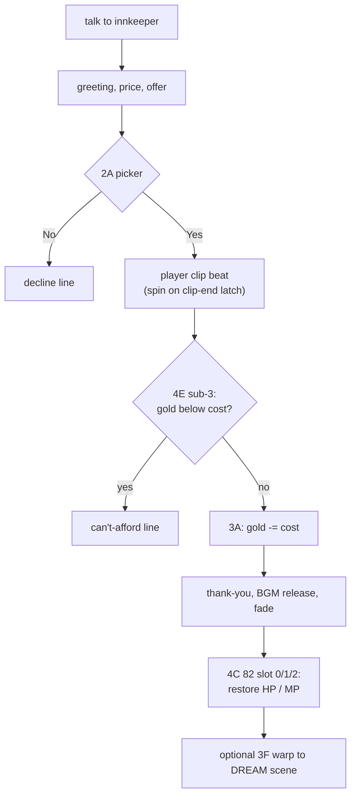

# Inn Subsystem

How resting at an inn restores HP / MP. Retail has **no inn overlay, no inn
opcode and no inn cost table**. Each inn is an ordinary field-VM interaction
record in its scene's MAN (the per-scene script container): the price is a
literal in the script, and the whole stay - offer, choice, gold gate, debit,
fade, restore - is one pass of that record through the
[field VM](script-vm.md). The port runs the same record through its field VM,
so the inn you reach in game is the retail script, not an engine routine.

## At a glance

| Question | Answer |
|---|---|
| Where is the price? | A `u16` literal in the scene MAN: gold gate `0x4E` sub-op 3 followed by a negative `0x3A` `ADD_MONEY`. |
| What marks a dialogue as an inn? | Nothing. The option picker's Yes jump simply lands on the gate. |
| What restores the party? | Three `4C 82 <slot>` ops, one per party slot, in the same record. |
| Port entry | `World::trigger_field_interact` -> `step_inline_dialogue` -> `legaia_engine_vm::field::step`. |
| Cost scanner | `legaia_scene_formats::inn_costs`, the disc census behind the cost list below. The engine reads no cost from it: the record's own ops charge the stay. |
| Oracles | `crates/engine-core/tests/inn_stay_field_vm_disc.rs`, `crates/scene-formats/tests/inn_costs_disc.rs` (both disc-gated). |



## Retail cost source (field-VM script literals)

An inn stay is a scripted **gold-gate + debit pair** inline in the scene MAN
(asset type `0x03`), the same place the town gold-shop stock lives
(see [Shop](shop.md#gold-shop-stock-source)):

```text
0x4E <pp> 0x30 <cost u16> <skip u16>   ; if gold < cost, jump +skip
...                                    ;   (the "can't afford" reply)
0x3A <sext24(-cost)>                   ; ADD_MONEY: gold -= cost
```

Op `0x4E` **sub-op 3** (operand byte 1, high nibble) loads the party gold
`_DAT_8008459C` and compares it against the u16 literal at operand `+2` (low
nibble `0` = jump when gold < literal - the can't-afford branch); sub-op 10 is
the 32-bit sibling (literal lo16 at `+2` / hi16 at `+6`, 9 bytes) used where a
price can exceed 65535 (the casino gold-to-coin counter). Provenance: the
op-`0x4E` inner jump table at field-overlay VA `0x801CEE30`, 12 words read out
of PROT 0897's own bytes. Arm `3` is `0x801E0AEC` = `lw s1,0x459c(0x8008)` -
`_DAT_8008459C`, the party gold. Arm `2` is `0x801E0AC0`, which multiplies the
slot by `0x414` through the `sll`/`addu` chain at `0x801E0AC8..0x801E0AD8` and
reads `0x6f8` off `0x80084140` - i.e. `record + 0x130`, the level byte. Arm `9`
is `0x801E0B34` = `lw s1,0x45a4(0x8008)` - `_DAT_800845A4`, the casino coin
bank. Read the disassembly rather than
`ghidra/scripts/funcs/overlay_0897_801de840.txt`'s C: its case labels collapse
these arms, and arms `5`..`8` share one body (`0x801E0B0C`).
Op `0x3A` (`ADD_MONEY`, [script-vm](script-vm.md)) applies the signed 24-bit
delta.

After the debit the same script continues in-line: the innkeeper's
thank-you text, per-party-slot `0x4C` records on slots 0/1/2 (the restore),
and a `0x3F` transition whose destination name is `DREAM@@` - the inn dream
sequences. So cost prompt, gate, debit, restore, and dream hand-off are all
one field-VM dialogue; no menu-overlay sub-screen is involved in retail.

## The trigger: the picker's own jump table

There is no "this dialogue is an inn" test anywhere - no opcode, no flag, no
carrier table. The hand-off from the innkeeper's offer to the restore is the
**option picker's per-option relative jump**, and the innkeeper's record is
laid out so that the Yes entry points at the gate.

The shape, read off `retock`'s innkeeper record (partition-1, the record
containing the scene's one scanned charge):

```text
1F <greeting> 00  1F <price line> 00  1F <offer question> 00
2A <rel16 yes> <rel16 no> 24        ; 2-option picker + post-page continue
1F <"yes" label> 00  1F <"no" label> 00
  ; yes-jump target:
A2 F8 <clip>  AC F8 08  AD F8 08    ; play a player clip, clear its end
                                    ;   latch, spin until it re-latches
... 26 <rel16>                      ; -> the gate
4E <pp> 30 <cost u16> <skip u16>    ; if gold < cost, skip to the refusal line
3A <sext24(-cost)>                  ; take the money
1F <thank-you> 00 1F <good night> 00
35 / 34 01 / 4A / 36 / 4A           ; BGM release, colour fade, wait,
                                    ;   rest cue, wait
4C 82 00  4C 82 01  4C 82 02        ; the restore, one op per party slot
36 FFFF / 35 / 34 00 / 4A           ; cue stop, BGM resume, fade back
1F <good morning> 00
```

What the stay sounds like, from `retock_inn_stay_prompt` with a Cross every `40` vsyncs
(`autorun_audio_timeline.lua`, `V` the vsync the release arms): the `35` is sub-op `5` with a
deadline of `90`, so the field track (`2015`) fades from `107` one unit a vsync and stops at
`V + 98` with its read cursor rewound; the rest cue is a CD-XA one-shot, so no SPU cue voice keys
while the score's own releases ring out; the closing `35` replays the track from its head at
`V + 214`, at `107`. The audio level `_DAT_8007B910` holds `215` throughout. A second stay in the
same run reads the same offsets.

Nothing but the record's own text boxes is drawn during a stay: the rest
itself is the fade, the cue and the waits, with no caption over the dark
screen.

The **no**-jump target runs its own clip beat and lands on the decline line;
the gate's skip target lands on the can't-afford line. Both are inside the
same record, so a stay never leaves the field VM.

Two details of that layout decide whether the Yes branch reaches the gate:

- **The open byte is `0x2A`, not `0x27`.** `FUN_80038050` - the inline-script
  control handler that applies the chosen option's jump - treats `0x27`,
  `0x28`, `0x29` and `0x2A` identically (one `switch` arm, `new_pc = (O + 1 +
  index*2) + i16_LE(entry[index])`). On the pager side `0x2A` selects state
  `0x11` where `0x27` selects `0x13`, and the shared cursor handler at
  `0x801D941C` reads the option count off the *active* state: `0x18` = 4,
  `0x16` = 3, anything else = 2. So `0x2A` is a **2-option** menu that
  animates the box geometry first, and its cursor does not wrap (the
  `state == 0x12` carve-out at `0x801D9474` clamps at both ends instead). See
  [`formats/mes.md`](../formats/mes.md#post-page-dispatch-state-0x19).
- **`AD F8 08` is a spin, not an end - and it spins on the *player's* word.**
  `0x2D` tests a bit of the clip-control word `actor+0x62`, and bit 8
  (`0x0100`) is the "end" flag the actor tick `FUN_800204F8` latches when a
  clip cursor reaches an end - so the `A2 F8 <clip>` / `AC F8 08` /
  `AD F8 08` triple is "play it, clear the latch, wait for it". The `F8`
  makes all three **cross-context**: `FUN_8003C83C` short-circuits that id to
  the live player object (`_DAT_8007C364`) ahead of its actor-list walk, so
  the innkeeper's record is driving the player's clip words, not its own.
  Retail's dialog SM `FUN_80039B7C` returns and re-enters per frame until the
  latch lands. A runner that treats the halt as the end of the conversation
  stops one instruction into the Yes branch, before the gate.

The Yes branch's full gesture is the door-swing shape aimed at the player -
`AC F8 01` un-hold, `A2 F8 04` poke the clip, clear + spin, `AC F8 03`
un-clamp, `4A 03 00`, `AB F8 03` re-clamp, clear + spin again, then
`A2 F8 02` to hand the player back to the locomotion move. Every operand
there is an animation bit of the player's `+0x62`, not one of the record's
own local flags.

## The port

The engine path is `World::trigger_field_interact` ->
`World::drive_inline_dialogue` -> `World::step_inline_dialogue`
([`inline_dialogue`](../../crates/engine-field/src/inline_dialogue.rs)) ->
`legaia_engine_vm::field::step`.

- **Cross-context clip words.** The runner binds the poked actor's `+0x62`
  into the executing context around each cross-context `2B` / `2C` / `2D`,
  mirrors it back, and parks on the clip-end spin until the player's clip
  cursor (`field_env::PropAnimBank::actor_clips`, advanced by the
  `FUN_800204F8` port `PropAnim::tick`) latches the end itself. The runner
  writes no latch of its own.
- **NPC cursors.** A field NPC a talk reaches before any `A2 <id> <clip>` poke
  gets a cursor on first use, as the player does: every spawned actor loops
  its clip from the template `+0x62`, so its latch lands once per wrap. (`vozz`
  P1[7], the Genesis Tree, raises actor `0x06`'s clamp, clears the latch and
  spins on it before the scene goes on.) A spin on such a resolved cursor
  parks even before the talk's first box opens.
- **Gate, debit, restore.** The gate reads the live purse through
  `FieldPartyInventoryHost::party_bank_value`; the debit is the record's own `ADD_MONEY`;
  the restore is its own `4C 82 <slot>` ops
  (`FieldPartyInventoryHost::restore_party_slot`).
- **Pool mirroring.** Retail's character record is the only copy of a member's
  pools. The port also keeps them on the party actor, which a battle seats
  from and writes back over the record, so the restore projects the record
  onto that actor as every field heal does.

The disc-gated oracle `inn_stay_field_vm_disc` drives the real `retock` record
from the interact call and asserts the gold delta and the pools on the Yes, No
and can't-afford branches.

### The cost scanner

The shared scanner is [`legaia_scene_formats::inn_costs`]: a byte scan (robust to the
dialogue-picker jump tables that desync a linear walk) for a gold compare
whose literal reappears as the magnitude of a negative `ADD_MONEY` within a
few ops of the gate (retail sites sit 7..~16 bytes apart). Swept disc-wide
by `crates/scene-formats/tests/inn_costs_disc.rs`: the pair resolves in the inn /
paid-lodging scenes (e.g. the 200 G innkeeper sites in the `ropeway` and
`balden` blocks, `rayman2`'s 200 G stay, `retock`'s 240 G stay), the paid
tours and the 3,000 G `station3` train ticket (sub-3, u16 costs), and the
casino gold-to-coin counters (`koin*`; `koin4` carries the only sub-10 u32
sites, 8,500..90,000 G). Free rests (Rim Elm's bed, Biron) simply have no
gate + debit pair in their scripts.

### The dream hand-off

Some inns append a story-flag-gated tail that warps to a `DREAM` scene after
the restore (the `0x3F` transition above). The restore runs first and
unconditionally, so a stay is complete without it.

The tail is a story gate and then a **dice roll**. `retock` `P1[26]` and the
Usha Research Center's cook (`doman` `P1[5]`) each carry two arms, picked by
the last dream seen (`0x35C` in `retock`, `0x35D` in `doman`). Each arm skips
the dream when `0x3EF`, `0x57F` or its own next-dream flag is set, walks a
`0x35B..0x35D` ladder, and ends on an op `0x4E` with sub-op `4`, which
compares `Rand() & 0xFF` against a threshold
([INVENTORY_CMP](script-vm.md#0x4e-inventory_cmp)). Below it, the arm sets
its marker (`0x588` in `retock`, `0x58C` in `doman`) and changes the scene to
`DREAM`; otherwise the stay ends on the morning fade.

| Inn | First arm | Second arm |
|---|---|---|
| `retock` `P1[26]` | `< 0xFF` | `< 0x66` |
| `doman` `P1[5]` | `< 0xFF` | `< 0x7F` |

So a stay that meets every flag can still give no dream: the
`retock_inn_stay_prompt` state stands in `retock`'s second arm, where
two stays in five dream. On return, `doman`'s entry script `P1[0]`
clears `0x57F`, then sets it again and clears `0x58C` when `0x58C` is up
(`+0x4F..+0x5A`), so no second dream comes before `doman` is entered
again. The
`dream_noa_*` retail states come from a stay with the cook.

### The night-before stay in Conkram

The Conkram innkeeper (`conc` `P1[9]`) ends a stay with a scene change rather
than a fade: it sets system flag `0x53C` and loads `CONC3` at tile `(15, 96)`.
conc3's entry script `P1[0]` spawns the wake-up record `P2[9]` (`44 59`) only
while `0x53C` is set and `0x5F7` clear. `P2[9]` fades back in, parks the
innkeeper, Dr. Usha, his companion and the counter relay at the off-map tile
(`A3 <id> 7F 7F` for `P1[7]` / `P1[8]` / `P1[9]` / `P1[23]`), sets `0x3F9`,
shows its wake-up page and sets `0x5F7`, so a later entry seats the four
again. Disc-gated `conc3_inn_arrival_disc` (engine-scene-host) pins both arms;
the `conc3_field_inn_night` capture holds the post-record end state.

## No engine-side inn screen

Retail has no inn screen, and neither has the engine: the stay a player
reaches is the field-VM record above, which both hosts run. The menu state
graph (`engine-menus::menu`) carries no inn states, and its bytes `0x1E` /
`0x1F` are unassigned.

## Relationship to `legaia_save`

Gold is stored at `_DAT_8008459C` in retail RAM and in `World::party.money` in the
engine. Per-character HP/MP live pools are the `(max, cur)` u16 pairs at
`+0x104 / +0x106` (HP) and `+0x108 / +0x10A` (MP) within the 0x414-byte
character record (see [`save-record.md`](../formats/save-record.md)).

## See also

**Reference** -
[Shop UI](shop.md) ·
[Save screen](save-screen.md) ·
[Level-up](level-up.md)
