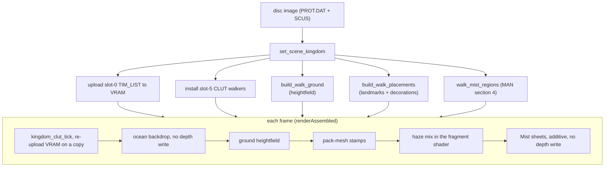

# World-overview viewer

The `/world-overview/` page of the static site draws each of the three
kingdom continents in real-time WebGL 3D, straight from a disc image the
reader supplies: the terrain heightfield, the landmark and decoration meshes
standing on it, the animated ocean and rivers, a distance haze and the
story's Mist. It makes
the world-map data reviewable end to end without a save state or an emulator,
and it can export the assembled continent as a `.glb`.

The retail world-map subsystem itself (overlay structure, key functions,
render pipeline, globals) is documented in [`world-map.md`](world-map.md);
this page covers only the viewer and the capture-side tooling that feeds it.
VR presentation of the same scene is in [`vr-mode.md`](vr-mode.md).

## At a glance

| Layer | Built from | Section |
|---|---|---|
| Continent ground | walk `.MAP` floor grid + MAN floor-height LUT, textured from the kingdom's terrain atlas | [heightfield](#continent-ground-heightfield) |
| Landmarks + decorations | walk `.MAP` placement records stamping slot-1 pack meshes | [placements](#walk-frame-placed-landmarks--decorations) |
| Water animation | the kingdom bundle's slot-5 CLUT-walk table, stepped on retail's cadence | [ocean](#ocean-tile---disc-side-asset--13-frame-clut-animation), [plumbing](#web-overview-shader-plumbing) |
| Ocean backdrop | a flat quad past the continent, sampling the walked ocean CLUT | [plumbing](#web-overview-shader-plumbing) |
| Distance haze | retail's walk-view depth cue (PROT 0901), stood in from a virtual walk camera | [haze](#distance-haze) |
| Mist | the kingdom MAN's fog-region table + the fog pool's spawn / draw rules | [Mist](#the-mist) |
| Top-down map (2D side panel) | the same heightfield cells and stamps, plus the kingdom MAN's world-map label table | [top-down map](#top-down-map) |
| Legacy overview-frame layers (hidden) | capture JSON: MAN-table landmarks, live-RAM actors, unplaced-mesh grid | [layout engine](#layout-engine-for-unplaced-slot-1-tmds), [bulk terrain](#bulk-terrain-placement-resolver-man-0x7f-sentinels) |



## Continent ground heightfield

The viewer draws the kingdom's full continent terrain the same way the
native engine's world-map render does: a procedural **heightfield
surface** built from the walk `.MAP` floor grid, per-cell-textured from a
terrain-type-keyed multi-page atlas. This is the bulk ground (grass /
mountain / water / forest), distinct from the sparse slot-1 landmark
meshes layered on top. The heightfield model and per-cell texturing are
pinned in [`world-map.md`](world-map.md) "Ground texturing"; the surface
math is `legaia_scene_formats::field_objects::build_ground_heightfield` with the
overworld's cell gate (`FUN_80019278` bilinear floor sampler).

The WASM viewer builds the same surface from the raw PROT.DAT it already
has in hand (`legaia_web_viewer::build_walk_ground`), mirroring
`Scene::walk_heightfield` without the full `ProtIndex` / CDNAME stack:

- **Walk `.MAP`** is slot 0 of the kingdom's scene block, identified by its
  `0x12000` extended footprint ([`field-map.md`](../formats/field-map.md#numbering)).
  The bundle the viewer is handed is slot 2 of the same block, so the map is
  `prot_base - 2`. The first `0x12000` entry at or after the bundle is the
  *next* scene's map; for a kingdom it reads as the wrong continent with only
  a handful of `0x1000` cells.
- **Floor-height LUT** is `man[+0x02..+0x22]` (16 `s16` LE) from the
  kingdom bundle's MAN slot (slot 2) - the same bytes
  `Scene::field_floor_height_lut` reads.

`build_walk_ground` reuses `build_walk_heightfield` for the grid math, so
its output is **byte-identical** to the engine's `Scene::walk_heightfield`
(positions + per-cell UVs + per-cell `[clut, tpage]` + indices), asserted
for all three kingdoms by the disc-gated test
`crates/web-viewer/tests/walk_ground_parity.rs`.

Per-cell UVs follow the retail emitter's corner orientation: U along +X/col,
**V flipped vs +Z/row** (the low-Z corner samples the tile's bottom texel row).
This is baked into `build_walk_heightfield`, so the viewer inherits it for free;
it is what makes directional transition tiles (coastline sand, ridge faces) flow
continuously instead of mirroring in place. See
[`world-map.md`](world-map.md) "Ground texturing".

The heightfield's per-cell `[clut, tpage]` reference the terrain atlas
VRAM pages (grass `0x1A` at fb `(640, 256)`, mountain `0x0C` at fb
`(768, 0)`, water `0x1B`/`0x1C`, forest `0x0B`). Those pages are already
resident: the kingdom bundle's slot-0 TIM_LIST (uploaded to VRAM by
`set_scene_kingdom` for the landmark meshes) is the *same* atlas the
native `SceneLoadKind::WorldMap` VRAM build uses, so the ground samples
correct terrain textures from the VRAM the viewer already has.

The `walk_ground_{positions,uvs,cba_tsb,indices,quad_count}` WASM
accessors hand the surface to the WebGL renderer. `TmdRenderer.uploadGround`
keeps it resident as one mesh; `renderAssembled` draws it over the ocean
backdrop plane (which writes no depth - see the ocean section), with a fixed `diag(1, -1, 1)`
model - the same Y-flip the placement models apply, since the heightfield is
already in world coordinates. The "terrain" checkbox toggles the ground pass
(read per-frame, no kingdom re-entry). The heightfield drives the default
camera framing (centred on its XZ centroid, sized to its extent); the
"lock to retail top-view" button still recentres on the captured spawn
anchor on demand.

The assembled world view renders through a **perspective orbit camera**
(`buildWorldOrbitVp` in `site/js/webgl-math.js`) - the retail world map is
genuinely 3D (GTE `RTPT` perspective projection; confirmed by moving the
retail camera with GameShark), so the viewer matches: the eye orbits a
ground-plane target on `(yaw, pitch)` spherical angles, with `pitch = 0` the
straight-down view and larger values tilting toward the horizon. Zoom keeps
its orthographic meaning - `halfWidth`/`halfHeight` define the visible
window at the target plane, and the orbit distance is derived from them
(`dist = halfHeight / tan(fovY/2)`), so wheel zoom and pan speed behave
identically at any tilt. Controls: left-drag pans (through the yaw-rotated
ground basis), right-drag or shift+drag orbits, wheel zooms; "lock to
retail top-view" flattens `pitch` to 0 on the captured spawn anchor and the
reset button restores the default tilt. The gesture handler is the shared
`attachWorldOrbitControls` in `site/js/webgl-math.js`; the asset-viewer
page's assembled full-map mode attaches the same handler over the same
orbit camera, so both assembled views control identically.

Both cameras render the map **rotated 180° and then horizontally flipped**
to match retail's world-map orientation. The up vector is world `+Z` (the
180° rotation: screen-up = world `+Z`, screen-right = world `-X`), and the
projection then mirrors the horizontal screen axis (`buildTopDownVp` swaps
`ortho`'s left/right; `buildWorldOrbitVp` negates the perspective matrix's
X scale), so the net basis at `yaw = 0` is screen-up = world `+Z`,
screen-right = world `+X`. The mirror reverses triangle winding, which is
harmless since `renderAssembled` disables `CULL_FACE`. The pan controls map
drag deltas back through this same post-mirror basis. The ortho
`buildTopDownVp` path remains the projection for `renderAssembled` callers
whose camera record carries no `yaw` field (the asset viewer's full-scene
map mode).

## Walk-frame placed landmarks + decorations

The continent isn't just terrain: two sparse slot-1 pack-mesh layers draw on
top of the heightfield, in the **same `col*128` world frame** as the ground -
the same sets the native `play-window --scene map01 --world-map` render draws
over its heightfield:

- the **placed landmarks** (the `flags & 0x4` objects `FUN_8003A55C` stamps
  on occupied tiles - towers, castles, bridges), and
- the **decoration layer** - every cell carrying the draw bit `0x2000` whose
  record is not placed, stamping the record's `+0x10` mesh: the crossed-quad
  billboard trees (a forest cluster stamps one tree mesh from dozens of
  cells), mountain groups, small props, and the **big enterable mountains**
  (Drake's terraced peak is record 412 / pack 23 at cell `(39, 80)`; Karisto
  has six such records). Those mountain cells carry `0x2000` and **no**
  `0x1000` walk bit - the mesh is the ground there - so the sweep must gate
  on `0x2000` alone: gating on the walk bit draws every tree and drops every
  big mountain. The riverbank/system record 408 family (nonzero
  `+0x10`, walk bit only) never carries `0x2000` and stays out by the gate
  alone; drawing it tiles a wall mesh down every river.

`legaia_web_viewer::build_walk_placements` resolves both from the raw
PROT.DAT the viewer already holds, sharing the walk `.MAP` + floor-LUT
resolution with `build_walk_ground` (`resolve_walk_map_and_lut`):

- Runs `legaia_scene_formats::field_objects::parse_placements` +
  `parse_walk_decorations` on the walk `.MAP` and concatenates.
- Each placement's mesh is the record's `+0x10` field (`pack_index`) - a
  slot into the kingdom's slot-1 TMD pack the `pack_mesh_*` accessors expose.
- World position is the placement's `(world_x, world_z)` plus the world Y the
  shared `Placement::world_y` kernel resolves - the 2 x 2 corner-tile average
  for decoration cells, the single placement-tile nibble for placed objects,
  plus `y_off` (the runtime stores the floor LUT negated) - so the mesh sits
  on the heightfield, mid-slope on a tier edge. This mirrors the native
  engine's `resolve_placement_draws` exactly; the disc-gated
  `crates/web-viewer/tests/walk_placements_parity.rs` asserts the viewer's
  resolved placements equal `Scene::walk_object_placements` +
  `Scene::walk_decoration_placements` + the floor LUT for all three kingdoms.

- Each placement carries the record's authored **yaw** (`+0x0A`, PSX
  `4096`-per-rev units) - the field `FUN_8003A55C` copies into the actor's
  rotation triple (`+0x24/+0x26/+0x28`) and the render dispatcher turns into
  the draw matrix via `FUN_80026988`. This is what gives the Sebucus island
  bridges their distinct quarter-turn orientations (`0x400`/`0xC00`) and the
  decoration trees their variety; the record's X/Z tilts are zero on every
  retail walk `.MAP` and aren't carried.

- Each stamped mesh is uploaded **whole**: the `pack_mesh_*` accessors
  build the slot through the shared pack kernel
  `legaia_engine_scene::scene_assembly::build_hybrid_pack_mesh` - the
  textured prims first, then the untextured `F*`/`G*` vertex-colour prims
  appended with `(cba, tsb) = (0, blend)` - and `pack_mesh_flat_rgba` is the
  index-aligned `[r, g, b, flag]` packet-colour stream (`flag` 255 =
  textured, modulate; 0 = untextured, fill), the `packet_color` convention
  the field-scene page and the `.glb` baker already read. The landmark
  meshes need it: Rim Elm's hut walls are textured quads and its four roofs
  are 24 gouraud triangles, Karisto slot 8 (the Uru Mais temple at cell
  `(36, 75)`) is colour prims only, and 34 slots across the three packs
  carry some. Retail draws both families
  through one per-prim dispatch (the untextured slots of the world-map
  overlay's `0x801F8968` row are populated - [world-map.md](world-map.md)),
  so a textured-only upload draws the huts as open rings. `renderAssembled` turns the shader's fill branch on per mesh that
  carries the stream, and that branch runs the same distance-haze mix as
  the textured path (retail's untextured leaves cue too). Disc-gated:
  `crates/web-viewer/tests/world_map_pack_hybrid_real.rs`.

The `walk_placement_{count,slots,positions,rot_y}` WASM accessors hand the
list to JS, which uploads each referenced pack mesh once and pushes a draw
record per stamp. `renderAssembled` draws them after the ground with
`placementModelScaledY(x, -world_y, z, rotY, 1)` - the JS yaw is
`-(rot & 0xFFF) * PI / 2048` because retail's pure-Y matrix maps local `+Z`
to `(sin, 0, cos)`, the opposite yaw sense of `placementModelScaled*` -
scale `1` (the slot-1 meshes
are already in true world units, unlike the legacy overview-frame icons that
needed a presentation scale) and the same `(1, -1, 1)` Y-flip the ground and
the native render use. The anchor Y **must be negated on the JS side**:
`placementModelScaledY` flips only the mesh-local geometry, not the
translation, while the ground bakes `-lut` into its vertices and lands at
`+lut` (up) under the shared flip. An un-negated anchor mirrors the stamp
below the surface by `2*(lut - y_off)` (Drake's mountain cells have a LUT up
to 288, enough to bury a cave entrance). The site viewer's full-map path
applies the same negation. The "landmarks" checkbox toggles the layer. The
fragment shader's PSX cutout rule (BGR555 `0` with STP `0` discards) is what
makes the tree quads read as foliage; the `u_no_discard` silhouette fallback
is off in the assembled path, since the kingdom's real VRAM image is uploaded
and CLUTs resolve like retail.

One authored exception (`WALK_STAMP_SUPPRESS` in `world-overview-app.js`):
placed objects are script-managed - `FUN_8003A55C` runs each spawn's MAN
interaction script's leading ops inline, so a placed record's resting
position/visibility isn't necessarily its grid cell (see the placer's MAN
gate in [`world-map.md`](world-map.md)). The static viewer can't run MAN
scripts, so stamps known (from retail) not to rest at their grid cell are
suppressed by `(mesh, world x, world z)` - currently Drake's record-349
golden bridge, whose grid cell sits over the river at `(10688, 5312)` while
retail shows the single bridge at the record-441 road crossing
`(12224, 6336)`. `window.__woWalkStamps` exposes the stamp list actually
queued per render (the headless-verification hook, like `__woCam`).

**The legacy overview-frame placement layers stay hidden.** The
`world-overview.json` MAN-table landmarks, live-RAM actor placements, and the
unplaced-slot-1 layout grid (described under "Layout engine for unplaced
slot-1 TMDs" below) are in the top-down *overview* coordinate frame
(mednafen captures / MAN overview coords), which is misaligned with the
walk-view heightfield. The walk-frame placements above supersede them for the
landmark layer; the `SHOW_LEGACY_PLACEMENTS` flag in `world-overview-app.js`
still re-enables the old overview-frame code (preserved for the
unplaced-layout toggles). The page's [top-down map](#top-down-map) plots the
walk-frame layers, not these.

## Top-down map

Beside the 3D canvas the page draws the loaded kingdom as a 2D plan
(`site/js/world-overview-minimap.js`). It is the assembled scene's data seen
from straight above, not a second data source: the app gathers it off the same
WASM accessors, in the same load, that the 3D draw list is built from.

| Layer | Source | Drawn as |
|---|---|---|
| Land outline | `walk_ground_positions` reduced to one cell per quad, less the cells on the water pages `0x1B` / `0x1C` (`walk_ground_cba_tsb`) - the heightfield covers the whole grid, sea included | a 128 x 128 land mask over the sea colour |
| Decorations | `walk_placement_*` stamps whose record has no placed flag | small dots |
| Placed objects | stamps whose record carries flag `0x4` (`walk_placement_placed`) | squares |
| Named places | `world_map_labels_json` - the kingdom's records of the location table trailing the kingdom MAN | circles, labelled |

**Frame.** The label table's coordinates are `map << 7`, the position the
game's own map display projects each name from (the label pass at
`0x801CF368` in PROT 0981, [`place-names.md`](../formats/place-names.md#the-label-pass)).
That is the walk frame the heightfield and the stamps are built in, so a label
lands on its town with no transform. `build_world_map_labels` filters the
29-record table by the kingdom's `region` byte; the disc-gated
`crates/web-viewer/tests/world_map_labels_real.rs` asserts every label falls
inside its own kingdom's heightfield bounds and that the three kingdoms
partition the table.

**Orientation and fit.** Screen-right is world `+X` and screen-up is world
`+Z`, the basis of the 3D scene's default camera (`buildWorldOrbitVp` at
`yaw = 0`). The plot is fitted to the bounding box of the land cells, widened
to hold every marker, with a fixed margin and one scale for both axes, so a kingdom that is wider than tall is
letterboxed rather than stretched. Nothing is clamped to the canvas: a record
with no position is not plotted.

**What is left out, and counted.** The legend names two families it does not
plot: the MAN partition-1 actors parked at the `(0x7F, 0x7F)` sentinel, which
a script positions at runtime ([below](#bulk-terrain-placement-resolver-man-0x7f-sentinels)),
and any stamp the 3D scene suppresses through `WALK_STAMP_SUPPRESS`.

**Names.** The place names are read from the reader's disc when the kingdom
loads and are never written into the site. `site/world-overview.json` carries
coordinates, ids and counts only: the MAN actor records' developer labels
(Shift-JIS, in the bytes before each placement header) are disc text and
`extract-world-placements.py` does not emit them. Without a disc the canvas
shows a prompt instead of a plot.

**Only partition 1 is a placement.** The kingdom MAN's header counts are its
three record partitions, and `FUN_8003AEB0` runs the placement walker over
partition-1 records `1..N1` alone ([`world-map.md`](world-map.md#entity--actor-placement-table)):
8 / 7 / 19 records for `map01` / `map02` / `map03`. Partition 2 is the scene's
event scripts. Walking on into it reads field-VM script bytes as a placement
header - a zero "tile X" on almost every record, which decodes to world
`x = 64` - and yields a column of points down the map's west edge. The
extractor stops at the partition boundary.

**Presentation.** Colours are CSS custom properties on the side column
(`--wo-map-*`), read by the canvas and used directly by the legend keys, with a
light-theme override; the backing store is sized by `devicePixelRatio`. Labels
are placed greedily around their markers and one that would overlap another is
dropped, leaving the hover readout and the list beside the map (whose rows ring
their marker) to name it. `window.__woMinimap` reports the last draw - counts
per family, labels drawn, markers off the canvas - for headless verification.

## Ocean tile - disc-side asset + 13-frame CLUT animation

The world-map ocean is a **static 4bpp tile** + **CLUT cycling**
animation, both shipped on disc:

- **Texture:** PSX TIM image at VRAM ``(768, 256)`` 64 halfwords ×
  256 rows (= 256 × 256 logical pixels in 4bpp), inside slot 0
  (TIM_LIST) of each world-map kingdom bundle (PROT 0086 Drake / 0245
  Sebucus / 0392 Karisto - the bundle entry, one past the block's
  prescript; see [`legaia_scene_formats::kingdom_bundle`](../../crates/scene-formats/src/kingdom_bundle.rs)). The kingdom-specific TIM is the one with
  CLUT block fb_xy ``(0, 506)`` and image block fb_xy ``(768, 256)``.
  Texture bytes vary per kingdom (each ships its own variant).
- **Wave-ramp region:** the ocean data fills the **top-left 96 × 96
  logical pixels** of the 256 × 256 page; the rest is shared with
  other tile prims in 4bpp mode and reads as CLUT-entry-0 padding at
  world-map entry. Confirmed by walking non-zero byte density across
  every row and byte column of the decompressed image - rows 1-96
  + logical pixel cols 0-95 are 100% non-zero, the rest tapers off
  to zero past row 191. The prim-trace POLY_FT4 cluster UVs for the
  ``clut=0x7E80 tpage=0x001C`` family land entirely inside this
  envelope (UVs from ``(0,0)`` to ``(95,95)``).
- **Base CLUT:** 256-entry BGR555 row at VRAM ``(0, 506)`` (same TIM
  as the texture). The first 16 entries are the ones the runtime
  overwrites per frame; entries 16..255 stay fixed and belong to other
  tiles sharing the row.
- **Animation table:** **13 frames × 16 BGR555 entries = 416 bytes**,
  byte-identical across all three retail kingdoms (SHA-256
  ``dfc6dd263a71152c40ab7726193d79e9658efc04402f4280f5f49f392e32071f``).
  Located by signature scan in each kingdom's decompressed slot 0;
  the disc wraps each frame in a 532-byte "CLUT-only TIM" record at
  TIM_LIST slots 3-5 (Sebucus/Karisto) or 10-15 (Drake), with the
  first frame starting 0x54 bytes into the record (8 zero bytes +
  12-byte CLUT block header + 32 unrelated CLUT entries).

Each frame overwrites the first 16 CLUT entries; the wave peak (``0x3D05``
bright blue) propagates through indices 0..7 over the 13-frame cycle.
Frame 0 starts at index 5; the cycle wraps back to index 0 at frame
8 and continues through index 2 at frame 12. Entry 0 of every frame is
``0x0000`` - a transparent texel.

**This 13-frame table is not what retail cycles.** Retail drives the same
``(0, 506)`` head from the kingdom bundle's **slot-5 CLUT-walk table**, on a
different cadence (18 steps, one every 9 vsyncs, ≈2.7 s per cycle), copying
from parked strips whose entry 0 is ``0x8000`` (opaque black, STP set), and
seven more walkers fill the river / shoreline CLUT cells beside it. The
13-frame slot-0 path survives only as the fallback for a bundle with no
parseable slot 5, which no retail bundle is. See
[`world-map.md`](world-map.md) for the retail mechanism.

## Web-overview shader plumbing

[`legaia_scene_formats::ocean::find_ocean_assets`](../../crates/scene-formats/src/ocean.rs)
decompresses the kingdom bundle's slot 0, locates the ocean TIM by VRAM coords, and
signature-scans the slot for the animation table. The disc-gated
test ``crates/web-viewer/tests/ocean_assets.rs`` verifies extraction
across all three kingdoms.

The viewer animates the water through the **retail slot-5 walker**:
`set_scene_kingdom` resolves the kingdom's CDNAME block and runs the engine's
`ClutWalkAnim::install` over the kingdom VRAM (parks the slot-0 source strips,
plus the Drake complement on map02 / map03, and seeds the eight walkers), and
the page steps it with `kingdom_clut_tick` on wall-clock vsyncs at the
overworld's 3-vsync game tick, re-uploading the VRAM when a copy lands. It is
the same kernel the play hosts and the field-scene viewer run, so the ocean
head `(0, 506)` (CBA `0x7E80`), the river cells and the shoreline cells hold
retail's palettes and shimmer on retail's cadence.

Without the walk, the page's VRAM holds only the slot-0 TIMs: the source
rows 498 / 502..505 are blank and the walker destination cells keep another
TIM's palette, so the rivers draw pink-grey instead of retail's grey-blue. The
13-frame cycle (entry 0 transparent, where retail's walked head holds
`0x8000` on half its strips) stays only as the page's fallback for a kingdom
with no walker.

The ocean *backdrop* (``site/js/webgl-tmd.js``) is a flat quad at
``y=0`` extending past the continent so the sea reaches the horizon
under the orbit camera; its shader samples the same 4bpp texture
through a 16-entry CLUT texture copied from the walked VRAM row
`(0, 506)` after every step (`setOceanClutFromVram`), so the open sea past
the continent grid shimmers in lockstep with the heightfield's water cells.
The plane is drawn first **without writing depth**, so everything after it
covers it whatever the depth: it is a backdrop fill, not geometry. Retail has
no sea plane at all - inside the kingdom the sea is the heightfield's own water
cells, and the river / lake / coastal cells sit at the lowest floor tier, only
`0.6` units above `y = 0` once `GROUND_SINK` is applied. A depth-writing plane
z-fights them as soon as the camera tilts (at range the depth step exceeds that
gap). The "ocean" checkbox toggles only this backdrop pass.

Capture pipeline for the procedural-tint fallback used before the
disc is loaded:

```
scripts/mednafen/resolve_bulk_terrain.py --bundles map01,map02,map03 \
    --json site/world-overview-live.json <mc1> <mc2> <mc3>
python3 scripts/asset-investigation/extract-world-placements.py \
    --prot-dir extracted/PROT --out site/world-overview.json
```

``pick_ocean_color`` walks every POLY_FT4 cluster reported by
``mednafen-state prim-trace``, samples each cluster's representative
tile via its CLUT + tpage out of the save's VRAM, and ranks
blue-dominant clusters by ``hits × blue_dominance``. The winner's
average RGB lands as ``site/world-overview.json[kingdom].ocean_color``
and drives the viewer's fallback colour before the textured pipeline
loads.

## Distance haze

The "distance haze" toggle draws the depth cue the overworld walk view puts
on the continent, which is a brightening toward white, not a coloured fog.
PROT 0901's ground emitter runs `DPCS` on each cell's packet colour with
`IR0 = max(SZ1 - 0x5000, 0) >> 3` toward the far colour its caller sets with
`SetFarColor(0x100, 0x100, 0x100)`; the decoration sweep cues each tree or
prop by its object's `TRZ` toward `0xD0D0D0`; placed landmarks take no cue
([world-map.md](world-map.md#ground-texturing)). A textured prim's colour is
`texel * packet / 128`, so the far ground climbs toward twice the texel and
saturates where the packet word reaches `0xFF`.

Every term of that cue keys on the walk camera's depth, and this page's
orbit camera is not retail's. The page therefore stands in a **virtual walk
camera** seated on the centre of the view, as if the party stood there:

```text
SZ  = eyeZ + 6 * cos(pitch) * |xz - centre|
IR0 = clamp((SZ - 0x5000) / 8, 0, 0x1000) / 0x1000
```

`eyeZ` and `pitch` are the kingdom's walk-camera eye depth and pitch from the
[resident overworld states](world-map.md#walk-view-camera-retail-model-ram-pinned)
(`KINGDOM_WALK_EYE`), and `6` is the base matrix's world scale. The haze
starts about 2300 world units from the centre on Drake and saturates near
8800, so at the default framing the far half of the kingdom visibly pales.
Retail's cue is a depth along the view direction; the stand-in is radial,
which is the one deliberate difference.

| Draw | Mode (`u_fog_enable`) | Far colour (`u_haze_far`) |
|---|---|---|
| Continent ground | `1`: per vertex | `0xFF / 128` (`0x100` after the DPCS saturation) |
| Decoration stamp (`hazeDeco`) | `2`: one `IR0` from the stamp origin (`u_haze_ir0`) | `0xD0 / 128` |
| Placed landmark | `0`: none | - |
| Ocean backdrop | its own program, the ground's law | `0xFF / 128` |

Setter `TmdRenderer.setDistanceHaze`; the per-draw staging is `_setHazeDraw`
in `webgl-tmd-frame-state.js`. The ocean backdrop takes the ground's cue so
it stays one layer with the heightfield's water cells.

The toggle used to mix toward a hand-set per-kingdom tint by a "fog LUT"
found in `SCUS_942.54`. That table is the arctan LUT `FUN_80019B28` reads
([do-not-re-walk](../reference/re-do-not-re-walk.md#world-map--kingdom-bundles)),
and the page's depth term reached under 4% of it at any framing, so the
toggle drew nothing visible. Retail has no per-kingdom haze colour to take
instead: both far colours are fixed in PROT 0901's code. Not a haze source
either, in case the reading recurs: `FUN_801E3E00` is the keyframe script of
the field-VM's attached light, and its `+0x74` is the light pool's centre
colour ([world-map.md](world-map.md#the-fog-rgb-script-is-the-attached-lights)).

## The Mist

The story's Mist is not the haze. On the world map retail draws it with the
**field fog pool**, the same system as a town's drifting fog
([field-ambient-fx.md](field-ambient-fx.md#the-pool-on-the-kingdom-overworld)):

- each kingdom's scene system script (MAN `P1[0]`) rewrites every fog
  region's enable byte from the inverse of its story flag (op `4C C1`) and
  raises the pool's gate (op `4C 30`);
- the emitter bursts particles at tiles of the visible-tile window, and the
  spawner `FUN_801D629C` keeps a tile only inside the **first** MAN
  section-4 region that holds it, and only while that region is enabled;
- each particle drifts on its region's heading and speed, fades in over age
  `0x400` and out after `0xC00`, and draws as two additive (ABR 1) half-sheets
  sampling page `(448, 0)` through CLUT `(0, 473)` (`FUN_8003F3FC`,
  `FUN_8003F86C`).

The region flags are the per-area Mist lifts: a region stops spawning once
the story sets its flag, which is how an area clears. The three kingdoms'
tables:

| Kingdom | Regions | Flags |
|---|---|---|
| Drake (`map01`) | 10 | `0x19A` (five small regions), `0x2FA`, `0x308` (three), `0x2FD` |
| Sebucus (`map02`) | 8 | `0x51B`, `0x51A` (three), `0x51C` (two), `0x51D` (two; one spans the whole map) |
| Karisto (`map03`) | 9 | `0x007`, `0x526`, `0x51E` (three), `0x520` (two; one most of the map), `0x51F`, `0x521` (the whole map) |

The "Mist" toggle (`world-overview-mist.js`) draws the kingdom as it stands
before any Mist lifts: every region enabled except the ones the kingdom's own
entry script disables on a first arrival (`map02` sets `0x51B` unless `0x1D5`
is set, `map03` sets `0x526` unless `0x36F` is set; `KINGDOM_MIST`). It keeps
retail's region test, spawn record (heading, speed, height, grey, age rate),
brightness ramp, half-width growth, UV rows, sheet art
([`world_mist::mist_sheet_rgba`](../../crates/web-viewer/src/world_mist.rs))
and 5-bit additive blend. Sheet heights sit on the tile's floor plus the
camera-offset control word the kingdom's script hands op `4C 49` (`60` /
`128` / `152`).

What it changes: retail's pool lives only in the window around the party,
capped at `0x48` sheets. The page spreads the same density over the whole
continent (cap and spawn rate scaled by the Mist-covered tile count over
the `36 x 44`-tile window), so the overview shows every Mist area at once.
The spawner's camera-depth drop and the player-proximity ageing key on
retail's walk camera and party, which the overview has neither of, and are
not modelled. Seen from the overview's height a sheet (one tile tall, six
to ten wide) reads as a thin streak; zooming toward the ground shows the
bank the party walks through.

`map01`'s white bank on the ridge north of Rim Elm is a second, separate
mechanism - additive sprite-arm sheets of the scene's ambient move-VM tree
([field-ambient-fx.md](field-ambient-fx.md#map01s-mist-bank-is-ambient-sprite-arm-sheets))
- and the page does not draw it.

## Camera anchors

Per-kingdom camera centres + zoom anchors live in two tables and a
JSON override:

- `KINGDOM_CAM` - walk-view spawn anchors (load-time map-origin
  coords from `_DAT_80089118` / `_DAT_80089120`, decoded by
  `mednafen-state world-map-camera --table <save>`). This is the
  default view when a kingdom tab is opened.
- `KINGDOM_TOPVIEW_CAM` - hardcoded fallback for the
  "lock to retail top-view" button.
- ``world-overview.json[kingdom].topview_cam`` - per-kingdom
  capture preferred over `KINGDOM_TOPVIEW_CAM` when present.
  ``resolve_bulk_terrain.py::capture_topview_cam`` writes this from
  ``mednafen-state world-map-camera`` against the user-supplied save
  state for each kingdom. The "lock to retail top-view" button reads
  this first; the values drive the world cam centre + frame the
  kingdom at its captured extent.

The captured anchor is the load-time map origin (`-_DAT_80089118` /
`-_DAT_80089120`). Top-view dev-menu captures (``DAT_801F2B94 != 0``)
would refine this with an interactively-scrolled centre + a refined
``zoom``; walk-view captures (``DAT_801F2B94 == 0``) match the spawn
anchor, which is good enough as a "lock" target since the dev-menu
top-view also enters from this anchor before user input scrolls it.

## Continent `.glb` export

The page's "Download .glb" button bakes the assembled world view - the
continent ground heightfield plus every walk-frame landmark / decoration
stamp on screen - into a single binary glTF via the WASM
`scene_export_*` session (`legaia_web_viewer::scene_export`, bake in
`legaia_actor_formats::scene_gltf`). The page hands the exporter the same mesh
buffers it uploads to WebGL and the same per-draw
`(translation, rotY, scale)` triples it builds model matrices from, so
the file matches the render; the PSX VRAM+CLUT texture indirection is
baked out into one RGBA atlas (one 256x256 tile per distinct
`(cba, tsb-page)` pair the vertices sample, NEAREST-sampled, `MASK`
alpha for the PSX word-0 cutout rule). The per-vertex packet-colour
stream goes with the buffers - the same `pack_mesh_flat_rgba()` the page
hands the shader - and lands as `COLOR_0`, so the file carries the
`texel * colour / 128` shading rather than the raw texels
([renderer](renderer.md#the-same-shading-in-an-exported-glb)). The
continent ground is a synthesized heightfield with no packet stream on
either path, so it exports exactly as the canvas draws it. The animated
ocean backdrop is a screen effect, not geometry, and is excluded. The asset-viewer page's
full-map (town) and single-TMD exports ride the same session; the enemy
table's monster export is the sibling `monster_gltf::export_glb` (it
additionally carries action animations).

## Layout engine for unplaced slot-1 TMDs

This layer belongs to the legacy overview frame, hidden by default (see
[above](#walk-frame-placed-landmarks--decorations)).

The MAN placement table pins a small subset of each kingdom's slot-1
TMD pack at world coordinates (5 / 6 / 17 slots for Drake / Sebucus /
Karisto). The remaining slots are positioned at runtime by the
field-VM via actor-mesh chains and don't carry a static world coord.
The viewer's "show unplaced slot-1 TMDs" toggle drops those onto a
canonical layout grid, classified by `slot1_classification.toml`:

- **landmark** - row south of the kingdom bounds, sorted by slot.
- **decoration** - row north of the kingdom bounds.
- **ground_tile** - grid west of the kingdom (the runtime tiles
  them via the overlay-routed dispatch table).
- **npc_token** - hidden (reused generic actor bases; reporting
  the count avoids cluttering the view).
- **unknown** - grid east of the kingdom.

Two per-mesh transforms keep the layout legible:

1. **AABB-centroid anchor** - each unplaced TMD is drawn so its
   AABB centroid sits at the assigned grid slot, instead of its
   TMD-local origin (which can be far from the visual centre and
   shift the mesh out of frame).
2. **Class-conditional footprint normalisation** - per-class
   target footprints in world units (landmark ~600, decoration ~200,
   ground_tile ~1200, unknown ~600). Each mesh's larger XZ extent maps
   to the target via a per-placement scale so the row reads at a
   consistent size regardless of the TMD's native scale.

The "normalize unplaced" toggle disables both transforms (falls back
to the legacy constant scale + TMD-local-origin pivot) so the user
can ground-truth against retail.

## Bulk-terrain placement resolver (MAN `0x7F` sentinels)

MAN-record placements where ``(x_enc, z_enc) == (0x7F, 0x7F)`` static-
decode to the literal world coordinate ``(16320, 16320)`` (the
world's NE corner, just outside any visible kingdom). Those actors
are positioned at runtime by the FieldVM prescript embedded in the
record's trailing bytes, dispatched from ``FUN_8003A1E4`` (the MAN
placement walker in SCUS):

```c
// FUN_8003A1E4 lines 326-336 (excerpted):
uVar14 = (uint)*(byte *)(iVar11 + iVar10);    // script[PC]
if ((uVar14 - 0x24 < 2) && (... > 0x1F)) {    // op in {0x24, 0x25}
    while (true) {
        iVar10 = func_0x801de840(...);         // -> FieldVM dispatcher
        *(short *)(iVar9 + 0x9e) = (short)iVar10;
        if (uVar14 == 0x21) break;
        // walk next opcode
    }
}
```

Each actor is allocated by ``FUN_80024C88`` then its prescript runs
once through the FieldVM (``FUN_801DE840``). The prescript can write
``actor[+0x14] / actor[+0x18]`` (X / Z position), so the *resolved*
position differs from the literal MAN-record decode.

**Statically resolving these without running the FieldVM is not
covered by the asset extractor.** The MAN prescript is a per-record
bytecode that picks a position based on actor type, story-flag state,
overlay-resident lookup tables. A full from-scratch port would need
the engine-vm field VM driving real actor records.

The practical alternative is a **runtime snapshot capture**:

- ``scripts/mednafen/resolve_bulk_terrain.py`` extracts the
  post-resolve placements out of mednafen save states. It walks every
  actor list head listed in `Globals used` (see [`world-map.md`](world-map.md#globals-used)),
  captures the actor's live ``+0x14 / +0x18`` coords plus its mesh
  chain at ``+0x44`` (resolved back to the kingdom TMD pack via
  reverse-magic-search), and tags each placement ``kind: 'bulk_terrain'``
  when ``actor[+0x90]`` is outside the MAN buffer or ``'man_actor'``
  otherwise.
- `scripts/asset-investigation/extract-world-placements.py` merges the resulting JSON into
  ``site/world-overview.json`` under ``bulk_terrain_placements`` per
  kingdom (alongside the existing ``placements`` and
  ``live_placements`` fields). The world-overview viewer renders both
  layers in the same scene.
- ``crates/web-viewer::sentinel_placements`` is the Rust port of the
  RAM-side resolver (record parser + actor-list walker + TMD-pack
  reverse lookup) for downstream callers; the Python script is the
  end-to-end driver.

The Drake-only count produced by the existing PCSX-Redux capture
(``site/world-overview-live.json`` legacy single-bundle dict) lands
as ``man_actor`` under the new tagging since that capture script
predates the ``kind`` field.

## Global-pool placement placeholders

MAN-record placements with ``tmd_slot >= 0xF0`` reference the global TMD
pool (``DAT_8007C018``) rather than the kingdom-local pack at slot 1.
The disc-side global mesh pool is not bundled into
``site/world-overview.json``, so the legacy overview-frame layer
stamps the kingdom pack's slot 0 mesh (typically a ground tile) at the
decoded world coordinates and tags the draw record ``kind: 'global_pool'``.
The snapshot panel surfaces both the underlying ``global TMD refs``
count and the ``+ N global-pool placeholders`` rendered count so the
gap stays visible without dropping the placements silently.

## See also

**Reference** -
[World map](world-map.md) ·
[World-map overlay](../formats/world-map-overlay.md) ·
[Renderer](renderer.md)
