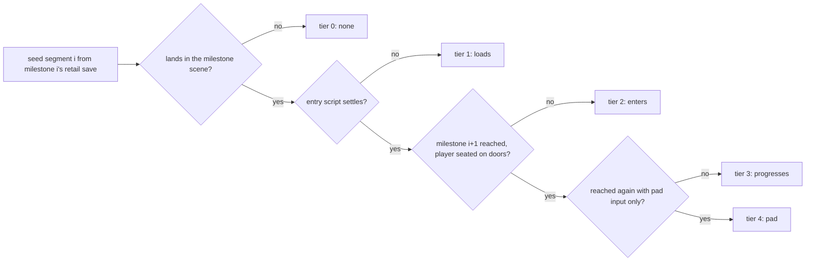

# Full-game ladder

The full-game ladder is a test that asks one question of the port: **from a cold New Game, how far through the whole story - to the ending credits - does the engine get, and where does it stop.** It cuts the story into segments between milestones, starts each segment from a real retail save taken at that point, and scores how far the engine gets toward the next milestone: does the save load, does the scene's entry script finish, can the story be advanced with the player placed on each door, and can it be advanced with pad input alone.

When a segment falls short, the report names the reason one level down - the script instruction that parked, the door gate that refused, the story flag that was never set and the disc records that set it - so a stall points at the next thing to fix.

- Test: [`crates/engine-shell/tests/full_game_ladder.rs`](../../crates/engine-shell/tests/full_game_ladder.rs)
- Spine: [`scripts/replays/full_game_spine.toml`](../../scripts/replays/full_game_spine.toml)
- Baseline: [`scripts/replays/full_game_baseline.toml`](../../scripts/replays/full_game_baseline.toml)



## Contents

- [How it relates to the other ladders](#how-it-relates-to-the-other-ladders)
- [The spine](#the-spine)
- [Segments and tiers](#segments-and-tiers)
- [The continuous run](#the-continuous-run)
- [How to run](#how-to-run)
- [How to read a stall](#how-to-read-a-stall)
- [Seeding](#seeding)
- [How the seated tier plays a segment](#how-the-seated-tier-plays-a-segment)
- [How the pad tier walks](#how-the-pad-tier-walks)
- [How fights are played](#how-fights-are-played)
- [Input conventions in both passes](#input-conventions-in-both-passes)
- [Diagnostics](#diagnostics)
- [What it cannot measure](#what-it-cannot-measure)
- [Route notes](#route-notes)

Terms used throughout: a scene's script records live in **partitions**, written `P0[n]` (placed props and doors), `P1[n]` (NPC and entry records) and `P2[n]` (walk-on and spawned records). A **walk-on band** is a run of tiles that starts a `P2` record when stepped on. A **story flag** is one bit of the system-flag bank, written `0x227`. Op `0x3F` is the field VM's scene change.

## How it relates to the other ladders

| Instrument | Question |
|---|---|
| [`critical_path_replay`](../../crates/engine-shell/tests/critical_path_replay.rs) | How far a pad run gets along the chapter-1 route, with no seating. |
| `chapter1_frontier_ladder` (parity) | Which chapter-1 scenes load, script, walk and leave - breadth. |
| chapter-2 / chapter-3 / boss spine oracles | Whether the pinned gates of one arc sequence through the engine. |
| **this ladder** | How far each stretch of the **whole** story gets from a real save there, and how far a cold New Game gets without help. |

The chapter ladders are deeper where they reach; this one is shallow and
wide. A stall here names where to point the deep instruments.

## The spine

The spine is the main-story milestone sequence, New Game (`opdeene`) to the
credits crawl (`edlast`). Each milestone names its scene and a **retail
anchor**: a save on one of the library's memory cards, by card file and save
name, or a catalogued save state, by `scripts/scenarios.toml` label and backup
fingerprint. The anchor's bytes are read at test time and never committed.

The ladder reads the anchor's **SC save window** - RAM `0x80084140` to
`0x80086140`, which is exactly the block a memory card stores
(`block_offset = ram - 0x80084140`; [`save-record.md`](../formats/save-record.md)).
A card save and a live state therefore yield the same thing: party records,
bag, gold, the system-flag bank at `0x80085758`, the scene label at
`0x80084548`, and the field position snapshot at `0x80084568` / `0x8008456C`.

The order is the anchors' own:

- The two playthrough cards are one run. Their play-time counters
  (`0x80084570`) and system-flag populations rise together across every save,
  so they order themselves.
- Chapter 1 before Mt. Rikuroa has no card save. Its anchors are states from
  several sessions, ordered by flag inclusion: a state whose set flags are,
  save a few optional ones, a subset of another's comes first.
- The ending anchor is a debug credits run, so it anchors the scene and is
  excluded from the order check (`order_check = false`).
- `west_voz_forest` (scene `vell`) is placed by the flag its entry writes,
  not by its anchor. `0x489` (setters `vell` P1[0] and `map02` P2[13]) is
  clear in every anchor through `dolk2_market_noa` and set in every card
  save from `PRO-01` on, so the playthrough's first visit falls between
  `drake_castle_revisited` and `voz_forest`. The anchor, `vell_fog_field`,
  is a door-tile poke from a state standing outside Rim Elm, so its flags are
  that state's plus `vell`'s three entry writes: it anchors the scene but
  neither the order (`order_check = false`) nor the next segment's seed
  (`seeds_next = false` - `voz_forest`'s segment seeds from
  `dolk2_market_noa`, the last save the run made before it).

Part A (`part_a_spine_is_anchored_ordered_and_routed`) re-derives all of it:
every anchor loads and sits in the scene the spine names, the flag-inclusion
order holds pair by pair, every reach flag is set in its own anchor, and the
route between consecutive milestones exists in the disc's scene graph. It
prints that route with its hop kinds:

| Arrow | Hop |
|---|---|
| `>` | A `0x3F` scene change a walk-on `.MAP` band reaches. |
| `=>` | A `0x3F` only a talk, touch or scripted record carries. |
| `~fmv~>` | An FMV hand-off (`4C E2 id`) from a walk-on record; the destination is retail's post-play dispatch (`FUN_801CEA3C`). |
| `~fmv=>` | An FMV hand-off from a record no walk-on band reaches. |

Routes are cheapest-first with walk-on hops preferred, so a `=>` in a route
means no all-walk-on route exists.

What "reached" means is per milestone: `scene` (in the scene, walking),
`control` (and the pad is back), or `flags` (and every reach flag is set).
`flags` is for two consecutive milestones in one scene. Each reach flag is one
the anchor gained over its predecessor that a clean **partition-2** SET site in
that scene writes, per the disc-wide system-flag census; entry-script writes
are excluded because they fire on every visit. Part A prints the candidates.
A `scene` milestone a scripted chain only passes through is reached on the
landing: the ending's `edteien` is one link of the credits chain that runs on
to `edlast`, and its anchor is a state taken mid-cutscene there.

A milestone may also name `via` scenes: story waypoints the anchors show the retail run passed through between the previous milestone and this one, and that the cheapest route skips. They are visited in order, each with its beats pass played, before the route heads for the milestone's own scene. Each carries a comment in the spine naming the flags that put it there:

| Milestone | Waypoints | Why the cheapest route is not the story's |
|---|---|---|
| Fire Path | `geremi`, Vidna, `ropeway2`, `geremi`, `stone` | `stone` holds the Star Pearl that opens the `tunnela` door; the cheapest route rides `ropeway2`'s elevator, whose door opens only after Xain. Zalan hands the pearl over only once `0x321` is up: Cara's meeting, which `ropeway2` P0[16] spawns (P2[18]). |
| Rogue Tower | `conc3` | Its P2[10] sets the `0x3E5` the `juui1` hand-off in `conc2` waits on. |
| Zora Castle | `nilboa` (its own start scene), then `deene` and `son` | Koru's fight thaws the overworld's way south ([route notes](#route-notes)). |
| Noaru Valley | `chitei2` (its own start scene), then `concend`, `jou` and `retockin` | `chitei2`'s chain ends on the `0x4C8` that opens the `map03` portal to `concend`; the way back from Drake was by land and cart, not the Uru Mais warp. |
| Sol Tower | `dohaty` (its own start scene) | Its P2[13] sets the `0x1D4` every `station` placement, the ticket seller among them, waits on. |
| Sol Tower B2 | `kor5` (its own start scene), then `koin2`, `koin4`, `koin2` | Gaza's first fight on Sol's roof ([route notes](#sol-tower)), then the [Sage's Gate errand](#an-errand-the-story-waits-on): the chests in `koin2`, the bread in `koin4`, then the chests again. |
| Zeto's dungeon | `vozz` (its own start scene) | A run that walks in from Drake arrives at `vozz`'s east mouth and can walk straight back out to `map01`, on the side `garmel`'s door is not; the way on is the Genesis Tree beat (`vozz` P1[7]), whose flight lands by `bylon`. |
| Sky Gardens | `garmel` (its own start scene) | `garmel`'s transport pads join the Songi band to the `map01` door, so the cheapest route leaves the dungeon; the story's way out is the Zeto fight (`garmel` P2[12], `0x198`). |
| Ratayu | `retona` (its own start scene) | A run that arrives at Mt. Letona's trailhead has reached the `mt_letona` milestone on its first step and would turn round; the anchor gained the summit chain (`0x354`..`0x357`, `0x367`). |
| Dohati Castle | `retock` (its own start scene), then `jagaroom` twice | Ratayu's west gate (`retock` P2[27]) turns the party back until `0x33E` is set. `jagaroom`'s entry script raises it only once Eliza's scene (`retock` P2[33], `0x33C`), the talk `jagaroom` P1[8] (`0x351`), the door cutscene `jagaroom` P2[8] (`0x33B`) and the return `jagaroom` P2[9] (`0x34F`) have played in that order. |

A milestone may instead name `continuous_via`: the waypoints part C plays in place of `via`, where a seeded segment starts past the story or its seated hand cannot play it. Dr. Usha's research and Nivora are its case, the chain the [Nivora route notes](#nivora) list: `korb3`, `map03`, `koin2` for the first (Sol's stone maze and Gaza's second fight, the Genesis Tree, Etora's password), and `doman`, Uru Mais and its three dreams, and `doman` again for the second; Gaza's second fight is that stretch's risk.

Zora Castle is another case: its seeded segment starts from an anchor whose flags the save bridge carries forward, but a run of its own has to raise the chain that opens `deene`'s dock (`nilboa`, `bubu1`, `koin1b`, `bubu1`, `deene`, `son`; [route notes](#overworld-and-dungeon-joins)), and Conkram's Past takes `son` for the crossing to `concnow`.

A waypoint whose own arrival script carries the party on counts as visited: `concend`'s P2[0] is its beat, and it ends in the hop to `town0d`. One that carries it straight back to the scene it came from was a stay, not a visit: `jiji`'s inn sleeps the party over in `ropeway`, whose arrival cutscene returns it to `jiji`. Part A checks every waypoint is a disc scene.

## Segments and tiers

One pad run cannot cross the game, so the ladder is **segmented**: segment `i`
seeds the engine at milestone `i` and asks how far it gets toward milestone
`i + 1`. Segment 0 is seeded by `BootSession::start_new_game` - the cold
opening, not a save. Tiers are cumulative:

| # | Tier | Cleared when |
|---|---|---|
| 1 | `loads` | The seeded save lands in its milestone's scene, Field or WorldMap. |
| 2 | `enters` | The entry script settles: the pad comes back, or the script leaves the scene itself. |
| 3 | `progresses` | The next milestone is reached by **seated** traversal plus the beats pass. |
| 4 | `pad` | The next milestone is reached with pad input only. |

A segment whose seed fails or lands outside its milestone scene, or whose
seated pass panics, scores tier 0, `none`.

Tier 3 and tier 4 are two separate passes over the same route. The seated pass ([below](#how-the-seated-tier-plays-a-segment)) proves doors, scripts, gates and the scene graph; the pad pass ([below](#how-the-pad-tier-walks)) repeats it from a fresh seed as a player would, and is the locomotion claim.

The **headline** is how many milestones a cold New Game reaches contiguously
at `progresses` and at `pad` - the count of leading segments that each cleared
the tier - plus the tier sum over all segments.

## The continuous run

Every segment above starts from the retail save taken at its milestone, so
it plays with the party, bag and gold a retail player had there. That scores
each stretch's doors and scripts. It does not say whether the engine's own
run *arrives* at a stretch able to clear it - with the levels it earned,
what it bought, what it still holds.

Part C (`part_c_continuous_run`,
[`full_game_ladder/continuous.rs`](../../crates/engine-shell/tests/full_game_ladder/continuous.rs))
asks that. It seeds one session with `start_new_game` and plays the pad
pass toward each milestone in turn, never re-seeding:

- The story state is the engine's from the first frame. The next anchor's
  **flags** still steer the beats pass - they are route knowledge - but
  nothing of an anchor's party or bag reaches the session.
- At each milestone reached it takes the engine's own save
  (`World::save_full`). After a party wipe it reloads that save, as a
  player would, with the same guard retry and reload allowance the pad
  tier has.
- It stops at the first milestone it cannot reach and prints the stall.

Its score is `[continuous] reached` in the baseline: the count of
milestones reached in order. The distance between that and the segmented
headline is the measurement - how much of each stretch's pass rests on
arriving with a retail player's party.

### What a continuous run exercises that a seeded one cannot

A seeded segment starts from state retail wrote, so anything the engine
would have had to write itself before that point is never asked of it. The
continuous run is the only pass in which those writes are load-bearing:

- **Scripted grants.** A flag, an item or an equipment change an earlier
  scene's script makes is in every later anchor, whether or not the port
  runs the op correctly. Op `0x3B` (`SET_EQUIP_SLOT`, how a Ra-Seru is put
  on and grows a stage) is the case in point: a port that mis-applied it
  still passed every segment, because each seed already wore the Ra-Seru.
- **Joins after a reload.** A member who joins takes a level-1 record from
  the SCUS starting-party template. A seeded segment's save already carries
  all four records (retail's New Game seeds them), so the join never reads
  the template. A run that reloads its own save, whose roster holds only
  the members who have joined, does - in a session where no New Game ran.
- **The pause menu's commits.** The seeded pad hand opens the Equip screen
  only to guard a boss's element. A hand that has to wear what it finds
  uses the Best Equipment row, whose swaps do not end the session and so
  travel a different path back to the record than a single-slot confirm.
- **Growth.** Levels, gold and the bag are whatever the run earned. The
  seeded passes flee every random encounter, which costs them nothing; a
  run that does the same reaches its first boss at level 1.
- **The shop screen.** No seeded pass talks to a merchant. A hand that buys
  drives the merchant's op `0x49` through the talk that reaches it, the buy
  list, the quantity stepper and the equipment recipient picker, and comes
  back to the same counter later. The picker's rows are the present party
  in party-list order (`FUN_801DB380`), and the talk parks on the shop op
  until the screen closes, then resumes past it.
- **The Point Card.** A run that opens Rim Elm's chest buys with the card
  held from chapter 1 on, so every purchase runs the accrual and the toast
  ([below](#how-the-continuous-hand-plays)).
- **Captured Seru.** A party that fights learns Seru magic and casts it, in
  rounds where another member's strike may land first: a cast queued at a
  monster that has since died goes through the turn picker's dead-target
  redirect (`FUN_801DB124`'s Magic arm) like a strike does.

### How the continuous hand plays

The continuous hand is the pad tier's hand plus what a player who means to
finish the game does between fights. Everything below is off in the
segmented passes, which play exactly as the sections further down describe.

**On arrival in a field scene**, before it heads for the next door, it runs
one upkeep pass, in this order:

1. **Shops.** It walks to each placed NPC whose record (or a record it
   spawns) carries a priced stock list (op `0x49` sub-0) and talks. The
   ladder plays the host's part for the screen: it opens the staged shop in
   a menu runtime of its own (`MenuRuntime::open_field_overlay_requests`),
   steps it on pad edges with the field frozen
   (`MenuRuntime::step_field_session`), and lets the merchant's record
   resume once the screen has closed. It buys three healing items for each
   present member first, then the affordable piece of equipment that
   improves a present member's slot the most (through the recipient
   picker, which equips it on the spot), then healing items up to fifteen
   for each present member. The stock is counted in Healing Flowers' worth
   (800 HP each), not in items: counted by the item, 38 Healing Leaves read
   as a full stock, and a run that bought seven Flowers at `rayman2` met Van
   Saryu (`jagaroom`) with none. A counter whose stock list sells a healing
   item is visited ahead of the others: `retock`'s arms dealer (P1[34])
   took 46800 of 49991 gold before its item counter (P1[36]) was reached,
   and the party met Dohati with one Healing Flower. At a counter that
   sells no healing item, a bag short of its three keeps 300 gold back for
   the counter that does. A merchant is visited again only with a
   different purse or bag, or once a counter the story had closed has
   opened ([below](#a-counter-the-story-has-closed)).
   A heal is ranked by HP restored per gold, and a full restore (the
   Healing Berry, "Restores maximum HP") counts as a present member's
   maximum HP: `doman`'s counter, the last before Nivora's three solo
   duels, sells no other restorative. At a counter that sells a heal, a bag
   under its fifteen a member first sells the armament no member who has
   joined (present or not) is better off wearing, whole stacks, as the
   errand rule below does for gold. A sale the screen does not complete is
   struck off that visit's list rather than ending the visit: ending it
   there left `rayman2`'s item counter with a purse of 20000 and two
   Healing Flowers bought.
   A purse that pays for that stock four times over buys up to three
   stocks, and MP restoratives beside them: past Jette's fortress the run
   carried 650000 gold through `ropeway` and `station3` with its stock
   full, met no counter after them, and fought Cort out of an empty bag
   with Vahn at 22 MP.
2. **Equipment.** Start, Equip, each member, the Best Equipment row. That row ranks only the four armament slots, so the hand then fills each member's empty Goods slots from the bag, best passive first (HP, attack and arts boosts ahead of guards), never two of one passive on a member and never Rage, Zero Defense, Last Attack or No Escape.

   Best Equipment (`FUN_801CF760`) ranks a weapon by its stats alone, and a weapon outside the wearer's class raises the arm command's AP cost ([`arts-command-gauge.md`](../subsystems/arts-command-gauge.md)): the Astral Sword costs Vahn 54 a swing, his nine-command art no longer fits a turn, and Koru (`nilboa` P2[20]) outlasts him. So after the row the hand reads each member's arm cost off its player battle file, the way the battle loader does (`swing_command_costs`), and where a weapon in the bag swings cheaper than the one worn it puts that one on (Start, Equip, the member, the weapon row, the weapon, Yes), the best attack among equally cheap ones.
3. **Rest.** Under four fifths of its HP in a scene that rolls no
   encounters, it takes the scene's rest: a bed's walk-on band, or a
   keeper whose record runs the `4C 82` restore. A keeper's offer is a
   picker, answered with the option whose branch reaches the restore
   soonest. Where encounters roll, only a rest within 32 tiles is worth the
   walk, and only to a party under half.
4. **The scene's story.** It plays the beats pass
   ([below](#the-beats-pass)) without waiting for a door to refuse, for up
   to twelve rounds while a round still gains a flag (a staged talk plays
   one stage a contact: `cave01` P1[2], Terra, raises `0x158`..`0x15E` one
   talk at a time). Outside the milestone's own scene this pass walks only
   the bands that carry the story - a record that raises a still-clear flag
   the anchors ahead carry and that nothing in the scene lowers again. A
   room marker is raised on the way in and cleared on the way out, and
   crossing a dungeon for one costs fights and buys nothing.
   The extra rounds past the segmented pass's three go on only while a
   round raises a flag the pass has not seen up before: a room marker
   toggles with every walk across the scene (`bylon`'s `0x528` / `0x529`),
   and a round that only moved those gained nothing.
   When a hop out of a scene skimmed this way fails, the scene is owed the
   segmented pass's full one: `retona`'s wall switches P2[4] / P2[5] raise
   only room markers and are the way down from the summit, and `doman`'s
   P2[1] walk is what carries the party to the side of the `map03` door,
   and `taiku`'s way back to `map03` raises no anchor flag either.
5. **Training.** While a present member is more than a level short of the
   target, and the scene has a rest, it trains from that bed: out to where
   the encounters roll (the scene itself when its rest is close by, else
   the next scene of the route), walking legs and taking the fights it
   prices as winnable until a member is under 55%, then back to the bed. It
   spends nothing from the bag on those legs. When the levels are there it
   shops and rests once more and moves on. A walk that stalls ends the
   training, not the stretch, and an outing leg that does not arrive sends
   the next one somewhere else.
   A bed that stops working leaves the bag in its place
   ([below](#a-rest-that-stops-resting)): a party short of the levels the
   next boss is beaten with does better with them than with the
   restoratives it would otherwise carry in.

**At a waypoint** the hand plays the waypoint's story, not this upkeep -
except that a party walking in with under half its stock of heals (fewer
than seven a member) stocks up and rests first. `retock`'s beats lead
straight into the `jagaroom` fight (13245 HP); a party that arrived there
with no heal, next to no MP and 36000 gold lost it six times. `son` is the
dock the boat lands at on the way to `taiku`, the last counter before Zora
(F9, 22422 HP, a party-wide breath every other round): a party that passed
it with eight Healing Flowers and 52000 gold fought Zora out of an empty bag
and lost three times in four.

A talk or a stay that carries the party out of the scene (`dolk2`'s inn
plays Noa's dream and brings it back) leaves the rest of the pass for the
return: the scene's story and its training still follow. A stay taken
during the training itself (a keeper whose rest plays the same dream)
brings the party back to the training alone, without the arrival pass
again; a party whose training ended at that dream walked on to Voz levels
short and wiped on the Genesis Tree's fight.

The **level target** is the anchors' own curve: each character's level in
the anchor five milestones ahead, read only as far as every later anchor
agrees with it (several chapter-1 anchors are other sessions), and leaving
out the anchors outside the order check. Five ahead, because a party is
trained where the rests are, not inside the dungeon an anchor was saved in.
Near the end of the spine the fifth milestone ahead carries no party (the
ending's anchors are the debug credits), so the target is the furthest
anchor within five that does: Biron's castle, levels 50..53, for the
stretches from Jette's fortress on. Without it those stretches trained to
nothing and the run met Songi in `noaru` at level 40.

A scene whose beats include a staged fight trains before them, since the
beats walk into the boss, and so does a scene with a bed while a member is
five or more levels below the target. `conc3` is the last bed before
Rogue's tower, Jette's fortress and Cort (`chitei2`, 50000 HP), and its
boss band is already down when the run arrives: a party that left it at
level 35 lost to Cort six times, one trained there to 41 beat him first
time.

**It opens the chests the retail run opened.** A placed chest (a
partition-0 record that gives an item) whose flag an order-checked anchor
up to five milestones ahead carries is a beat wherever the run stands,
not only when the next anchor carries it. The Point Card is the case:
`town0c` / `town0d` P0[17] (`0x10F`) lies in Rim Elm, and the playthrough
first holds it at Mt. Rikuroa, past every visit the next-anchor rule makes
there. Holding it, every buy credits the card's points
(`World::credit_point_card`, `FUN_801DB7F4`'s accrual arm) and parks the
shop on the card's toast (window 31) until a confirm, which the hand
presses. The run's `[point card]` line prints whether the card is held,
the bank and the toast edges pressed.

**Which beats it plays** is still the next anchor's flags. One exception:
standing early in the scene of the milestone after next, it plays toward
that milestone's anchor as well. Noa's stretch begins in `cave01` during the
stretch that ends at `ravine`, whose anchor is another session's and
carries none of the cave's flags.

**In a fight** it takes the random encounters it expects to win. At each
round prompt it prices the fight - what the foes still hold, times what the
run's fights have cost so far in party HP per foe HP, times `(n + 1) / 2`
for a group of `n` - and fights while that is under three fifths of what
the party has left. The exchange rate is learned across the whole run, so
the hand takes on larger groups as the party levels and gears up, and a
fight that turns goes back to Run on the next prompt. A member under a
quarter of its HP makes every encounter a run, whatever the sum says: the
first round that finds it drops it, and a fight's revive sets the fallen at
1 HP. Priced on the sum alone, `concnow` after Zora's fight was taken on
1 + 1 + 1708 HP, and the next surprise round wiped the party.

**Its MP is for the fights it cannot run from.** In a random encounter a
member casts only a spell that leaves it half its MP; a fight that forbids
running is cast at freely.

**It aims.** A strike, an Arts string or a damage cast at one foe goes to
the foe the hand picks, not the one the target cursor opens on (the
member's last target while it stands): a cast to
the standing foe the element matrix lands it hardest on
(`matrix[summon creature element][foe element]`, `FUN_801DD864`), a strike
and a tie to the standing foe with the least HP left. It steps the cursor
there with Right, which runs retail's angular attack-target ring
(`FUN_801D8A88` builds it from the seats, `FUN_801D8D00` steps it), and
confirms where the cursor stands after a dozen presses that have not
brought it there: the ring covers four seats, and a fifth foe (a Divide
clone) is one no cursor reaches while the four below it stand
([`battle-command-flow.md`](../subsystems/battle-command-flow.md#the-cursors-opening-and-the-fifth-seat)). The spell it casts is chosen against the same best foe. The
segmented hands confirm the opening slot, so in them the ring is never
stepped. The run's `[aim]` line counts the frames spent asking for a step
and the commits that landed off the opening foe, and checks the engine
underneath: a strike confirmed on a foe must dispatch
(`World::dispatch_pending_party_action`) against that foe while it stands -
the cursor, the commit and the actor's target byte `+0x1DD` are three writes
of one value. Each strike that dispatched elsewhere prints its member, the
foe confirmed and the actor struck; a foe that fell first is the dead-target
redirect's (`FUN_801DB124`), and a confused member's strike is retargeted at the dispatch (`FUN_801E7320`); neither is counted.

**Its bag is for the fights.** On the road a party of two or more spends a
restorative only under 45%, a lone member under 65%; it does not open the
menu on an empty bag. It heals with spells first: Start, Magic, the caster,
the spell, the weakest member or the group confirm, through the engine's own
field cast (`apply_spell_outcome`, the discounted MP debit and the heal),
picking the cast that restores the most across the party's deficits. A
caster spends only the MP above three fifths of its pool there - the line
the bag tops MP up to before a staged fight, so a cast on the road is never
paid for with a Magic Fruit at the boss's door - and all of it once the bag
holds no restorative: the run met Koru (`nilboa`) with an empty bag, two
members near death and every Spoon unspent. On the way to a boss an empty
bag's MP is the boss's, except when a member is under a quarter of its HP:
the Delilas duels hand `nivora_late` a party with Noa at 1 HP and no bed in
`nilboa`, and a hand that kept the MP lost Koru's race five times running
with her down from the first round. A rest is taken for low MP as
well as low HP (the lower of the two gauges reads against the line): a run
that reached Nivora's duels with Gala at 54 of 346 MP lost Che's on every
stream. Before a staged fight it wears what the last chest
held, takes a rest that is close by, and opens the bag only under three
fifths - for HP, and for MP when the member lowest on it is under three
fifths, since the casts are half of what a boss is beaten with.

**On the way to a boss it runs.** In a scene whose story waits behind a
staged fight on a walk-on band, the beats pass takes no random encounter
(training outings excepted): the party's HP and bag are the boss's.
Dohati (`dohaty` P2[10], 17200 HP, a party-wide breath every third round)
is met at the end of a castle the hand had been fighting its way through:
it arrived at a third of its HP with the Healing Flowers spent on the
road, and lost six times.

**Its options travel with its saves.** The options screen's words, Field
Move among them, are part of the save as on a retail card (SC `+0x58C`;
[`save-screen.md`](../subsystems/save-screen.md#what-a-card-load-restores)),
so a wipe's reload, a checkpoint kept under `LEGAIA_FGL_CHECKPOINT_DIR` and
a seed from an anchor all play the Field Move their save was written with.
Walking instead of running misses `jouind`'s timed switch pair on every try.

**It runs when walking is what holds it.** A New Game walks, and the
playthrough's player switched Field Move to Run by Mt. Rikuroa (every
order-checked anchor from `mt_rikuroa` on holds `1` at SC `+0x58C`). The
continuous player keeps walking until a stretch stalls short of a wipe in
a stretch whose anchor runs; then it sets Run, reloads the stretch's save
once and keeps running - setting it again on any reload of a save from
before the switch. Running from Mt. Rikuroa on re-dealt the whole
middle of the game, and a runner meets corners and stones differently: it
wedged in `ropeway` at (24, 27), and Sol's lower floors closed off Gaza's
second fight (`korb3` P2[2]). Held back, it first switches on at
`jouind`'s switch pair.

**It waits on a running clock.** A hop that fails while the field's op
`4C D3` countdown is armed (`FUN_801D2EBC`, read from the engine), with its
expiry flag still clear, is the story waiting on the clock: the hand stands
still until the countdown runs out, then looks at the scene again.
`chitei2`'s collapse is the case: its expiry flag `0x4C7` is what the entry
script's `0x4C8` hand-off tests, and no record on the disc sets it.

### Talks the story reaches from elsewhere

- **A dry talk is asked again.** A talk that ran and raised nothing is
  remembered with the state of the system flags its record tests, and is
  tried again in the same round once a later talk has moved one of them,
  before the round's walk-ons can carry the party off. `doman`'s P1[3] has
  nothing to say until Dr. Usha (P1[15]) has raised `0x379`, and the band
  walked after her talk rides the lift up to the street.
- **A record that polls a box is stood in.** A partition-1 record whose
  first instructions box-test the player (`CD F8`) runs its story while the
  player stands in the box once its talk has armed it. When its record
  raises a still-clear flag the next anchor carries or a partition-2 record
  of the scene tests, the hand talks to it, steps into the box, and then
  straight onto the band that waits on what it raised. `doman` P1[18], Dr.
  Usha's intercom at (40..41, 81), asks for the password and calls the lift
  (`0x371`); the lift band P2[7] (41..43, 83) loops on `0x371` and rides the
  party down to the lab. Walked in record order, P2[3] would send the lift
  back up first; after the ride the round's other walk-ons wait for the next
  round, whose talks come first.
- **A talk gated on a member standing in a box** is played from a split
  party (`43 02`): when the talk's record tests a clear flag the entry
  script raises inside a player box test, the leader walks to the box's
  middle (the entry script carves its edges out with half-tile `4C E4`
  tests) and hands control on with Square, each member in turn, until the
  flag stays up behind it.
- **A dream is a visit.** A waypoint whose arrival script carries the party
  straight back where it came from counts as visited when the stay moved a
  system flag (`urudre3` P2[0] raises `0x3F4`, on which `uru`'s entry script
  plays the waking).

- **A story talk in another room is crossed to.** At a waypoint, a story
  talk outside the player's walk component is reached by a round trip
  through a neighbouring scene that lands on its side, errand talks first
  ([below](#an-errand-the-story-waits-on)): `koin2` P1[19], Emperor Etora,
  gives the password from the throne room at (20, 9), off another `kor` door.

What it still does not do: sell outside an errand, use magic outside
battle, or leave the cheapest route for a chest that sets no flag an anchor
carries.

### A maze of stones and closers

`korb3`'s maze ([route notes](#sol-tower)) and the two box tests on the way
to Nivora set four rules the continuous hand plays by:

- **It opens a gate only from where it can walk.** A gate stone (a prop
  whose touch clears walls, `4C 70`) is examined from a tile beside it that
  the walk reaches from where the party stands, so the maze opens gate by
  gate from the hall the party arrives in; a stone it cannot reach waits
  for a round in which an opened gate leads to it. Other props are examined
  from any side, as the segmented passes do. A seat beside the tile the
  prop's centre lies on counts too, walked up to until the facing probe
  reaches it (`korb3` P0[3] is examined from the corridor at (47, 31)). A
  stone whose walls are all clear already is left alone: it would only arm
  the band on the near side, which walls the gate up in front of a party
  walking through. A walk that a prop's box holds a few units off the
  corridor's centre line, where the tile's centre is clear, steps back onto
  the line instead of pressing on (the follower's dead band otherwise
  ignores so small an offset; P0[3] stops a walk 8 units west of it).
- **A switch stays solid after its press.** `korb3`'s switch P0[18]
  opens its partner with `B1 13 00`, which `FUN_8003C83C` resolves to
  object `0x13` (P0[19]), not to the switch, so the switch's own box
  (centre `(4800, 4720)`, half-extent `0x50`) still blocks. A walk north
  from the hall stops at Z `4862`, where the leading probes 64 units ahead
  touch the box, short of the centre `4832` of the cell the lattice turns
  east from. The planner therefore enters a cell only when the probes from
  its own centre clear the bodies ahead in the direction it is entered
  from, the goal cell excepted.
- **NPC bodies never seal a pocket on their own.** The same probe test
  around a standing NPC is coarser than the locomotion, which slides past
  a body at sub-cell offsets the lattice does not hold. `deene`'s entry
  corridor reads sealed by P1[4] and P1[5] at (18, 46) / (17, 46), yet the
  player leaves it between them at (17, 47). A plan the NPC bodies alone
  keep from its goal is searched again without them, and the follower's
  stall handling answers a body that does block. Without it the hand left
  the corridor only when a talk's step-away happened to cross the gap,
  which the run's timing decides: from the same tile, with the same NPCs,
  the lean onto P1[4] faced it on one display-frame parity and P1[5] on
  the other, so a fight that ran an odd number of ticks longer stranded
  the party there.
- **A closer is no beat and no obstacle.** A walk-on record that raises no
  system flag, lowers one the next anchor carries and walls tiles up
  (`4C 71`; `korb3` P2[4..13]) is never walked as a beat, and a walk may
  cross one: the bands one step past each gate stand on the only way
  through it. A band that lowers a flag without walling anything keeps the
  ordinary rules (`rikuroa`'s terrace hops).
- **A box test reads the actor's own tile.** A script's `CD` box test
  compares `(x - 0x40) >> 7`, half a tile off the dispatch tile a walk
  arrives in, so the hand steps onto the box tile's middle. `doman` P1[18],
  Dr. Usha's intercom, runs its password exchange (the code lock, then
  `0x36E` and the lift's `0x371`) for a player standing in (40..41, 81). A
  box record whose only raise is a flag the scene lowers again (the lift)
  is stood in only while a story talk waits in another walk component.
- **A box held by a member.** When the entry script tests a named member's
  actor on the same box as the leader's (`nilboa`'s `CD 31`), that member
  takes control and walks in, and control passes on until a leader stands
  who can walk to the talk; the talk's actor is read again after every swap,
  since the swap's own record moves it.
- **A split party's stones come first.** Inside an armed three-actor talk a
  gate stone may stand in another member's part of the map, and the band at
  the end of a member's tunnel ends that member's part: the swap passes it
  by from then on. So each round plays the gate stones before its walk-on
  bands, handing control on with Square until a member can walk to the
  stone. `nilboa`'s Shield Control Panel (P0[6], `0x458`) and the snowball
  over the gap (P0[10], `0x475`) stand in the Wind Ravine member's tunnel and
  clear the walls in the other two; walked after that member's tunnel end
  P2[2], neither was reached again and P2[1] / P2[3] lay outside every
  member's walk component.

### An errand the story waits on

A stretch can wait on an item the party has to buy. `kor`'s guard dogs
(P1[9] / P1[10]) stand in the `korb2` doorway until `0x40A`, which `kor`
P2[10] raises; the Sage's Gate (`kor` P1[13]) spawns it once all eight of
`koin2`'s Sage's Treasure Chests (P1[8..15]) have raised `0x40B..0x412`, and
each chest raises its flag only when it is handed a Soru Bread: it asks the
bag with `4C DC B2` and takes the loaf with `4C 52 B2`. The one gold counter
that sells the bread is Soru's Bakery in `koin4`, at 6000 a loaf. The
retail anchors carry the chests fed and a 99 999 999 purse; a run of its
own arrives with a few thousand.

The hand reads such **errands** off the disc: for every flag the next
anchor carries, the records of the stretch's waypoints and milestone scene
that set it, and of those, each one that takes an item from the bag. While
the bag is short of an errand's copies:

- **Its talks are played wherever they stand.** The chests stand in five
  rooms of `koin2`, each entered by its own `kor` door (P2[1..5]), so a chest
  outside the player's walk component is reached by a round trip through
  `kor` that lands on its side ([crossing scenes](#crossing-scenes)). The
  first contact hands over the chest's own item and raises its
  `0x413..0x41A`; a talk that runs and raises nothing is not crossed to again
  until the bag holds more of the errand's item.
- **So are a waypoint's boss bands.** A live walk-on band in a waypoint
  whose record raises a flag the next anchor carries and stages a fight
  (itself or through a record it spawns), standing outside the player's
  walk component, is reached the same way, up to three round trips a visit.
  Any band is too many: crossing to every far band of `uru` replays its
  dream bands out of order and walls off the `urudre1` door. `chitei2`'s Jette fight (P2[13] at (18, 89), `0x4C4`) lies past
  the car from the side `deroa` P2[3] re-enters at (93, 108); the `0x4C8`
  its aftermath raises opens `map03`'s portal to `concend`.
- **It sells what the party has outgrown.** At any counter, an armament
  piece no present member is better off wearing - worth less, summed over
  its stat bonuses, than what each member who can wear it wears in its slot,
  and for a weapon no cheaper to swing ([`arts-command-gauge.md`](../subsystems/arts-command-gauge.md))
  - is sold, the whole stack, before anything is bought.
- **It fights for the rest.** While the purse plus what the outgrown pieces
  sell for is short of the errands' price, it trains as it trains for
  levels, from a bed or, with no bed in reach and heals in the bag, from the
  bag; `kor` rolls the encounters the floors above it do not. The price it
  fights for includes refilling the bag to its fifteen heals a member, at
  the price of the heal that restores the most per gold: training from the
  bag spends the heals the next boss is fought with, and a run that stopped
  the moment the bread was paid for, then bought armour with the rest,
  met Gaza's second fight (`korb3`) with one Healing Flower.
- **It keeps the price back.** A counter sells it the errand's item first;
  heals and equipment come out of what is left over the price, and the
  item is never used as a heal (a Soru Bread restores HP). Equipment also
  leaves the heal refill's price in the purse, and once a counter has sold
  the errand its item the counters that sell heals are visited again with
  the change. Once only the refill is still owed, the fighting stops at the
  bag's three heals a member: training from the bag spends the heals it is
  fighting to buy back.

The waypoints put the stretch in order: `koin2` for the chests' first
contact (and the gold), `koin4` for the bread, `koin2` again to feed them.
`kor` P1[13]'s talk then raises `0x40A` and the doorway is clear.

### A rest that stops resting

A keeper's record carries the `4C 82` restore on one branch of its story,
and the hand finds rests by the op, not the branch. `cave01`'s Terra (P1[2])
restores on the `0x15C` stage; once `0x15D` / `0x15E` are up her talk sends
the party on toward Mt. Rikuroa and restores nothing, and the overworld
past the cave's mouth does not reach a town in that stretch. A rest the hand
takes under its line that lifts nobody is remembered as dry, keyed by the
state of the system flags its own record tests, so the hand stops walking
to it until one of those flags moves; a room marker or latch the record
never reads does not reset it.

Training from a home whose every rest is dry heals from the bag instead
(the field menu, to nine tenths) and goes on while the bag lasts. Before
this, Noa's training ended at the first outing that left her under three
fifths, and how far she got was the rand stream's: on eight dealt streams
from the run's own `snowdrift_cave` save she reached Caruban at level 5 or 6
on six and at 8 (the target) on two, and only those two cleared him. With
the bag standing in, all eight reach level 8, and seven clear him (six on
the first try); the eighth stalled before the fight on the mountain's
`P2[45]` / `P2[60]` terrace pair, which the planner reads as ledge hops
([below](#how-the-pad-tier-walks)). Caruban (1024 HP, about 150 a round on one member) outlasts a
level-6 Noa and level-5 Vahn by one or two rounds; a level-8 Noa ends the
fight first.

### A counter the story has closed

A merchant's talk can run and sell nothing. `dolk2`'s Arms Dealer (P1[11])
and Tool Dealer (P1[12]) each test `0x27D` ahead of their shop op and, while
it is up, call out their sale and loop back. The flag is the festival's:
the market's walk-on band P2[11] raises it (with its own latch `0x27C`) the
first time the party crosses `(69..71, 94)` after Caruban, which is on the
way to both counters. The keepers P1[13] and P1[46] test it too. Three records
lower it again: P2[14], the last stage of Noa's talk ladder (P1[2] raises
`0x2FE`, then `0x2FF`, then spawns it), and P2[16] / P2[15], which the gate
bands P2[0] / P2[1] spawn in place of their scene change while it is up.

So when a talk opens no shop screen, the hand reads the merchant's record
for a system flag it tests that is up and that some record of the scene
lowers, and plays what lowers it: first the NPC whose record, or a record
it spawns, does (one stage a contact, up to six), then a walk-on band whose
record does. It then goes back to the counters. A counter still closed
after that is remembered with the flags it was closed on, and the hand
looks in again before it leaves the scene once one of them has come down.

### Budget

A stretch has the pad segment's walking budget, a quarter of it again for
each waypoint (the stretch to Nivora has eight: `doman` twice, Uru Mais
three times and its three dreams), and four times its battle allowance: this hand takes the fights it can win, so a stretch's battles
run long past the fleeing hand's. Its hop budget counts hops only: a
scene's arrival pass and the scripted rides its rests and outings come back
on (`retock`'s inn plays the dream and returns) are bounded by the frame
budget instead, or a stretch that trains on the way (`dohaty` to `kor5`)
runs out of hops on the right route.

### The carried-state diff

Under `LEGAIA_FGL_TRACE` the run prints, at each milestone reached and at
the stall, the engine's own state beside the retail anchor's for the same
milestone: each member's level, XP, HP, MP and equipment bytes, the present
party, gold and the bag, then the flags each side holds that the other does
not. It is the instrument that tells an engine defect from a weak party:

| The diff shows | Reading |
|---|---|
| An equipment byte or bag item retail holds and the engine never gained | A scripted grant: find the op that writes it in the scene the anchors bracket. |
| A member present in the roster with no record line (zero max HP) | A join that found no template row. |
| Lower level and XP, same equipment | Growth: the hand fled or the fights paid nothing. |
| Flags the anchor has and the engine lacks | Beats retail played that the hand walked past; optional ones (a chest, a talk) show here too. |
| Flags the engine has and the anchor lacks | A beat retail had not played yet, or a latch. |

Chapter-1 anchors come from several sessions, some with cheat-seeded
parties (three members before the story joins them, a full bag), so a line
of the retail side is evidence only where the next anchor agrees with it.

### A milestone reached with a fight committed

A milestone can be reached between a record's `3E FF` and the fight it
commits: `jouine` P2[5] is the arrival cutscene, it commits Cort, and the
milestone (`cort_chamber`, reached on arrival) holds while the battle
intro has yet to run (`World::field_scripts_held_for_battle`). A save there
carries the flags the record set past the op but not the fight, and a
reload of it seated the party on the epilogue's walk-on band
(`jouine` P2[2]) with Cort unbeaten. No retail player saves on that frame,
so the run keeps the save it already had, and a wipe after it reloads that
earlier save and plays the stretches between again, each as itself, with
the failing stretch's attempts carried over. The scene is remembered as one
whose door leads to a boss - and the spine marks the one it knows of
(`arrival_fight = true` on `cort_chamber`), route knowledge like the
waypoints, so the first visit is ready too - and a hop into it goes through ready
(`pad_ready`: the last chest's gear on, a rest close by), and then full on
HP and MP from the bag, since the fight starts as the door lands.

Cort is the case. Its first turn of party-wide damage is about 2500 a member
(a `0x70` hit on all three seats; its MP falls 100 a cast and 255 for
Doomsday, as the boss table lists), and a party that walks in from
`jouind`'s fights at three fifths loses two members to it. The hand then
spends every turn reviving one member at a quarter HP into Cort's next
strike, and wipes. The reload walks in full: the same cast (2700..3100 a
member on that stream, the guard against Cort's element byte `7` worn or
not) leaves every member standing, and the bag heals between casts. That
is the hand's first sight of the fight, not an engine fault the trace
shows.

### A later start

`LEGAIA_FGL_CONTINUOUS_FROM` seeds the run once from a later milestone's
anchor. Its first stretch is the seeded pad pass played by the continuous
hand; every stretch after it starts where the engine's own run arrived,
which is the scene's door rather than the spot the retail save was taken
at. A stall on a second stretch is therefore read against the anchor's
position before its flags:

| The stall shows | Reading |
|---|---|
| The milestone was reached in a second or two and the next hop has no path | A `scene` milestone reached on arrival: the stretch's story lies deeper in the scene and the cheapest route walks back out. The start scene becomes a waypoint of the next milestone. |
| A reach band or a door a walk component short, in a dungeon the seeded segment starts inside | The way through is a link the planner does not model (a pad, a ride, a switch). |
| `party wiped` on a boss the seeded segment beats | The party the run carried in: levels, MP spent on the way, what it wears. |
| `battle unresolved` with no `[commit]` and no `[hit]` to the end | The engine parked: read the action state and the last commits. |

Only the last is an engine defect on its face. The flags a run holds that
its anchor lacks are mostly positional - the entry scripts' zone and camera
bands (`garmel` P1[0] keeps `0x527`..`0x52E` and `0x19D`..`0x1A5` for
where the player stands) - and `LEGAIA_FGL_SITES` names the record behind
any that is not.

[`scripts/ci/play-depth.py`](../../scripts/ci/play-depth.py) prints this
figure beside the retail-compare image floor, from the committed baselines.

## How to run

The extracted tree and the save library default to `extracted/` and `saves/library/` under the repo root. They live only in the main checkout, so a worktree points at them:

```bash
LEGAIA_EXTRACTED_DIR=/path/to/extracted \
LEGAIA_SAVES_LIBRARY=/path/to/saves/library \
cargo test -p legaia-engine-shell --profile release-test \
  --test integration full_game_ladder:: -- --nocapture --test-threads 1
```

`LEGAIA_DISC_BIN` must be set; without it, or without either tree, both parts print `[skip]` and pass. `LEGAIA_SCUS` defaults to the extracted tree's `SCUS_942.54`.

| Variable | Effect |
|---|---|
| `LEGAIA_FGL_ONLY=<id>,...` | Runs only the segments ending at those milestones, and does not assert the baseline. |
| `LEGAIA_FGL_NO_PAD=1` | Skips the pad tier. |
| `LEGAIA_FGL_RNG_SEED=<u32>` | Re-seeds the world rand stream once a pad segment is seeded, dealing it another hand. Part C takes it at its New Game (or the checkpoint it resumes) and mixes it into each wipe reload, and asserts the baseline's `[continuous_seeds]` row `seed_<n>` when it has one (see [the seed set](#the-seed-set)). |
| `LEGAIA_FGL_SEATED_RNG_SEED=<u32>` | The same for the seated pass - how a seated boss fight is checked across streams. |
| `LEGAIA_FGL_PIN_RETAIL=1` | Pins every fidelity toggle to retail's value (`WorldToggles::pin_retail`) in each session the ladder opens, so both parts measure the retail-faithful mode. The gameplay difference from the defaults is the ledge-hop landing guard, off; the rest is presentation. |
| `LEGAIA_FGL_CONTINUOUS_FROM=<id>` | Starts part C at that milestone, seeded once from its retail anchor and never again, and does not assert the baseline. A probe for a later stretch's carried state; the party it sets out with is retail's, so it is not the continuous score. |
| `LEGAIA_FGL_CHECKPOINT_DIR=<dir>` | Part C keeps the engine's own save at each milestone it reaches in that directory (`<id>.lgsf`, with the scene, rand stream and learned exchange rate beside it). The saves hold disc-derived state: keep the directory under `target/`. |
| `LEGAIA_FGL_CONTINUOUS_RESUME=<id>` | Starts part C at that milestone from the save an earlier run kept there, and does not assert the baseline. The party is the run's own; the picker rotation and the shopping memory start fresh, so a stall it shows is confirmed on the full run. |
| `LEGAIA_FGL_CONTINUOUS_UNTIL=<id>` | Ends part C once it reaches that milestone, and does not assert the baseline: with `LEGAIA_FGL_CONTINUOUS_RESUME` and a spread of `LEGAIA_FGL_RNG_SEED` values, how often one stretch clears. |

### The seed set

One stream's part C score can rest on a fight the hand only won by the
deal: a change that shifts one draw re-deals every later encounter and boss
turn. `[continuous_seeds]` in the baseline records the score on other
streams, one row per `LEGAIA_FGL_RNG_SEED` value, and a dealt run asserts
its own row `>=` (a seed with no row falls back to `[continuous] reached`).
Each run is a full New Game, about twenty minutes, so the set is run one
seed at a time:

```bash
for s in $(seq 3 16); do
  LEGAIA_FGL_RNG_SEED=$s cargo test -p legaia-engine-shell --profile release-test \
    --test integration full_game_ladder::continuous:: -- --nocapture --test-threads 1
done
```

Zora (`taiku`) is where the set was fragile: seed 5 stopped there at 26
before the fighter learned to guard against Stone
([the boss section](#a-boss-the-anchors-party-cannot-outlast)). Cort takes a
second attempt on most streams, as the Cort notes above describe.

The ratchet asserts every per-segment tier, both headline counts and the tier sum `>=` the baseline. Raise the baseline in a reviewed edit from the block the run prints; never lower it to make a red run green. The trace and debug switches are under [Diagnostics](#diagnostics).

## How to read a stall

Part B prints one table row per segment and a stall list. Each stall line is
one level down from the tier that failed:

| Line shape | Meaning |
|---|---|
| `seed: ...` / `seed landed A in <mode>, milestone scene is B` | The resume failed, or did not land walking in the milestone's scene (tier 0). |
| `entry script never released: <holder> at <ctx> pc=.. op=..` | The pad holder - cutscene timeline, dialogue, spawned record - parked on that instruction for a whole window. |
| `hop A -> B: no walk-on door to B (...)` | Scene A's `0x3F` to B is carried by a talk, touch or scripted record; seating cannot trigger it, and no talk the ladder can find leads there. |
| `no walk-on door to B; talks that lead there did not leave: ...` | A talk whose record (or a record it spawns) names B ran, and the scene stayed. |
| `hop A -> B: no overworld portal to B installed (...)` | The overworld seeder installed no portal to B under the live flags; the portal set is printed. |
| `N door(s) to B, none fired: ...; sites: P2[r] gates FAIL: 0x.. clear` | The door record's C1 / C2 story gates (retail `FUN_8003BDE0`) refuse it; the failing flags are named. |
| `B is reached by an FMV hand-off from record(s) {(p, r)}` | The hop is a movie whose trigger record is not on a walk-on band. |
| `reach flag(s) 0x.. never set` | The target scene was reached but the beat that separates the milestones did not play. |
| `battle unresolved ...: action SM ctx[7]=0x.. <state> actor N` | The battle action state machine (retail `FUN_801E295C`) sat in that state for the whole budget. |
| `party wiped: ...` | The fighter lost. It heals, casts, enters arts and guards a two-round cadence's heavy round. Equipment changes only on a boss retry (`pad (attempt N, element-E guards)`, see [the boss section](#a-boss-the-anchors-party-cannot-outlast)). |
| `no walkable path: the start's walk component ends N tiles short` | The lattice cannot reach the door from where the player stands, through the scene's teleports and object doors; a pad hop then tries a crossing scene. |
| `pad walk stalled at tile ..` | A path existed and the follower stopped making progress on it. |
| `PANIC: ...` | An engine panic, caught per segment. |

Under each failed seated segment, the ladder lists the flags the next anchor
has that the engine never set, each with the disc sites that SET it
(scene, partition, record) from the system-flag census. That is the "which
flag was never set" answer, and usually names the record to look at next.

### An unresolved battle: parked or outlasted

A `battle unresolved` line prints the action state the fight was in on the
tick the budget ran out, which is not evidence the state machine sat there.
A stall whose line reads `ctx[7]=0x70 ... no command session` with the round
phase at `Execute` and nothing pending is what any enemy cast looks like
mid-action. The budget ends a fight 36 000 ticks after a foe last lost HP
([Tick caps](#tick-caps)), so the two HP totals in the line are current, and
a fight that is still trading blows reaches it as readily as one that froze.

`LEGAIA_FGL_TRACE=1 LEGAIA_FGL_TRACE_HITS=1` settles which: it prints every
commit, every HP change and each round's party loss. A parked engine shows
no `[commit]` and no `[hit]` after some tick; a hand that is outlasted shows
commits to the end, nearly all of them `Item` and `Spirit`. The second is
the fighter's policy, and the fix belongs in what it chooses.

### A pad wipe that moves with an unrelated change

The pad tier is deterministic, but every random draw it meets - the
encounter step, the formation roll, the escape roll, enemy targeting - comes
off the one world rand stream, and so does any field system that draws per
frame (the fog spawner `FUN_801D629C` draws only once its region gate
passes). A change that alters how many draws happen before a fight -
gating a fog region off, say - deals every later fight a different hand.
Where a segment is seeded with a lone member near death and an empty bag,
that hand decides the tier: a back attack plus one caught Run is a wipe.

So a `party wiped` stall that appears or disappears with a change that does
not touch battle is first a rand-stream question. Trace it with
`LEGAIA_FGL_TRACE=1 LEGAIA_FGL_TRACE_HITS=1` (each HP change with its actor
and action state): a back attack shows as an enemy hit before the party's
first command, and the fight's opening formation and HP read off the
`[battle] start` line. If the draws are retail's, the move is the route's
fragility, not a regression.

`LEGAIA_FGL_RNG_SEED` measures that fragility directly: run the segment
under a spread of seeds and count the wipes. `rim_elm_restored` shows
what such a fragility usually is: a property of the anchor rather than of
the hand. The segment seeds from `player_steal_skeleton_banner`: Vahn alone
at 17 of 219 HP, mid-battle in a mist-era `dolk` whose every region rolls
(`0x142` clear), on the frame after his killing blow stole an **Incense**
from the skeleton. Its sibling `player_steal_skeleton_pre`, the frame
before the steal resolves, holds the same SC block without the Incense, and
seeded from it the pad tier is a draw: a pair of `map01` monsters
out-speeds a 17-HP fleer and deals more than 17 in one round whether the
Run is caught or not. Walking straight out clears on 23 of 30 dealt
streams, fighting every encounter instead on 13 of 21, and the one rest in
reach, `dolk` P2[9] (the bed behind the inn's stair door), wipes on 14 of
21 on the way there. From the post-steal frame the hand burns the Incense
before it sets out, no region rolls between `dolk` and Rim Elm, and the
pad tier clears on the default stream and on seeds 1..40 alike.

### A boss the anchor's party cannot outlast

`noaru_valley -> bio_castle` meets the third Songi fight (48000 HP, UDF
`402`, INT `324`) on the walk out of `noaru`. The hand's damage is not the
gap: Gala casts Gilium for about 3000 and drinks a Magic Fruit when it
cannot afford the next, and Vahn and Noa, Fury-boosted, type their Miracle
Arts for about 2400 a round. Every term of those rolls, and of Songi's, reads
off the disassembly (the summon branch of `FUN_801DD0AC`, the INT wrapper
`FUN_801DD4B0`, the melee kernel `FUN_801EC3E4`).

The `PRO-04` party is level 31 with 1683..1956 HP. Songi's turn is a
3..6-strike combo of about 700 a strike (ATK 477 with `x5/4` boss boost,
power-28 swings, plus `HP/256` = 187 off its own pool) or a single
928-power special of about 1300..1550, so most of its turns drop one member,
and a Phoenix brings that member back at a quarter of its HP for the next
turn to drop again. Below half HP, on a turn its core picked a strike, it
arms Genocidal Cannon half the time, and from then on every turn is the
cannon - about 1800 to each member, more than Vahn or Noa holds - for as
long as its 3000 MP lasts. The next anchor's save (`PRO-10`) holds the same
party at 3090..3583 HP. Unequipped, the hand beats Songi on 2 of 10 dealt
streams.

What a player does after that game over is equip for the fight. Songi's
element is Dark, the cannon goes through the resist-respecting wrapper, and
the anchor's bag holds 99 Ebony Jewels (Dark Guard, passive `0x23`: the
finisher halves a Dark hit on its wearer). So a pad segment that ends in a
party wiped by a boss (a fight that forbids running) is played once more
from the same seed, and before it sets out the hand equips the bag's guard
against that boss's element (passive `0x1D + element`, record `+0x1D`) on
every present member without one: Start, Equip, the member, the third Goods
row, the guard, Yes. The third row is the slot a player keeps the least for:
against Songi the Defender Chain's evasion, which Vahn and Noa carry second,
is worth more than their third-slot Wonder Amulet and Spirit Talisman, and
equipping the jewel there instead of over the chain wins on more streams.
The strike combo still drops a full member, so the heal arm ignores a
biggest-hit-seen larger than a member's whole HP when it sizes "in danger":
holding everyone near full against a hit no heal outlasts had the guarded
hand spending most turns on items.

A boss that **Stoned** a member is guarded against the stone instead of its
element. Zora (`taiku`, monster 169) alternates Darkness Typhoon with Glare,
whose opposed INT roll petrifies one member a cast
([battle-formulas.md](../subsystems/battle-formulas.md#selector-9---opposed-int-roll-stone)),
and the `0x5A` wipe scan counts a Stoned member as down: the party wipes
with HP to spare once the last member standing is turned (Noa at 661 beside
two statues). The reload wears Stone Guard (passive `0x1A`, Stone Amulet;
Master Guard, the Wonder Amulet, counts too) in the third Goods slot. The
fighter also treats a member that cannot take its turn (Numb, Sleep, Stone,
Faint) as out of the round: it is neither the "weaker healer" a group heal
is left to nor a heal target - the hand once left Spoon to a Stoned Gala
for two rounds while Typhoon took Vahn and Noa from 791 and 717. From the
seed-5 run's own `zora_castle` checkpoint the stretch clears on 9 of 9
dealt streams (14 reloads) where it cleared on 6 of 9 (32 reloads) before.

Guarded, the hand still beats Songi only about half the time. The losses
are the cannon phase: below half HP Songi arms its party-wide cast
(`monster_ai`'s `0xB3` arm, on a physical-strike turn) and every turn after
is that cast, about 1300 a member unguarded; Songi (SPD 196) usually acts
ahead of the party (about 161), so a heal committed in a round lands after
that round's cannon. Raising the heal line to four fifths of max HP, or
handing out the Wonder Elixir (whose SPD share moves a member ahead of
Songi) in place of the Power Elixir, each win on some streams and lose
others. So a wipe after the guard retry, or a wipe with no boss element to
guard, is reloaded again with a fresh hand - the rand stream advanced by an
amount keyed on the attempt, standing in for the time a player spends on the
game-over and card screens - up to `PAD_WIPE_ATTEMPTS` (six) attempts in all. The
anchor itself points the same way: the playthrough's play-time counter
advances about five hours between `PRO-04` (`noaru`) and `PRO-10`
(`jouind`), over which the party's HP nearly doubles.

Three reads keep the cannon phase from being lost on the turn order. Once
the party-wide hit has landed two rounds running, the hit is the foe's every
turn, and one group heal is queued each round while some member could not
take two more of it, full HP or not: the hand that healed only once members
read low healed one round, swung with all three the next, and the cannon
that opened the round after dropped two members at once. The second group
heal a round (the backup against a caster drawn behind the foe) is cast only
with three members standing: with one member down, Noa and Gala cast Spoon
side by side round after round and dealt nothing until the battle stalled
out unresolved, which ends an attempt without the reload a wipe gets. And in
a fight down to one foe, a member whose next attack takes off at least what
the foe still holds swings ahead of every heal, revive, item and stance,
reckoned from the least each of its attack kinds (a spell it can still pay
for, or Arts) dealt this battle: a lone Gala at full HP revived Vahn into
Songi's next strike round after round with Songi at 366 HP. Together they
take the guarded hand from about two Songi wins in five to about three in
five.

Which hand the default stream deals moves with any change to how long a cast
runs: seating Gilium's creature on the pass that drains PROT 0923's arm-3
countdown (`bgtz` at `0x801F6D9C` ahead of `jal 0x801F19EC`) lands its
damage `0x200 / 8` = 64 ticks later and shifts every later draw, with each
cast's damage unchanged. A Songi stall that comes and goes with such a change
is the hand, not the port: measure it across `LEGAIA_FGL_RNG_SEED` streams
before reading it as a regression.

The pad heal outside battle re-enters the Items screen while the party is
still below its line: a use's result closes the screen back to the root
menu, and a hand that stopped there walked on with one member healed and
another at 1% of its HP into the `jouina` encounter that wiped it.

A retry is reported as `pad (attempt N, element-E guards)`, or `pad (attempt N)`
when there was no element to guard. The Jette
fight on `jette_fortress_late -> noaru_valley` is the same shape: a Dark
50000 HP boss the unguarded hand loses at about half its HP, and wins once
guarded. It is met in the **seated** pass too, so the seated pass takes the
same guard retry - once, from the same seed - and reports it as `seated
(element-E guards)`; unguarded, that one hand decided the segment's
`progresses` and `pad` tiers together, and any change to how long a battle
action runs moved it.

### Lifts that ask first

Past Songi the same segment crosses `jouinb`, whose floors join through
three lifts: P2[6], P2[7] and P2[8], each one partition-2 record laid on
bands more than sixteen tiles apart. Stepped on, a lift asks "ride?" (a
two-way picker); Yes walks the party into the car and rides it to the
landing the car flags `0x450` / `0x461` pick, and No walks the party a tile
or three back off the band. The planner does not route through a lift,
since where the car stands is story state the walk cannot read ahead, so
the hand rides one only when a beat or a walk steps on its band.

A walk-beat onto P2[8]'s west band at (46, 99) can ride the party to the
east pocket around (108..113, 110..114). The pocket's only way out is the
same lift's band at (108, 111), so every later plan from there fails with
`no walkable path`. When a hop fails that way and the scene's crossings
and beats have not opened it, the hand rides out (`crossings::ride_out`):
it walks to the nearest reachable lift band's side, presses onto it once,
and answers the picker with the option that does not just step it back
(`script_runner::ride_option`, live only during that ride). It then tries
the hop again, up to `MAX_CROSS_OVERS` times per scene. Pressing once and
no further matters: a walk that kept its goal after the car set the party
down walked straight onto the far landing's band and rode back.

Whether a beat reaches the pocket at all depends on the dealt stream (the
walks and fights before it), so this stall comes and goes with any change
to battle timing. Over the default stream and `LEGAIA_FGL_RNG_SEED` 1..32,
the stranded hand lost `noaru_valley -> bio_castle`'s `pad` tier on 10 to
13 of the 33, a different set whenever battle timing moved; riding out, it
loses none.

## Seeding

The seed goes through the host's own resume path,
`BootSession::resume_save`, so a segment is a load of a real save. The save
import carries everything the SC block holds that a segment depends on: the
whole system-flag bank up to the item array at `0x80085958`, the party count
at `0x80084594` and the roster at `0x80084598`, and the field position
snapshot at `0x80084568` / `0x8008456C`, where the resume seats the party.

The anchor's **Field Move** word (`0x800846CC`, SC `+0x58C`) comes in with
the block's other options words, as retail's card load restores it, so the
ladder's player runs or walks as the anchor's player did. Timed scripts are paced for it -
`jouind`'s switch pair resets unless the second switch is reached within 50
vsyncs of free walk (system script slot `0`, `4C CB 00 FF FF` against
`4E 00 50 32`), which a walking pad hand misses by a few frames.

The other thing the ladder adds is for a **state** anchor taken mid-field: its
live position is not the snapshot, so the ladder arms
`SceneHost::set_entry_seat` with the live one. A card save seats from its own
snapshot, as a card load does.

`BootSession::tick` routes the naming prompt's pad edges to
`World::step_name_entry_frame` and drains the per-tick queues, as both play hosts
do, so a headless driver that only ticks crosses the opening's op `0x49`.

## How the seated tier plays a segment

### Seated traversal

Seated traversal follows the route hop by hop. On a field scene it seats
the player one tile off a walk-on door and then onto it, so the engine's own
tile-change dispatch fires the door record; on an overworld it seats the
player on the installed portal. Scripted departures along the way are
followed. The engine does the scene change; the ladder only places the player.
A hop that still fails after the scene's beats have run marks its edge dead,
and the route is recomputed around it when another way exists: `station`'s
only `0x3F` to `map03` is P2[23], the chapter-3 cart crash, which the entry
script spawns only while `0x36C` is clear, so later crossings go through the
ticket talk's hop to `station3`.

### The beats pass

The **beats pass** runs once per scene visit - in the pad tier, again when
the story came back to the scene with new flags (`retona`: the Songi fight,
the `P0[1]` -> P2[17] hop to `map02` and P2[10]'s carry back, then the summit
scene P2[18], before the summit's wall switches P2[4] / P2[5] open the way
down) - when the scene is the target and its
reach flags are unset, at a waypoint, or when a hop's door does not fire. It
approaches every boss stager whose park gate is clear (the touch dispatch runs
its placement record) - every round, until a contact gains nothing, since a
stager's record is often a staged conversation (`tunnelc` P1[4], Xain) - and
plays four kinds of beat in rounds, repeating
while a round still gains flags, since each unlocks the other:

- **Talks.** A talk NPC is spoken to when its own partition-1 record, or a
  partition-2 record it spawns (op `0x44`, followed three levels), cleanly
  SETs a still-clear flag the next anchor carries. The hand stands on a tile
  beside the NPC, faces it so the retail interact probe (64 units ahead, the
  72-unit box) lands on it, presses Cross, pages the conversation to its end
  and steps back off, so the pulsing confirm cannot re-open the same talk.
  A talk that hands the frame to a record it spawned stays put instead: the
  beat owns the player (`station`'s P2[19] walks it from the counter to the
  cart).
  A record that branches on where the player stands is tried from each side.
  A venue cabinet - a record that runs the minigame door-warp (`3E` with
  `op0 >= 100`), `balden` P1[24]'s slot machine among them - is never a
  talk beat: the flags it raises are the minigame's.
- **Walk-ons.** The ladder steps onto every gate-1 walk-on tile whose
  partition-2 record the live flags let spawn and that is not a door. The
  tile must be the record's own - the dispatch takes the first
  primary-then-fallback entry on a tile - and the approach tile must carry no
  trigger of either kind, or a kind-0 teleport there arms a warp that carries
  the player off the tile under test.
- **Object doors.** A `.MAP`-bound partition-0 door record branches on the
  story flags, and one arm may run op `0x44` in place of its teleport. When
  that arm, resolved against the live flags, spawns a partition-2 record, and
  the door's own record or the spawned one (itself or through what it
  spawns) sets a wanted flag, the hand is seated on the door and nudges the
  pad, so the locomotion's own touch dispatch posts the contact. `town01`
  P0[29], Vahn's front door, spawns the P2[5] night beat that sets `0x227`
  once `0x226` is up - the flag the spar's post-fight branch in P1[10] tests.
- **Props.** A placed prop whose own bind record cleanly SETs a wanted flag,
  or spawns a partition-2 record that does (op `0x44`, three levels) - the
  latch rule below applies to the prop's record as to a talk's. `rikuroa`
  P0[2], the Genesis Tree, is the spawn case: examining it after Caruban
  spawns P2[53], which raises `0x28A` and carries the party down to `map01`.
  An interact-gated one (the cupboard class, contact result bit `1`) is
  examined the way a talk is: stand beside it, face it so the prop arm of the
  facing probe lands on its box, press Cross and page what opens - `chitei2`
  P0[33], a transport switch, raises the `0x4F0` that the P2[11] walk-on
  setting `0x470` waits on. A touch-class one (a door, bit `4`) is walked
  into from a tile beside it - `town0d` P0[1], the house door, sets `0x3B9`
  and spawns the P2[28] night scene.
  A prop whose touch moves its flags and still leaves the next anchor's
  wanted flag clear is a **dial**: it is touched again, after a short
  settle, until every flag its touches have moved agrees with the next
  anchor, up to six touches. `stone`'s four statues each step through four
  facings (`0x1D8..0x1DB`, `0x1DC..0x1DF`, `0x1E0..0x1E3`,
  `0x1E4..0x1E7`), and the way to `tunnela` opens on one combination;
  touched once a round, all four turned in step and the pass ran out of
  fresh flags short of it on half the dealt streams.

### Beats the ladder skips: latches

A beat is skipped when its record, itself or through a record it spawns, sets
a **latch** - a flag some partition-2 C1 gate of the scene reads - that the
next anchor does not carry: retail had not played it, and its latch shuts the
record the story takes (`conc2` P2[12] latches `0x3E1`, the C1 gate of the
`juui1` hand-off P2[20], and the walk-on P2[11] spawns P2[12] as its
epilogue). Three shapes are not overreach. A record that raises a
still-clear flag the next anchor carries - itself, through what it spawns,
or through the sequel the entry script spawns on a flag one of them raises
before a fight - is the beat retail played, its latch a hold or another
branch's: `nilboa` P2[20] holds `0x00F` (the C1 gate of the stepping-stone
hops) for its jump down to Koru, and its chain (P2[21], then P1[0]'s P2[25]
on `0x47A`) raises `0x56D`; `concnow` P2[15] raises `0x3EF` and jumps past
the `0x3D2` arm. A chain of arcs (two or more on the `0xF8` channel, the
stepping stones) that lowers its own hold again is a crossing, not a beat
retail skipped; a stair band (`dohaty` P2[3..8]) or a single-arc ledge
(`jouind` P2[0], P2[6..9]) with the same hold stays skipped, since walking
one strands the hand on the far side. And a flag the record hands to the
scene it changes to, whose entry script clears it, is no latch (`concnow`
P2[18] raises `0x423` for `conc2`). A
boss stager is skipped on the same evidence: its own record
sets a flag the next anchor lacks and no record of the scene clears, so
retail never fought there (`town0b` P1[36], a loss-allowed fight, raises
`0x5C0` before its `3E FF 03`). A walk-on band that stages a fight is held
to it too, counting the sequel the entry script spawns on the band's
pending flag after the fight: `deene` P2[18] raises `0x6B5` before a
64800 HP fight, and P2[19], which P1[0] spawns on it, raises the `0x6B6`
no later anchor carries.

### Fights and talk-carried hops

A talk or walk-on beat whose record ends on `3E FF` has committed a fight
that starts only after the record is gone, so the beat is fought before the
next one runs: what the story does next often hangs on the post-battle
return, where the scene system script re-runs and spawns the next record
(`chitei2` P2[13] stages the Jette fight; the return spawns P2[14], which
raises the `0x6D1` behind the `map03` hand-off setting `0x4C8`). A beat that
has already reached the milestone it is played for stops short of its fight
(`chitei2` P2[11] sets `0x470`, then stages a battle).

A hop no walk-on band carries is tried by talking to an NPC whose record, or
a record it spawns, names the destination in a `0x3F` or spawns the record
whose FMV hands off to it (`town01` P1[40] spawns P2[25], the mist-night
movie). Battles are fought with the pad ([below](#how-fights-are-played)).

## How the pad tier walks

The **pad tier** repeats the route from a fresh seed with the random-encounter
roll armed, and plays the same waypoints and beats with pad input only. It
plans with an A* over the collision lattice (`World::field_dir_blocked` and the
actor boxes) and follows with a walker that inverts the live camera remap - a
condensed `critical_path_replay` walker. The planner models the two ways a
field map joins its own parts, since a town's house interiors sit in the same
map as its street:

- a **kind-0 teleport** tile is an edge to its landing cell. A closed door prop
  standing over one reads solid from every side, and the planner counts it
  open: pressing into it is the touch that opens it (`31 00`). A leaf is
  over the teleport when its box centre lies within the tile's half-tile
  margin or its anchor tile is one step from it - `dolk`'s inn stair door
  is anchored at (76, 121) in front of the (76, 122) teleport, its box
  centre short of the margin. A touch-class door whose touch reaches `31 00`
  opens itself wherever it stands, so it counts open too: `jiji` P0[0], the
  door across the corridor to the `map02` mouth at (66, 96), stands over no
  teleport. An interact-class prop (`31 1E` in its spawn prologue, the
  button-gated contact) whose resumed record reaches `31 00` opens the same
  way on the action button, which the follower taps when held against it:
  `chitei2` P0[2], the gate at (41, 122) in front of the kind-0 teleport at
  (41, 124) into the Jette pocket. A prop whose resumed record parks itself
  on the hide tile (`23 7F 7F`) opens the same way: `vozz` P0[1], the
  thickets across East Voz's paths, once `0x079` is up - the flag P1[1]
  raises with the item that cuts them. The touch is read from the record's resume point (past its first
  `21`) with story-flag tests followed against the live flags; a door whose
  opening sits behind a box test of the player opens only from a cell inside
  that box (`ropeway` P0[2], the Octam station door, opens for a player on
  tiles (27..30, 33..34) and is a wall from the corridor south of it).
- an **object door** - a walk-touch placement whose record, resolved against
  the live flags, moves the player - is an edge wherever the leading actor
  probe points reach its contact box, including through the wall the door is
  set in. A second door leaf beside the contact counts as open for the same
  reason. A lift ride lands on the partner's platform under the engine's
  arrival bracket (see [`field-locomotion.md`](../subsystems/field-locomotion.md#the-arrival-bracket)),
  so its edge ends not on the landing but on each cell just out of the
  platform's reach that the landing's pocket opens onto; a plan that starts
  under a live bracket walks the platform freely.
- a **ledge hop** - a gate-1 walk-on tile whose partition-2 record the live
  flags let spawn and whose body arcs the player to one landing tile (op
  `0x43` sub-0/1/A/B on the `0xF8` channel) - is an edge like a teleport. A
  mountain joins its terraces this way: the way down from `rikuroa`'s summit
  is a kind-0 teleport into the west strip and then the P2[6..25] hops. A
  chain of hops in a record with no branch of its own lands where its last
  arc does: `nilboa`'s stepping stones (P2[8], P2[9], P2[12], P2[13], two or
  three arcs each) join the ledge pocket below Nivora's summit to the
  teleports on toward the `map03` door. A record that box-tests the player
  is followed from the band tile it is stepped on: inside the box falls
  through, outside skips, as the dispatcher's case `0x4D` does. A
  random-chance branch (`4E 00 40`, `Rand() & 0xFF`) is followed both ways
  and lands only where both arms agree. `rikuroa`'s terrace pair is the
  case: once `0x282` is up P2[45] hops the party down from row 109 to 111
  and P2[60] hops it back up to 108, each out of whichever box the tile
  sits in, and on a die roll after a stumble to the same row. A record
  that forks around more than one arc on a picker or a flag it cannot read
  is left out: its landing is not one place.

  The beats pass does not walk such a band as a beat when every tile of it
  is a link and its record, with what it spawns, raises no flag the world
  lacks outside the ones it lowers again. Stepped on as a beat, the pair
  traded the party up and down until the walk gave up, on whichever side
  the last hop left it: below the terrace, a stretch from Caruban.
- a **warp pad** - the same kind of walk-on record with no arc, whose
  player-channel snaps (`0x23` MOVE_TO / `4C 51`, on every story-flag branch)
  all land on one tile and which leaves the scene by neither `0x3F` nor a
  movie - is an edge the same way. Rogue Tower's floors join only through
  these: `rugi` P2[0..37] fade out, test `0x462`, and snap the party to one
  landing on either branch. A pad with no fork that seats the player
  somewhere else on the way lands where its last snap does, provided every
  story flag it raises it lowers again: `garmel`'s transport pads P2[0] /
  P2[1] / P2[8] / P2[9] show the tank room at (8, 117) and then seat the
  party on the far pad. A record that leaves a flag up is a story beat, not
  a way across (`rayman` P2[19] seats the player three times and raises
  `0x1FC`).
- a **transporter** - the same kind of record whose player moves are walk
  legs (op `0x47` on the `0xF8` channel, `C7 F8 x z mode`) - is an edge to
  its last leg's tile: `deroa`'s shaft platforms (P2[12] / P2[13] / P2[14])
  carry the walker across the walls between its rooms. A record whose only
  forks are story-flag tests is followed under the live flags: the hub
  P2[11] sends its platform to one of three rooms by the `chitei2` Rapid
  Transport switches' `0x4EF` / `0x4F0`. On that path a player snap
  (`A3 F8 x z`) is a landing as well as a walk leg: Rogue Tower's upper pads
  (`rugi` P2[40..61]) walk the party onto the pad and then snap it to the
  partner pad while `0x462` is clear, or back to the hub (86, 59) while it is
  set. `0x462` / `0x463` are not story state: no field script writes them,
  and the scene's ambient move-VM effect flips them as time passes (ext
  sub-ops `0x1C` / `0x1D`, [`move-vm-overlay-ext.md`](../subsystems/move-vm-overlay-ext.md)),
  so the pads change partner on a clock. A leg's encoded point can sit in the
  pillar beside where the platform parks the player (the hub's west leg,
  `0xB6`), so a landing in a wall cell is moved to the nearest open cell.
- a **lift** - the same kind of record whose player moves are compass legs
  (ops `0x37` / `0x41` on the `0xF8` channel, `B7 F8 d n` / `C1 F8 d n`), with
  no fork, lowering every story flag it raises - is an edge to the band tile
  plus the legs' summed displacement: each leg moves the player
  `rate * (n & 0x3F)` units along compass `d` (rate `0x80` for `0x37`, `0x40`
  for `0x41`; the axis signs are the table at `0x80073F14`, the walk kernel
  `FUN_8003774C`'s arm). `dohaty`'s stairs (P2[3..8]) join the castle's
  floors this way; without them a run that walks in from `map02` stands in
  the entry hall, a component away from P2[9] / P2[10], and P2[10]'s `0x345`
  is what the entry script spawns the closing beat P2[13] on (`0x1D4`, which
  every `station` placement waits on). A run of legs that ends inside a tile
  of where it began is a step back off a band, not a ride.
- a **clock pad** - a pad of the kinds above whose landing forks on a flag
  the scene's own ambient move-VM stagers write (`2F 1C flag` / `2F 1D flag`
  in the prescript records) rather than on story state - is an edge to each
  phase's landing, the phase the flag is not in now dearer by the wait.
  `rugi`'s prescript cycler idles until `0x594` (raised by the entry cutscene
  P2[72]), then each lap holds `0x463` for a moment and `0x462` for a
  stretch; in the engine `0x462` is up 92 frames of every 442. The upper pads
  P2[40..61] land on their partner pad while it is down and on the hub
  (86, 59) while it is up, and the hub's own pad P2[62] lands on (86, 53),
  which is P2[40]'s tile. A plan that read only the live landing saw the hub
  as a dead end whenever it was made while `0x462` was up, and a pad tile the
  walker landed on was never entered again; the jump onto such a tile is now
  planned from the cell beside it.

  The follower times the step. It watches each clock flag's flips, keeps the
  shortest run of each phase it has seen, and steps onto the pad only while
  the wanted phase will still hold when the pad tests it (`PHASE_TEST_LEAD`:
  the walk leg onto the pad, its fade and the 80 wait frames before P2[40]'s
  `74 62 69 00`). A phase shorter than that is not planned through, so the
  hub landing is not used once `0x462`'s run is known. Rogue's fight P2[38]
  raises `0x46A`, on which the cycler parks; a clock that has not flipped for
  4000 frames is not waited on.

### The follower

- **Cross-axis offset.** The follower leaves a cross-axis offset of a few units alone while the other axis still has ground to cover. Chasing its own overshoot flips the diagonal every frame, and along a terrace edge the side-step toward the drop is a ledge hop (`tunnela`'s corridor at (89, 79) drops the party to (89, 80), a one-way hop it cannot climb back).
- **A script that fires and changes no flag** more than a couple of dozen times on one walk makes that walk a stall. `retock` P2[26], the Mt. Letona checkpoint, turns the party back every time it is crossed without Lord Saryu's key. The count is per record as well as per park site: `jouinc`'s camera bands P2[3..57], one every three tiles of the way to `jouind`, all park at the same `pc` and op, and are distinct records, not one script firing repeatedly.
- **A script that carries the walker to a landing it has carried it to before**, leaving the same flags, is a loop after the third time, even when the flags it toggles keep the first count from building. `chitei2`'s transport rides between (98, 102) and (94, 22), each ride flipping the car's flags (met on a walk to P2[9]).
- **Teleports and notches.** The follower presses a teleport waypoint until the jump lands, and backs out of a diagonal-wall notch where all four lattice steps read blocked. The lattice cannot say which neighbouring cell the free movement reaches, so each second the walk stays wedged it heads for the next open cell in turn: on `retona`'s stair landing at (16, 99) the nearest one lies west, and the slide toward it carries the player straight back.
- **The action button.** Held against something for a second, the follower tries the action button. In a field the tap waits for a frame the player did not move: the stall counter also counts a run step that stays inside one cell, and a tap there would stand the player still one frame in every few. A tap that opens the same talk twice on one walk without changing a flag ends the tapping for that walk: `jiji`'s inn counter (P0[8..10], the witch's "Want to stay?") opened on every tap of the walk past it, two thousand frames each, and spent a stretch's budget on the walk to P1[19]'s pickup.
- **Minigame cabinets.** The tap is never pressed at a minigame cabinet, a talk record that runs the minigame door-warp (`3E` with `op0 >= 100`) itself or through a record it spawns. `koin1`'s slot machines (P1[51..56]) are props the interact probe reaches but no NPC slot carries; a tap beside one on the walk to the Prize Counter (P1[5]) asked to play, the scripted-sequence hand answered, and the session sat at the slot machine. A session that lands in a minigame anyway leaves it with Start, the engine's shared minigame exit, which also closes the door-warp's round trip back to the field.
- **A script that runs on the way and changes nothing** - no flag, no cell, no scene (an examined prop with nothing to say) - leaves the route as it was rather than re-planning the walk component.
- **Walk-on bands.** Walks avoid the live walk-on bands unless one is the only way through. A band whose record's story gates shut it is walkable, and so is an inert band that only sets the camera or the view, such as `retona` P2[0] across the summit's passes. A band that turns the party back (`retona` P2[24], until `0x367`) stays avoided.

A door tile whose centre is wall is aimed at through its open sub-cell, which
says the side a player steps in from (`teien`'s way down at (42..43, 29) is
entered from the corridor above). A walk-on band whose record clears a C1
latch of the target door's own record is the way in rather than a beat to
step around, and the hand crosses it first (`ropeway` P2[25] clears `0x514`,
the latch of the gate to `ropeway2`, and re-opens the door frame in front of
it). Standing on a door band whose crossing was consumed - the dispatch drops
a tile change made while a script holds the player - the hand steps off and
back on from each side.

A pad walk whose route runs out short of its goal heads straight for the
goal, except into a walk-on band that leaves the scene: the plan keeps those
clear, and once a live one closes the only corridor the goal is behind it
(`deene` P2[13] at (16..18, 23), the cutscene out to `map03`, live on some
streams by the time the hand walks to P1[12]). The walk reports no path
instead of stepping onto it, and the beat pass moves on - on those streams
the talk lay behind the band and the walk left the town without it.

### Pad beats

The pad hand's beats are the seated tier's, played as a player plays them:

- a **talk** walks up to the NPC (re-reading a routed NPC's position),
  leans toward it until the retail interact probe lands on it, presses Cross,
  pages the conversation and steps away. Talks go nearest first;
- a **walk-on** walks to an inert tile beside the band, then onto it. A band
  is often several tiles wide and boxed in on some of them (`retockin`
  P2[42], Lord Saryu's audience, spans (104..107, 50) and (107, 50) is walled
  in): when the walk finds no path to its tile, or stalls at its edge, the
  band's other tiles are tried, nearest first;
- an **object door** or a **boss stager** is walked up to and leaned on. A
  stager's fight fires on the next field step, so the walk that step belongs
  to fights it instead of fleeing it;
- before a boss, and whenever a walk sets out with the weakest member below
  four fifths of its HP (a travel leg's encounter can open on a back attack,
  a round before the party acts, and a three-monster group can catch Run
  several rounds running), the hand heals through the pause menu:
  Start, Items, Use, the first HP restorative, the weakest member, Circle
  back out. The list's hand walks every bag row, usable in the field or
  not, so the hand steps down to the restorative's row;
- still below half HP after that, in a scene that rolls encounters, with an
  Incense (`0x8A`) in the bag and its window `_DAT_8007B600` run out, the
  hand burns one: Start, Items, Use, the Incense row, Yes. The region roll
  skips while the window is open, so one use is `0x40` walk-regen ticks
  (`0x800` walking vsyncs) with no encounter, whatever the stream deals;
- leaving a scene that rolls no encounters with the weakest member still
  below half HP and nothing in the bag to heal it, the hand **rests**: it
  walks onto a live walk-on band whose partition-2 record runs the `4C 82`
  restore (a bed), or talks to an NPC whose record or a record it spawns
  does (an innkeeper; the gold gate is the record's own). In a scene that
  rolls, the walk to the bed costs what the walk out does, so it heads out.

### Budget and plan memory

A pad segment has a frame budget (`PAD_SEGMENT_FRAMES`); a segment the hand cannot finish inside it stalls with `pad frame budget (N) spent` rather than holding the run. The budget is for walking: a fight's frames come off it only past a battle allowance (`PAD_BATTLE_ALLOWANCE`), since each fight is already bounded by its own tick cap and the hand's fights are slow - `nilboa`'s Three Tunnels put each member alone against a 9500..12000 HP boss, and those three fights alone outrun the walking budget.

A plan that cannot reach its goal searches the start's whole walk component,
and a stalled walk re-plans every second, so a failed plan is remembered -
the cells it reached and the one nearest the goal, keyed by scene, goal,
avoid set and story flags - and a start inside it plans straight to that
cell. On the overworld the follower inverts the camera remap exactly (of the
eight pad directions, the one whose world bits are the step's): a rounded
rotation turns a cardinal step diagonal whenever the camera sits off an axis.
In the field it inverts the engine's own remap the same way: the held
direction nibble is rotated by the camera azimuth in eighth turns around the
eight-direction ring (`World::remap_pad_direction`, index
`((azimuth + 0x100) >> 9) & 7`), and the press is the one whose remapped bits
are the step's. On an axis-aligned camera that is the quarter-turn mapping;
on a diagonal one a quarter-turn rounding pressed a cardinal for a diagonal.

The follower walks the planned cells in order, and a slide that leaves the
player a cell or two off the route rejoins it at the nearest route cell
rather than re-planning. That rejoin can leave a route head the follower
cannot press toward: the player's own cell (aimed at its own centre, nothing
is left past the dead band) or a cell one diagonal step away (a diagonal
pressed into a wall corner pins the player). The walk onto `nilboa`'s Koru
ledge (P2[20]) stalls that way at (12634, 13762) aiming at (12608, 13792),
and a re-plan from the stall reaches the band. Every form of that remedy
tried moved measured stretches: inserting the open corner cell or dropping
the head on every frame cost two seeded segments their pad tier and
stranded a continuous run in `ropeway`, and re-planning on the stall alone
sent the Three Tunnels' walks down a costlier way that spent a dozen
Healing Berries before the Delilas duels, which then lost on every stream.
A walk across a teleport maze has the opposite failure: a fresh plan from
every cell the walker is carried to chooses between routes of nearly equal
cost from wherever it stands, and the walk can alternate between them for
good (`taiku`'s escape, [route notes](#overworld-and-dungeon-joins)). The
continuous hand commits to a plan that crosses two or more jumps: off the
route it plans only to the route's next jump and rides the rest as planned,
and a jump aimed at three times without landing on the route drops the
commitment.

The follower keeps the plain rejoin, and the remedy sits in the beats pass
instead, scoped to the one shape: when the walk onto a band whose record
stages a fight stalls up to three tiles short (two for every other band),
the continuous hand, outside a split party, tries the band's other tiles,
and P2[20] is entered from its south side. The Three Tunnels' walks and
the duels after them are left as they were.

### Overworld diagonals

On the overworld the pad tier walks diagonals **through tile corners**. The
encounter step is a change of 128-unit tile, and a change of one tile on both
axes at once is one step: `FUN_801D9E1C` caches the tile and reads a region
only when the new one differs by at most one on each axis (`slti 0x2` at
`0x801D9EF0` / `0x801D9F08`). The lattice's four-way staircase pays two steps
for every diagonal tile it gains, so a kingdom crossing drains the counter
about twice as fast as a player cutting corners does - the difference between
two fights and three for a lone member walking out of a dungeon worn down.
The tile route is eight-connected over tiles whose four wall sub-cells are
open (a diagonal also needs both tiles whose corner it cuts), one step per
move, to the open tile nearest the goal; the lattice finishes from there and
takes over outright when the route presses without moving. A diagonal is held
only once both axes are the same number of 2-unit sub-steps from their tile
edge, so both edges fall in one sub-step. Until then the farther axis walks
alone, tapping when close: a released pad zeroes the overworld walk carry, so
the next pressed tick commits exactly one sub-step.

### Crossing scenes

A door whose walk component the start cannot reach is tried through a
**crossing scene**: a scene the current one has a door to and a door back
from, entered and left by its reachable door farthest from where the player
came in. The crossing to take is read off the lattice first: with every door
tile a boundary, the scene splits into walk components, and a crossing joins
the component its door touches to the components holding the entry tiles of
its own `0x3F`s back (a town with two gates has two landings). Only the
partition-2 door records' `0x3F`s count as landings: those are the exits a
walk-on band or a played beat leaves by, and a talk record's `0x3F` is that
conversation's own exit on its own story gate. `dolk2` P1[47], the castle's
old machine, lands on `map01` `(65, 50)`; read as a landing, it made `dolk2`
the way to `vell`'s side while both of `dolk2`'s gate bands land where the
party came in, and the planner spent its crossings there. The playthrough
drains `suimon` instead (`0x27B` is set, P1[47]'s other write `0x17D` is
not, in every card save from `PRO-01` on). A
breadth-first search over those joins names the first crossing of the
shortest chain to the component of the wanted door, and the chain is walked
one round trip at a time, re-planned from each landing. Leaving the crossing,
the hand prefers the door whose own record lands on the planned side, and
takes any door when that one is out of reach. A crossing that
returns to the same side is taken once more with its own beats played first,
and after that it is left out of the plan: which side it delivers to is story
state the lattice cannot see (`suimon`'s two chambers join only once its water
gate is drained). Candidates the lattice cannot place are still tried in
turn behind the planned one. An arrival script that carries the party
straight back out counts as a round trip, landing and all. A detour that ends
in a third scene leaves the player on another side of the scene it set out
from, and a further detour is taken from there (up to three per hop): from
`rim_elm_restored`, `rikuroa` turns the party away and the walk out lands by
`cave01`, on the side of `map01` that holds `keikoku`'s west mouth.

## How fights are played

A battle is fought through the command ring, one pad edge at a time, by a fighter shaped like a player.

### The fighter's turn

For each member, in order of priority:

1. **Revive.** A member who is down gets a revive.
2. **Heal.** A member in danger gets a heal: a party heal when two or more are in danger, else the smallest single heal that lifts the worst-off member clear (in a solo duel, clear after the foe's next round too - see [Guards and boss reads](#guards-and-boss-reads)), aimed at that member. Heals the round's earlier members already committed count as landed, so two members never spend their turns on one wound.
3. **Cast.** Otherwise a member with an affordable damaging Seru spell casts the strongest one. A command ring that answers Magic by reopening itself (a fight whose special word forbids the Ra-Seru chip, or a caster with no spell session) is asked for two seconds and then not again that battle.
4. **Attack.** Otherwise it attacks through `Command`, entering the longest art its command pool pays for and spending the rest on plain directions. Whether a matched art fires is the queue builder's call, out of the Spirit gauge. The plan runs up to nine commands, the length of each character's Miracle Art. A member with all three limbs rotted (`+0x16E & 0x38`) takes the Spirit stance instead: the ring refuses its Attack arm (`FUN_801D0748`, `0x801D1560`) and stays up, and a fighter that kept pressing it left Sol's fights against monster 120 unresolved.

   One or two rotted limbs leave the entry open but refuse their own directions (Left for `0x08`, Right for `0x10`, Up and Down for `0x20`; `rot_blocks`, `0x801D1E60..0x801D1F7C`), so the plan keeps to the open ones: a plan through a rotted arm waited on a Left that never landed, and a `jouinc` fight after a party-wide Rot ran out its budget with the entry half typed.

A member is **in danger** when it is standing and either:

- under 45% of its HP - three fifths against a boss of eight times the party's largest HP or more, whose party-wide hit is unseen until it lands; or
- unable to take another loss the size of the biggest it took this battle between two of the party's command windows. That is a round, not a hit: a fast foe acts twice in one, and a cast lands its flurry and its burst as separate HP writes.

### Random encounters

A random encounter that interrupts a pad-tier walk is fled (the round prompt's Run), unless the fight forbids running. So is one the region roll raises while a script carries the party across a rolling region - the tick's step moved the region counter with no scripted formation armed (`jouinb` P2[6], the rapids, rolls several on one ride).

- After two failed runs with nothing to heal with, against foes whose combined max HP is at most four times the party's, the hand fights instead. A lone chapter-1 Vahn on `map01` can fail to flee a pair of 99 HP monsters six rounds running.
- A member in danger is healed before the run, unless the foes' last round took half or more of what the party still holds: a heal does not win that race, and the run is the better draw.

The foe row of a `[battle]` line lists every seated monster, and it can grow during a fight: a Green Slime's Divide seats a clone behind the monsters already there ([`cast-module.md`](../subsystems/cast-module.md), `World::apply_glare_divide_split`), up to the five monster seats. A two-monster `map01` formation that ends as `mobs[0/76 0/69 69/69 69/69]` is the Gobu Gobu and the first slime dead and two clones standing, not a second formation.

### Guards and boss reads

A foe that winds up is guarded against the turn its blow lands: a
capture-class charge body (Xain's Bull Charge, PROT 0953) sets its caster's
ability latch (`0x801C8FE0`) and deals nothing, and the next cast through the
body is the party-wide Terio Punch (power `0x274`), which reaches about 900
on each member of a party in the 800s. A talk whose record, or a record it
spawns, stages a fight is walked into at full strength, as a stager is.

The fighter also reads a boss's cadence the way a player does. It keeps each
round's total party HP loss, and when the last four rounds went heavy, quiet,
heavy, quiet (no two heavy rounds back to back all battle), the coming round
is the heavy one: a member whose HP, once the round's committed heals land,
the guard's halving lets live through it takes Spirit instead of attacking
(Rogue alternates Element Change with a party-wide hit, off its picker's
round parity). A foe on any other cycle gets no guard on cadence, but once a
party-wide hit has taken two fifths of a member or more (Van Saryu's
Earthquake), a member that hit would drop and the guard would not takes
Spirit, ahead of healing itself when no ally is worse off; not on the round
after a heavy one from a foe that has never hit hard twice running, never
against a foe that telegraphs its hit with a charge latch, and not again on
the round after a stance that met no party-wide hit. Gaza's second fight
(`korb3` P2[2]) lands its party-wide hit about every third round, and all
three members held the stance three rounds running at half their HP, healing
nothing and dealing nothing, until its single hits had worn them under the
band.

The cadence read needs four rounds, and Rogue (`rugi` P2[38], 28200 HP) does
not always leave them: its first party-wide hit, on the second stretch, takes
about 1700 from members holding 1560..1802, and when it drops two of the three
the party revives one at a quarter of its HP per quiet round into the next
hit, which drops it again. A lost attempt is therefore remembered: when a boss
wipes the party and its round history (the stretch the wipe ended included)
shows party-wide hits on every other stretch, on one parity, never two in a
row, the reload guards that boss's heavy stretches from the first one, sizing
the threat by the hit it learned. Only a reload of the same segment against
the same boss uses it; a fight the hand wins first time is played exactly as
before.

Songi in `noaru` (P2[30], `3E FF 04`, formation F4, monster 179, 48000 HP)
is a real fight, not a scripted loss. The band raises no scripted-loss latch
(system flag `0`) before the battle op, and the party that "wipes" at 1 HP
apiece is the annihilated arm's unconditional floor
([battle-round-loop.md](../subsystems/battle-round-loop.md)), so the loss is
a game over and the band, its C1 gate `0x448` raised on the way in, spawns
again on the reload. Songi hits one member a round for 1260..2380 and never
the party at once. Against members of 2258..2681 HP that keeps two of the
three turns on Healing Flowers most rounds, and the arts the hand types deal
about 900..1400 a round, so most attempts lose the race with 15000..35000
left. The same spell is not the same hit from every caster: Slippery (`0x92`)
took 3171 off Songi from Gala and 862 from Vahn, and Gala's party-heal
reserve keeps her from casting it a second time. The gap is the formula's
([battle-formulas.md](../subsystems/battle-formulas.md#scale---fun_801dd864-and-the-element-matrix)):
Gala held Slippery at magic level 7 and Vahn at 3, which scales the attacker
roll by 1.75 and 1.25 before the defender roll is subtracted, so a common
roll of about 4600 against a defence of about 4900 gives 3171 and 862.
Treating a single-target hit within a quarter of a member's HP as one no heal
outlasts did not change the outcome on two streams.

The party was the difference. At `noaru` the run stood at level 40 (HP
2258..2681) against the retail anchor's 31, but the retail party reached
Biron's castle at 50..53, so it fought Songi well past 40, and the run's
level target for these stretches was empty (above). Trained to 49 on the
way, the run beats Songi on the first attempt on both streams. The retail
party also carries about twenty Seru spells a member to the run's five to
ten.

Koru (`nilboa` P2[20], 20000 HP) is a race. Its pick arm casts by the
battle-mode counter - `0xA2`, `0xA3`, `0xA4`, `0xA5` on modes `0..=3`, then
Dead End Crisis (`0xA1`), which in this fight writes a flat 9999 to every
party seat - and the scene runs it with no scripted-loss latch, so the party
must deal 20000 inside four rounds while each round's cast takes 600..700 off
one member. The hand fights it without heal turns (`racing_a_finisher`):
Vahn and Noa type their Fury-boosted Miracle Arts every round, Gala casts or
hands out the attack Elixir, and spends a turn on a heal only when an Arts
member would not live through Koru's biggest hit so far, never on the
finisher's own round. A seated beat whose band stages a fight tops a party
not near full up first, as the pad walk does, and the seated pass reloads a
boss wipe with a fresh hand up to `PAD_WIPE_ATTEMPTS` times, as the pad pass
does: on one stream the race is won or lost by a few dozen HP.

Koru (monster `0xB6`, 20000 HP) is a timed fight: its AI casts the
all-party finisher on round counter `4` (`timed_fight.rs`), so the party
has five rounds. Spells and short Arts strings fall a few hundred HP
short. The fighter spends a member's first turn on a Fury Boost when that
buys a Miracle Art (the `+0x1F9` byte makes every later round boundary
restore the pool to `base * 7 / 5 + 8`), prefers the Miracle over any
summon once the live pool pays for it, and has a member with no Miracle
hand Power Elixirs to the Miracle typists.

One boss's tell is its shield. Monster `0xB4` (the `chitei2` P2[13] fight)
opens behind a Mystic Shield that halves every hit on it, and its pick arm
(`FUN_801E9FD4`, `monster_ai::decide`) rolls Evil Seru Magic (`0xAD`) one time
in three only once the shield is down (at half HP), on the odd values of the
per-round battle-mode counter, and while it holds the 255 MP the cast spends.
The cast lands a flurry and a burst that together take about 1900 from each
member of the anchor's lv30 party - more than any member holds - and about
half that in the Spirit stance. So once the shield has dropped, on the rounds
the cast can come, every member above 55% of its HP takes Spirit; the others
are the heal arm's, and the even rounds are the party's to act on.

A lone member against a foe of several times its HP (the `nilboa` Delilas
duels) alternates a Spirit round with an Arts round, and holds the stance
while it sits below five eighths of its HP or within three twentieths again
of the foe's worst unguarded round so far: a Delilas round's size follows its
swing count, and Che's went from 716 to 903 two rounds apart.

A duel's heal is sized by the round it has to outlast. A lone member has
nobody to swing while it heals, so a heal the foe's next round undoes buys
no turn: Che's rounds take 300..700 from Gala (and about 100..200 on the
third, its special), and a Healing Leaf's 200 lifts Gala over the heal line
only until that round lands. A hand that picks the smallest heal clearing
the line then spends two turns in three on items and never reaches the HP
its Arts round waits for - it stays alive and deals nothing until the
battle goes unresolved. So in a solo duel the heal must leave the member
clear of the line after another round the size of the foe's worst so far,
capped at full HP, and when no item does that it is the largest in the bag
(the Healing Flower's 800). Whether the smaller-heal hand wins is a matter
of the dealt stream, which is how a change to anything that draws before
the fight turned this one from a win into a stall.

The three duels are won by attrition out of one bag: the retail-seeded pass
spends about 25 Healing Flowers on Che alone. So a duellist uses everything
the bag and its own spell list give it:

- **Every heal is a single heal.** For a lone member a party heal (a
  Healing Fruit, all-party) restores the same as a single one, and it is on
  the heal arm's list.
- **The stance waits on a heal that can come.** The hold below five eighths
  lasts only while the bag holds a restorative; with none left the member
  goes on alternating Spirit and Arts rounds.
- **An attack Elixir first.** The member drinks a Power Elixir on itself
  before its first Arts round (the `x6/5` attack ramp lasts the battle), or a
  Fury Boost when its Miracle string is armed and the boosted pool pays for
  it. Outside a duel these wait for a foe of ten times the party's HP.
- **Spells once the bag is dry.** Under three fifths of its HP with no
  restorative left, it casts the healing spell it knows that restores the
  most and that it can pay for (Spoon, 270 HP for 45 MP, for all three
  duellists), and drinks the bag's largest MP item when it cannot pay.

The spell heal is not only a duel's. In a party fight that forbids running,
a caster with an affordable group heal casts it (Spoon restores ~1150 on
each of three members, Orb ~700) for any member under the line once the bag
holds no restorative - Gaza's second fight (`korb3` P2[2]) ran the bag dry
with every member's Spoon unspent - and ahead of the bag and of the Spirit
stance whenever two members are under it. The line there is three fifths of
the member's HP or the foe's party-wide hit with a quarter's margin,
whichever is higher: Zora (`taiku` P2[19]) hits all three for ~1150 a
round, two thirds of Noa's HP. One group heal a round is counted as landed
for the members after its caster, with the same backup rule as the items
below. A member whose spell list holds no damage spell still opens the
Magic window for its heal: the window's "nothing to cast" is remembered per
battle for damage spells only.

The MP for those heals is kept. Against a boss, a member that knows a group
heal casts damage spells only out of the MP above two casts of it; and on
the way to a boss a staged fight short of one is cast at only out of the
upper half of the pool, like a random encounter (`taiku`'s P1[2] fight
otherwise took Vahn from 197 MP to 24 two rooms before Zora). The field
upkeep keeps it too: on the way to a boss and at its door a dry bag no longer
turns into field casts out of the whole pool (four door casts took Vahn from
197 to 17 before Zora), and the road leaves the bag's last three heals a
member for the boss (`son`'s nineteen Healing Berries were drunk on
`taiku`'s road). The shop buys one MP restorative a member, the best MP per
gold on the counter, right after those three heals.

The heals follow the bag. A second member backs up a committed heal while
someone stands within one party-wide hit of death (turn order is drawn per
round, so the first may act after the foe), but never with the same item
when the bag holds fewer than ten, and never on the member the first single
heal or revive is already for. A walk in a scene with a live fight-staging
band (`jagaroom` P2[9]) starts at full strength too, since the route to
another beat can cross the band.

### Tick caps

A fight runs at least 60 000 ticks and goes on past that while a foe's HP is still dropping, up to 600 000. It is unresolved only once 36 000 ticks pass with no foe losing HP (`BATTLE_TICKS`, `BATTLE_STALL_TICKS`, `BATTLE_TICKS_CAP`).

## Input conventions in both passes

- **Scripted sequences** get Cross on a press-2-release-14 duty cycle - and nothing while no script holds the frame. A Cross then is a talk: a seat on `rayman`'s `tunnelb` door beside the gate guard opens his talk on the frame the walk-on band is due.
- **The naming prompt's Yes/No confirm** gets Up first (it opens on No).

The party's battle forms - the action clips the hit events are paced by and
the art records the arts input tokenizes - are the engine's to install at
battle entry (`SceneHost::ensure_battle_party_forms`, see
[`battle.md`](../subsystems/battle.md)), so a headless fight swings the same
clips and matches the same arts a windowed one does. Beyond that:

- Field dialogue runs through the inline-script field-VM runner, as it does
  in both play hosts (`World::toggles.use_vm_dialogue`); `BootSession` leaves
  it off, and without it a talk only types its first segment.
- A picker takes option `k` on its `k`-th opening, in a conversation and in
  a script's own box alike, counted by the record's bytes and the picker's
  offset across every talk of the run (the modal timeline's, else the first spawned
  record holding one). Option 0 is often "tell me again", a branch back to
  the same speech, so always confirming the default loops a talk forever
  (`town0d` P1[5], Tetsu's sparring offer). On a picker's first opening,
  when exactly one option's branch raises a still-clear flag the next
  anchor carries, that option is taken instead: `stone`'s four statues
  (P0[2..5]) each ask a four-way question whose options raise their own
  flags, and only the four right answers spawn the P2[5] that opens the
  Stone Flower. A reopened picker goes back to the rotation, since a staged
  conversation can want another answer first (`tunnelc` P1[4], Xain).
- A picker whose one option clears collision-grid wall bits (op `4C` nibble
  7, sub 0 or 2) while another sets them (sub 1 or 3) is answered with the
  option that opens the way, as a player who wants through answers it.
  `balden` P2[6], the lower elevator car's call band, asks "Are you human?":
  Yes clears the car door's wall bits (`4C 72`) and arms the car, No paints
  them back (`4C 73`). The rotation's No on a later crossing shut the door,
  and the upper car (P0[14]) then set the party down inside the shut car at
  (11, 119), walled on every side, with the call band beyond the door.
- An op-`49 02` code lock (slot `0x21`, `FUN_801EED58`) gets its code
  from the parked operand, one face button per symbol (Cross `0`, Circle
  `1`, Square `2`, Triangle `3`). A player was told the password; Cross on
  every symbol is the wrong answer.
- A quiz is answered: of a picker with four options, the one whose
  branch goes somewhere of its own while every other option's goes to one
  shared reply. `doman` P1[3] asks four such questions before it raises
  `0x4FF`, and each wrong answer ends the talk.
- The continuous hand does not walk to a talk side off the scene's
  walk-visible floor. Retail's locomotion reads only the wall bits, so the
  black between a town's interior cutaways is open ground: `geremi` P1[68]
  stands in the gap in a house's south wall, and stepping round it put the
  party in the void.
- A record polling the held pad (`42 01 <i>`, the compass table - Rim Elm's
  "stand here and press Down" doors) gets that direction held.
  A band whose record polls once, on the tick it spawns, and that the pad
  walk crosses on its way elsewhere is crossed holding the walk's own pad
  for that tick, as a player walking through does: `balden`'s elevator call
  bands (P2[6], P2[7]) want Up toward the car, and answering their poll
  walked the player back off the band onto which the walk re-crossed it.
  A modal timeline that reaches its poll only on the tick a wait ends gets
  the direction held through the wait: the hand looks past yields, flag
  busy-waits and the flag, move and camera ops that cannot branch to the
  next `42 01` (a jump, a branch test or text ends the look). `jouinb`'s
  rapids (P2[6..8]) poll any compass point or Circle at each landing, on
  the tick the walk-to yield on the player ends, and jump off there; the
  ride otherwise loops its lap. A hand that held nothing rode about 75000
  frames a crossing, which spent the continuous run's walking budget in
  `jouinc`.
- An op-`49 04` flag-window picker (the Uru Mais warp pads) gets the row
  whose branch in the record names the hop's destination; the rows are drawn
  flipped, so Up raises the selection.
- A sparring tutorial validates each commit against its lesson, so the
  fighter takes the ring's up arm (Item, using the first item) for the Items
  lesson, its down arm for Spirit, and `Command` with the Somersault
  (`Up Down Up`) for the hyper-arts drill, where an Auto attack is refused.

## Diagnostics

| Variable | Prints |
|---|---|
| `LEGAIA_FGL_TRACE=1` | One line per played beat: what ran, how it ended and the flags it set. As `[hop]`, the hop failure that sent the pass to the beats, which the final stall would otherwise hide. A `[battle]` line at each fight's start and end (formation, both sides' HP, the action-SM state). Each pad segment's frames and planner cost. In part C, an `[aim]` line for each target cursor the aim gave up on, with where the cursor stood. On success, the seated tier's trail, so a pad stall can be read against the route the seated tier took. |
| `LEGAIA_FGL_TRACE_BATTLE=1` | A `[battle]` line every 1000 ticks. |
| `LEGAIA_FGL_TRACE_HITS=1` | Each HP change with its actor and action state. |
| `LEGAIA_FGL_CAPS=1` | Each script context the engine's anti-hang timeline cap ends (`World::cutscene.capped`): scene, modal or helper, record length, PC and opcode. Retail has no such cap, so each line is a record the engine cut short; over both passes there are none. |
| `LEGAIA_FGL_PAD_DEBUG=1` | In a fight where no foe has lost HP for 6000 ticks, the fighter's pad and the command, spell and item windows' phases every 97 ticks: what a battle that will end `unresolved` was being asked. |
| `LEGAIA_FGL_SHOP_DEBUG=1` | Each pad edge of a shop screen with the hand's next buy and sale, the screen state, the purse and the bag's heals in Healing Flowers' worth. |
| `LEGAIA_FGL_HEAL_DEBUG=1` | Each pad edge of the field heal with the Items screen's focus, list rows, usable rows and target rows. |
| `LEGAIA_FGL_WALK_DEBUG` | A stalled walk's wall map, the scene's teleports, tile triggers and door colliders. With `LEGAIA_FGL_STALL_PRESSES=1` as well, it holds each of the eight presses for 20 ticks from the stall and prints where each leaves the player (the walk is disturbed from then on: a diagnosis, not a run). |
| `LEGAIA_FGL_PLAN_DEBUG` | Each object-door edge the planner adds. |
| `LEGAIA_FGL_COMP_DEBUG` | The tile map of every walk component a plan failed inside (`o` reached, `A` avoided door tile, `b` actor box, `G` the goal), with the overworld's installed entities, the live NPCs, the solid props with their bind records, and the self-opening doors. Beside it, a sub-cell flood of the wall bits alone. |
| `LEGAIA_FGL_JUMP_DEBUG` | Every pad-walk frame that moves the player more than 64 units (a door or lift ride), with the live arrival bracket. |
| `LEGAIA_FGL_CLOCK_DEBUG` | Each flip of a clock flag the follower watches (frame, whether it was timed, the shortest run of each phase), and each frame a walk steps toward a clock pad in the phase it wants; and each overworld clock a talk on the route wants, with its live value. |
| `LEGAIA_FGL_POS_TRACE` | Every tick of a scripted run that moves the player or changes the pad holder's park site. |
| `LEGAIA_FGL_PROBE_AT=<scene>:<x>,<z>;U;R;...` | Seats the player at the start of the first pad hop in that scene and holds each listed direction for 40 frames, printing where it went. |
| `LEGAIA_FGL_EDGES=<scene>,...` | Part A: each named scene's out- and in-edges (`*` marks a scripted one). |
| `LEGAIA_FGL_GAINED=<id>,...` | Part A: every flag each named milestone's anchor gained or lost over its predecessor, with its disc SET sites - the evidence a waypoint is chosen from. |
| `LEGAIA_FGL_SITES=0x19F,...` | Part A: every disc site that sets or clears each named flag - how a flag in the carried-state diff is traced to the record that wrote it. |

Two reading notes. When the `COMP_DEBUG` wall-bit flood stops short of the goal too, the gap is a join the walls do not show - a script or a story gate - not the planner. And `PROBE_AT` is the way to ask the engine, rather than the lattice, whether a spot can be walked off.

## What it cannot measure

- The seated tier places the player. It proves doors, scripts, gates and the
  scene graph, not locomotion; the pad tier is the locomotion claim.
- The seated tier talks only to NPCs whose record reaches a flag the next
  anchor carries or a destination the route needs, and picks conversation
  options by rotation, not by reading them. Neither segmented tier buys,
  and only the pad tier opens the pause menu (to heal, or to equip a boss's
  elemental guard on a retry); a beat that waits on a purchase or an equip
  reads as a stall at that beat. The continuous run's hand does buy
  ([above](#how-the-continuous-hand-plays)).
- The segmented fighter guards only a foe that hits hard every other
  round, takes the target cursor where it opens (only the continuous hand
  [aims](#how-the-continuous-hand-plays), at a foe's elemental weakness or
  its lowest HP), changes equipment only to guard a boss's element after
  losing to it, and flees a random encounter. A fight that needs anything
  else reads as a wipe.
- The pad planner finds a crossing scene by trial, not by reading which side
  each of its doors lands on, and a crossing whose side is story state
  (`suimon`'s water gate `0x27B`) needs that beat played first. The talk
  beats count a **hand-off** as a story beat: a talk that sets a flag the
  live state lacks and changes scene to one whose entry script tests it.
  `suimon`'s Water Gate Controller (`P1[4]`) sets `0x2C6` and enters `map01`
  at `(0, 0)`, which is retail's own landing for a cutscene visit: `map01`'s
  `P1[0]` spawns the drain (`P2[15]`, `0x2C6` -> `0x2C7`), which returns the
  party to the drained chamber, where `suimon`'s `P1[0]` sets `0x27B`. None
  of those flags but the last is in the next anchor, so a flag-reach test
  alone never picks the controller. A crossing whose beat changed scene lets
  the landing's arrival run before the position is read.
- The segmented pad hand heals only with items it already carries and with
  a free or affordable rest in a scene that rolls no encounters, and wards
  off encounters only with an Incense it carries; it does not buy items or
  use magic.
- Routes follow `0x3F` names and FMV hand-offs, and prefer walk-on bands. A
  transport an entry script spawns on a story flag (`map01`'s P1[0] spawns
  the P2[31] / P2[32] flights on `0x2C3` / `0x2C5`; `station`'s spawns the
  P2[23] crossing to `map03` on `0x36B`) is an edge of the scene it leaves
  **to**, taken on arrival, which the graph does not model. Op `0x3E` with
  `op0 >= 100` is the minigame door-warp, not a transport, so no story edge is
  lost with it.
- Waypoints are hand-set in the spine from the anchors' flag differences; a
  stretch whose retail path left no flag the census can place has none.
- Chapter-1 anchors come from several sessions, some with cheat-seeded
  parties; they seed a segment faithfully to that session, not to one
  canonical playthrough.
- A card save whose scene lies off the route between two milestones (the
  endgame card's last save, on `deene`) anchors no milestone.

## Route notes

Scene-specific facts the route and the pad hand depend on. Each is a property of the disc's scripts, cited by scene and record.

### Split parties, pickers and staged fights

- Inside an armed three-actor talk (`43 02`) each party member stands in
  its own part of the map, and the pad hand presses Square - the edge the
  talk controller `FUN_801D27E0` reads - to hand control to the next member
  when a walk-on beat is out of the leader's walk component. Three rules
  hold the split together, all keyed on the armed talk. A script's picker
  is answered with the first option whose branch spawns no record and
  changes no scene: `nilboa`'s tunnel mouths (`P2[4]` / `P2[5]` / `P2[6]`)
  ask "go back outside?", and their Yes spawns `P2[28]`, which regroups the
  party and clears the members' progress. A band that fires twice on one
  walk, changes no flag and moves the walker (the mouths' No, a step back)
  is a wall to every later plan in the segment, and the walk that met it
  ends as unwalkable, so the next member is tried; the members' tunnels join
  only outside, through the mouths. And a record that ran on a walk to
  somewhere else counts as played: the split cutscene `P2[0]` runs from the
  entrance band `P2[29]` (`44 4E`), and walking its own band afterwards
  sent every member across the map, the Fire Ravine member re-dressing the
  boulder room (`P2[26]`) across the way another member needs, which only
  `P2[27]` re-opens. Both have C1 `0x00D` and C2 `0x457`: live once the
  boulders are pushed and the party is whole again. A band no member can walk to stays on the beat list: a later
  beat may open the way, as the warp at the end of a tunnel (`P2[39]`)
  drops its member into the `P2[2]` pocket. The boulders `P1[13]` /
  `P1[14]` stay pushed (`0x457`) across `P2[27]`'s `4C C3` re-seats
  because the port re-runs their spawn sections.
- Each pass answers pickers from a fresh rotation, so a segment's pad tier
  does not depend on what its seated pass, or an earlier segment, opened.
  On the walk-on beat being played, its own picker is answered with the
  first option whose branch spawns a record: `nilboa` P2[20] spawns the
  Delilas family's challenge P2[21] only on "I'm ready!", and a band is
  walked once per visit.
- A route that crosses a band whose record stages a fight is a walk into a
  boss: a party under nine tenths of its HP is healed first (`taiku` P2[27],
  Zora's F9 fight on the way out: met at three quarters after a fled
  encounter the party falls, met full it wins). The fight opens after the
  walk that crossed the band has returned, so the band's formation rows are
  recorded as staged and the next walk fights the battle instead of fleeing
  it.
- A solid touch-class prop whose record walks the player (`C7 F8 <tx> <tz>`)
  is a ride: the planner takes it as an edge from its contact box to the
  last leg's tile under the live flags, unless the record then changes scene
  or teleports the player (`retockin` P0[0] walks the player into the
  doorway and leaves for `jagaroom`: a door). `taiku` P0[6] is the lift at
  (109, 78) that joins Zora Castle's east corridor to its south half (the
  way to the west wing's exit band P2[15] after the fight); it runs only
  while `0x38C` is set, and `0x38B` picks the direction.
- A prop whose bind record spawns the ride as a partition-2 record is a
  ride to where that record leaves the player: its last reposition (walk
  leg, `0x23` MOVE_TO or `4C 51` seat) plus the compass legs after it.
  `chitei2`'s cars are the case: P0[5] at (100, 102) spawns P2[7], which
  seats the party at (94, 24) inside the far car's box and walks it two
  tiles north (`C1 F8 00 84`) to (94, 22); P0[12] at (94, 24) spawns P2[8],
  back to (100, 102) and two tiles west to (98, 102). Neither record tests a
  flag: the cars run whatever the Rapid Transport switches (`0x4EF` /
  `0x4F0`) say, which route only `deroa`'s hub. The car is the one way from
  the side `deroa` P2[3] re-enters at (93, 108) to the column at (94, 5..24),
  the room behind it and the corridor down to the Jette gate (41, 122). The
  `.MAP` also carries a kind-0 teleport on the near car's tile to (94, 24),
  which no walk reaches past the car's box.
- A pad hop whose walk stalls against the door's own frame (two tiles or
  less short) treats the door as refused and tries the scene's other door
  to the same place, as for a door that turns the walk back.

### Sol Tower

- Sol's warp pads (`kor3` P2[9..12] and their `kor` / `kor4` twins) are
  doors read off the record's own floor list: the pad raises its floor and
  one of two list variants (`0x136`, the full eight-floor list; `0x137`, the
  four rows from row 4 that leave out `kor`), parks on op `0x49` sub-op `4`,
  and branches on the picked row to one scene change per floor; a pad is a
  door to every scene a visible row names, and the pad hand moves the
  highlight to that row. On the way from `sol_tower` the pad rooms are shut:
  their doors `kor3` P0[3] / P0[5] answer "The power is out." while `0x403`
  is clear (the debug flag menu labels it Genesis Tree Resurrection), and a
  walk toward a pad stalls on that line. A band that turns the walk back
  under the live flags is remembered for the segment, and the hop tries the
  scene's other doors toward the same destination first.
- The way down `kor3` is the stair: the west doorway's teleport `(18..19, 39)`
  lands at `(115, 13)`, and the door to `kor`, `(115..116, 11)`, is reached
  around the pillar from the north, not across `(115, 12)`, which teleports
  back to the doorway. The corridor round the pillar crosses `(113, 5..6)`,
  the walk-on band of P2[14] (the Cara and Grantes beat into `koin1b`),
  whose C1 gate is `0x426`: once that is set the band is floor. A hop's
  hazard set holds only the doors whose records the live flags let spawn,
  so a spent beat's band does not wall off the corridor it lies in.
- Gaza's first fight is on `kor5`, after the `sol_tower` anchor and before
  `sol_tower_b2`'s: P2[3] at (32, 43) raises `0x43A`, P2[4] at (32, 41)
  raises `0x464` and stages monster 165, the scene's reload hands `0x464` to
  P2[5], which raises `0x436`, and P2[8] at (32, 86) raises `0x6C4`. `korb3`'s
  second fight waits on `0x436`, so `kor5` is the stretch's first waypoint.
- `korb3`, under Sol, is a stone maze. Its entry script walls up seven
  gates while `0x403` is clear (`4C 71`); each of the stones P0[3..9],
  P0[23], P0[24] holds itself shut at spawn and, examined, raises its flag
  (`0x43E..0x444`, `0x45C`, `0x459`) and clears one gate (`4C 70`), two
  stones per gate where the gate is on the way in. A band one step past each
  gate (P2[5..13]) walls it up again behind the party and clears the
  stone's flag; P2[4] at the hall's door resets them all. The two switches
  P0[18] (37, 37) and P0[21] (37, 18) raise `0x41C` / `0x41B`, on which the
  entry script clears the centre (34..40, 24..30), and P2[2] at (36, 21) -
  C2 `0x41B`, `0x41C` and `kor5`'s `0x436` - stages Gaza's second fight
  (formation 15, monster 166). Its hand-off P2[3] raises `0x511`, on which
  `map03`'s entry script plays P2[11] (the Genesis Tree, `0x403`).
  The hand plays the maze from where the party stands
  ([below](#a-maze-of-stones-and-closers)); with `0x403` up every stone's
  spawn pass raises its flag at once, the arrival burst the retail captures
  show.

### Nivora

- The `nivora` anchor is a save taken inside the Three Tunnels: the split
  cutscene (`0x47C`) has played, both boulders are pushed (`0x457`) and
  `P2[32]` (`0x47E`) is behind it. A run of its own meets the boulders
  unpushed. `P1[13]` / `P1[14]` push only while `0x4F2` is up, and
  `nilboa`'s entry script raises it each pass that the leader or member
  `0x31` stands in the box `(53..55, 62..64)` clear of the sub-boxes its
  `4C E4` tests exclude, and lowers it otherwise. Each leader swap ends in
  P2[17], which re-dresses the boulder room by the incoming leader's ravine:
  Fire Ravine (`0x010`) seats the boulders at (49, 65) / (51, 65), Wind
  Ravine (`0x011`) parks them at (127, 127), Thunder Ravine (`0x012`) leaves
  them. So member 1 walks into the box, control passes on to member 0
  (through member 2), and the Fire Ravine leader pushes while member 1's
  actor holds the flag up ([below](#a-maze-of-stones-and-closers)).
- `P2[32]`'s C2 gate is `0x370`, which Dr. Usha (`doman` P1[15]; P1[2]
  is a developer flag menu) raises in the lab, a walk component below the
  street the `map03` door lands on. The `usha_research` and `nivora`
  milestones are both reached on arrival, so the story between them is all
  waypoint play, and the retail anchors carry it as one chain:
  1. `korb3`, Sol's lower floors ([Sol Tower](#sol-tower)): Gaza's second
     fight P2[2] hands off to P2[3], which raises `0x511`, on which `map03`'s
     entry script spawns P2[11], which raises `0x403`.
  2. `koin2` P1[19], Emperor Etora, stands at (127, 127) until `0x403` is
     up; his talk raises `0x36D`, the password.
  3. `doman` P1[18], the intercom, asks for it (`49 02`, then `0x36E`) and
     calls the lift (`0x371`); the lift band P2[7] rides down to the lab.
     Usha's first talk raises `0x379`; P1[3]'s quiz then raises `0x4FF`.
  4. `uru`: P2[38] (C2 `0x379`, `0x4FF`) raises `0x3FC`, on which the entry
     script clears the walls in front of the three statues; each statue
     (P0[18..20]) carries the party to a corridor ending in a bed door
     (P2[29] / P2[33] / P2[31]) into `urudre1` / `urudre2` / `urudre3`. The
     entry script plays each waking (P2[30] / P2[32] / P2[34]) on the
     dream's return flag, and the wakings raise `0x39A..0x39C` in turn;
     P1[7] then spawns P2[36], which raises `0x36F` (and `map03`'s portal
     to `uru` becomes `uru2`).
  5. `doman` again: Usha's `0x36F` branch raises `0x370`.

  The continuous run plays the chain as the two milestones' `continuous_via`
  ([the spine](#the-spine)). Without it the run reaches `doman` and `nilboa`
  on arrival and stalls inside the tunnels on P2[32]'s `0x370`. Gaza's second
  fight is the stretch's risk: it is won out of what the Sol errand leaves
  in the bag ([above](#an-errand-the-story-waits-on)), and a party that
  meets it with one Healing Flower loses it.
- Past the tunnels, the Delilas duels (P2[3]'s branch once all three tunnel
  ends are reached: Che against Gala, Lu against Noa, Gi against Vahn) are
  fought one member at a time out of the party's one bag
  ([guards and boss reads](#guards-and-boss-reads)).
- Koru (P2[20]'s challenge, F32, 20000 HP) is a race against its round-4
  finisher ([`KORU_MONSTER_ID`](#guards-and-boss-reads)), and the retail
  party wins it on Miracle Arts: Vahn and Noa drink a Fury Boost in the first
  round and type their nine-command Miracle every round after (about 2500
  each). A Miracle costs nine presses at the arm's price (30), 270 from the
  action gauge, and a Fury Boost lifts the gauge to `base * 7 / 5 + 8`, so it
  fits from a base AGL of 188. The anchors' party holds that at level 25
  (Vahn 202, Noa 189, the AGL Boost accessory's +20% included). AGL grows by
  its own divisor in the level-up applier (`0x18C0` against every other
  stat's `0x24C0`, [`level-up.md`](../subsystems/level-up.md)); an engine
  that divided it by `0x24C0` grew it two a level where retail grows three,
  and its level-31 party (Vahn 157, Noa 177) lost the race at about half
  Koru's HP on every stream. With the divisor corrected the run's party
  reaches `nivora_late` at AGL 191 / 211 / 173 and, carried past the ledge,
  beats Koru on the first or second attempt. The ledge band P2[20] is
  reached from its other tiles ([how the pad tier
  walks](#how-the-pad-tier-walks)), and the stretch then plays the chain
  that opens `deene`'s dock ([overworld and dungeon
  joins](#overworld-and-dungeon-joins)) on its way to the `son` boat.

### Overworld and dungeon joins

- From `rim_elm_restored`, `vell` has no walkable way: on `map01` Rim Elm's
  side and `vell`'s are separate walk components of the static collision
  grid (the grid in a retail RAM image of the overworld matches the disc
  `.MAP` except Rim Elm's gate paint), and every crossing open at that story
  point lands elsewhere - `suimon`'s two chambers join only once its water
  gate is drained (the controller, P1[4], wants `0x26F`, the Water Gate key,
  whose one clean setter is `dolk2` P2[7], after Caruban), and `keikoku`'s
  west lane is held by P2[7] at `(42, 89)` until `0x142`, the Caruban beat.
  That is why `west_voz_forest` sits after `drake_castle_revisited`, where
  the pad hand drains `suimon` and crosses `bylon` to the `vell` door.
- From `nivora_late`, the overworld's north half (where `nilboa`'s door
  P2[34] lands) and its south half (`deene`, `son`) join only once `0x378`
  is up: `map03`'s entry script P1[0] tests it and clears the walls at
  `(84..89, 70..74)` (`4C 70`). `0x378` is set by `map03` P2[15], the Koru
  cutscene the entry script spawns on `nilboa` P2[25]'s `0x592`, and P2[25]
  is the entry script's own post-battle hand-off on `0x47A` - the flag the
  Delilas family's challenge `nilboa` P2[21] raises before staging Koru
  (`3E FF 20`), which the ledge band P2[20] spawns on its "I'm ready"
  branch. So `zora_castle` names `nilboa` itself as its first waypoint.
  The `son` portal `(45, 84)` is walled in: it is the landing of the boat
  ride `map03` P2[13], spawned on `0x575`, which `deene` P2[14] raises
  (the anchor carries that record's `0x37E`), hence the `deene` waypoint.
  The party that walks into `deene` is boxed in the room it lands in, and
  the way out opens on `0x6C6` (tested by the entry script P1[0] and the
  objects P0[1] / P0[2]). Its one setter is the talk `deene` P1[4], and
  only on its `0x3D7` branch, a cutscene that ends by rewriting the
  collision round (15..19, 45..49) (`4C 71` / `4C 72` / `4C 73`); with
  `0x3D7` clear the talk is only words. `0x3D7` is `bubu1` P2[3]'s, a walk-on whose C2 gate is
  `0x3DA`; `0x3DA` is `koin1b` P2[6]'s, which the musician `koin1b` P1[4]
  spawns once `0x3D5` is set ("bring me the music"); and `0x3D5` is `map03`
  P2[12]'s, the cutscene the first arrival at `bubu1` plays. The
  `nivora_late` anchor carries none of `0x3D5..0x3DA` and the `zora_castle`
  anchor all of them, so the continuous run plays `nilboa`, `bubu1`,
  `koin1b`, `bubu1`, `deene`, `son` (`koin1b` is `kor3` P2[3]'s door, a
  walk-on the route reaches through `korout`, `kor` and `kor3`).
- From `zora_castle`, the stretch is Zora (`taiku`, monster 169, 22422 HP,
  whose Darkness Typhoon takes more than half of each member's HP) and then the
  Floating Castle's escape against the clock
  ([`field-oddities.md`](../reference/glitches/field-oddities.md#no-encounters-in-jettes-absolute-fortress)):
  six minutes, of which every fight on the way out costs twenty seconds
  besides its own length. The escape's success record raises `0x380` /
  `0x382` (the `zora_castle` anchor's successor carries both); on expiry
  `0x396` routes the party out through P2[20] (variant MAN), which raises
  `0x501` and `0x616` and lands on `map03` at (90, 85), where the cruise
  P2[9] tests `0x616` and ends in the scripted game over (`4C EA`) instead
  of its scene change. The exit is the walk-on P2[15] at (16, 28), whose
  `0x393` has the entry script spawn the success record P2[16], and the
  way to it from the Mist Generator crosses five teleports of `taiku`'s
  maze, the last at (84, 59). Re-planned from every cell the walker was
  carried off its route to, the walk switched between that route and one
  through the door P0[6] at (109, 78), which carries the walker across in
  both directions and re-walls its tiles on each crossing, and spent the
  clock going back and forth; the continuous hand now commits to a route
  that crosses two or more jumps, re-planning only to its next jump
  ([how the pad tier walks](#how-the-pad-tier-walks)). While the clock runs
  it also flees every random fight. Zora itself (Glare petrifies, and a
  petrified member counts as down for the whole battle) is the remaining
  risk: the hand buys no Stone Amulet (Sol's bakery), and a stream can lose
  it on every reload. From the landing at (90, 85) no walk reaches
  `concnow`'s portal (66, 101); `son` P1[4], on `0x380`, spawns the
  crossing that lands beside it, hence `conkram_past`'s `son` waypoint.
- From `zora_castle`, `concnow`'s way into Conkram's past is the walk-on
  P2[17], which spawns P2[18] (`0x3F` to `conc2`) once the visions P2[13]
  .. P2[16] have run; its other `conc2` bands lie behind walls. The gate
  guards P1[12] / P1[13] stand at `(11520, 15232)`, inside the gate's wall
  line (collision rows 118..121, cols 88..91), which their talk paints
  open (`4C 70`, cols 89..90) once `0x3EF` is up, raising `0x5F8`. The
  facing probe cannot reach them from either side (the wall stops the
  player at `z = 15038` north and `z = 15424` south; the probe reaches 64
  ahead plus a 72-unit box). What it reaches is P1[26], an undrawn
  placement one tile in front of them at `(11520, 15104)` whose
  interaction is `B1 3D 08`, the touched mark on guard P1[13]: a talk
  proxy (see [`field-locomotion.md`](../subsystems/field-locomotion.md)).
  Through it the pad hand opens the gate and reaches `conc2`.
- `chitei2`'s parts join only through `deroa`. The Rapid Transport System is
  `deroa`'s platform hub (P2[11]); `chitei2`'s three switches (P0[32..34]) only
  pick where it goes (`0x4EF` / `0x4F0`), and each parks the player on the
  car's track to watch it and puts it back. The entry room and the hub
  (P2[11], `0x470`) are one side; the junction's north-south band (P2[3],
  `0x3C8`) is reached by re-entering at (93, 108) from `deroa` P2[3], whose
  room the hub's west leg serves while `0x4F0` is up. So when a milestone's
  reach beat lies outside the player's walk component, the pad hand takes a
  round trip toward its band the way a hop takes one toward a door (the
  crossing lattice above), and a round trip that comes back to the side it
  left refuses the door it went out by, so the next leaves by another
  (`chitei2` P2[4] lands north of the hub, P2[5] south of it, where the ride
  starts). A reach beat that clears a flag the live state holds waits while
  another missing reach flag's band is out of reach: P2[11] clears the switch
  flags the `deroa` route needs, so the junction comes first.
- The Karisto cart runs only from the side it stands on, and shuttles on a
  clock once Zora's castle has raised `0x38F`. `station` P1[15] sells the
  ride east (P2[24], which raises `0x466` and clears `0x467`) only while
  `0x467` is up and otherwise says no return is scheduled; `station3` P2[2]
  rides it back west. Neither ride is the only writer: the overworld moves
  the cart too. `map02` P1[0], while `0x38F` is up and the cart stands east,
  adds the frame tick to script counter 0 (`4C CB 00 FF FF`), and once it
  reaches 480 rolls `Rand() & 0xFF` against 1 each frame; on the roll it
  spawns P2[14], which raises `0x5A4`, and the cart actor's tail-section-1
  stream switches to its `0x5A4` variant, flies the cart west and raises
  `0x467` / drops `0x466` (motion-VM ops `0x07` / `0x08`). `map02` P2[15]
  (`0x5A5`) and `map03` P2[17] / P2[18] (`0x5A2` / `0x5A3`) are the other
  legs. A party that crosses the Karisto overworld for a few hundred frames
  finds the cart waiting at the station.

  The clock runs both ways, so a party that trains on `map02` can send the
  cart back east as easily as west. Before the hand leaves an overworld, it
  reads each talk along its route up to the next overworld: a flag that
  only this overworld's motion streams write, which the talk tests, and
  under one value of which (and not the other) the talk leads on - followed
  through the talk's picker, compare and box branches both ways - is a clock
  the hand stands still for until it shows. Short of the overworld, with the
  clock wrong, the hand steps out onto it first, and training outings head
  there rather than toward the talk. `station` P1[15] wants `0x467` up; the
  cart lands in a little over a thousand frames of standing on `map02`.
